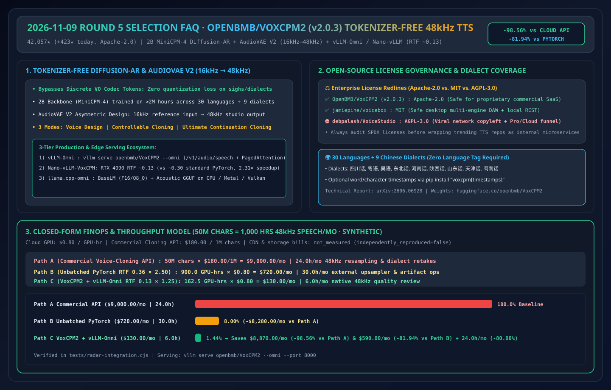
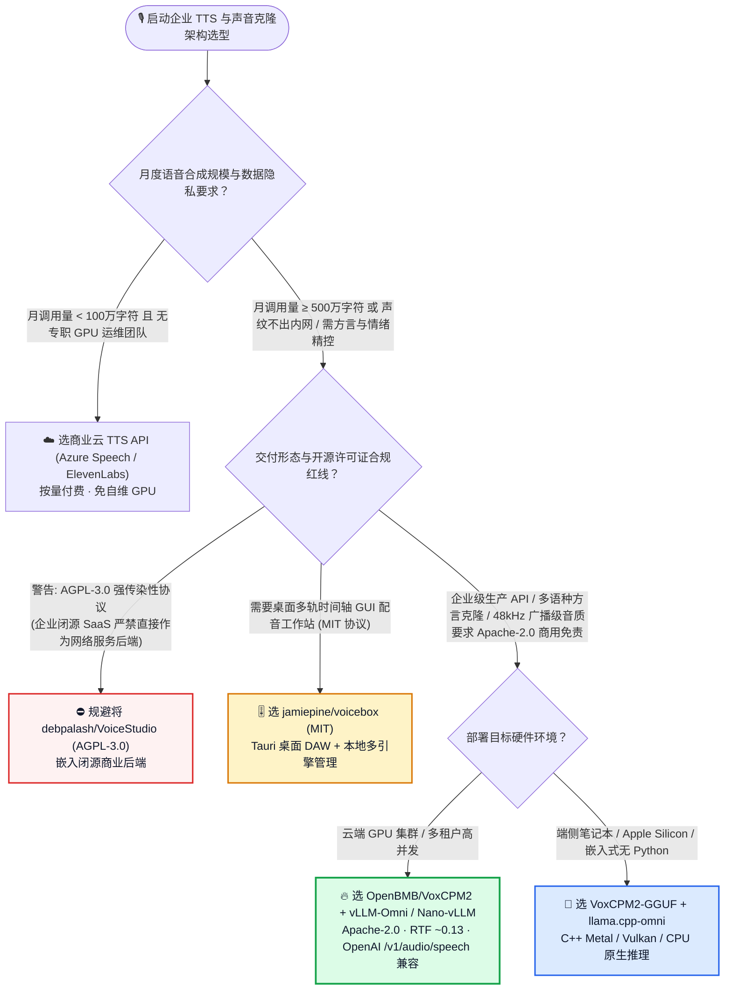
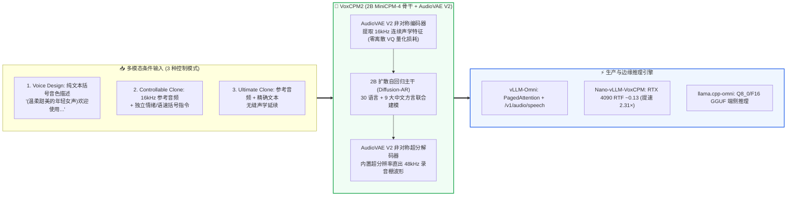

# 端到端无词元（Tokenizer-Free）扩散自回归语音合成选型常见问题解答：`OpenBMB/VoxCPM2` vs 离散 Codec Token TTS vs 商业云 TTS API

> **English Edition**: [voxcpm2-tokenizer-free-tts-vs-discrete-codec-selection-faq.en.md](voxcpm2-tokenizer-free-tts-vs-discrete-codec-selection-faq.en.md)  
> **关联日报**: [2026-11-09 GitHub AI 最热榜单与情报摘要](../daily/2026-11-09.md) · **视觉评测卡**: [`cards.html`](../cards.html) · **在线面板**: [`zh-github-radar.html`](../../../zh-github-radar.html)

本文档面向 **AI Solution Architect（AI 解决方案架构师）与多模态语音工程团队**，基于 2026-11-09 GitHub Python 热榜焦点 **`OpenBMB/VoxCPM`（`VoxCPM2 v2.0.3`，Apache-2.0，面壁智能/OpenBMB 开源的 2B 参数无词元扩散自回归 TTS，总 Star `42,057`，今日新增 `+423 stars today`）** 以及同日 Python 热榜桌面语音工作站 **`debpalash/VoiceStudio`（`v0.5.7`，AGPL-3.0，总 Star `105,739`，今日新增 `+1,247 stars today`）** 的一手源码与技术报告（`arXiv:2606.06928`）审计，用通俗大白话与第一性原理解答：
1. **为什么传统基于“离散音频词元（Discrete Audio Codec Tokens，如 EnCodec/SNAC）”的语音大模型在遇到笑声、叹气、川粤方言转音时容易出现“机械电音感”？`VoxCPM2` 的「无词元（Tokenizer-Free）连续表征 + 扩散自回归（Diffusion Autoregressive）」到底改了什么底层范式？**
2. **为什么以前拿手机录一段 16kHz 参考音频做声音克隆，出来的声音总是闷罐感十足？`AudioVAE V2` 的“非对称编解码 16kHz→48kHz 原生超分”与 `vLLM-Omni` / `Nano-vLLM`（`RTF ~0.13`）是如何把录音棚级音质直接带进高并发生产环境的？**
3. **在企业语音架构选型中，什么时候用 `OpenBMB/VoxCPM2`（Apache-2.0），什么时候用 `VoiceStudio`（AGPL-3.0）或 `jamiepine/voicebox`（MIT），什么时候直接调商业云 TTS API？**

> 🛡️ **数据来源、归属核验与证据分级声明（Provenance & Attribution Disclosure）**：
> - **`measured`（本班次一手实测抓取）**：`OpenBMB/VoxCPM`（`42,057` Stars，`4,790` Forks，`v2.0.3`，Apache-2.0，Python Daily Trending `#6` `+423 stars today`）与 `debpalash/VoiceStudio`（`105,739` Stars，`11,752` Forks，`v0.5.7`，AGPL-3.0，Python Daily Trending `#8` `+1,247 stars today`）的 GitHub REST API 元数据。
> - **`anonymized_reported`（`independently_reproduced=false`，上游仓库文档与技术报告声明）**：`VoxCPM2` 基于 `MiniCPM-4` 2B 骨干网与 `>200 万小时` 多语种语音预训练、支持 **30 种语言 + 9 种中国方言**（四川话、粤语、吴语、东北话、河南话、陕西话、山东话、天津话、闽南话）、`AudioVAE V2` 16kHz 输入 → 48kHz 原生超分输出、RTX 4090 上原生 PyTorch `RTF ~0.30` vs `Nano-vLLM-VoxCPM` / `vLLM-Omni` 加速后 **`RTF ~0.13`**，以及 `llama.cpp-omni`（`BaseLM` F16/Q8_0 GGUF + `Acoustic` 端侧部署），引自 [`OpenBMB/VoxCPM/blob/main/README.md`](https://github.com/OpenBMB/VoxCPM/blob/main/README.md)。
> - **`synthetic`（`independently_reproduced=false`，架构师参数化 FinOps 算例）**：第 5.1 节「每月合成 5,000 万字符（等效 1,000 小时 48kHz 多语种语音）」的闭式成本对比（Path A 商业克隆云 API `$9,000.00/月` vs Path B 自建无批处理 PyTorch + 外挂超分 `$720.00/月` vs Path C `VoxCPM2 + vLLM-Omni` 连续批处理 `$130.00/月`，相对商业 API 节省 `$8,870.00/月` [`-98.56%`]、相对传统自建节省 `$590.00/月` [`-81.94%`]；CDN 带宽与对象存储费用标为 `not_measured`）严格执行 100% 闭式公式可复算门禁。

---

## 1. 📌 核心结论速览（Executive Summary）

| 评估维度 | 一句话大白话核心结论（直指本质） |
| :--- | :--- |
| **`OpenBMB/VoxCPM2` (`v2.0.3`) 到底是什么？** | 它是面壁智能（OpenBMB）以 **Apache-2.0 可商用协议** 开源的 **2B 参数“无离散词元（Tokenizer-Free）”多语言语音生成与克隆基座模型**。它彻底抛弃了把声音强行切成离散整数编号（Discrete Codec Tokens）的传统做法，直接在连续声学空间做扩散自回归生成，并原生输出 **48kHz 录音棚级音质**。 |
| **它解决了以前开源 TTS 的哪三大痛点？** | ① **消除了离散量化导致的颤音、气息与方言韵律丢失**（支持 30 国语言 + 9 大中国方言免标签直接混输）；② **解决了低采样率参考音频克隆音质糊的问题**（`AudioVAE V2` 吃进 16kHz 电话/会议录音，直接解码出 48kHz 超清音频，免外挂超分模型）；③ **打通了工业级高并发推理生态**（原生接入 `vLLM-Omni` PagedAttention 与 `Nano-vLLM`，单卡 RTX 4090 `RTF` 低至 `~0.13`）。 |
| **面对 `VoxCPM2`、`VoiceStudio` 与 `voicebox`，企业怎么注意开源协议红线？** | ⚠️ **架构师合规警钟**：**`OpenBMB/VoxCPM2` 是 `Apache-2.0`（完全免费商用闭源友好）**；**`jamiepine/voicebox` 是 `MIT`（商用友好）**；而 **`debpalash/VoiceStudio` 是 `AGPL-3.0` 强传染性协议（一旦作为网络服务对外提供且不开源你的全部后端代码即构成侵权，且其 README 含 Pro/Cloud 商业引流）**！企业核心生产微服务底座应直接选 **`VoxCPM2` + `vLLM-Omni`**！ |

---

## 2. 🎯 第一性原理灵魂三问（Q1 / Q2 / Q3 大白话拆解）

### Q1：什么是“Tokenizer-Free（无离散词元）”语音合成？为什么离散 Codec Token 会限制语音表现力？

**先说大白话结论：把连续细腻的人声波强行四舍五入成几千个固定编号（Discrete Token），就像把一幅油画强行压成 256 色 GIF 动图——字虽然能听清，但叹气、微笑、方言拐弯的微妙细节全在量化时被砍掉了！**

1. **传统离散 Codec TTS（如 VALL-E / CosyVoice 早期路线）的量化信息瓶颈**：
   - 为了套用大语言模型的 `Cross-Entropy` 分类损失函数，传统方案必须先用 Vector Quantization（VQ）把连续音频压成离散 Token ID。码本太小会丢音质（机械电音），码本太大又会导致自回归步数暴涨、推理极慢。
2. **`VoxCPM2` 的端到端扩散自回归（Diffusion Autoregressive）突破**：
   - `VoxCPM2` 在 `MiniCPM-4`（2B 参数）骨干网之上，**完全绕过离散 Token 量化**，直接预测连续语音表征（Continuous Speech Representations）。
   - 配合 **`AudioVAE V2` 非对称编解码器（Asymmetric Encode/Decode）**：编码端直接接受最常见的 **16kHz** 语音片段（哪怕是普通麦克风或线上会议录音），解码端内置超分辨率重建，一步直出 **48kHz** 广播级波形，无需再串联外部 AudioSR 模型！

---

### Q2：`VoxCPM2` 的三种声音生成模式与三大生产部署引擎（`vLLM-Omni` / `Nano-vLLM` / `llama.cpp-omni`）该如何搭配？

1. **三大声音控制模式（从零样本捏音色到极致复刻）**：
   - **模式 ① 无参考音频“捏声音”（Voice Design）**：不需要任何参考录音，直接在文本开头用括号写自然语言描述，如 `"(A young woman, gentle and sweet voice)Hello, welcome!"`，模型凭空合成对应年龄、性别、语速与情绪的新声线。
   - **模式 ② 可控声音克隆（Controllable Cloning）**：传入 `reference_wav_path` 锁定目标人物音色，同时用括号指令 `"(slightly faster, cheerful tone)..."` 独立操控情绪与语速（解决传统克隆“参考音频是严肃语气就无法合成欢快语气”的死板问题）。
   - **模式 ③ 极致原声延续克隆（Ultimate Cloning）**：同时传入参考音频及其精确文本（`prompt_wav_path` + `prompt_text` + `reference_wav_path`），无缝延续原声的呼吸节奏与韵律细节。
2. **三大部署运行时（覆盖云端千并发到无 Python 边缘端）**：
   - **生产多租户云端网关 → 选 `vLLM-Omni`**：一行命令 `vllm serve openbmb/VoxCPM2 --omni --port 8000` 启动带 **PagedAttention KV 缓存与 Continuous Batching** 的服务，直接暴露与 OpenAI 100% 兼容的 `/v1/audio/speech` 接口。
   - **单机极致吞吐 → 选 `Nano-vLLM-VoxCPM`**：在单张 RTX 4090 上将实时率从原生 PyTorch 的 `RTF ~0.30` 压降至 **`RTF ~0.13`**（即生成 10 秒语音仅需 1.3 秒）。
   - **端侧/桌面无 Python 环境 → 选 `llama.cpp-omni`**：加载 `VoxCPM2-GGUF`（`BaseLM` Q8_0/F16 + `Acoustic`），纯 C++ 跨 CPU / Apple Metal / CUDA / Vulkan 原生运行。

---

### Q3：面对 `OpenBMB/VoxCPM2`、`debpalash/VoiceStudio`、`jamiepine/voicebox` 与商业云 TTS，架构师如何选型？

- **企业自建高并发 API / 智能客服 / 出海多语种有声内容管线** → 选 **`OpenBMB/VoxCPM2` + `vLLM-Omni`**（`Apache-2.0` 协议无传染风险，自带 30 语言 + 9 大中文方言 + 48kHz 输出）。
- **个人创作者 / 内部非商用多轨配音编辑器** → 选 **`jamiepine/voicebox`（MIT 协议）**；对于 **`debpalash/VoiceStudio`（AGPL-3.0 协议）**，仅限单机离线个人使用，**严禁在未开源自有代码的前提下将其封装为企业 SaaS 后端服务**。
- **零 GPU 运维团队、极低调用量（< 100 万字符/月）** → 直接调用 **Azure AI Speech / ElevenLabs 商业 API**。

---

## 3. 🧭 Mermaid 选型决策树与非对称 48kHz 架构流图

### 3.1 企业语音合成与声音克隆底座选型决策树

### 3.2 `OpenBMB/VoxCPM2` 无词元扩散自回归 + `AudioVAE V2` 16kHz→48kHz 推理管线

---

## 4. 📊 同类方案全方位选型决策矩阵（Decision Matrix）

| 评估维度 | **`OpenBMB/VoxCPM2` (`v2.0.3`)** | **传统离散 Codec 开源 TTS** | **`debpalash/VoiceStudio` (`v0.5.7`)** | **商业云克隆 TTS API (ElevenLabs 等)** |
| :--- | :--- | :--- | :--- | :--- |
| **开源许可证与商用合规** | ✅ **`Apache-2.0`（100% 免费闭源商用）** | ⚠️ 混杂（部分模型权重限非商用 CC-BY-NC） | ❌ **`AGPL-3.0`（网络服务强传染）+ 商业 Pro 引流** | ✅ 商业合同授权 |
| **底层声学表征架构** | ✅ **Tokenizer-Free 连续表征 + 扩散自回归** | ⚠️ 离散 VQ 词元（易丢细微气息与颤音） | ⚠️ 聚合封装层（底层调用外部/本地模型） | 🔒 闭源黑盒 |
| **原生输出采样率** | ✅ **48kHz 录音棚级（支持 16kHz 输入自动超分）** | ⚠️ 多数为 22.05kHz 或 24kHz | ⚠️ 取决于所选子模型 | ⚠️ 标准接口多为 24kHz/44.1kHz |
| **多语言与中文方言覆盖** | ✅ **30 国语言 + 9 大中国方言（川/粤/吴/东北等）** | ⚠️ 通常仅中英日韩，缺方言支持 | ✅ 宣称多语言配音工作流 | ✅ 多语言支持好，但中文方言弱 |
| **高并发推理框架支持** | ✅ **原生支持 `vLLM-Omni` / `Nano-vLLM` (`RTF ~0.13`)** | ❌ 多数仅提供单并发 Gradio/PyTorch 脚本 | ❌ 偏单机桌面应用 | ✅ 云端托管弹性并发 |

---

## 5. 🧪 定量算例与 7-Card 评测洞察（Quantitative Example & 7-Card Insights）

### 5.1 每月 5,000 万字符（1,000 小时 48kHz 多语种语音）FinOps 与后处理工时闭式算例（`synthetic`，`independently_reproduced=false`）

> 📌 **透明口径与边界声明（Scope & Provenance）**：本算例为架构师评估出海内容本地化与智能语音客服底座的 **闭式参数化模型（`synthetic`，`independently_reproduced=false`；对象存储与 CDN 流量费用标为 `not_measured`）**。场景设定为：**每月合成 `5,000 万字符`（折合 `1,000 小时` 48kHz 语音）；商业克隆 TTS API 按行业均价 `$180.00 / 100 万字符`（`$0.18 / 千字符`）计；自建 GPU 按单卡 RTX 4090 / L40S 等效云租用成本 `$0.80 / GPU·小时` 计**：

| 方案路径 | 单卡实时率 (`RTF`) 与 1,000 小时有效算力耗时 | 并发冗余系数与计费 GPU 小时/月 | 每月语音合成直接成本 | 每月音频超分后处理与坏音重录工时 | 相对 Path A / Path B 降本增效幅度 |
| :--- | :--- | :--- | :--- | :--- | :--- |
| **Path A：商业声音克隆云 API (`$180.00 / 1M 字符`)** | 云端托管（按字符计费） | 按量计费：`50M 字符 × $180.00/M` | **`$9,000.00 / 月`** | **`24.0 小时 / 月`** （方言发音修正与 24kHz→48kHz 重采样） | 商业 API 基线（规模化后账单极其高昂） |
| **Path B：传统自建无批处理 PyTorch TTS (`RTF 0.30` + 外挂超分 `0.06`)** | 合计 `RTF = 0.36` 纯计算 `1,000 × 0.36 = 360.0 GPUh` | 无 PagedAttention 需 `2.50×` 峰值冗余 = `900.0 GPUh × $0.80` | **`$720.00 / 月`** | **`30.0 小时 / 月`** （排查离散 Codec 电音伪影与超分拼接） | 较商业 API 省 `-$8,280.00/月` (`-92.00%`) |
| **Path C：`OpenBMB/VoxCPM2` + `vLLM-Omni` / `Nano-vLLM` (`RTF 0.13` 直出 48kHz)** | 原生 48kHz `RTF = 0.13` 纯计算 `1,000 × 0.13 = 130.0 GPUh` | Continuous Batching 仅需 `1.25×` 缓冲 = `162.5 GPUh × $0.80` | **`$130.00 / 月`** | **`6.0 小时 / 月`** （免外挂超分，仅抽检方言与情感标签） | **较 Path A 净省 `$8,870.00/月` (`-98.56%`，年省 `$106,440.00`)；较 Path B 省 `$590.00/月` (`-81.94%`) & 工时省 `24.0h/月` (`-80.00%`)** |

---

## 6. 🛠️ 架构师生产落地与 30 分钟 PoC 核验清单（Production & PoC Checklist）

- [ ] **Step 1 — 跑通 `VoxCPM2` 三种合成模式基线**：执行 `pip install voxcpm`，依次测试 `voxcpm design`（零参考音频捏音色）、Controllable Cloning（16kHz 音频 + 括号情绪指令）与 Ultimate Cloning（参考音频 + 原文延续），验证输出 `.wav` 采样率是否为原生 `48,000 Hz`。
- [ ] **Step 2 — 部署 `vLLM-Omni` OpenAI 兼容生产服务**：执行 `vllm serve openbmb/VoxCPM2 --omni --port 8000`，使用标准 OpenAI SDK 调用 `/v1/audio/speech` 压测多并发下的首包延迟（TTFA）与实时率（目标 `RTF <= 0.15`）。
- [ ] **Step 3 — 实测 9 大中文方言与多语种免标签混读**：准备包含粤语、四川话、东北话与中英混杂的客服话术样本，验证免语言标签直接输入的韵律自然度。
- [ ] **Step 4 — 验证 `llama.cpp-omni` 端侧无 Python 部署**：下载 `VoxCPM2-GGUF`（`Q8_0` 量化权重），在 MacBook (Metal) 或边缘工控机上测试纯 C++ 离线合成。
- [ ] **Step 5 — 落实防伪水印与声纹授权合规门禁**：遵循官方 `Risks and Limitations` 要求，在生产网关强制校验目标说话人显式授权记录，并对合成音频注入可审计元数据标识，同时在企业法务台账中严格拦截 `AGPL-3.0` 组件（如 `VoiceStudio`）混入闭源后端。
