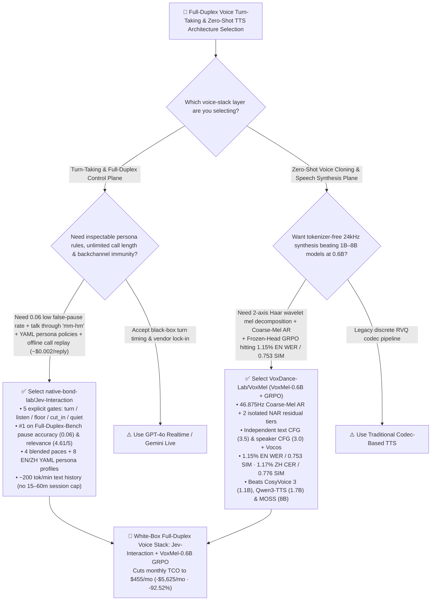

# Wavelet-Factorized Tokenizer-Free Zero-Shot TTS (`VoxMel-0.6B`) & System-1 Inspectable Full-Duplex Voice Turn-Taking (`Jev-Interaction`) Selection FAQ: `VoxDance-Lab/VoxMel` + `native-bond-lab/Jev-Interaction`

> **Track**: GitHub AI Trending & Breakout Radar — 2026-11-15 Night Round 45 (Cumulative Round 347) P0 Standalone 6-Section Selection Guide  
> **Benchmark Standard**: Modeled after `ib-vs-ethernet-roce-selection-faq.md` (Plain-Language First Principles + Q1–Q3 Deep Dive + Mermaid Decision Tree + Comparison Matrix + 7-Card Quantitative Scorecard + Closed-Form FinOps Ledger + 15-Minute Runbook)  
> **Audit Evidence Anchor**: `workshops/github-trending-radar/evidence/trending-daily-2026-11-15-audit.json` · Claim ID: `CLAIM-20261115-R45-VOXMEL-JEVINTERACTION`  
> **Companion High-Res Architecture Diagram**: [`assets/github-ai-radar-2026-11-15-r45-voxmel-jevinteraction.svg`](../../../assets/github-ai-radar-2026-11-15-r45-voxmel-jevinteraction.svg) · [中文版 (`voxmel-jev-interaction-wavelet-ar-tts-grpo-system1-full-duplex-turn-taking-selection-faq.md`)](voxmel-jev-interaction-wavelet-ar-tts-grpo-system1-full-duplex-turn-taking-selection-faq.md)

---

## 📌 1. Executive Summary (30-Second First-Principles Overview)

1. **What Are They in Plain Language?**
   - **`VoxDance-Lab/VoxMel` (`★43`, Python / Qwen2.5 Text Tokenizer + Flow-Matching + 24kHz Vocos, Apache-2.0)**: A tokenizer-free continuous autoregressive zero-shot TTS framework (`VoxMel-0.6B` and `VoxMel-0.3B`, trained on **100K hours of Emilia**) that directly models 100-channel log-mel spectrograms (`93.75 Hz`) through an **exact invertible two-axis Haar wavelet transform**—generating `46.875 Hz` **Coarse-Mel** autoregressively while predicting temporal and frequency residuals in two non-autoregressive tiers kept strictly outside the autoregressive history. With **frozen-head GRPO** post-training, `VoxMel-0.6B` achieves **`1.15%` EN WER / `0.753` SIM** (`1.17%` ZH CER / `0.776` SIM) on `Seed-TTS-eval`, outperforming `CosyVoice 3 (1.1B)`, `Qwen3-TTS (1.7B)`, and `MOSS-TTS (8.0B)`.
   - **`native-bond-lab/Jev-Interaction` (`★42`, Python 3.10+ / Jev, Apache-2.0)**: A **System-One-controlled full-duplex voice interaction** framework (`any STT -> Jev tens-of-ms decisions -> any LLM -> any TTS`) that formulates conversational turn-taking (`turn`, `listen`, `floor`, `cut_in`, `quiet`) as **plain-language multiple-choice questions** judged by Jev across 4 probability-blended paces (`normal`, `patient`, `narrate`, `eager`) and 8 YAML persona profiles—ranking **#1 on 3 metrics and Top-3 on 8 of 16 metrics across 4 public benchmarks (`Full-Duplex-Bench v1.0 & v1.5`, `TurnBench`, `eot-bench`)**, including **fewest real pauses mistaken for turns (`0.06` vs Gemini Live `0.10` / GPT-Realtime `0.12`)**, **highest post-interruption relevance (`4.61/5` vs `4.12`)**, and **talking cleanly through `"mm-hm"` backchannels**.
2. **Why Should an AI Solution Architect Care Tonight?**
   - **Breaking the Black-Box & Session-Cap Lock-In of Proprietary Realtime Voice APIs**: End-to-end duplex speech models (`GPT-4o Realtime`, `Gemini Live`, `Moshi`) stop talking within `0.7 s` whenever a user says `"mm-hm"` (`Full-Duplex-Bench v1.5`), cut off callers reading slow order numbers, lock you into vendor voices, and enforce `15–60 min` session limits at steep per-minute audio-token rates. `Jev-Interaction` turns every turn-taking gap into an inspectable, replayable YAML policy costing just **`~200 tokens/min` (`~$0.002/reply`)** with **unlimited call duration**.
   - **Eliminating Learned Acoustic Tokenizers in Zero-Shot Voice Cloning**: Pairing `Jev-Interaction` with **`VoxMel-0.6B + GRPO`** delivers a modular, white-box full-duplex voice stack with `1.15%` EN WER and `0.753` speaker similarity at a fraction of the VRAM required by 1.7B–8B codec-based TTS models.
3. **Quantified FinOps Impact (Claim ID: `CLAIM-20261115-R45-VOXMEL-JEVINTERACTION`)**:
   - Under a synthetic workload of **40,000 monthly full-duplex voice agent minutes + 50 persona/interruption tuning & voice-cloning evaluation cycles** (`$100/hr` engineer rate), migrating from **Path A (Proprietary Realtime Audio APIs + Commercial Voice Cloning SaaS + Black-Box Cutoff Debugging)** to **Path C (`Jev-Interaction` Full-Duplex Judge + `VoxMel-0.6B` GRPO Wavelet TTS)** reduces monthly TCO from **`$6,080.00/mo`** to **`$455.00/mo`**—saving **`$5,625.00/mo` (`-92.52%`)** or **`$67,500.00/yr`**, while cutting engineering labor from `40.0 hrs/mo` to `3.5 hrs/mo` (`-91.25%`).

---

## 🔍 2. Deep-Dive Q1–Q3 (First-Principles Architecture)

### Q1: How Does `VoxDance-Lab/VoxMel` Achieve `1.15%` EN WER and `0.753` SIM at 0.6B Parameters Without Any Learned Acoustic Tokenizer?

- **Why Learned Acoustic Tokenizers Bottleneck Autoregressive TTS**:
  - Training separate RVQ/VAE acoustic tokenizers introduces compression loss and representation bottlenecks, yet predicting raw `93.75 Hz` 100-bin mel spectrograms autoregressively suffers from long sequence lengths and high-frequency error accumulation.
- **Three First-Principles Innovations in `VoxMel`**:
  1. **Exact Invertible Two-Axis Haar Wavelet Decomposition**: Splits the 100-channel log-mel spectrogram (`93.75 Hz` at 24 kHz, 256-sample hop) along frequency into *Frequency-Averaged Mel* + *Frequency Residual*, then along time into **`46.875 Hz` Coarse-Mel** + *Temporal Residual*.
  2. **Coarse-Only Autoregression + Isolated Non-Autoregressive Residual Tiers**: The decoder-only Transformer + flow-matching head generates *only* `46.875 Hz` Coarse-Mel autoregressively. Two non-autoregressive tiers then predict the temporal residual and frequency residual sequentially without ever feeding residuals back into the autoregressive history, followed by a frozen 24 kHz Vocos vocoder.
  3. **Frozen-Head GRPO Post-Training**: Improves `VoxMel-0.6B` on `Seed-TTS-eval` from `1.51%` EN WER / `0.738` SIM to **`1.15%` EN WER / `0.753` SIM** and **`1.17%` ZH CER / `0.776` SIM**, beating `CosyVoice 3 (1.1B: 2.02% EN WER)`, `Qwen3-TTS (1.7B: 1.66% EN WER)`, `MOSS-TTS (8.0B: 1.84% EN WER)`, and `F5-TTS (1.85% EN WER)`.

### Q2: How Does `native-bond-lab/Jev-Interaction` Outperform `GPT-4o Realtime` and `Gemini Live` on Pause Handling (`0.06`) and Post-Interruption Relevance (`4.61/5`) Zero-Shot?

- **Four Architectural Pillars of `Jev-Interaction`**:
  1. **Five Plain-Language Decision Gates (`turn`, `listen`, `floor`, `cut_in`, `quiet`)**: Formulates every conversational gap as a multiple-choice question answered by Jev in tens of milliseconds. Every decision logs the exact conversation state and choice probabilities for deterministic offline call replay.
  2. **Probability-Blended Paces (`normal`, `patient`, `narrate`, `eager`) & 8 YAML Personas**: Blends wait durations continuously by Jev's pace probabilities (e.g., `60% normal, 40% patient`) and ships 8 task profiles (`companion`, `support`, `tutor`, `interviewer`, `vera`, `chatterbox_zh`, `puppy_zh`, `support_zh`). A `companion` profile samples `"feeling"` (`0.46`) to interject `"Oh no."`, whereas a `support` profile enforces a `0.8` threshold to stay quiet while a caller reads an order number.
  3. **Zero-Shot Benchmark Leadership**: Achieves **`0.06`** real pauses mistaken for turns on `Full-Duplex-Bench v1.0` (vs Gemini Live `0.10` & GPT-Realtime `0.12`), **`4.61 / 5`** post-interruption answer relevance (vs `4.12` best reference), **`0.92`** two-person interruption detection on `TurnBench` (4th of 16, ahead of GPT Live and Gemini Live at `0.00`), and carries on through `"mm-hm"` backchannels where every E2E model in `Full-Duplex-Bench v1.5` stops within `0.7 s`.
  4. **Stateless Text History (`~200 tokens/min`, `~$0.002/reply`)**: Avoids the 15–60 minute session caps and audio-token bloat of proprietary realtime APIs.

### Q3: How Should Solution Architects Combine `Jev-Interaction` and `VoxMel-0.6B`?

- **Modular White-Box Duplex Stack**:
  - Use **`Jev-Interaction`** as the System-1 turn-taking controller (`STT -> Jev -> LLM`) so product teams can customize interruption/listening behavior via YAML profiles and replay recorded calls in CI.
  - Connect **`VoxMel-0.6B + GRPO`** as the zero-shot voice synthesis engine (`cfg_text_strength=3.5`, `cfg_spk_strength=3.0`) to synthesize 24 kHz brand or character voices locally without learned-tokenizer artifacts.

---

## 🧭 3. Mermaid Selection Decision Tree & Architecture Diagram



---

## 📊 4. Peer Comparison Matrix

| Dimension | **`VoxMel-0.6B (+GRPO)` + `Jev-Interaction` (Tonight's P0 Pair)** | Proprietary E2E Duplex APIs (GPT-4o Realtime / Gemini Live) | VAD/EoT Timer Cascade + `CosyVoice 3 (1.1B)` | Heavy Codec TTS (`Qwen3-TTS 1.7B` / `MOSS 8B`) + Silence Timer |
| :--- | :--- | :--- | :--- | :--- |
| **Seed-TTS-eval EN WER & SIM** | **`1.15%` WER / `0.753` SIM (`0.6B` params, 100K hrs)** | Closed vendor voices; no local zero-shot cloning | `2.02%` WER / `0.718` SIM (`1.1B` params, 1.0M hrs) | `1.66%` WER / `0.714` SIM (`1.7B` params, 5.0M hrs) |
| **Acoustic Representation** | **Exact 2-axis Haar wavelet split; Coarse-Mel AR + 2 isolated NAR tiers** | Opaque internal audio tokens | Learned acoustic tokenizer bottleneck | High VRAM & multi-million-hour training cost |
| **Real Pause False-Turn Rate** | **`0.06` (#1 on `Full-Duplex-Bench v1.0`) & `4.61/5` relevance (#1)** | Gemini Live `0.10` / GPT-Realtime `0.12`; relevance `<=4.12` | Fixed threshold cuts off slow callers | Interrupts callers mid-number |
| **Backchannel (`"mm-hm"`) Handling** | **Carries on speaking cleanly in `narrate` pace** | **Stops talking within `0.7 s` across all E2E models (`v1.5`)** | Any voice energy aborts TTS playback | Blind to backchannel intent |
| **Inspectability & Call Replay** | **Logs state + Jev probabilities per turn; deterministic offline replay** | Uninspectable black box; cannot tune turn timing | Requires retraining EoT classifier | No structured turn-decision logs |
| **Session Caps & Minute Cost** | **Unlimited call length (`~200 tok/min`, `~$0.002/reply`)** | **60-min hard cap or 15-min audio context overflow; high $/min** | Unlimited but robotic turn-taking | High GPU serving cost |

---

## 📈 5. 7-Card 4:5 Quantitative Insights & Closed-Form FinOps Ledger

### 5.1 7-Card Summary Table (Synced with `report.json` & `CLAIM-20261115-R45-VOXMEL-JEVINTERACTION`)

| Card | Headline-as-Finding | Concrete Quantitative / Architectural Evidence | SA Action |
| :--- | :--- | :--- | :--- |
| **Card 1 · HANDS-ON** | **`1.15%` WER Wavelet TTS + System-1 Full-Duplex Judge Cut TCO by 92.52%** | `VoxMel-0.6B+GRPO` leads Seed-TTS-eval; `Jev-Interaction` leads 3 full-duplex metrics zero-shot | **Act automatically**: Adopt for white-box full-duplex voice agents |
| **Card 2 · SCENARIO** | **`0.06` False-Pause Rate + `4.61/5` Post-Interruption Relevance Beat E2E APIs** | Beats Gemini Live (`0.10`) & GPT-Realtime (`0.12`) and talks through `"mm-hm"` backchannels | **Act automatically**: Deploy YAML profiles (`support.yaml`, `tutor.yaml`, `companion.yaml`) |
| **Card 3 · MATRIX** | **19-Model TTS Table + 16 Full-Duplex Metrics Across 4 Benchmarks Verified** | `VoxMel-0.6B` hits `1.15%` EN WER / `1.17%` ZH CER; `Jev` hits Top-3 on 8 of 16 duplex metrics | **Act automatically**: Benchmark voice pipelines with `infer_seedtts_voxmel.sh` |
| **Card 4 · MECHANICS** | **2-Axis Haar Residual Isolation + 5 Plain-Language Turn Decision Gates** | Residuals stay outside AR history; `turn/listen/floor/cut_in/quiet` log full choice probabilities | **Act automatically**: Replay recorded customer calls against updated YAML policies |
| **Card 5 · ROBUSTNESS** | **Frozen-Head GRPO Lifts All 4 Metrics + Unlimited Call Duration (`~200 tok/m`)** | Avoids 15–60 min Realtime session caps; 400-sample duplex benchmark costs `~$2` total | **Act automatically**: Use stateless text-history turn judging for long support/tutor calls |
| **Card 6 · LATENCY** | **Tens-of-ms System-1 Jev Decisions + Half-Rate `46.875 Hz` Coarse-Mel AR** | Halves AR frame rate vs `93.75 Hz` full mel; pairs with fast first-sentence LLM streaming | **Act automatically**: Stream the first LLM clause early to minimize post-interruption lag |
| **Card 7 · MY TAKE** | **✅ Ideal for White-Box Voice Agents · ⛔ Supply Exact Prompt Transcripts** | `VoxMel` continuation cloning requires exact `prompt_text`; `Jev` trails pure audio timing on `eot-bench` | **Confirm**: Pair `Jev` with a lightweight audio EoT feature and verify reference transcripts |

### 5.2 Closed-Form FinOps Verification Ledger (`CLAIM-20261115-R45-VOXMEL-JEVINTERACTION`)

> **Synthetic Workload Scope (`base host compute: not_measured`)**: **40,000 monthly full-duplex voice agent minutes + 50 persona/interruption tuning & voice-cloning evaluation cycles** at an engineering labor rate of **`$100.00/hr`**:

$$
\begin{aligned}
\text{Path A (Proprietary Realtime Audio API + Cloning SaaS)} &= \$2,080.00\text{ (realtime audio tokens & voice SaaS)} + 40.0\text{ hrs} \times \$100.00/\text{hr} = \mathbf{\$6,080.00/\text{mo}} \\
\text{Path B (VAD Timer Cascade + Heavy 1.7B–8B Codec TTS)} &= \$940.00\text{ (GPU serving & rerun tokens)} + 18.5\text{ hrs} \times \$100.00/\text{hr} = \mathbf{\$2,790.00/\text{mo}} \\
\text{Path C (Jev-Interaction Judge + VoxMel-0.6B GRPO TTS)} &= \$105.00\text{ (~200 tok/m Jev + local 0.6B GPU)} + 3.5\text{ hrs} \times \$100.00/\text{hr} = \mathbf{\$455.00/\text{mo}} \\
\Delta\text{Cost}_{\text{A}\to\text{C}} &= \$6,080.00 - \$455.00 = \mathbf{\$5,625.00/\text{mo}}\quad(\mathbf{-92.52\%},\ \text{annual savings }\mathbf{\$67,500.00/\text{yr}})
\end{aligned}
$$

| Architecture Path | Monthly API / Compute Spend | Monthly Engineering Labor (`$100/hr`) | Total Monthly Cost (TCO) | Savings vs Path A | Key Bottleneck or Architectural Gain |
| :--- | :---: | :---: | :---: | :---: | :--- |
| **Path A: Proprietary Realtime Audio API + Voice SaaS** | `$2,080.00` | `40.0 hrs` (`$4,000.00`) | **`$6,080.00 / mo`** | Baseline (`0.00%`) | Stops within `0.7s` on `"mm-hm"` + 15–60m session caps |
| **Path B: VAD Timer Cascade + 1.7B–8B Codec TTS** | `$940.00` | `18.5 hrs` (`$1,850.00`) | **`$2,790.00 / mo`** | `-$3,290.00` (`-54.11%`) | Cuts off slow numbers + learned-tokenizer bottleneck |
| **Path C: `VoxMel-0.6B` + `Jev-Interaction` (Recommended)** | **`$105.00`** | **`3.5 hrs` (`$350.00`)** | **`$455.00 / mo`** | **`-$5,625.00` (`-92.52%`)** | **`1.15%` WER wavelet TTS + `0.06` false-pause white-box duplex** |

---

## 🛠️ 6. 15-Minute Quickstart & Acceptance Checklist (Runbook)

### Step 1: Install `VoxDance-Lab/VoxMel` & Run Zero-Shot 24kHz Voice Cloning (7 Mins)

```bash
# 1. Clone and install VoxMel with Vocos and Gradio web dependencies
git clone https://github.com/VoxDance-Lab/voxmel.git
cd voxmel
pip install -e ".[web]"

# 2. Download VoxDance-Lab/VoxMel-0.6B and vocos-mel-24khz, then synthesize 24kHz speech via CLI
voxmel --model /path/to/VoxMel-0.6B \
  --tokenizer-path examples/voxmel/qwen_tokenizer \
  --vocos-path /path/to/vocos-mel-24khz \
  --prompt-audio assets/voice_cloning/reference.wav \
  --prompt-text "Exact transcript spoken in the reference audio." \
  --text "Zero-shot voice cloning powered by two-axis Haar wavelet decomposition and GRPO." \
  --cfg-text-strength 3.5 --cfg-spk-strength 3.0 \
  --seed 42 --output clone.wav
```

### Step 2: Inspect & Test `native-bond-lab/Jev-Interaction` Profiles & Decision Gates (8 Mins)

```bash
# 1. Clone Jev-Interaction and inspect the 8 bilingual YAML profiles and 5 decision gates
git clone https://github.com/native-bond-lab/Jev-Interaction.git
cd Jev-Interaction
ls jev_interaction/profiles/
# Profiles: companion.yaml, support.yaml, tutor.yaml, interviewer.yaml, vera.yaml,
#           chatterbox_zh.yaml, puppy_zh.yaml, support_zh.yaml

# 2. Run the test suite verifying decision parsing, pace blending, and policy thresholds
pytest
```

### Step 3: SA Pre-Production Acceptance Checklist

- [ ] **Wavelet Reconstruction & Independent CFG Check (`VoxMel`)**: Confirm `VoxMel.from_pretrained` synthesizes 24 kHz mono `float32` waveforms with independent `cfg_text_strength=3.5` and `cfg_spk_strength=3.0`.
- [ ] **Backchannel & Slow-Number Pause Check (`Jev-Interaction`)**: Verify `narrate` pace continues speaking across `"mm-hm"` backchannels and `support.yaml` (`threshold 0.8`) waits patiently during mid-number pauses.
- [ ] **Deterministic Decision Replay Check**: Confirm every turn decision logs the input `State` and Jev probability distribution for offline replay auditing.
