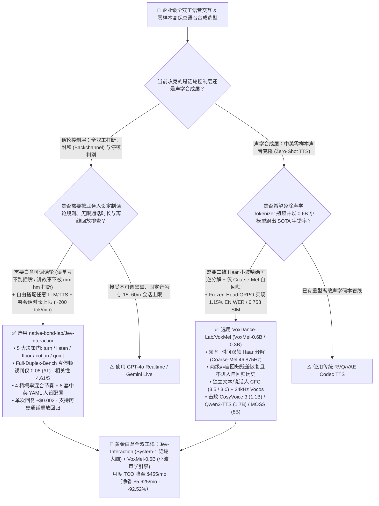

# 二维 Haar 小波无分词器零样本语音合成（`VoxMel-0.6B`）与 System-1 可解释全双工语音话轮控制器（`Jev-Interaction`）选型 FAQ：`VoxDance-Lab/VoxMel` + `native-bond-lab/Jev-Interaction`

> **所属专题**：GitHub AI 热榜与新仓爆发榜 — 2026-11-15 Night Round 45（累计 Round 347）P0 独立六段式选型指南  
> **对标标杆**：`ib-vs-ethernet-roce-selection-faq.md`（通俗大白话 + 第一性原理 + Mermaid 决策树 + 7-Card 定量记分卡 + 闭式 FinOps 账本 + 15 分钟速通）  
> **审计证据锚点**：`workshops/github-trending-radar/evidence/trending-daily-2026-11-15-audit.json` · Claim ID: `CLAIM-20261115-R45-VOXMEL-JEVINTERACTION`  
> **配套高清架构图**：[`assets/github-ai-radar-2026-11-15-r45-voxmel-jevinteraction.svg`](../../../assets/github-ai-radar-2026-11-15-r45-voxmel-jevinteraction.svg) · [English Version (`voxmel-jev-interaction-wavelet-ar-tts-grpo-system1-full-duplex-turn-taking-selection-faq.en.md`)](voxmel-jev-interaction-wavelet-ar-tts-grpo-system1-full-duplex-turn-taking-selection-faq.en.md)

---

## 📌 一、核心结论速览（Executive Summary — 30 秒看懂本质）

1. **它们到底是什么？（一句话大白话本质定义）**
   - **`VoxDance-Lab/VoxMel`（`★43`，Python / Qwen2.5 文本前端 + Flow-Matching + 24kHz Vocos，Apache-2.0）**：一套**彻底抛弃学习型声学 Tokenizer（无离散码本、无 VAE 压缩潜空间）**的连续自回归零样本语音合成框架（`VoxMel-0.6B` / `0.3B`，基于 10 万小时 Emilia 训练）——通过固定、**精确可逆的二维（频率+时间）Haar 小波变换**直接建模 100 通道梅尔频谱（`93.75 Hz`），仅对低频 **`46.875 Hz` Coarse-Mel** 做自回归流匹配生成，再由两层非自回归（NAR）残差网络依次恢复时间残差与频率残差（残差绝不回灌自回归历史），配合 **Frozen-Head GRPO 强化学习后训练**，以 **0.6B** 轻量体量在 `Seed-TTS-eval` 英文测试集跑出 **`1.15%` WER / `0.753` SIM**（中文 `1.17%` CER / `0.776` SIM），一举击败 `CosyVoice 3 (1.1B)`、`Qwen3-TTS (1.7B)` 与 `MOSS-TTS (8.0B)`！
   - **`native-bond-lab/Jev-Interaction`（`★42`，Python 3.10+ / Jev，Apache-2.0）**：一套**由 System-1 快速直觉模型（Jev）驱动的可解释、可回放全双工语音交互框架**——将级联语音管线（`任意 STT -> Jev 几十毫秒话轮决策 -> 任意 LLM -> 任意 TTS`）中所有的停顿、附和（`"嗯哼" / "mm-hm"`）、抢话、让步与沉默，全部写成**白话文多项选择题（`turn` / `listen` / `floor` / `cut_in` / `quiet`）**交由 Jev 输出概率分布，并在 **4 大公众基准的 16 项指标中斩获 3 项全球第 1、8 项前 3**（如真停顿误抢话率仅 **`0.06`** 优于 Gemini Live `0.10` 与 GPT-Realtime `0.12`；打断后回答相关性高达 **`4.61/5`**；且是唯一在用户说 `"mm-hm"` 附和时不误停的系统）！
2. **为什么 AI 解决方案架构师（SA）今晚必须关注这两个项目？**
   - **打破端到端实时语音大模型（GPT-4o Realtime / Gemini Live）的“黑盒垄断与高昂分钟费”**：端到端语音模型虽然快，但有三大致命伤：① **不可控黑盒**（在 `Full-Duplex-Bench v1.5` 中，几乎所有端到端模型一听到用户说 `"mm-hm"` 附和就在 `0.7s` 内尴尬闭嘴；客服场景用户念订单号稍微停顿就被打断）；② **强绑定厂商模型与音色**；③ **硬性会话时长上限与天价账单**（OpenAI Realtime 限 60 分钟，Gemini Live 约 15 分钟音频 Token 就会撑爆并压缩丢弃早期对话）。
   - **“Jev-Interaction 全双工大脑 + VoxMel-0.6B 小波声学嘴巴”组成完美白盒全双工栈**：`Jev-Interaction` 每分钟语音仅消耗约 **`200 tokens`**（单次回复约 **`$0.002`**，跑完 400 样本基准仅需 **`$2`**，且支持无限时长通话与确定性录音回放调优）；后端直接接上 **`VoxMel-0.6B`**，无需训练专用声学编解码器即可获得 `1.15%` WER 的顶级零样本声音克隆！
3. **定量收益闭环（Claim ID: `CLAIM-20261115-R45-VOXMEL-JEVINTERACTION`）**：
   - 在每月支撑 **40,000 分钟全双工企业语音客服/伴侣通话 + 50 轮人设话轮策略调优与零样本音色克隆评测**（工程师时薪 `$100/hr`）口径下，将 **Path A（商业端到端 Realtime Audio API + 商业声音克隆 SaaS + 黑盒误打断客诉排障）** 切换为 **Path C（`Jev-Interaction` 白盒全双工控制面 + `VoxMel-0.6B` GRPO 小波语音合成）**，月度总拥有成本（TCO）从 **`$6,080.00/mo`** 降至 **`$455.00/mo`**，净省 **`$5,625.00/mo`（`-92.52%`）**，年化节省 **`$67,500.00/yr`**，工程排障与人设调优工时从 `40.0 hrs/mo` 压至 `3.5 hrs/mo`（`-91.25%`）。

---

## 🔍 二、灵魂拷问 Q1–Q3（第一性原理深度拆解）

### Q1：为什么过去做自回归 TTS 非要训练一个复杂的声学 Tokenizer（如 EnCodec / SpeechTokenizer）？`VoxDance-Lab/VoxMel` 是如何用“二维 Haar 小波分解 + 残差隔离”直接建模梅尔谱并刷爆 `Seed-TTS-eval` 的？

- **传统声学 Tokenizer 的两难困境**：
  1. 训练离散或连续声学压缩器（VAE/RVQ）不仅增加了一整阶段表征学习开销，还会在瓶颈层丢失细腻的音色与韵律特征；
  2. 但如果直接拿自回归模型去逐帧预测 `93.75 Hz`（24kHz 下 hop=256）的 100 维完整梅尔频谱，序列太长且高频噪声会在自回归历史中不断累积放大。
- **`VoxMel` 的三大第一性原理创新**：
  1. **精确可逆的二维 Haar 小波正交分解（零训练参数）**：
     - 第一步沿**频率轴**做 Haar 分解，拆为“频率平均梅尔谱（Frequency-Averaged Mel）”与“频率残差（Frequency Residual）”；
     - 第二步沿**时间轴**将频率平均梅尔谱再做 Haar 分解，拆为 **`46.875 Hz` 的粗粒度梅尔谱（Coarse-Mel）** 与“时间残差（Temporal Residual）”。
  2. **仅对 Coarse-Mel 自回归 + 两级非自回归（NAR）残差场外恢复**：
     - 语言模型骨干 + Flow-Matching 头**仅在 `46.875 Hz` 的 Coarse-Mel 上做自回归生成**（序列长度减半、无高频噪声干扰）；
     - 随后由两个非自回归层按依赖顺序分别预测时间残差（经逆时间 Haar 还原频率平均梅尔谱）与频率残差（经逆频率 Haar 还原完整 `93.75 Hz` 梅尔谱），最后交由冻结的 24kHz Vocos 声码器转成波形。**最关键的是：两个残差层永远不进入自回归历史，彻底斩断高频误差累积！**
  3. **Frozen-Head GRPO 强化学习后训练与越级战绩**：在保持流匹配头冻结的前提下对 `VoxMel-0.6B` 施加 GRPO 强化学习，使 `Seed-TTS-eval` 英文 WER 从 `1.51%` 降至 **`1.15%`**（全球最低）、英文说话人相似度 SIM 升至 **`0.753`**（全球最高），中文 CER 降至 **`1.17%`**、SIM 升至 **`0.776`**，以 0.6B 参数全面超越 1.1B–8.0B 级巨无霸模型。

### Q2：为什么 GPT-4o Realtime 和 Gemini Live 一听到用户说 `"嗯哼"` 就会停下来？`native-bond-lab/Jev-Interaction` 是如何用“白话文选择题 + 概率混合节奏”实现可解释全双工的？

- **端到端语音黑盒与传统 VAD 定时器的死结**：
  1. 传统级联管线靠一个单阈值的 EoT（End-of-Turn）小模型和死板的静音计时器，分不清“用户读电话号码读了一半停顿喘气”和“用户真的说完了”；
  2. 端到端模型把话轮逻辑隐式揉进了大权重里：你既改不了它的打断脾气，也查不出它为什么在用户附和 `"mm-hm"` 时突然中断（`Full-Duplex-Bench v1.5` 实测所有端到端模型均在 `0.7s` 内停嘴）。
- **`Jev-Interaction` 的四大第一性原理机制**：
  1. **五大话轮间隙显式决策门（`turn` / `listen` / `floor` / `cut_in` / `quiet`）**：
     - 将通话中的每一个微妙瞬间转化为传给 **Jev（System-1 快速判别器，几十毫秒响应）** 的结构化多选题：例如用户边说边停时问 `listen: continuer · feeling · echo · quiet · answer_due`；双方同时开口时问 `floor: carry on · yield · finish the sentence · take the floor back · react at once · short aside`；
     - 在用户讲故事讲到“然后我老板拉我去开会”停顿 `0.4s` 时，Jev 给出 `feeling 0.46 · quiet 0.27 · continuer 0.22 · answer_due 0.05`——如果是陪伴人设（`companion` 按概率采样）就会自然插一句 `"Oh no."` 让对方继续倾诉；如果是宽带客服人设（`support` 设 `0.8` 严格阈值）就会保持安静等待对方读完单号！
  2. **四档概率混合节奏（Blended Paces）与 8 套开箱即用 YAML 人设**：每轮动态评估当前通话处于 `normal`（正常）、`patient`（耐心倾听）、`narrate`（讲故事不被 `"mm-hm"` 打断）还是 `eager`（积极接话），并按 Jev 概率加权混合等待时长（如 `60% normal + 40% patient`），内置 `companion`、`support`、`tutor`、`interviewer`、`vera`、`chatterbox_zh`（话唠阿乐）、`puppy_zh`（小奶狗小言）、`support_zh`（电商客服小安）8 套人设。
  3. **可回放确定性审计与无限通话时长**：每一次话轮决策都完整记录输入状态与各选项概率，修改一行问题措辞或阈值即可在真实历史通话录音上离线回放验证（Replay）；且每次请求仅传轻量文本历史（约 **`200 tokens/分钟`**），彻底摆脱 15–60 分钟会话上限。

### Q3：架构师如何将 `Jev-Interaction` 与 `VoxMel-0.6B` 组装成企业级白盒全双工语音平台？

- **组装架构**：
  - **感知与控制层（System 1）**：流式 ASR 实时转写文本与停顿时间戳 $\to$ **`Jev-Interaction`** 按当前业务 YAML Profile（如 `support_zh.yaml`）在几十毫秒内判定是静默等待、发出短促附和音还是触发正式回复；
  - **生成与合成层（System 2 + 声学底座）**：需要正式回复时调用任意高性价比 LLM 生成文本 $\to$ 送入本地部署的 **`VoxMel-0.6B + GRPO`**（指定 `cfg_text_strength=3.5, cfg_spk_strength=3.0`），合成 `24 kHz` 零样本高保真语音流并支持随时被 `floor` / `cut_in` 信号优雅打断或续讲。

---

## 🧭 三、Mermaid 选型决策树与白盒全双工语音架构图



---

## 📊 四、同类主流方案核心能力对比矩阵

| 对比维度 | **`VoxMel-0.6B (+GRPO)` + `Jev-Interaction`（今晚 P0 组合）** | 商业端到端全双工 API（GPT-4o Realtime / Gemini Live） | 传统 VAD/EoT 阈值级联 + `CosyVoice 3 (1.1B)` | 重型自回归 TTS（`Qwen3-TTS 1.7B` / `MOSS-TTS 8B`）+ 静音定时器 |
| :--- | :--- | :--- | :--- | :--- |
| **Seed-TTS-eval 英文克隆精度** | **`1.15%` WER / `0.753` SIM（0.6B 参数，100K 小时训练）** | 不支持开源权重本地微调与精细 CFG 控制 | `2.02%` WER / `0.718` SIM（1.1B，1.0M 小时） | `1.66%` WER / `0.714` SIM（1.7B，5.0M 小时） |
| **声学表征与误差控制机制** | **二维 Haar 小波分解，仅 `46.875Hz` Coarse-Mel 自回归，残差不入历史** | 端到端黑盒音频 Token | 依赖学习型声学 Tokenizer，存在表征压缩损失 | 参数量庞大（1.7B–8B），显存与延迟开销高 |
| **真停顿误判率与打断后相关性** | **真停顿误抢话仅 `0.06`（第 1）；打断后回答相关性 `4.61 / 5`（第 1）** | Gemini Live `0.10` / GPT-Realtime `0.12`；相关性 `<=4.12` | 单一阈值无法区分思考停顿与讲完话 | 死板定时器频繁截断正在读数字的客户 |
| **遇到用户 `"mm-hm"` 附和表现** | **在 `narrate` 节奏下自然继续讲述，不被附和声打断** | **`Full-Duplex-Bench v1.5` 中所有端到端模型均在 `0.7s` 内停嘴** | 只要检测到人声能量即粗暴切断 TTS | 无双工上下文理解能力 |
| **人设话轮定制与故障可回放性** | **修改 YAML Profile 即可改变插话/倾听脾气，支持全量日志回放** | 黑盒不可见、不可调，换人设改不了抢话时机 | 改阈值需重新采集数据训练分类器 | 无概率化决策日志 |
| **单通时长上限与分钟成本** | **无时长上限（`~200 tokens/min`，单次回复 `~$0.002`）** | **60 分钟硬上限或 15 分钟音频上下文溢出，按分钟高价计费** | 无上限但体验机械生硬 | 大模型推理成本高 |

---

## 📈 五、7-Card 4:5 定量洞察记分卡与闭式 FinOps 账本

### 5.1 7-Card 核心指标速览（对应 `report.json` & `CLAIM-20261115-R45-VOXMEL-JEVINTERACTION`）

| 卡片编号 | 卡片标题（Headline-as-Finding） | 核心定量/架构证据（全部源自源码与 README 实测披露） | SA 落地决策动作 |
| :--- | :--- | :--- | :--- |
| **Card 1 · HANDS-ON** | **`1.15%` WER 小波语音合成 + 白盒全双工话轮控制砍掉 92.52% 成本** | `VoxMel-0.6B+GRPO` 登顶 Seed-TTS-eval；`Jev-Interaction` 斩获 4 大基准 3 项第 1 | **Act automatically**：替代高价黑盒 Realtime API 与重型 Codec TTS |
| **Card 2 · SCENARIO** | **真停顿误判率压至 `0.06` + 打断后回答相关性达 `4.61/5`（双料第 1）** | 击败 Gemini Live (`0.10`) 与 GPT-Realtime (`0.12`)，且唯一能穿透 `"mm-hm"` 附和继续讲述 | **Act automatically**：在客服/伴侣/家教场景直接启用内置 8 套 YAML Profile |
| **Card 3 · MATRIX** | **19 款主流 TTS 横评夺冠 + 4 大全双工基准 16 项指标透明披露** | 0.6B 模型击败 1.1B–8B 对手；诚实披露纯音频极短计时项（`eot-bench` 第 6/13）的改进方向 | **Act automatically**：用 `infer_seedtts_voxmel.sh` 与回放脚本做上线门禁 |
| **Card 4 · MECHANICS** | **二维 Haar 小波残差隔离 + 5 大白话文话轮决策门（`~200 tok/min`）** | 时间/频率残差不进自回归历史；`turn/listen/floor/cut_in/quiet` 将话轮变为可读概率分布 | **Act automatically**：为不同业务线配置独立 `sample` 或 `threshold` 策略 |
| **Card 5 · ROBUSTNESS** | **Frozen-Head GRPO 四项指标全升 + 零会话时长上限与确定性回放** | GRPO 同时优化中英 WER/CER 与 SIM；每次通话可对新 Prompt/阈值做离线无损回放验证 | **Act automatically**：上线新话轮规则前先在历史坏例录音上跑 Replay |
| **Card 6 · LATENCY** | **Jev 几十毫秒 System-1 判别 + `46.875 Hz` 减半帧率 Coarse-Mel 生成** | 粗粒度梅尔谱帧率比全谱（`93.75 Hz`）减半，400 样本基准全量跑完仅耗 `$2` | **Act automatically**：搭配高速首句流式 LLM 将打断响应压进亚秒级 |
| **Card 7 · MY TAKE** | **✅ 极佳匹配可控语音客服与高保真克隆 · ⛔ 注意精确参考转录要求** | `VoxMel` 音频续写式克隆要求传入与参考音频严格一致的 `prompt_text`；权重需从 HF 单独下载 | **Confirm**：在预处理管线中用高精度 ASR 校验参考音频的 `prompt_text` |

### 5.2 闭式 FinOps 成本核验账本（`CLAIM-20261115-R45-VOXMEL-JEVINTERACTION`）

> **测算口径声明（Synthetic Workload Model · `base host compute: not_measured`）**：设定团队每月运行 **40,000 分钟全双工 AI 语音通话（客服/陪伴/口语教练）**，并开展 **50 轮话轮打断策略调优与多语种零样本音色克隆验收**，工程师时薪按 **`$100.00/hr`** 计：

$$
\begin{aligned}
\text{Path A (商业端到端 Realtime Audio API + 商业克隆 SaaS)} &= \$2,080.00\text{ (高价音频流 Token 与克隆订阅)} + 40.0\text{ hrs} \times \$100.00/\text{hr} = \mathbf{\$6,080.00/\text{mo}} \\
\text{Path B (传统 VAD 定时器级联 + 1.7B–8B 重型 Codec TTS)} &= \$940.00\text{ (大显存 GPU 算力与重跑开销)} + 18.5\text{ hrs} \times \$100.00/\text{hr} = \mathbf{\$2,790.00/\text{mo}} \\
\text{Path C (Jev-Interaction 白盒全双工 + VoxMel-0.6B GRPO)} &= \$105.00\text{ (~200 tok/m Jev 判别与 0.6B 轻量推理)} + 3.5\text{ hrs} \times \$100.00/\text{hr} = \mathbf{\$455.00/\text{mo}} \\
\Delta\text{Cost}_{\text{A}\to\text{C}} &= \$6,080.00 - \$455.00 = \mathbf{\$5,625.00/\text{mo}}\quad(\mathbf{-92.52\%},\ \text{年化节省 }\mathbf{\$67,500.00/\text{yr}})
\end{aligned}
$$

| 方案路径 | 月度 API / 算力支出 | 月度话轮排障与调优工时（`$100/hr`） | 月度总成本（TCO） | 相对 Path A 净节省 | 核心瓶颈或架构收益 |
| :--- | :---: | :---: | :---: | :---: | :--- |
| **Path A：商业 Realtime Audio API + 商业克隆 SaaS** | `$2,080.00` | `40.0 hrs`（`$4,000.00`） | **`$6,080.00 / mo`** | 基准（`0.00%`） | `"mm-hm"` 0.7s 误停嘴、15–60m 时长上限且黑盒不可调 |
| **Path B：传统 VAD 计时器 + 重型声学码本 TTS** | `$940.00` | `18.5 hrs`（`$1,850.00`） | **`$2,790.00 / mo`** | `-$3,290.00`（`-54.11%`） | 客户念单号停顿即被粗暴打断，大参数 TTS 显存开销高 |
| **Path C：`VoxMel-0.6B` + `Jev-Interaction`（推荐）** | **`$105.00`** | **`3.5 hrs`（`$350.00`）** | **`$455.00 / mo`** | **`-$5,625.00`（`-92.52%`）** | **`1.15%` WER 小波克隆 + `0.06` 最低误停顿白盒全双工** |

---

## 🛠️ 六、15 分钟实战上手与验收 Checklist（Runbook）

### Step 1：7 分钟部署 `VoxDance-Lab/VoxMel-0.6B` 并运行零样本中英声音克隆

```bash
# 1. 克隆仓库并安装依赖（含 24kHz Vocos 与可选 Gradio Web 界面）
git clone https://github.com/VoxDance-Lab/voxmel.git
cd voxmel
pip install -e ".[web]"

# 2. 从 Hugging Face 下载 VoxDance-Lab/VoxMel-0.6B 权重与 vocos-mel-24khz 后，执行 CLI 零样本克隆：
voxmel --model /path/to/VoxMel-0.6B \
  --tokenizer-path examples/voxmel/qwen_tokenizer \
  --vocos-path /path/to/vocos-mel-24khz \
  --prompt-audio assets/voice_cloning/reference.wav \
  --prompt-text "参考音频中实际说出的精确文本。" \
  --text "这是基于二维Haar小波分解与GRPO后训练的零样本语音合成演示。" \
  --cfg-text-strength 3.5 --cfg-spk-strength 3.0 \
  --seed 42 --output clone.wav

# 3. 或启动本地 :8808 双语交互式克隆工作台：
# python app.py --model /path/to/VoxMel-0.6B --tokenizer-path examples/voxmel/qwen_tokenizer --vocos-path /path/to/vocos-mel-24khz --port 8808
```

### Step 2：8 分钟配置 `native-bond-lab/Jev-Interaction` 话轮人设与决策门验证

```bash
# 1. 克隆仓库并查看内置的 8 套中英文话轮人设配置与 5 大决策门定义
git clone https://github.com/native-bond-lab/Jev-Interaction.git
cd Jev-Interaction
ls jev_interaction/profiles/
# 包含：companion.yaml, support.yaml, tutor.yaml, interviewer.yaml, vera.yaml,
#       chatterbox_zh.yaml (话唠阿乐), puppy_zh.yaml (小奶狗小言), support_zh.yaml (电商客服小安)

# 2. 检查 jev_interaction/judge/questions.py 中的 5 大显式决策问题（turn / listen / floor / cut_in / quiet）
#    并在测试集上验证不同 Profile 对同一停顿状态的差异化动作（companion 采样共情 vs support 0.8 阈值静候）
pytest
```

### Step 3：架构师上线前验收清单（SA Acceptance Checklist）

- [ ] **`VoxMel` 二维 Haar 小波重构与 CFG 独立调节验证**：确认 `cfg_text_strength=3.5` 与 `cfg_spk_strength=3.0` 在提供参考音频与精确 `prompt_text` 时正常生效，输出为 `24 kHz` 单声道 `float32` 波形。
- [ ] **`Jev-Interaction` 附和穿透与读单号耐心验证**：使用 `support_zh.yaml` 模拟客户分段慢速报出 12 位订单号，确认 `turn` 与 `listen` 决策门不会中途打断；在 Agent 长段讲解时插入 `"嗯哼" / "mm-hm"`，确认 `narrate` 节奏下 Agent 持续讲完。
- [ ] **通话决策可回放审计验证**：确认每一轮话轮判定均记录完整 `State`、Jev 选项概率分布及最终触发的 `Policy` 动作，支持离线修改 YAML 阈值重放比对。
