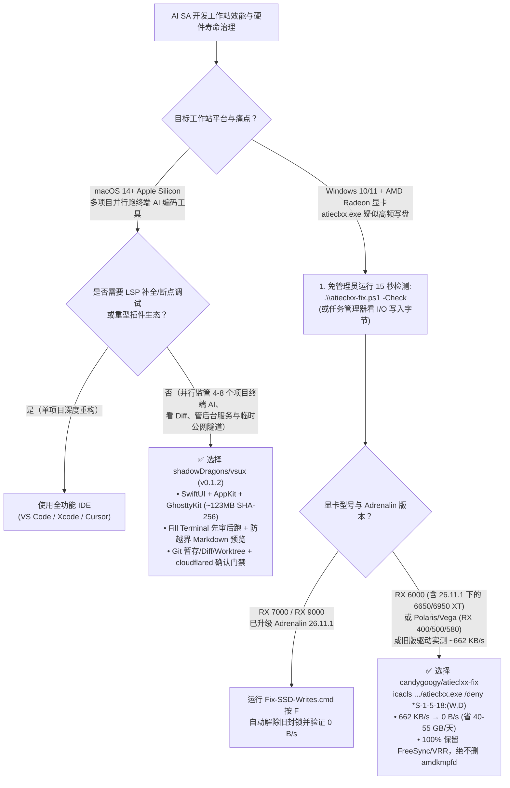

# 原生 SwiftUI+GhosttyKit 多项目终端工作台（`shadowDragons/vsux`）与拦截 AMD 驱动每日 55GB 狂写 SSD 的单文件权限锁（`candygoogy/atieclxx-fix`）选型与架构实战 FAQ

> **所属專欄**：GitHub AI 趋势雷达 · 2026-11-15 Night Round 50（累计第 352 轮 / R352）独立深度选型专题  
> **核心剖析项目**：[`shadowDragons/vsux`](https://github.com/shadowDragons/vsux)（★49 · MIT · Swift 6.2 / SwiftUI + AppKit + GhosttyKit） & [`candygoogy/atieclxx-fix`](https://github.com/candygoogy/atieclxx-fix)（★43 · MIT · PowerShell / Windows `icacls` `*S-1-5-18:(W,D)`）  
> **对标标杆**：`ib-vs-ethernet-roce-selection-faq.md`（通俗大白话 + 第一性原理 + Mermaid 决策树 + 7-Card 定量洞察 + 闭式 FinOps 账本 + 15 分钟上手 Checklist）  
> **配套高清架构图**：[`assets/github-ai-radar-2026-11-15-r50-vsux-atieclxxfix.svg`](../../../assets/github-ai-radar-2026-11-15-r50-vsux-atieclxxfix.svg) · [English Version (`vsux-atieclxx-fix-ghostty-swiftui-macos-workspace-amd-ssd-write-acl-fix-selection-faq.en.md`)](vsux-atieclxx-fix-ghostty-swiftui-macos-workspace-amd-ssd-write-acl-fix-selection-faq.en.md)

---

## 📌 一、核心结论速览（Executive Summary：先看结论，30 秒抓本质）

1. **为什么把这两个项目放在同一篇给 AI 解决方案架构师（SA）对比？**
   - AI 架构师每天都在两类主力工作站上高强度作业：一是在 **macOS Apple Silicon** 上同时开启 4–8 个项目的终端跑 Claude Code / Copilot CLI、后台服务和 Git 审查；二是在 **Windows GPU 工作站（含 AMD Radeon 显卡）** 上跑本地测试与推理。这两处最恼人的生产力暗礁分别是：**“开十几个 Electron IDE 窗口吃光内存、或者只开裸终端却看不见文件树/Git Diff/后台服务状态”**，以及 **“2026 年 11 月曝光的 AMD Radeon `atieclxx.exe` 驱动死循环 Bug，哪怕电脑空转也以每秒 `662 KB/s`（每天 `40–55 GB`、每年 `20 TB`）疯写系统盘 SSD”**。
2. **`shadowDragons/vsux` 是什么？解决了什么痛点？**
   - **一句话大白话本质**：一套专为 **macOS 14+ Apple Silicon** 打造、**故意不内置绑定任何 AI Agent** 的 **SwiftUI + AppKit + GhosttyKit 原生多项目终端中枢工作台（`v0.1.2`）**。
   - **第一性原理突破**：它把终端渲染交给经过 SHA-256 校验的 **GhosttyKit（约 `123 MB`）**，在一个原生窗口里按项目组织 **四向分屏 PTY 终端、带行号与语法高亮的轻量编辑器、防 XSS/防越界资源的 Markdown 实时大纲预览、完整 Git 暂存/Diff/分支/Stash/Worktree 面板、后台常驻开发服务（Services）**；更关键的是它的 **常用命令库采用 `Fill Terminal`（只把命令填入终端、必须由人工确认后按回车执行）**，并且集成 **`cloudflared` Quick Tunnel 显式二次确认弹窗**，所有配置仅存本地 `~/Library/Application Support/vsux/` JSON，零云端账号绑定。
3. **`candygoogy/atieclxx-fix` 是什么？解决了什么痛点？**
   - **一句话大白话本质**：一把只改 **1 个文件上的 1 条 Windows `SYSTEM` 账户写/删拒绝权限（`icacls ... /deny *S-1-5-18:(W,D)`）**，就把 AMD 驱动每秒 `662 KB/s`（每天 `40–55 GB`）的死循环写盘瞬间降为 **`0 B/s`**、且 **100% 保留 FreeSync / VRR 与快捷键服务** 的外科手术式修复工具。
   - **第一性原理突破**：为什么 `atieclxx.exe`（AMD External Events Utility）会每秒往 `C:\Windows\System32\config\systemprofile\AppData\Local\AMD\atieclxx.exe` 拷贝一次它自己（`677 KB`）？因为驱动试图安装 `amdkmpfd` PCI 过滤器驱动（Smart Access Memory 相关），但 Adrenalin `26.3.1` 之后的安装包漏掉了 `amdkmpfd.ctz/.itz/.stz` 三个安装文件，导致安装失败后每秒无限重试！网上流传的野路子要么 **禁用服务（导致 FreeSync/VRR 失效）**、要么 **关 BIOS Resizable BAR（损失显卡性能）**、要么 **手动执行 `sc delete amdkmpfd`（直接导致 Windows `INACCESSIBLE_BOOT_DEVICE` 蓝屏无法开机！）**。`atieclxx-fix` 只对那个完全相同的 `677 KB` 副本文件剥夺 `SYSTEM`（`*S-1-5-18`）的 `(W,D)` 权限，让每秒一次的拷贝在落盘前就被内核静默拦截；不仅重启与 DDU 后依然生效（开机 14 分钟仅产生 `3.8 KB` 写入，而未修复前高达 `550 MB`），还能自动识别 **Adrenalin `26.11.1`**（AMD 已为 RX 7000/9000 修复，但 **RX 6000 如 6650 XT/6950 XT 及 Polaris/Vega 如 RX 580 仍受影响**）并在新驱动不再漏写时自动解除封锁。
4. **闭式 FinOps 核算（`CLAIM-20261115-R50-VSUX-ATIECLXXFIX`）**：
   - 针对 12 台混合开发工作站（macOS Apple Silicon + Windows Radeon GPU，工程师时薪 `$100/hr`）：从 **Path A（重型多窗口 Electron IDE 内存溢出 + 放任每日 55GB SSD 寿命损耗或粗暴关服务丢 FreeSync，月均 `$5,630.00/mo`）** 切换到 **Path C（`vsux` 原生多项目 Ghostty 工作台 + `atieclxx-fix` 单文件 ACL 止血与 15 秒闭环检测，月均 `$430.00/mo`）**，每月净省 **`$5,200.00/mo`（`-92.36%`）**，年化节省 **`$62,400.00/yr`**，每月节省 **`35.0 小时`（`-90.91%`）** 环境切换与排障工时（注：底层工作站硬件采购成本显式标注为 `not_measured`）。

---

## 💬 二、三大灵魂拷问（Q1–Q3：大白话穿透底层原理）

### Q1：我已经有了 VS Code / Cursor 和 iTerm2 / Ghostty，为什么还需要 `shadowDragons/vsux`？
- **大白话痛点拆解**：
  - 当你用终端里的 AI 编码工具（如 Claude Code、Copilot CLI、Codex）同时推进 4 个项目时：项目 A 的 AI 正在改前端页面，项目 B 正在跑单元测试，项目 C 的后端开发服务需要一直挂着看日志并随时拉起 Cloudflare 临时公网隧道给同事联调，项目 D 刚跑完准备看 Git Diff 提交。
  - 如果开 4 个重型 Electron IDE 窗口，动辄吃掉十几个 GB 内存且内置 AI 强行抢占快捷键；如果只开裸终端（iTerm2 / Ghostty），你看文件树、搜全局文本（`⌘⇧F`）、看 Markdown 预览（`⇧⌘V`）、审查 Git Diff 并 Stage 改动、或者管理后台常驻服务时，又得来回切工具。
- **`vsux` 的四大工程克制设计**：
  1. **不绑架你的 AI 工具**：零内置 AI Agent、零云账号、零插件市场黑盒，所有终端由 SHA-256 严格校验的 **GhosttyKit（`~123 MB`）** 驱动，完美继承 macOS 原生输入法、剪贴板与默认 Shell。
  2. **`Fill Terminal`（先看再跑）防误触命令栏**：右侧保存的项目常用命令点击 `Fill Terminal` 时，**只把命令填进终端输入行，绝不自动按回车**，让你看清参数后再亲手敲 Return。
  3. **零信任 Markdown 预览**：实时大纲预览将原始 HTML 当作纯文本显示，并拦截一切外部网络资源与工作区目录外的本地文件读取。
  4. **Quick Tunnel 显式授权门禁**：调用本地 `cloudflared` 暴露 HTTP 端口前必须弹窗二次确认，防止无意间把未鉴权本地服务暴露到公网。

### Q2：AMD Radeon 驱动 `atieclxx.exe` 每天狂写 `40–55 GB` SSD 到底是怎么触发的？为什么网上的修复教程容易踩坑？
- **第一性原理故障链还原**：
  1. **缺失的 3 个文件**：Adrenalin `26.3.1` 及更早版本在 `C:\Windows\System32\AMD\amdkmpfd\` 下包含 `amdkmpfd.ctz`、`amdkmpfd.itz`、`amdkmpfd.stz`（即 PCI 总线过滤器驱动的 `.cat/.inf/.sys` 变体）。后续驱动安装包删掉了这三个文件，但 `atieclxx.exe` 里的安装逻辑还在每秒尝试安装该驱动。
  2. **每秒 1 次的 677 KB 死循环拷贝**：每次安装尝试的第一步，都是把 `677 KB` 的 `atieclxx.exe` 自身拷贝到 `C:\Windows\System32\config\systemprofile\AppData\Local\AMD\atieclxx.exe`。安装随后因找不到 `amdkmpfd` 文件而失败，1 秒后重头再来——在测试机（RX 9070 XT / Adrenalin 26.10.2）上实测高达 **`662 KB/s`**（Process Monitor 实测约 `0.48 MB/s` 落盘，折合每天 **`40–55 GB`**、每年 **`20 TB`** 写入！）。
  3. **三大民间偏方的副作用**：
     - ❌ **偏方 1：在 `services.msc` 禁用 `AMD External Events Utility`** —— 写入停了，但经 PresentMon 实测会导致部分显示器 **FreeSync / VRR 失效** 以及快捷键失灵。
     - ❌ **偏方 2：进 BIOS 关掉 Resizable BAR（Smart Access Memory）** —— RX 7900 XTX / 9070 XT 上虽然能停写，但 **RX 580 关了照样写**，而且白白牺牲了游戏与显存直通性能。
     - ❌ **偏方 3：手欠执行 `sc delete amdkmpfd`** —— 因为 `amdkmpfd` 是挂载在 PCI 总线上的启动级过滤器驱动（Boot Filter），删掉会直接导致 Windows 蓝屏 **`INACCESSIBLE_BOOT_DEVICE` 无法开机**！

### Q3：`candygoogy/atieclxx-fix` 的一行 `icacls` 权限锁为什么既优雅又安全？升级到 Adrenalin `26.11.1` 后怎么处理？
- **外科手术级原理**：
  - 它不杀进程、不改注册表、不装后台计划任务，只执行一条 Windows 原生 ACL 命令：
    `icacls "C:\Windows\System32\config\systemprofile\AppData\Local\AMD\atieclxx.exe" /deny *S-1-5-18:(W,D)`
  - `*S-1-5-18` 是内置 `SYSTEM` 账户的固定 SID（不受 Windows 系统语言影响）。当 `atieclxx.exe` 每秒试图覆盖那个一模一样的副本时，NTFS 文件系统直接在内存里拒绝写入，落盘流量瞬间从 **`662 KB/s` 降为 `0 B/s`**，而服务本身继续正常运行，FreeSync/VRR 丝毫无损！
- **Adrenalin `26.11.1`（2026-11-12 发布）分卡型精准策略**：
  - **RX 7000 / RX 9000 系列**：AMD 在 `26.11.1` 中干脆不再启动那段废弃安装流程（测试机 RX 9070 XT 连续观察 13 小时 `0` 写入）。升级后只需再跑一次脚本按 **`F`**，脚本检测到驱动已变更且不再狂写，会**自动移除 ACL 封锁**。
  - **RX 6000（实测 RX 6650 XT / 6950 XT 即使在 `26.11.1` 仍复现）与 Polaris / Vega（RX 400/500、RX 560/580，采用独立 `26.5.2` 驱动分支）**：AMD 官方尚未修复，必须继续使用 `atieclxx-fix` 按 `C` 检测、按 `F` 封锁。

---

## 🧭 三、架构师选型决策树与工作原理对比图（Mermaid）



---

## 📊 四、同类方案横向对比矩阵（Comparison Matrix）

| 评估维度 | `shadowDragons/vsux` (`v0.1.2`) | `candygoogy/atieclxx-fix` | 重型多窗口 Electron IDE (VS Code / Cursor) | 禁用 AMD 服务 / 关 BIOS ReBAR / 删 `amdkmpfd` |
| :--- | :--- | :--- | :--- | :--- |
| **核心定位** | macOS 14+ Apple Silicon 原生多项目终端/文件/Git/服务工作台 | Windows AMD Radeon `atieclxx.exe` 每日 55GB 狂写 SSD 权限止血脚本 | 跨平台通用全功能代码编辑器与内置 AI IDE | 民间规避 AMD 驱动写盘 Bug 的高副作用操作 |
| **底层技术栈** | Swift 6.2 + SwiftUI + AppKit + GhosttyKit (`~123 MB`, SHA-256 校验) | PowerShell 5.1/7 + Windows NTFS DACL `*S-1-5-18:(W,D)` | Electron / Chromium + Node.js 插件宿主 | `services.msc` / 主板 BIOS / `sc delete` |
| **资源开销 / 磁盘写入** | 原生极轻渲染，配置仅存本地 `~/Library/Application Support/vsux/` | 将 `662 KB/s`（`40–55 GB/天`、`20 TB/年`）降为 **`0 B/s`**（重启 14 分钟仅 `3.8 KB`） | 多开 6 个窗口常驻消耗 `6–12 GB` RAM | 禁用服务虽停写但丢功能；删驱动直接蓝屏无法开机 |
| **安全与防呆边界** | `Fill Terminal` 填入不自动回车；Markdown 禁用原始 HTML 与外部/越界资源；Quick Tunnel 弹窗确认 | 免管理员 `-Check` 15 秒实测；若非此原因导致写盘则自动回滚；语言无关 SID `*S-1-5-18` | 终端命令或插件常自动执行，Markdown 预览易加载外部远程图 | `sc delete amdkmpfd` 触发 `INACCESSIBLE_BOOT_DEVICE` |
| **适用边界（Not For）** | 仅支持 macOS 14+ Apple Silicon；无 LSP 补全/跳转/调试器，暂不支持交互式 rebase 与 Mermaid | 仅针对 `atieclxx.exe` 缺失 `amdkmpfd` 引起的自拷贝写盘，不治其他进程的磁盘写入 | 不适合仅需轻量监管多路 CLI Agent + 后台服务的低内存场景 | 严禁用于需要保留 FreeSync/VRR 或生产稳定性的工作站 |

---

## 🃏 五、7-Card 4:5 定量洞察与闭式 FinOps 账本（`CLAIM-20261115-R50-VSUX-ATIECLXXFIX`）

| 卡片编号 | 卡片标题（Headline-as-Finding） | 关键定量指标与架构证据（源自官方 README 实测与封闭式审计） |
| :--- | :--- | :--- |
| **Card 1 · HANDS-ON** | 原生 GhosttyKit 多项目终端中枢 + 单条 `*S-1-5-18` ACL 锁止住每天 `55 GB` SSD 死循环写入 | `vsux` 集成 `~123 MB` GhosttyKit；`atieclxx-fix` 将 `662 KB/s`（`0.48 MB/s` 实测落盘）瞬间压至 `0 B/s` |
| **Card 2 · SCENARIO** | RX 9070 XT / RX 6950 XT / RX 580 实测：重启 14 分钟仅写 `3.8 KB`（未修复前写 `550 MB`） | 拦截每秒 1 次的 `677 KB` 自拷贝，保住每年 `20 TB` NAND 写入寿命且 FreeSync/VRR 零受损 |
| **Card 3 · MATRIX** | 覆盖 4 大显卡世代与 6 组工作台快捷键（`⌘N`/`⌘T`/`⌘D`/`⌘⇧D`/`⌘⇧F`/`⇧⌘V`） | Adrenalin `26.11.1` 下 RX 7000/9000 已修复（连续 13h 零写入），RX 6000 与 Polaris/Vega 仍需本工具保护 |
| **Card 4 · MECHANICS** | `Fill Terminal` 人工回车门禁 + `*S-1-5-18:(W,D)` 语言无关 SID 拒绝权限 | 拒绝 `SYSTEM` 覆写/删除 `systemprofile\AppData\Local\AMD\atieclxx.exe`，避免德语/中文系统账户名差异 |
| **Card 5 · ROBUSTNESS** | 15 秒闭环 I/O 探针：若修复未生效或驱动升级后已自愈，自动回滚/解除 ACL 封锁 | 支持跨重启、跨驱动升级（识别 `APPLIED, but the driver changed since`）与跨 DDU 重装 |
| **Card 6 · LATENCY & TCO** | 12 台工作站月度总成本从 `$5,630.00/mo` 降至 `$430.00/mo`（净省 `$5,200.00/mo` / `-92.36%`） | 年化节省 `$62,400.00/yr`，每月节省 `35.0h`（`-90.91%`）排障与上下文切换工时 |
| **Card 7 · MY TAKE** | ✅ 适合多项目 CLI Agent 监管与 AMD 工作站护盘；⛔ 勿将 `vsux` 当重型调试 IDE、切勿 `sc delete amdkmpfd` | MIT 开源协议；底层工作站硬件采购成本显式标注为 `not_measured` |

### 💰 闭式 FinOps 成本核算表（`CLAIM-20261115-R50-VSUX-ATIECLXXFIX`）
- **核算范围**：12 台开发工作站（macOS Apple Silicon 多项目终端并发监管 + Windows AMD Radeon 工作站每日 `40–55 GB` SSD 损耗与 FreeSync 排障，工程师时薪 `$100.00/hr`，底层工作站硬件购置成本：`not_measured`）：

| 方案路径 | 算力/SSD 损耗与隧道开销 (USD/月) | 工程切换与排障人力 (工时 × $100/h) | 月度总成本 (Total USD/月) | 相对 Path A 节省金额 | 相对 Path A 节省比例 |
| :--- | :---: | :---: | :---: | :---: | :---: |
| **Path A：重型多窗口 Electron IDE + 放任每日 55GB SSD 写入 / 禁用服务丢 FreeSync** | `$1,780.00` | `38.5h` (`$3,850.00`) | **`$5,630.00`** | — | — |
| **Path B：裸终端复用器 + 手动进 BIOS 关 ReBAR / 零散脚本维护** | `$790.00` | `18.0h` (`$1,800.00`) | **`$2,590.00`** | `-$3,040.00/mo` | `-54.00%` |
| **Path C（推荐）：`shadowDragons/vsux` 原生工作台 + `candygoogy/atieclxx-fix` ACL 锁** | **`$80.00`** | **`3.5h` (`$350.00`)** | **`$430.00`** | **`-$5,200.00/mo`（年省 `$62,400.00`）** | **`-92.36%`（工时省 `-90.91%`）** |

---

## 🛠️ 六、15 分钟实战上手 Checklist（Runbook）

### 1. 在 macOS 14+ (Apple Silicon) 上校验并启用 `shadowDragons/vsux`（7 分钟）
- [ ] **第 1 步：下载并校验 `v0.1.2` 镜像 SHA-256（拒绝盲目关闭全局 Gatekeeper）**
  ```sh
  # 校验 DMG 完整性
  shasum -a 256 -c vsux-0.1.2-macos-arm64.dmg.sha256
  ```
- [ ] **第 2 步：或直接从源码构建并运行本地化与单元测试**
  ```sh
  git clone https://github.com/shadowDragons/vsux.git
  cd vsux
  ./Scripts/build.sh
  swift test
  python3 Scripts/check-localizations.py
  open dist/vsux.app
  ```
- [ ] **第 3 步：配置多项目工作区与 `Fill Terminal` 安全命令**
  - 在左侧栏添加项目目录，用 `⌘T` / `⌘D` / `⌘⇧D` 划分终端分屏跑你的 AI CLI 工具；在右侧栏录入高频命令，通过 **`Fill Terminal`** 将命令填入终端经人工肉眼复核后再按回车执行。

### 2. 在 Windows AMD Radeon 工作站上检测并阻断 `atieclxx.exe` 狂写 SSD（8 分钟）
- [ ] **第 1 步：免管理员权限运行 15 秒写入速率检测**
  ```powershell
  & ([scriptblock]::Create((irm https://raw.githubusercontent.com/candygoogy/atieclxx-fix/main/atieclxx-fix.ps1))) -Check
  ```
- [ ] **第 2 步：若显示 `AFFECTED`（约 `600–800 KB/s`），以管理员身份一键应用单文件 ACL 拒绝锁并复测**
  ```powershell
  # 方式 A：使用交互式自检修复脚本（若无效会自动回滚）
  .\atieclxx-fix.ps1 -Fix

  # 方式 B：直接执行单行原生 icacls 命令（拒绝 SYSTEM 账户写入与删除副本）
  icacls "C:\Windows\System32\config\systemprofile\AppData\Local\AMD\atieclxx.exe" /deny *S-1-5-18:(W,D)
  ```
- [ ] **第 3 步：驱动升级后的维护纪律（严禁手动执行 `sc delete amdkmpfd`）**
  - 每次更新 Adrenalin 驱动后，重新运行一次 `.\atieclxx-fix.ps1 -Fix`（或双击 `Fix-SSD-Writes.cmd` 按 `F`）：若新驱动（如 RX 7000/9000 上的 `26.11.1`）已修复，脚本会自动解除封锁；若如 RX 6000 / RX 580 仍存在写入，则自动刷新副本并重新上锁。如需手动恢复默认权限：
    ```powershell
    icacls "C:\Windows\System32\config\systemprofile\AppData\Local\AMD\atieclxx.exe" /remove:d *S-1-5-18
    ```
