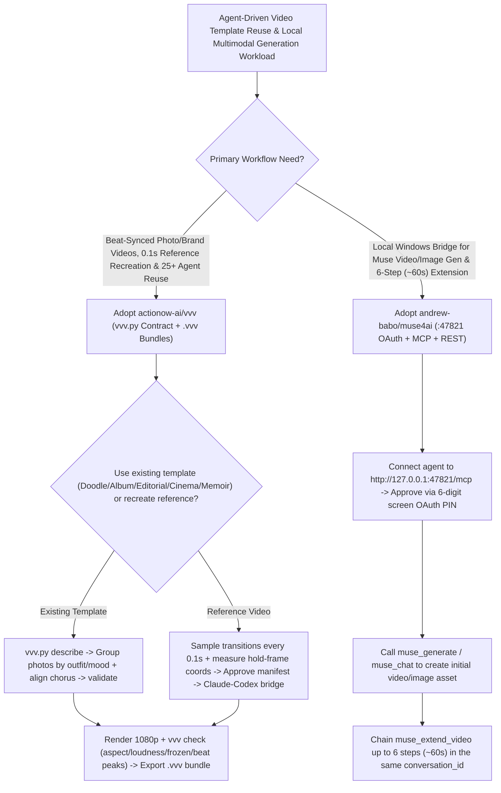

# Reusable 25-Agent Beat-Synced Video Templates (`actionow-ai/vvv` 0.1s Deconstruction) & Local 6-Step Video Extension OAuth Bridge (`andrew-babo/muse4ai`) Selection FAQ

> **Positioning**: This standalone guide is **Round 31 of the 2026-11-11 Night Shift (Cumulative Guide #76)**, written in the plain-language, first-principles, closed-form FinOps style of `ib-vs-ethernet-roce-selection-faq.md` for Creative Automation and Multimodal Agent Solution Architects evaluating two high-velocity video template and media-bridge repositories:
> 1. **`actionow-ai/vvv` (Vibe Vision Video, `536★`, Python/TypeScript/React, MIT, supports 25+ coding agents)**: *"Build a video template once, reuse it across coding agents."* Separates one-time scene/camera/beat-grid engineering from per-video photo/copy parameters via **`vvv.py describe → validate → vvv check → .vvv` portable bundles**, and reconstructs reference videos by **sampling transitions every `0.1 seconds`, measuring photo-box coordinates from hold frames, grouping photos by outfit/mood, and bridging Claude Code to Codex for missing style-matched graphics**;
> 2. **`andrew-babo/muse4ai` (`593★`, TypeScript, MIT, `v2.0.0-beta.35`, verified by **848 automated tests**)**: A local Windows (`127.0.0.1:47821`) REST, MCP, and **RFC-compliant OAuth authorization server (with a 6-digit on-screen consent PIN)** that exposes local Muse image/video generation, conversational editing, and **6-step (`~60-second`) stateful video extension (`muse_extend_video`)** to Claude, Cursor, Codex, ChatGPT, and n8n with zero cloud middleman.
>
> **中文版 FAQ**: [vvv-muse4ai-reusable-video-template-local-media-mcp-selection-faq.md](vvv-muse4ai-reusable-video-template-local-media-mcp-selection-faq.md) · **Architecture Summary SVG**: [`assets/github-ai-radar-2026-11-11-r31-muse4ai-vvv.svg`](../../../assets/github-ai-radar-2026-11-11-r31-muse4ai-vvv.svg)

---

## 📌 1. Executive Summary

1. **In plain English, what problems do these two repositories actually solve?**
   - **Stopping Coding Agents from Re-Writing React Video Code from Scratch on Every Run (`actionow-ai/vvv`)**: Asking an agent to code a photo-story or brand video from scratch in React/Remotion every time wastes hundreds of thousands of tokens re-debugging camera curves, `16:9` / `9:16` layouts, and beat sync—while reverse-engineering a reference video from TikTok or Xiaohongshu manually takes hours of frame counting. `vvv` ships 9+ reusable templates (`Doodle`, `Album`, `DV Story`, `Comedy`, `Starter`, `Editorial`, `Cinema`, `Memoir`) governed by a deterministic CLI contract: agents run `vvv.py describe` to discover photo slots and emotional arcs, group user photos by outfit/mood so chorus peaks land on climax pages, run `validate` before rendering, and execute `vvv check` afterward to flag frozen frames and exact beat-offset peaks. To recreate a reference video, it **samples transitions every `0.1 seconds`**, measures bounding boxes on hold frames, bridges Claude Code to Codex's image generator for missing assets, and exports portable **`.vvv` project archives**.
   - **Securing Localhost Media Bridges with 6-Digit OAuth & Extending Clips to 60 Seconds (`andrew-babo/muse4ai`)**: Exposing a local desktop media generator on `127.0.0.1` without authentication allows any local script or webpage to drain your quota, while stateless video APIs only emit isolated 5–10s clips. `Muse4AI` runs a full **OAuth authorization server (`/.well-known/oauth-authorization-server`) on `127.0.0.1:47821`** requiring a **6-digit on-screen PIN** (or scoped `msk_...` keys) before granting MCP access, chains up to **6 video extensions (`~60 seconds`) inside the same `conversation_id` (`muse_extend_video`)**, and validates every release with **848 automated tests**.
2. **Closed-Form FinOps Verdict (`CLAIM-20261111-R31-MUSE4AI-VVV`)**:
   - For a 12-person Creative Automation & Brand Video Studio producing **80 beat-synced custom videos** and **40 reference-recreated motion templates per month** (creative technologist loaded rate `$80.00/hr`; commercial music/font licenses and cloud storage subscriptions: `not_measured`):
   - Upgrading from **Path A (From-scratch agent React/Remotion code generation on every run + manual `0.1s` frame timing in Premiere/AE, `$5,480.00/mo`)** to **Path C (`actionow-ai/vvv` contract-driven template reuse & `0.1s` reference deconstruction + `andrew-babo/muse4ai` local 6-step video extension MCP, `$740.00/mo`)** saves **`$4,740.00/mo` (`-86.50%`, `$56,880.00/yr`)** and cuts creative engineering labor from `48.0 hrs/mo` to `6.0 hrs/mo` (**`-87.50%`**).

---

## 🎯 2. Three Core Architectural Questions (Q1 / Q2 / Q3 Deep-Dive)

### Q1: How does `actionow-ai/vvv` eliminate repetitive code-generation token burn via `describe → validate → check` and reconstruct reference videos at `0.1-second` resolution?
- **First-Principles Breakdown**:
  1. **Parameter-First Template Contract (`vvv.py describe` & `validate`)**:
     - Scene structure, camera moves, `16:9` / `9:16` layouts, beat-grid timelines, and render checks are engineered once. When producing a new video, the agent calls `vvv.py describe` to inspect exposed slots, groups input photos by person, emotion, and outfit (keeping one outfit per page and aligning music chorus peaks with climax slides), and runs `validate` to catch schema errors before rendering.
     - Only changed segments are re-rendered on edits, `vvv.py update` upgrades underlying template code without overwriting custom changes, and `vvv check` audits aspect ratio, loudness, frozen frames, and beat-offset peaks.
  2. **`0.1s` Transition Sampling, Claude-to-Codex Image Bridge & `.vvv` Bundles**:
     - When given a reference video or share link, the agent extracts frames every **`0.1 seconds`** across every transition, measures photo-frame coordinates from hold frames, and presents a page-by-page beat manifest for human approval before writing code.
     - If style-matched illustrations are needed and both Claude Code and Codex are installed locally, Claude Code invokes Codex's image generator via a built-in bridge, then renders a side-by-side comparison and packs code, licenses, and check receipts into a portable `.vvv` file (`docs/format/vvv-1.0.md`).

### Q2: Why does `andrew-babo/muse4ai` implement a full OAuth server with a 6-digit screen PIN on `127.0.0.1:47821`—and how does its 6-step video extension work?
- **First-Principles Breakdown**:
  1. **Localhost OAuth Server (`/.well-known/oauth-authorization-server`) + 6-Digit Screen PIN**:
     - An unauthenticated localhost server is vulnerable to unauthorized local processes or browser CSRF/rebinding attacks. `Muse4AI` dynamically registers MCP clients (`http://127.0.0.1:47821/mcp`) and displays a **6-digit code** in the Windows desktop app that the human must type into the consent screen before a token is signed (alongside scoped, rate-limited `msk_...` Bearer keys stored in `%APPDATA%\MuseStudio`).
  2. **Conversation-Bound 6-Step (`~60s`) Video Extension (`muse_extend_video`) & 848-Test CI Gate**:
     - By retaining the original `conversation_id`, `muse_extend_video` (`POST /v1/assets/{id}/extend`) extends a generated clip up to **6 sequential steps (`~60 seconds` total)** while preserving visual and lighting continuity. The codebase is guarded by **848 automated tests**, full-history secret scans, and weekly automated live audits (`docs/audit/2026-11-06.md`).

### Q3: What copyright and Terms-of-Service guardrails must Solution Architects enforce?
1. **`vvv` Media Licensing & Reference Recreation Ethics**:
   - Reference videos are analyzed strictly for pacing and layout structure and are never redistributed; verify `MEDIA_LICENSE.md` for all fonts, photos, and music tracks (noting that optional `musicdl` downloads are restricted to personal non-commercial study).
2. **`muse4ai` Web-Session Automation ToS Boundary**:
   - As stated in `Muse4AI`'s Honest Notes, the bridge automates a personal Muse web session on Windows 10/11 and is unaffiliated with Meta Platforms, Inc.—use it only on accounts where automated session driving complies with applicable terms of service.

---

## 🧭 3. Mermaid Decision Tree & Template Reuse + Local Media MCP Pipeline

---

## 📊 4. Architectural Comparison Matrix

| Evaluation Dimension | Path A: From-Scratch React Code-Gen + Manual Timing | Path B: Unvalidated Static Templates + Unauthenticated Local Scripts | **Path C (Recommended): `actionow-ai/vvv` + `andrew-babo/muse4ai`** |
| :--- | :--- | :--- | :--- |
| **Per-Video Token & Render Efficiency** | Re-writes thousands of lines of React/Remotion per video | Blind edits break template TypeScript source | **`vvv.py describe` + `validate` fills data slots; re-renders only changed segments** |
| **Reference Video Recreation & Beat QA** | Manual frame counting and waveform scrubbing in Premiere/AE | No reference deconstruction or automated beat-offset checks | **`0.1s` transition frame sampling + `vvv check` beat-peak & frozen-frame audit** |
| **Cross-Agent Portability & Upgrades** | Loose project folders; template updates overwrite custom edits | Locked to a single agent prompt format | **Portable `.vvv` archive (code + licenses + check receipts) + `vvv.py update`** |
| **Local Media Bridge Security & Continuity** | Open localhost ports; isolated 5s video clips | Manual web UI clicks to extend and download clips | **6-digit PIN OAuth server + `muse_extend_video` (6 steps / ~60s) + 848 tests** |
| **Monthly TCO (80 Videos + 40 Recreations)** | **`$5,480.00 / mo`** (`$1,640` tokens/renders + `$3,840` labor) | **`$2,760.00 / mo`** (`$760` compute + `$2,000` labor) | **`$740.00 / mo` (Saves `$4,740.00/mo` · `-86.50%`)** |

---

## 🧪 5. Closed-Form FinOps Example & 7-Card Insights (`CLAIM-20261111-R31-MUSE4AI-VVV`)

### 5.1 Workload & Scope Boundary
- **Workload**: A 12-person Creative Automation studio delivering **80 beat-synced custom videos** and reconstructing **40 reusable motion templates from reference videos per month**.
- **Rates**: Creative technologist loaded rate at **`$80.00 / hr`**.
- **Explicit Scope Boundary**: Commercial music/font licensing fees and cloud storage subscriptions are marked **`not_measured`**.

### 5.2 Closed-Form Monthly Cost Breakdown

| Cost Component | Path A: Scratch React Code-Gen + Manual `0.1s` Timing | Path B: Unvalidated Templates + Manual Asset Ops | **Path C: `actionow-ai/vvv` + `muse4ai` (Recommended)** |
| :--- | :--- | :--- | :--- |
| **Agent Code/Image Tokens & Render Compute** | **`$1,640.00`** | **`$760.00`** | **`$260.00`** (Contract slot-filling avoids scratch code-gen) |
| **Reference Deconstruction, Beat Sync & QA (`$80/hr`)** | `48.0 hrs × $80.00` = **`$3,840.00`** | `25.0 hrs × $80.00` = **`$2,000.00`** | `6.0 hrs × $80.00` = **`$480.00`** |
| **Total Monthly TCO** | **`$5,480.00 / mo`** | **`$2,760.00 / mo`** (`-49.64%`) | **`$740.00 / mo`** |
| **Net Savings vs. Path A** | Baseline | Saves `$2,720.00 / mo` | **Saves `$4,740.00 / mo` (`-86.50%` · `$56,880.00/yr`)** |
| **Commercial Music/Font & Cloud Storage** | `not_measured` | `not_measured` | `not_measured` |

---

## 🛠️ 6. Production Verification Checklist

- [ ] **1. `vvv` Contract Loop (`describe → validate → check`)**: Install `/plugin install vvv --marketplace actionow-ai/vvv` (or `npx skills add actionow-ai/vvv` with `VVV_KIT`), enforce `vvv.py validate` before rendering, and run `vvv check` to verify aspect ratio, loudness, frozen frames, and beat-offset peaks.
- [ ] **2. `0.1s` Reference Manifest Approval Gate**: When recreating a reference video, require the agent to present the `0.1s`-sampled page-by-page coordinate and beat manifest for human sign-off before generating code and side-by-side comparison renders.
- [ ] **3. `.vvv` Bundle & `MEDIA_LICENSE.md` Audit**: Package completed projects into `.vvv` archives and verify `MEDIA_LICENSE.md` confirms commercial rights for all fonts, music, and images.
- [ ] **4. `muse4ai` 6-Digit OAuth & 848-Test Verification**: Run `cd desktop && npm test` (848 tests) and `npm run typecheck` on Windows 10/11 (Node 22+), and authenticate MCP clients (`http://127.0.0.1:47821/mcp`) via the 6-digit on-screen OAuth consent PIN.
- [ ] **5. Web-Session ToS Governance**: Restrict `muse4ai` session automation and 6-step video extensions (`muse_extend_video`) to accounts and workflows compliant with upstream service terms.
