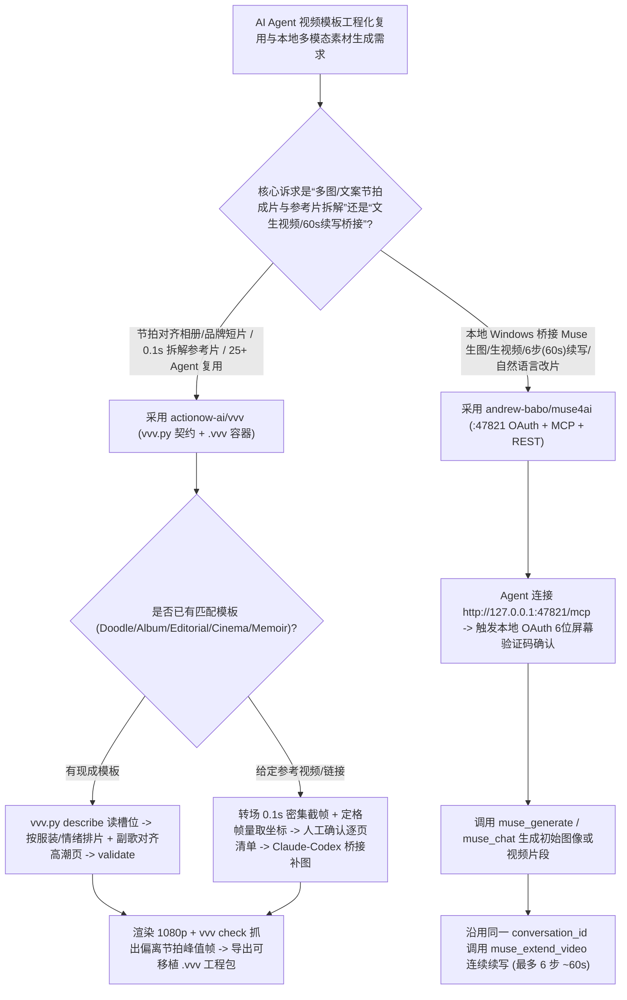

# 一次构建跨 25+ Agent 复用的节拍视频模板（`actionow-ai/vvv` 0.1s 拆片重建）与本地 6 步视频续写 OAuth 网关（`andrew-babo/muse4ai`）选型 FAQ

> **文档定位**：本文是 **2026-11-11 夜班多轮深潜 Round 31（累计第 76 篇独立选型专题）**，严格对标 `ib-vs-ethernet-roce-selection-faq.md` 的「通俗大白话 + 第一性原理 + 可核算定量算例」标杆文风，为可编程视频模板工程与多模态生成桥接架构师深度拆解今日两款创意自动化标杆：
> 1. **`actionow-ai/vvv`（Vibe Vision Video，`536★`，Python/TypeScript/React，MIT，兼容 25+ 款 Coding Agent）**：“一次构建模板，多次复用；给一部喜欢的片子，复刻出你自己的版本”——通过 `vvv.py describe → validate → vvv check → .vvv 跨 Agent 交接包` 避免每次从零写 React/Remotion 代码烧 Token，并支持对参考视频做 **`0.1 秒` 密集截帧测量照片框坐标、按服装/情绪排片、副歌对准高潮页以及 Claude Code 调 Codex 跨 Agent 生图补齐素材**；
> 2. **`andrew-babo/muse4ai`（`593★`，TypeScript，MIT，`v2.0.0-beta.35`，内置 **848 项自动化测试**）**：在本地 Windows（`127.0.0.1:47821`）将 Muse 图像/视频生成与对话式改片能力通过 **标准动态 OAuth（带屏幕 6 位数字 PIN 授权确认）+ MCP + REST** 暴露给 Claude、Cursor、Codex、ChatGPT 与 n8n，支持在同一会话内对视频做长达 **6 步（约 60 秒）连续续写（`muse_extend_video`）**。
>
> **English Companion**: [vvv-muse4ai-reusable-video-template-local-media-mcp-selection-faq.en.md](vvv-muse4ai-reusable-video-template-local-media-mcp-selection-faq.en.md) · **架构总结图**: [`assets/github-ai-radar-2026-11-11-r31-muse4ai-vvv.svg`](../../../assets/github-ai-radar-2026-11-11-r31-muse4ai-vvv.svg)

---

## 📌 一、核心结论速览（Executive Summary）

1. **先用大白话讲透这两个项目到底解决了什么痛点？**
   - **让 Coding Agent 做相册/品牌短片“每次从零写 React 代码狂烧 Token、卡点不准、看上小红书/抖音参考片却没法快速复刻结构”的痛点（`actionow-ai/vvv` 解决的问题）**：如果每次做一条活动开场或纪实相册短片都让 Claude Code 从零手写几千行 React/Remotion 动画代码，不仅每条片子都要重复烧掉几十万调试 Token，还经常出现文字出界、音乐副歌没对上高潮画面、转场脱节的问题。`vvv` 把“场景运镜、`16:9`/`9:16` 版式、节拍网格与渲染质检”固化进 9+ 套工业级模板（`Doodle`、`Album`、`DV Story`、`Editorial`、`Cinema`、`Memoir` 等）：Agent 先跑 `vvv.py describe` 读取开放参数槽位，自动识别人物/情绪/服装按套分组，优先只改配置而不动底层 TS 源码；若你想复刻一条小红书/抖音参考片，它会对每个转场按 **`0.1 秒` 密集截帧**、从定格帧量出照片框精确坐标、通过内置桥接让 Claude Code 调本地 Codex 生成缺失的风格化插画，并用 **`vvv check` 自动抓出偏离节拍最大的峰值帧**，最后打包成带版权与质检回执的 **`.vvv` 单文件工程**！
   - **本地 AI 生图/生视频工具接入 Agent“缺乏标准本地 OAuth 授权保护、单段视频太短无法在同一上下文里连续续写 60 秒”的痛点（`andrew-babo/muse4ai` 解决的问题）**：把桌面端媒体生成服务暴露在本地端口（如 `127.0.0.1:47821`）时，如果完全不设防，任何本机网页脚本或未授权进程都能偷偷发请求耗光你的配额；而且普通文生视频接口每次只出 5～10 秒孤立片段。`Muse4AI` 在本机实现了完整的 **RFC 标准 OAuth 授权服务器（`/.well-known/oauth-authorization-server`）**——当 Claude 或 Cursor 请求接入 `http://127.0.0.1:47821/mcp` 时，桌面端会弹出一个 **6 位数字验证码**，必须由本机用户亲手输入同意页才能签发令牌；同时提供 `muse_extend_video` 工具，保留原始 `conversation_id` 上下文将视频连续向后延展最多 **6 步（约 60 秒）**，并由 **848 项单测与每周一 02:00 UTC 自动巡检流水线**保障稳定性。
2. **闭式 FinOps 核算结论（`CLAIM-20261111-R31-MUSE4AI-VVV`）**：
   - 在 **12 人创意技术与品牌视频自动化团队每月交付 80 条节拍对齐定制短片 + 拆解复刻 40 套参考视频模板** 基准下（创意技术工程师全包时薪 `$80.00/hr`；商业正版配乐/字体采购与云盘会员费：`not_measured`）：
   - 从 **Path A（每次让 Agent 从零重写 React 动画代码 + 人工在剪辑软件里按 0.1 秒逐帧扒参考片参数，`$5,480.00/月`）** 升级至 **Path C（`actionow-ai/vvv` 契约化模板复用与 `0.1s` 自动拆片 + `andrew-babo/muse4ai` 本地受控 MCP 资产生成，`$740.00/月`）**，每月净省 **`$4,740.00/月`（降幅 `-86.50%`，年化节省 `$56,880.00/年`）**，工程调轴、扒片与代码排错工时从 `48.0 小时/月` 降至 `6.0 小时/月`（**节省 `87.50%`**）。

---

## 🎯 二、三大灵魂拷问（Q1 / Q2 / Q3 Deep-Dive）

### Q1：`actionow-ai/vvv` 是如何通过「`describe → validate → check` 契约」省下重复生成代码的 Token，并用 `0.1 秒` 密集截帧精准复刻参考片的？
- **第一性原理拆解**：
  1. **只改数据槽位、不动底层 React 源码的复用契约**：
     - 传统 Agent 视频生成每次都要让大模型重新推导贝塞尔缓动曲线和响应式布局。在 `vvv` 中，Agent 先运行 `vvv.py describe` 获取当前模板的照片槽位、文案字数限制与情绪段落（如先笑后泪、同一页保持同一套衣服、相邻组自动换装、音乐副歌精准落在高潮页），填入参数后由 `validate` 在渲染前拦截格式错误；
     - 渲染完成后，`vvv check` 自动检测画幅比例、响度、静止黑屏帧以及**音乐节拍对齐度（直接列出偏离节拍峰值最大的几个画面供微调）**，局部修改时仅重渲改动片段。
  2. **`0.1s` 转场截帧拆解 + Claude-Codex 跨 Agent 生图桥 + `.vvv` 标准容器**：
     - 面对一条参考视频，管线在每个转场区间按 **`0.1 秒` 步长密集抽帧**，从定格帧中精确测量照片框几何坐标与进出场动效，先输出「逐页节拍清单」由人类确认后再写代码；
     - 若参考片包含手绘贴纸或背景插画而用户只有实拍照片，当本机同时装有 Claude Code 与 Codex 时，Claude Code 会通过内置桥接自动调用 Codex 的生图能力补齐同风格素材；最终工程可打包为单文件 `.vvv`（含代码、素材授权声明与 `vvv check` 验证记录），随时交给其他 25+ 款 Agent 无缝续做，且支持 `vvv.py update` 无损升级模板底座。

### Q2：`andrew-babo/muse4ai` 为什么要在本地 `127.0.0.1:47821` 进程里实现一套带 6 位 PIN 码的完整 OAuth 授权服务？它的 6 步视频续写是怎么设计的？
- **第一性原理拆解**：
  1. **防范本地端口越权调用的 6 位屏幕 PIN 码动态 OAuth**：
     - 很多本地 MCP 桥接服务直接在 `127.0.0.1` 裸奔，导致任何知道端口号的本地脚本或恶意网页（CSRF/DNS Rebinding）都能静默调用。`Muse4AI` 内置标准 OAuth Server（发布 `/.well-known/oauth-authorization-server` 并支持动态客户端注册）：当外部 Agent 发起连接时，Windows 桌面端屏幕会实时生成一个 **6 位一次性验证码**，必须由人工在授权页输入该验证码才会签发 Token（或使用可独立限流、随时吊销的 `msk_...` API Key），所有凭据与历史严格保存在本机 `%APPDATA%\MuseStudio`。
  2. **绑定 `conversation_id` 的 6 步（~60 秒）视频连续延展与文字改片**：
     - 通过 `muse_extend_video`（对应 `POST /v1/assets/{id}/extend` 与 `/v1/conversations/{id}/extend`），Agent 可在生成初始视频的同一个 `conversation_id` 上下文内连续向后续写最多 **6 步（累计约 60 秒）**，保持光影与主体连贯；同时支持直接附带 MP4 通过自然语言描述修改画面。

### Q3：架构师在企业与工作室落地这两套工具时，有哪些必知的合规与平台边界？
1. **`vvv` 的版权与非商用组件边界**：
   - 参考视频拆解仅用于学习镜头结构与节拍节奏，严禁直接搬运他人受版权保护的成片画面；若使用可选的 `musicdl` 下载音乐仅限个人非商业学习，商业交付务必使用自有版权配乐、字体与照片，并检查生成的 `MEDIA_LICENSE.md`。
2. **`muse4ai` 的非官方会话风险与平台支持（Honest Notes）**：
   - 官方文档诚实声明：`Muse4AI` 是独立开源项目（与 Meta 无关），底层通过自动化用户本机的 Muse 网页会话工作——网页改版可能导致接口失效，且自动化操作可能受平台服务条款（ToS）约束，因此**仅建议用于个人创意实验或合规授权的测试账号，切勿作为企业核心生产 SLA 的唯一依赖**（目前打包优先支持 Windows 10/11 + Node 22+）。

---

## 🧭 三、Mermaid 选型决策树与模板复用 + 本地媒体 MCP 流水线

---

## 📊 四、同类方案核心能力对比矩阵（Comparison Matrix）

| 评估维度 | Path A：每次从零写 React 代码 + 手工逐帧扒参考片 | Path B：静态死板视频模板 + 无鉴权本地生成脚本 | **Path C（推荐标杆）：`actionow-ai/vvv` + `andrew-babo/muse4ai`** |
| :--- | :--- | :--- | :--- |
| **同类型视频二次制作 Token 成本** | 每次重新生成数千行动画代码，反复调试布局 Bug | 虽能改字，但Agent不知道槽位约束，易改坏源码 | **`vvv.py describe` + `validate` 契约化填槽，仅局部重渲改动片段** |
| **参考视频拆解与节拍对齐质检** | 人工在剪辑软件里按帧量坐标、肉眼对齐鼓点 | 无参考片重建能力，无自动化卡点偏差检测 | **转场 `0.1s` 密集截帧测量 + `vvv check` 自动列出节拍偏离峰值画面** |
| **跨 Agent 工程迁移与底座升级** | 散装 React 目录，换个 Agent 或升级模板极易冲突 | 改过定制逻辑后无法同步上游模板修复 | **`.vvv` 标准打包（含代码+版权+质检回执）+ `vvv.py update` 保留定制** |
| **本地视频生成安全与长片段延展** | 裸开本地端口无授权确认；单次仅能出 5s 孤立片段 | 需人工去网页端反复点 Extend 再手动下载回本地 | **屏幕 6 位 PIN 码动态 OAuth + `muse_extend_video` 同会话 6 步 60s 续写** |
| **月度总拥有成本（80 成片+40 拆片）** | **`$5,480.00 / 月`**（Token/重渲 `$1,640` + 人工 `$3,840`） | **`$2,760.00 / 月`**（算力 `$760` + 人工 `$2,000`） | **`$740.00 / 月`（净省 `$4,740.00/月`，降幅 `-86.50%`）** |

---

## 🧪 五、闭式定量 FinOps 算例与 7-Card 评测洞察（`CLAIM-20261111-R31-MUSE4AI-VVV`）

### 5.1 基准假设与边界声明
- **评测负载**：12 人创意技术与品牌视频工作室每月交付 **80 条节拍对齐定制短片**，并从热门参考片中拆解重建 **40 套可编辑动态模板**。
- **单价基准**：创意技术工程师（Creative Technologist）全包时薪 **`$80.00 / hr`**。
- **显式边界声明（Scope Boundary）**：商业正版音乐曲库、商用字体授权费用及第三方云盘会员订阅标记为 **`not_measured`**。

### 5.2 三路径闭式成本核算表

| 成本构成项 | Path A：从零生成代码 + 人工逐帧扒片调轴 | Path B：无质检静态模板 + 手工排片升级 | **Path C：`actionow-ai/vvv` + `muse4ai`（推荐）** |
| :--- | :--- | :--- | :--- |
| **Agent 代码/生图 Token 与本地渲染算力** | **`$1,640.00`** | **`$760.00`** | **`$260.00`**（契约填槽省去重复代码生成） |
| **拆片量坐标、卡点对齐与排错工时（`$80/hr`）** | `48.0 hrs × $80.00` = **`$3,840.00`** | `25.0 hrs × $80.00` = **`$2,000.00`** | `6.0 hrs × $80.00` = **`$480.00`** |
| **月度总成本（Monthly Total）** | **`$5,480.00 / 月`** | **`$2,760.00 / 月`**（`-49.64%`） | **`$740.00 / 月`** |
| **相对 Path A 净节省（Savings）** | 基准线（Baseline） | 节省 `$2,720.00 / 月` | **净省 `$4,740.00 / 月`（`-86.50%` · 年省 `$56,880.00`）** |
| **商业配乐/字体授权与云盘订阅** | `not_measured` | `not_measured` | `not_measured` |

---

## 🛠️ 六、生产级落地核验 Checklist（SA Actionable Verification）

- [ ] **1. `vvv` 技能安装与 `describe / validate / check` 闭环**：在 Claude Code 中安装 `/plugin install vvv --marketplace actionow-ai/vvv`（或其他 20+ Agent 执行 `npx skills add actionow-ai/vvv` 并配置 `VVV_KIT`），每次渲染前强制跑通 `vvv.py validate`，导出后跑 `vvv check` 核验画幅、响度、静止帧与节拍峰值。
- [ ] **2. 参考视频 `0.1s` 拆解人工清单门禁**：使用参考片重建流程时，强制要求 Agent 先提交基于 `0.1s` 转场截帧测量的「逐页节拍与坐标清单」供人工确认，确认无误后再生成代码并输出新旧并排对比视频。
- [ ] **3. `.vvv` 归档与版权合规检查**：交付或跨 Agent 移交时打包为 `.vvv` 格式，核验内附的 `MEDIA_LICENSE.md` 确保照片、商用字体与配乐具备合法授权（严禁将个人学习用途的 `musicdl` 曲目用于商业发布）。
- [ ] **4. `muse4ai` 本地 6 位 PIN OAuth 与 848 项测试自检**：在 Windows 10/11（Node 22+）上运行 `cd desktop && npm test` 确认 848 项测试通过，接入 `http://127.0.0.1:47821/mcp` 时优先采用屏幕 6 位验证码 OAuth 授权，并定期在 **Settings → API & agent → Connected apps** 审计已连接客户端。
- [ ] **5. 非官方会话 ToS 边界管理**：鉴于 `muse4ai` 通过自动化本地 Muse 会话运行，仅在合规的个人/沙盒账号下使用 `muse_extend_video`（最多 6 步 60 秒续写），避免在无人值守高频商业网关中违反上游平台 ToS。
