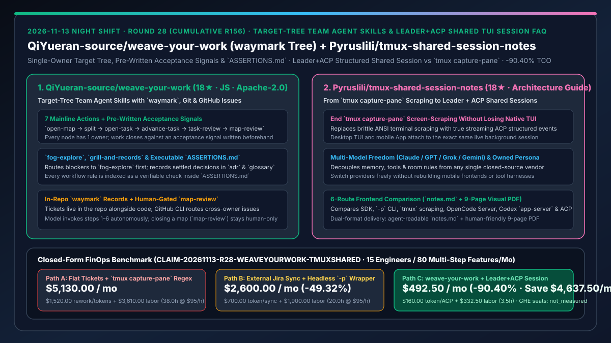
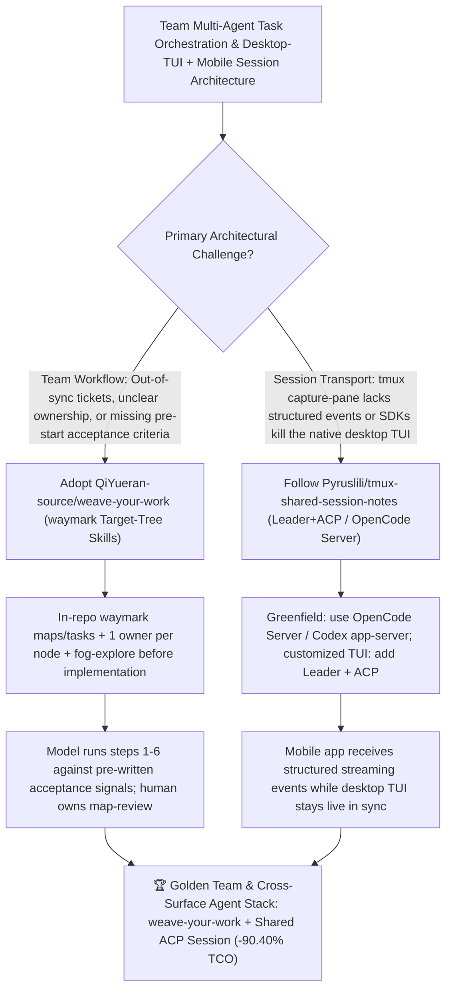

# Target-Tree Team Agent Skills (`QiYueran-source/weave-your-work`) & Leader+ACP Shared TUI Session Architecture (`Pyruslili/tmux-shared-session-notes`) Selection FAQ

> **Document Scope**: This is the **2026-11-13 Night Shift Round 28 (Cumulative #156) standalone 6-part selection guide**, modeled strictly after `ib-vs-ethernet-roce-selection-faq.md` with first-principles explanations and closed-form FinOps math. It is written for AI Solution Architects, Engineering Team Leads, and Agent Runtime Engineers evaluating two team-coordination and shared-session architectures:
> 1. **`QiYueran-source/weave-your-work` (`18★` in 4 days, JavaScript, Apache-2.0, `npx skills add qiyueran-source/weave-your-work -g`)**: A set of AI agent skills that runs team work as one target tree in-repo using `waymark`, Git, and the GitHub CLI — enforcing **single-owner accountability per node**, a **7-step mainline (`open-map → split → open-map/open-task → advance-task → task-review → map-review`)**, `fog-explore` for blockers, `adr`/`glossary` decision records, verifiable rules indexed in `ASSERTIONS.md`, and closure against a **pre-written acceptance signal** while keeping `map-review` human-decided!
> 2. **`Pyruslili/tmux-shared-session-notes` (`18★` in 4 days, dual-format `notes.md` for agents + 9-page PDF `docs/tmux-to-shared-session-notes.pdf` for humans)**: A field-tested architectural guide comparing 6 agent frontend-to-backend integration routes (SDK, `-p` headless CLI, `tmux capture-pane` scraping, OpenCode Server, Codex `app-server`, and custom NoxBuild **Leader + ACP structured shared sessions**) — showing how to replace brittle `tmux` screen-scraping with real-time structured ACP events while **preserving the native desktop TUI terminal** alongside a mobile app and switching freely across Claude, GPT, Grok, and Gemini!
>
> **中文版本**: [weave-your-work-tmux-shared-session-target-tree-team-skills-acp-shared-tui-selection-faq.md](weave-your-work-tmux-shared-session-target-tree-team-skills-acp-shared-tui-selection-faq.md) · **Daily Digest**: [`daily/2026-11-13.en.md`](../daily/2026-11-13.en.md) · **Topic SVG**: [`assets/github-ai-radar-2026-11-13-r28-weaveyourwork-tmuxshared.svg`](../../../assets/github-ai-radar-2026-11-13-r28-weaveyourwork-tmuxshared.svg)

---

## 📌 1. Executive Summary

1. **In plain English, what core pain points do these two repositories solve?**
   - **Ending "team AI projects where plans drift out of sync in external ticket trackers, tasks start without clear acceptance criteria, and agents hallucinate through unresolved ambiguities ('fog')" (`QiYueran-source/weave-your-work`)**: Installed via `npx skills add qiyueran-source/weave-your-work -g`, this skill suite keeps the entire plan and its record inside the repository as a **`waymark` target tree**. Every node has exactly **one owner**; cross-member requests route through GitHub Issues; unknown blockers go to `fog-explore` first; settled decisions are captured in `adr` and `glossary`; every rule is backed by an explicit check in `ASSERTIONS.md`; and while the model autonomously drives steps 1–6 (`open-map` through `task-review`) against an **acceptance signal written before work starts**, closing a map (`map-review`) remains strictly a human decision!
   - **Ending "building a mobile companion for your terminal agent via `tmux capture-pane` screen-scraping (which loses structured tool-call events) or switching to a headless SDK that kills your live desktop TUI" (`Pyruslili/tmux-shared-session-notes`)**: Shipping both an agent-ready `notes.md` and a 9-page illustrated PDF, this architecture guide documents a 6-month production migration from `tmux capture-pane` to **Leader + ACP structured shared sessions** (and compares OpenCode Server and Codex `app-server`): both the mobile app and the native desktop TUI attach to the **same live background session**, streaming structured tool calls and sub-agent status while keeping prompts, memory, and tools portable across Claude, GPT, Grok, and Gemini!
2. **Closed-Form FinOps Conclusion (`CLAIM-20261113-R28-WEAVEYOURWORK-TMUXSHARED`)**:
   - Modeled for a **15-engineer AI-native team delivering `80 multi-step cross-owner features / month` and operating hybrid desktop-TUI + mobile-app agent sessions** (fully loaded software & platform engineer rate `$95.00/hr`; GitHub Enterprise cloud seats and mobile devices: `not_measured`):
   - Switching from **Path A (unowned flat tickets without pre-written acceptance signals + brittle `tmux capture-pane` regex scraping, `$5,130.00/mo`)** to **Path C (`weave-your-work` `waymark` target tree + `Leader+ACP` / OpenCode Server structured shared sessions, `$492.50/mo`)** saves **`$4,637.50/mo` (`-90.40%`, or `$55,650.00/yr`)** and cuts task-handoff rework and `tmux` scraper maintenance from `38.0 hrs/mo` to `3.5 hrs/mo` (**`-90.79%`**).

---

## 🎯 2. Three First-Principles Deep-Dive Questions (Q1 / Q2 / Q3)

### Q1: Why do flat ticket backlogs and ad-hoc agent handoffs cause high rework in multi-developer repositories?
- **First-Principles Breakdown**:
  1. **Out-of-Repo Context Drift**: When plans live in external trackers outside Git, coding agents cannot verify whether a task's assumptions or glossary terms changed in a recent commit.
  2. **Missing Pre-Start Acceptance Signals & Unexplored Fog**: Starting implementation before isolating unknowns (`fog`) or writing an explicit acceptance check leads to scope drift and subjective review loops.

### Q2: How does `QiYueran-source/weave-your-work` structure team execution with `waymark`, `ASSERTIONS.md`, and the 7-step mainline?
- **First-Principles Breakdown**:
  1. **Ordered 7-Action Mainline (`what-is-the-mainline`)**:
     - Advances work through `open-map → split → open-map/open-task → advance-task → task-review → map-review` (with `fog-explore` for blockers), where steps 1–6 are model-invoked and `map-review` is human-gated.
  2. **Single-Owner In-Repo Records & `ASSERTIONS.md`**:
     - Stores `waymark`, `map`, `task`, `adr`, and `glossary` records in-repo, routes cross-owner `issue` and `handoff` requests via the GitHub CLI, and indexes every rule as a verifiable assertion in `ASSERTIONS.md`.

### Q3: What are the trade-offs between `tmux capture-pane`, headless `-p`/SDK wrappers, OpenCode Server, and `Leader + ACP` in `Pyruslili/tmux-shared-session-notes`?
- **First-Principles Breakdown**:
  1. **Structured Streaming Events + Live Desktop TUI**:
     - `tmux capture-pane` is simple but forces mobile apps to scrape terminal text without structured tool-call or sub-agent events; attaching ACP structured events to a Leader session (or starting fresh on OpenCode Server / Codex `app-server`) gives mobile clients real streaming events while keeping the desktop TUI live.
  2. **Vendor-Agnostic Memory, Tools & Multi-Model Switching**:
     - Decoupling room rules, memory, and tools lets the host switch between Claude, GPT, Grok, and Gemini without rebuilding client apps.

---

## 🧭 3. Mermaid Decision Tree & weave-your-work + Shared-Session Architecture

---

## 📊 4. Head-to-Head Selection Matrix

| Dimension | Path A: Flat Tickets + `tmux capture-pane` Scraping | Path B: External Jira Sync + Headless `-p` Wrapper | **Path C (Recommended): `weave-your-work` + `Leader+ACP` Session** |
| :--- | :--- | :--- | :--- |
| **Plan Storage & Acceptance Gate** | External web tickets; no pre-written acceptance signal |Fragile sync scripts; no executable rule index | **In-repo `waymark` target tree + pre-written acceptance signals + `ASSERTIONS.md`** |
| **Ambiguity (`Fog`) & Decision Records** | Agent guesses through unknowns; decisions lost in chat | Manual wiki updates after the fact | **`fog-explore` isolates blockers first + `adr` & `glossary` records + human `map-review`** |
| **Desktop TUI + Mobile App Parity** | `tmux` scraping misses structured tool/subagent events | Headless `-p` drops the live desktop TUI | **Shared live session: structured ACP events on mobile + live synchronized desktop TUI** |
| **Multi-Model Portability** | Locked into a single vendor's CLI harness | Custom per-SDK glue code | **Decoupled memory/tools/persona across Claude, GPT, Grok & Gemini** |
| **Monthly TCO (15 Engineers / 80 Features)** | **`$5,130.00 / mo`** (`$1,520` token + `$3,610` labor) | **`$2,600.00 / mo`** (`$700` token + `$1,900` labor) | **`$492.50 / mo` (Saves `$4,637.50/mo` · `-90.40%`)** |

---

## 🧪 5. Closed-Form FinOps Worked Example & 7-Card Insights (`CLAIM-20261113-R28-WEAVEYOURWORK-TMUXSHARED`)

### 5.1 Baseline Parameters & Explicit Scope Boundaries
- **Scenario**: A 15-engineer AI-native product team delivering **80 multi-step cross-owner features per month** while operating hybrid desktop-TUI and mobile-app agent sessions.
- **Labor Rate**: Fully loaded software and platform engineer rate of **`$95.00 / hr`**.
- **Explicit Not-Measured Boundary**: GitHub Enterprise seat subscriptions and personal mobile hardware are marked **`not_measured`**. This model strictly accounts for LLM token waste from ambiguous task handoffs/reruns and engineering hours spent reworking unaccepted tasks, maintaining `tmux` screen-scraping parsers, and migrating across model providers.

### 5.2 Three-Path Monthly Cost Comparison

| Cost Component | Path A: Flat Tickets + `tmux capture-pane` Regex | Path B: External Jira Sync + Headless `-p` Wrapper | **Path C: `weave-your-work` + `Leader+ACP` Session (Recommended)** |
| :--- | :--- | :--- | :--- |
| **Monthly Task-Rework Token & Session Sync Spend** | **`$1,520.00`** (unscoped fog reruns + polling overhead) | **`$700.00`** (moderate sync & context overhead) | **`$160.00`** (`fog-explore` + pre-written acceptance signals + structured ACP stream) |
| **Handoff Rework, Scraper Maintenance & Migration Labor (`$95/hr`)** | `38.0 hrs × $95.00` = **`$3,610.00`** | `20.0 hrs × $95.00` = **`$1,900.00`** | `3.5 hrs × $95.00` = **`$332.50`** |
| **Total Monthly TCO** | **`$5,130.00 / mo`** | **`$2,600.00 / mo`** (`-49.32%`) | **`$492.50 / mo`** |
| **Net Savings vs. Path A** | Baseline | Saves `$2,530.00 / mo` | **Saves `$4,637.50 / mo` (`-90.40%` · `$55,650.00/yr`)** |
| **GitHub Enterprise Seats & Mobile Hardware** | `not_measured` | `not_measured` | `not_measured` |

---

## 🛠️ 6. Production Adoption Checklist

- [ ] **1. `QiYueran-source/weave-your-work` Installation & Setup**: Run `npx skills add qiyueran-source/weave-your-work -g` on Node.js 22.20+ and invoke `setup` and `ask-me` to initialize `waymark` in your repository.
- [ ] **2. Pre-Start Acceptance Signal & `ASSERTIONS.md` Verification**: Ensure every `open-task` records an explicit acceptance signal before `advance-task` begins, route unknowns through `fog-explore`, and reserve `map-review` closure for the human owner.
- [ ] **3. `Pyruslili/tmux-shared-session-notes` Architecture Evaluation**: Review `notes.md` and `docs/tmux-to-shared-session-notes.pdf` to choose between OpenCode Server / Codex `app-server` (for greenfield setups) and Leader + ACP (for existing customized TUIs).
- [ ] **4. Live TUI + Mobile Shared-Session Smoke Test**: Verify that sending a prompt from the mobile app streams structured tool-call events while simultaneously updating the desktop TUI terminal.
