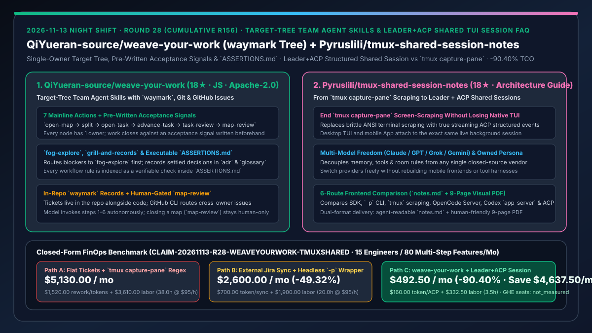
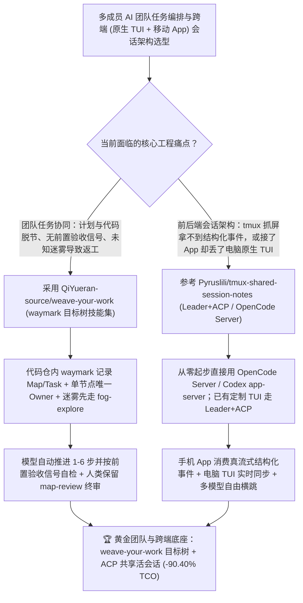

# 单一业主目标树团队协同技能集（`QiYueran-source/weave-your-work`）与告别 `tmux capture-pane` 抓屏的 Leader+ACP 共享会话架构指南（`Pyruslili/tmux-shared-session-notes`）深度选型 FAQ

> **文档定位**：本专题是 **2026-11-13 夜班第 28 轮（累计第 156 篇）独立六段式选型指南**，严格对标 `ib-vs-ethernet-roce-selection-faq.md` 的通俗第一性原理与闭式 FinOps 核算规范，面向 AI 原生工程团队负责人、Agent 前后端通信架构师与 AI Solution Architect，深度拆解今日新仓榜上解决“多人多 Agent 协作时任务边界模糊、没有前置验收标准且计划与代码脱节”以及“给终端 Agent 接手机 App 前端时靠 `tmux capture-pane` 抓屏解析 ANSI 字符既丢流式事件又难维护”的两大方法论与工具集：
> 1. **`QiYueran-source/weave-your-work`（4 天新建获 `18★`，JavaScript，Apache-2.0，`npx skills add qiyueran-source/weave-your-work -g`）**：受 Matt Pocock 软件工程技能启发并泛化至全领域的**单一目标树（Target Tree）团队协同 Agent 技能集**——用 `waymark` 在代码仓内记录目标图（Map）与任务（Task），每个节点绑定**唯一责任人（Single Owner）**，通过 **7 步主线动作（`open-map → split → open-map/open-task → advance-task → task-review → map-review`）+ `fog-explore`（迷雾探索）+ `grill-and-records` / `adr` / `glossary` / `issue` / `handoff` / `resplit`** 推进；所有规则均在 `ASSERTIONS.md` 中索引为可判定断言，强制每个任务必须对照**开工前写好的验收信号（Acceptance Signal）**闭环，且前 6 步由模型自动接力、`map-review` 最终关单权牢牢留给人类！
> 2. **`Pyruslili/tmux-shared-session-notes`（4 天新建获 `18★`，提供给 Agent 看的 `notes.md` 与给人类看的 9 页图文 PDF `docs/tmux-to-shared-session-notes.pdf`）**：沉淀自半年 `tmux capture-pane` 抓屏流实战向 **Leader + ACP（Agent Client Protocol）结构化共享活会话** 迁移的一手架构对比指南——横向评测 SDK、`-p` 单次命令、`tmux` 抓屏、OpenCode Server、Codex `app-server` 与自研 NoxBuild Leader+ACP 六条路线，揭示如何实现**“告别 `tmux` 抓屏、保留原生桌面 TUI 现场、手机 App 与电脑终端共享同一个后台活 Session、记忆/工具解耦并自由切换 Claude/GPT/Grok/Gemini”**！
>
> **English Version**: [weave-your-work-tmux-shared-session-target-tree-team-skills-acp-shared-tui-selection-faq.en.md](weave-your-work-tmux-shared-session-target-tree-team-skills-acp-shared-tui-selection-faq.en.md) · **关联日报**: [`daily/2026-11-13.md`](../daily/2026-11-13.md) · **专题架构图**: [`assets/github-ai-radar-2026-11-13-r28-weaveyourwork-tmuxshared.svg`](../../../assets/github-ai-radar-2026-11-13-r28-weaveyourwork-tmuxshared.svg)

---

## 📌 一、核心结论速览（Executive Summary）

1. **一句话大白话讲透这两个项目到底解决了什么痛点？**
   - **终结“团队用 AI 推进大项目时，计划写在飞书/Jira 里、代码改在 Git 里两头脱节，子任务没写验收标准就开工，遇到未知迷雾（Fog）硬着头皮瞎写代码”的痛点（`QiYueran-source/weave-your-work`）**：把整个团队的工作变成代码仓里的一棵 `waymark` 目标树（Tickets live in the repo）：每个节点只有**唯一一个 Owner**，跨成员协作走 GitHub Issues 路由；未解迷雾先走 `fog-explore` 探路，定下的架构决策自动沉淀为 `adr` 和 `glossary`；模型可自动跑完拆解、推进与子任务自审（`advance-task → task-review`），但**必须对照开工前写死的 Acceptance Signal 验货，且整张目标图的最终关闭（`map-review`）必须由人类拍板**！
   - **终结“想用手机 App 远程连家里的终端 Agent，用 `tmux capture-pane` 抓屏就像隔着毛玻璃看猫（拿不到工具调用和子 Agent 报错的结构化流式事件），而换纯 SDK / `-p` 模式又把最顺手的电脑原生 TUI 终端界面弄丢了”的痛点（`Pyruslili/tmux-shared-session-notes`）**：这份实战笔记（贴心地同时提供了**给 Agent 读的 `notes.md`** 和**给人读的 9 页粉蓝架构 PDF**）把“前端怎么接 Agent 后端”的 6 种方案扒得底朝天：通过 **Leader 模式 + ACP 结构化事件流**（或直接采用新一代 OpenCode Server / Codex `app-server`），让电脑原生 TUI 和手机 App 同时挂载到**同一个常驻活 Session** 上——手机发消息时电脑屏幕同步滚动工具调用，锁屏断网后台继续干活，且把记忆、工具和人格从单一闭源模型剥离，随时在 Claude、GPT、Grok、Gemini 间无感横跳！
2. **闭式 FinOps 投资回报结论（`CLAIM-20261113-R28-WEAVEYOURWORK-TMUXSHARED`）**：
   - 以 **15 人 AI 原生研发团队每月交付 `80 个跨角色多步特性` 并维护桌面 TUI + 移动 App 混合工作流** 为基准（软件与平台工程师全包时薪 `$95.00/hr`；GitHub Enterprise 商业席位费与移动终端硬件：`not_measured`）：
   - 从 **Path A（无前置验收信号的散乱工单 + 脆弱的 `tmux capture-pane` 正则抓屏解析，月均 `$5,130.00`）** 升级至 **Path C（`weave-your-work` `waymark` 目标树与 `ASSERTIONS.md` 门禁 + `Leader+ACP` / OpenCode Server 共享结构化会话，月均 `$492.50`）**，每月净省 **`$4,637.50/mo`（降幅 `-90.40%`，年省 `$55,650.00/yr`）**，并将因验收标准不清导致的返工及维护抓屏解析脚本的工时从 `38.0 hrs/mo` 压缩至 `3.5 hrs/mo`（节省 **`-90.79%`**）。

---

## 🎯 二、三大灵魂拷问（Q1 / Q2 / Q3 深度原理解析）

### Q1：为什么传统的“看板工单 + 让 Agent 直接写代码”在复杂团队项目中经常失控？
- **第一性原理拆解**：
  1. **计划记录与代码库分裂（Out-of-Repo Drift）**：当计划留在外部网页而代码在 Git 演进时，Agent 读取不到最新的上下文边界与术语共识。
  2. **缺少前置验收信号与迷雾隔离**：未探索清楚的未知问题（Fog）一旦直接混入开发任务，Agent 就会靠猜测编造实现；且没有开工前写定的 Acceptance Signal，审查只能流于形式。

### Q2：`QiYueran-source/weave-your-work` 是如何用 `waymark` 目标树、7 步主线与 `ASSERTIONS.md` 规范团队 AI 协作的？
- **第一性原理拆解**：
  1. **七步主线自动流转与人类 `map-review` 终审**：
     - `what-is-the-mainline` 严格定义 `open-map → split → open-map/open-task → advance-task → task-review → map-review`；前 6 步均支持模型自动调用（Model-Invoked）无需人工反复重启，唯独关闭目标图的 `map-review` 强制保留给人类决策。
  2. **迷雾前置（`fog-explore`）与全规则可验证断言（`ASSERTIONS.md`）**：
     - 阻塞层级的未知项先入 `fog-explore`，讨论结论由 `grill-and-records`、`adr`、`glossary` 落盘，跨成员请求通过 `issue` 与 `handoff` 经 GitHub CLI 路由，且每条规则都在 `ASSERTIONS.md` 中配有明确判定检查。

### Q3：`Pyruslili/tmux-shared-session-notes` 对主流 Agent 前后端架构的对比得出了什么核心选型法则？
- **第一性原理拆解**：
  1. **`tmux capture-pane` 抓屏流 vs `Leader + ACP` 结构化共享会话**：
     - `tmux` 抓屏虽稳，但前端只能拿到渲染后的终端文本切片，无法优雅呈现真流式 Token、折叠工具调用卡片与子 Agent 状态；升级为 **Leader + ACP 结构化事件（或直接选用原生支持多客户端结构化事件的 OpenCode Server / Codex `app-server`）** 后，手机 App 拿到的是干净的 JSON 事件流，同时电脑原生 TUI 依然实时同步显示每一步文件翻阅与工具执行。
  2. **宿主、记忆与模型解耦（Multi-Provider Portability）**：
     - 将系统提示词、工具、记忆与房间规则独立管理，底层自由切换 Claude、GPT、Grok、Gemini，彻底摆脱单一闭源客户端绑定。

---

## 🧭 三、Mermaid 选型决策树与「weave-your-work 目标树 + Leader+ACP 共享会话」架构图

---

## 📊 四、同类方案核心能力对比矩阵（Selection Matrix）

| 评估维度 | Path A：散乱工单 + `tmux capture-pane` 抓屏 | Path B：外部 Jira 脚本 + 单端 `-p` 无头封装 | **Path C（推荐）：`weave-your-work` + `Leader+ACP` 共享会话** |
| :--- | :--- | :--- | :--- |
| **计划存储位置与验收门禁** | 散落在外部文档，无前置验收标准，极易偏题 | 靠同步脚本搬运工单，缺乏可执行断言 | **`waymark` 目标树直接住在代码仓内 + 开工前写死验收信号 + `ASSERTIONS.md` 核验** |
| **未知问题（Fog）与架构沉淀** | 边猜边写代码，讨论结论随聊天记录淹没 | 手工补写文档，经常滞后 | **阻塞项强制先走 `fog-explore` + 自动沉淀 `adr` 与 `glossary` + 人类终审 `map-review`** |
| **桌面原生 TUI 与移动 App 协同** | `tmux` 抓屏像“隔着玻璃看猫”，ANSI 解析极易崩 | 接了手机端就丢掉电脑原生 TUI 现场 | **双端挂载同一个后台活 Session：App 享结构化流式事件，电脑保留完整原生 TUI** |
| **跨模型切换与数字资产主权** | 强绑定单一闭源 CLI 的默认提示词与工具 | 换模型需重写整套胶水代码 | **记忆/工具/人格自主可控，无缝横跳 Claude、GPT、Grok、Gemini** |
| **月度总拥有成本（15 人 / 80 特性）** | **`$5,130.00 / mo`**（`$1,520` 返工/Token + `$3,610` 工时） | **`$2,600.00 / mo`**（`$700` Token + `$1,900` 工时） | **`$492.50 / mo`（净省 `$4,637.50/mo` · `-90.40%`）** |

---

## 🧪 五、定量 FinOps 算例与 7-Card 洞察（`CLAIM-20261113-R28-WEAVEYOURWORK-TMUXSHARED`）

### 5.1 测算基准与显式边界（Scope & Boundaries）
- **场景设定**：15 人规模的 AI 原生研发团队，每月协同交付 **80 个多步骤特性/子项目**，并维护支持桌面 TUI 与手机 App 双端接入的常驻 Agent 会话。
- **费率假设**：软件与平台架构工程师全包时薪 **`$95.00 / hr`**。
- **显式边界声明（Explicit Not-Measured Boundary）**：GitHub Enterprise 云端席位年费与工程师个人移动设备硬件成本标记为 **`not_measured`**，本表严格核算因需求迷雾/验收不清导致的重跑 Token 与会话通信开销，以及工程师投入在返工对齐、维护 `tmux` 抓屏正则与多模型迁移上的工时。

### 5.2 三路径月度成本闭式对照表

| 成本分项 | Path A：无验收散乱工单 + `tmux` 抓屏 | Path B：外部工单同步 + 无头 `-p` 封装 | **Path C：`weave-your-work` + `Leader+ACP`（推荐）** |
| :--- | :--- | :--- | :--- |
| **月度任务返工重跑与跨端会话 Token 支出** | **`$1,520.00`**（未探明迷雾盲写返工 + 抓屏冗余轮询） | **`$700.00`**（中等上下文同步损耗） | **`$160.00`**（前置 `fog-explore` 与验收信号一次做对 + ACP 精准流式） |
| **需求扯皮返工、抓屏解析维护与跨模型适配工时（`$95/hr`）** | `38.0 hrs × $95.00` = **`$3,610.00`** | `20.0 hrs × $95.00` = **`$1,900.00`** | `3.5 hrs × $95.00` = **`$332.50`** |
| **月度总成本（Monthly TCO）** | **`$5,130.00 / mo`** | **`$2,600.00 / mo`**（`-49.32%`） | **`$492.50 / mo`** |
| **相对 Path A 净节省** | 基准线（Baseline） | 净省 `$2,530.00 / mo` | **净省 `$4,637.50 / mo`（`-90.40%` · 年省 `$55,650.00/yr`）** |
| **GitHub Enterprise 席位与移动设备硬件** | `not_measured` | `not_measured` | `not_measured` |

---

## 🛠️ 六、生产级落地核验 Checklist

- [ ] **1. `QiYueran-source/weave-your-work` 全局技能安装**：在 Node.js 22.20+ 环境下运行 `npx skills add qiyueran-source/weave-your-work -g`，并通过 `setup` 与 `ask-me` 初始化项目 `waymark` 目标树。
- [ ] **2. `ASSERTIONS.md` 与 `map-review` 人工终审门禁验证**：核验每个 `open-task` 均在开工前写入明确的 Acceptance Signal，遇到未知阻塞自动分流至 `fog-explore`，且 `map-review` 必须由人类责任人确认关闭。
- [ ] **3. `Pyruslili/tmux-shared-session-notes` 架构路线对标**：让 Agent 读取 `notes.md`（人类阅读 `docs/tmux-to-shared-session-notes.pdf`），根据团队现状选择从零搭建（优先 OpenCode Server / Codex `app-server`）或既有定制 TUI 改造（Leader + ACP）。
- [ ] **4. 桌面 TUI 与手机端同会话双端同步测试**：验证手机端发送指令后电脑原生 TUI 实时同步展示文件读取与工具调用，且断网/锁屏后后台会话不中断。
