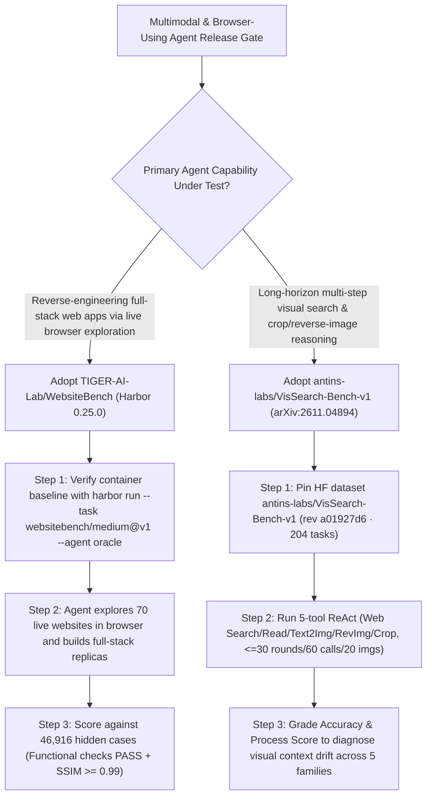

# Browser-Exploration Full-Stack Website Reconstruction (`TIGER-AI-Lab/WebsiteBench` 46,916 Hidden Cases) & Long-Horizon Visual Search (`antins-labs/VisSearch-Bench-v1`) Selection FAQ

> **Positioning**: This standalone guide is **Round 37 of the 2026-11-11 Night Shift (Cumulative Guide #82)**, written in the plain-language, first-principles, closed-form FinOps style of `ib-vs-ethernet-roce-selection-faq.md` for Multimodal Web Agent Leads and Benchmark Architects evaluating two newly released evaluation suites:
> 1. **`TIGER-AI-Lab/WebsiteBench` (`235★`, Python / Harbor `0.25.0`, Apache-2.0)**: Moves web coding evaluation beyond static single-screenshot HTML cloning by requiring agents to actively explore **70 production-level websites through a live browser** and reverse-engineer a full-stack replica scored against **46,916 hidden test cases (`302–2,016` cases per site)**, where each case passes only if all functional checks succeed **and** every visual checkpoint reaches a normalized **`SSIM >= 0.99`**;
> 2. **`antins-labs/VisSearch-Bench-v1` (`108★`, Python, `arXiv:2611.04894`, Tsinghua University + Ant Group + Renmin University of China)**: Evaluates **long-horizon visual context management** across **204 human-written tasks**, **5 visual search families** (`Set-wise` 68, `Sequential` 34, `Hybrid Wide–Deep` 34, `Competitive Disambiguation` 34, `Visual-Structure-Guided` 34), and **7 primary / 25 secondary domains** (`17.6` mean / `61` max reference steps), pairing a 5-tool ReAct loop (`<=30` rounds, `<=60` calls, `<=20` images including crops) with dual **`Accuracy`** and **`Process Score`** rubrics where even SOTA `Kimi-K3 + ReAct` reaches only **`26.47%` Accuracy** and `GPT-5.5 + ReAct` reaches **`49.52%` Process Score** (vs. `6.37%` Direct Answer).
>
> **中文版 FAQ**: [websitebench-vissearch-bench-browser-exploration-visual-search-selection-faq.md](websitebench-vissearch-bench-browser-exploration-visual-search-selection-faq.md) · **Architecture Summary SVG**: [`assets/github-ai-radar-2026-11-11-r37-websitebench-vissearch.svg`](../../../assets/github-ai-radar-2026-11-11-r37-websitebench-vissearch.svg)

---

## 📌 1. Executive Summary

1. **In plain English, what blind spots do these two benchmarks expose in current Multimodal & Coding Agents?**
   - **Beyond Single-Screenshot Static HTML Cloning (`TIGER-AI-Lab/WebsiteBench`)**: Traditional frontend benchmarks hand an agent one static screenshot and grade a single inert HTML page. In reality, production web apps hide their behavior behind multi-page routing, modals, form validations, and stateful interactions. `WebsiteBench` gives the agent a live website to explore via a browser and verifies the rebuilt full-stack app against **46,916 hidden test cases (`302–2,016` per site)** inside isolated Harbor containers—requiring both functional test passage and **`SSIM >= 0.99`** visual fidelity at every checkpoint.
   - **Beyond Single-Hop VQA to 17.6-Step Visual Context Management (`antins-labs/VisSearch-Bench-v1`)**: Multimodal LLMs excel at single-image QA, but collapse when a search spans 17–61 steps requiring image cropping, reverse image search, tracking 10+ candidate entities simultaneously, and following spatial diagrams. Across 16 backbones and 26 configurations on 204 tasks, Direct Answer tops out at **`6.37%`** (`GPT-5.5` / `Gemini 3.5 Flash`), while 5-tool ReAct lifts `Kimi-K3` to **`26.47%` Accuracy** and `GPT-5.5` to **`49.52%` Process Score**—pinpointing the massive drop-off between finding partial visual clues (`49.52%`) and keeping object-evidence bindings intact through final synthesis (`25.49%–26.47%`).
2. **Closed-Form FinOps Verdict (`CLAIM-20261111-R37-WEBSITEBENCH-VISSEARCH`)**:
   - For a 10-person Multimodal & Web Agent Engineering Team evaluating **20 candidate model/agent releases per month** across full-stack web reconstruction and long-horizon visual search regressions (senior evaluation engineer loaded rate `$90.00/hr`; enterprise commercial SERP annual contracts and residential proxy pool fees: `not_measured`):
   - Upgrading from **Path A (Manual Playwright test authoring & visual eyeballing + ad-hoc multi-hop image search grading, `$5,680.00/mo`)** to **Path C (`WebsiteBench` Harbor `46,916`-case `SSIM >= 0.99` verifier + `VisSearch-Bench-v1` 5-family dual-rubric harness, `$700.00/mo`)** saves **`$4,980.00/mo` (`-87.68%`, `$59,760.00/yr`)** and cuts manual evaluation maintenance and trajectory auditing labor from `46.0 hrs/mo` to `5.0 hrs/mo` (**`-89.13%`**).

---

## 🎯 2. Three Core Architectural Questions (Q1 / Q2 / Q3 Deep-Dive)

### Q1: How does `TIGER-AI-Lab/WebsiteBench` verify full-stack website reconstructions across 46,916 hidden cases?
- **First-Principles Breakdown**:
  1. **Interactive Browser Exploration**:
     - Instead of reading source code or a static PNG, the agent interacts with a live reference website through a browser to discover routes, interactive widgets, form behaviors, and dynamic state transitions.
  2. **302 to 2,016 Hidden Cases per Site & `SSIM >= 0.99` Visual Gate**:
     - Across 70 websites (`46,916` total hidden cases), a test case passes if and only if its functional assertions pass **and** every visual checkpoint reaches a normalized **`SSIM >= 0.99`**. The task reward (`jobs/<job>/<trial>/verifier/reward.txt`) is the fraction of passing cases, verified against a built-in `--agent oracle` reference solution.
  3. **Harbor `0.25.0` Host Allowlisting & `harbor-canary` Anti-Contamination**:
     - Executes reproducibly via `harbor run --dataset websitebench/WebsiteBench@v1` with explicit `--allow-environment-host` rules and embeds a `harbor-canary` GUID in task definitions to keep evaluation tasks out of pretraining corpora.

### Q2: What are the 5 search families in `antins-labs/VisSearch-Bench-v1` (`arXiv:2611.04894`), and why is there a >20-point gap between `Process Score` and `Accuracy`?
- **First-Principles Breakdown**:
  1. **Five Visual Search Families Across 204 Tasks (`187` Image-Initiated + `17` Text-Initiated)**:
     - **Set-wise Visual Search (68 tasks)**: Inspect every object in a bounded set, preserve object–evidence links without cross-contamination, and aggregate results;
     - **Sequential Visual Search (34 tasks)**: Carry a visual clue or identified entity from step $t$ into step $t+1$;
     - **Hybrid Wide–Deep Search (34 tasks)**: Alternate between broad candidate screening and multi-hop deep verification;
     - **Competitive Visual Disambiguation (34 tasks)**: Separate look-alike candidates using fine-grained local crops and primary source records;
     - **Visual-Structure-Guided Search (34 tasks)**: Use spatial layout, ordering, or diagram edges inside an image to control the search route and stopping criterion.
  2. **5-Tool ReAct Budget (`30` Rounds / `60` Calls / `20` Images) & The `PS` vs. `Acc` Gap**:
     - Equipped with web search, webpage reading, text-to-image search, reverse image search, and image cropping, `GPT-5.5 + ReAct` achieves **`49.52%` Process Score** (`25.49%` Accuracy) while `Kimi-K3 + ReAct` achieves **`26.47%` Accuracy** (`38.57%` Process Score). Agents successfully retrieve intermediate visual evidence (`~50%` of subgoals), but lose object-identity bindings once 15–20 cropped and retrieved images accumulate in context.

### Q3: How should AI Solution Architects combine `WebsiteBench` and `VisSearch-Bench-v1` in CI/CD release gates?
- **Evaluation Blueprint**:
  - Gate **browser-using full-stack coding agents** on **`WebsiteBench`** (requiring zero regression on functional + `SSIM >= 0.99` pass rates).
  - Gate **multimodal research and visual discovery agents** on **`VisSearch-Bench-v1`** (tracking both `Accuracy` and `Process Score` to separate retrieval tool failures from visual memory/synthesis failures).

---

## 🧭 3. Mermaid Decision Tree & Dual-Benchmark Pipeline

---

## 📊 4. Architectural Comparison Matrix

| Evaluation Dimension | Path A: Manual Playwright QA + Single-Hop VQA | Path B: Single-Screen HTML Clone + Text DeepResearch | **Path C (Recommended): `WebsiteBench` + `VisSearch-Bench-v1`** |
| :--- | :--- | :--- | :--- |
| **Web Reconstruction Depth & Scale** | Manual spot-checks on a few pages; brittle selectors | Single static PNG-to-HTML; ignores routing, forms & state | **Live browser exploration across 70 sites + 46,916 hidden `SSIM >= 0.99` cases** |
| **Long-Horizon Visual Context Stress** | 1-step VQA; never tests multi-crop reverse image chains | Text-only multi-hop search; blind to visual disambiguation | **204 tasks across 5 visual search families (`17.6` mean / `61` max steps)** |
| **Failure Attribution Granularity** | Binary pass/fail with slow manual trajectory review | Counts tool calls without step-level evidence grading | **Task-specific `accuracy_prompt` + `Process Score` rubrics isolate synthesis drop-off** |
| **Reproducibility & Leakage Hygiene** | Public URLs drift; high pretraining memorization risk | Unpinned local browsers cause font/SSIM drift | **Harbor Docker host allowlist + `harbor-canary` GUID + pinned HF revision** |
| **Monthly TCO (20 Eval Releases/Mo)** | **`$5,680.00 / mo`** (`$1,540` reruns + `$4,140` labor) | **`$2,920.00 / mo`** (`$760` compute + `$2,160` labor) | **`$700.00 / mo` (Saves `$4,980.00/mo` · `-87.68%`)** |

---

## 🧪 5. Closed-Form FinOps Example & 7-Card Insights (`CLAIM-20261111-R37-WEBSITEBENCH-VISSEARCH`)

### 5.1 Workload & Scope Boundary
- **Workload**: A 10-person Multimodal & Web Agent Team evaluating **20 candidate agent/model releases per month**.
- **Rates**: Senior evaluation & multimodal systems engineer loaded rate at **`$90.00 / hr`**.
- **Explicit Scope Boundary**: Enterprise commercial SERP annual contracts and external residential proxy pool subscriptions are marked **`not_measured`**.

### 5.2 Closed-Form Monthly Cost Breakdown

| Cost Component | Path A: Manual UI QA + Single-Hop VQA Scripts | Path B: Single-Screen HTML + Text-Only Search | **Path C: `WebsiteBench` + `VisSearch-Bench-v1` (Recommended)** |
| :--- | :--- | :--- | :--- |
| **Container Rerun Waste & Judge API Spend** | **`$1,540.00`** | **`$760.00`** | **`$250.00`** (Deterministic Harbor verifier + `--resume` JSONL cache) |
| **Test Authoring, Diff Review & Trajectory Audit (`$90/hr`)** | `46.0 hrs × $90.00` = **`$4,140.00`** | `24.0 hrs × $90.00` = **`$2,160.00`** | `5.0 hrs × $90.00` = **`$450.00`** |
| **Total Monthly TCO** | **`$5,680.00 / mo`** | **`$2,920.00 / mo`** (`-48.59%`) | **`$700.00 / mo`** |
| **Net Savings vs. Path A** | Baseline | Saves `$2,760.00 / mo` | **Saves `$4,980.00 / mo` (`-87.68%` · `$59,760.00/yr`)** |
| **Enterprise SERP Contracts & Proxy Pools** | `not_measured` | `not_measured` | `not_measured` |

---

## 🛠️ 6. Production Verification Checklist

- [ ] **1. `WebsiteBench` Oracle Verifier Sanity Check**: Install `pip install websitebench` and `uv tool install harbor==0.25.0`, then run `harbor run --task websitebench/medium@v1 --agent oracle` to confirm `verifier/reward.txt` scores `1.0` (`SSIM >= 0.99`).
- [ ] **2. Harbor Host Allowlist & `harbor-canary` Exclusion**: Pass explicit `--allow-environment-host` flags during `harbor run` and filter documents containing the `harbor-canary` GUID from all internal training datasets.
- [ ] **3. Pin `VisSearch-Bench-v1` Revision & Run `--dry-run`**: Load `antins-labs/VisSearch-Bench-v1` at `revision="a01927d6a0aa03552b607fd1f8b55558b2a84834"` and run `python -m vissearch_bench.inference --method direct --config configs/openai.json --limit 2 --dry-run`.
- [ ] **4. Enforce the 5-Tool ReAct Budget (`30` Rounds / `60` Calls / `20` Images)**: Keep the 5-tool ReAct limits uniform when comparing backbones so accuracy gains reflect visual context management rather than unbounded tool retries.
- [ ] **5. Track Dual `Accuracy` & `Process Score` Metrics**: Run `python -m vissearch_bench.evaluate` for both `--metric accuracy` and `--metric process` to pinpoint whether failures occur during visual evidence retrieval or multi-entity set aggregation.
