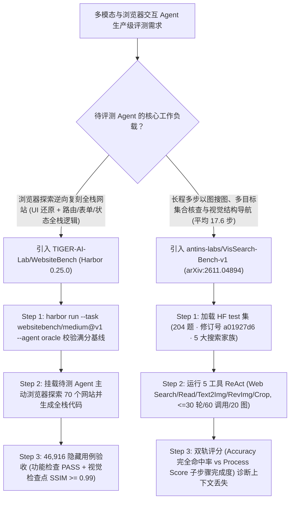

# 浏览器探索全栈网站重构基准（`TIGER-AI-Lab/WebsiteBench` 46,916 隐藏用例）与长程多步视觉检索评测（`antins-labs/VisSearch-Bench-v1`）深度选型 FAQ

> **文档定位**：本专题是 **2026-11-11 夜班第 37 轮（累计第 82 篇）独立六段式选型指南**，严格对标 `ib-vs-ethernet-roce-selection-faq.md` 的通俗第一性原理与闭式 FinOps 核算规范，面向多模态 Web Agent 研发负责人与基准评测架构师，深度拆解今日在真实交互式网站逆向工程与长程视觉上下文管理赛道爆发的两大新锐评测套件：
> 1. **`TIGER-AI-Lab/WebsiteBench`（`235★`，Python / Harbor `0.25.0`，Apache-2.0）**：滑铁卢大学 TIGER-AI-Lab 发布的**浏览器主动探索全栈网站重构基准**——彻底告别“给一张静态截图生成单页 HTML”的玩具评测，要求 Agent 在真实浏览器中主动点击探索 **70 个生产级全栈网站**，逆向复刻出外观与交互状态完全一致的全栈应用，并通过 **46,916 个隐藏测试用例（每站点 `302–2,016` 个用例，要求功能断言全过且全部视觉检查点归一化 `SSIM >= 0.99`）** 的严苛验收；
> 2. **`antins-labs/VisSearch-Bench-v1`（`108★`，Python，`arXiv:2611.04894`，清华大学 + 蚂蚁集团 + 中国人民大学）**：专门评测多模态 Agent **“在长达 17.6 步（最高 61 步）的搜索链条中能否管住自己看到的视觉证据”** 的长程视觉检索基准——涵盖 **5 大视觉搜索家族、7 大一级领域 / 25 个二级领域的 204 道人工精编任务**，配备五工具 ReAct 环路（网页搜索、网页阅读、以文搜图、以图搜图、图像局部裁剪 `crop`）与双轨评分（`Accuracy` + `Process Score`），实测 16 个主流多模态基座 26 种配置下，最强 `Kimi-K3 + ReAct` 完全准确率仅 **`26.47%`**、`GPT-5.5 + ReAct` 过程分 **`49.52%`**（无工具直答最高仅 **`6.37%`**）！
>
> **English Version**: [websitebench-vissearch-bench-browser-exploration-visual-search-selection-faq.en.md](websitebench-vissearch-bench-browser-exploration-visual-search-selection-faq.en.md) · **架构总结图**: [`assets/github-ai-radar-2026-11-11-r37-websitebench-vissearch.svg`](../../../assets/github-ai-radar-2026-11-11-r37-websitebench-vissearch.svg)

---

## 📌 一、核心结论速览（Executive Summary）

1. **一句话大白话讲透这两个基准到底戳破了当前多模态与 Coding Agent 的什么泡沫？**
   - **戳破“看单张截图写静态 HTML 就号称全栈前端 Agent”的泡沫（`TIGER-AI-Lab/WebsiteBench`）**：以前评测前端 Coding Agent（如 Design2Code），只给一张静态首页截图，Agent 写个死页面就能拿高分，但一点按钮、切路由、填表单或刷新状态就全崩。`WebsiteBench` 给 Agent 一个可交互的真实网站 URL，要求 Agent 自己开浏览器去点开弹窗、翻页、测试表单和后端状态，逆向写出完整全栈代码；验收时用 Harbor 容器跑 **46,916 个隐藏测试用例（每网站 `302–2,016` 个）**，只有当**交互功能检查通过且每个视觉检查点的归一化结构相似度 `SSIM >= 0.99`** 时才算过关！
   - **戳破“单图问答（VQA）刷榜高分、但多步以图搜图就丢线索”的泡沫（`antins-labs/VisSearch-Bench-v1`）**：多模态大模型单看一张图回答问题已经很强，但在真实调查任务中（平均 `17.6` 步、最长 `61` 步），Agent 需要先把原图局部 `crop` 下来去反向搜图、把认出的多个物体和外部网页事实一一对应保存、再顺着图里的空间箭头或拓扑关系继续搜。`VisSearch-Bench-v1` 用 **5 大视觉搜索家族（204 题）** 证明：不带工具的 Direct Answer 最高只有 **`6.37%`**（GPT-5.5 / Gemini 3.5 Flash），加上 5 工具 ReAct 后，`Kimi-K3` 拿下最高完全准确率 **`26.47%`**，`GPT-5.5` 拿下最高过程分 **`49.52%`**——揭示了“搜得到中间线索（49.52%）但管不住长上下文集合关联导致最终漏答（26.47%）”的核心瓶颈！
2. **闭式 FinOps 投资回报结论（`CLAIM-20261111-R37-WEBSITEBENCH-VISSEARCH`）**：
   - 以 10 人多模态与 Web Coding Agent 评测团队每月对 **20 个迭代候选模型版本** 执行全栈网站复刻与长程视觉检索回归测试为基准（高级评测与多模态系统工程师含税费率 `$90.00/hr`；企业级商业搜索引擎长期包年合同与住宅代理 IP 池月租：`not_measured`）：
   - 从 **Path A（手工编写 Playwright 用例 + 人工肉眼比对网页截图与多步以图搜图轨迹，月均 `$5,680.00`）** 升级至 **Path C（`WebsiteBench` Harbor `46,916` 隐藏用例 `SSIM >= 0.99` 自动验证器 + `VisSearch-Bench-v1` 5 家族双指标自动评测底座，月均 `$700.00`）**，每月净省 **`$4,980.00/mo`（降幅 `-87.68%`，年省 `$59,760.00/yr`）**，并将评测工程师维护测试脚本与人工打分的工时从 `46.0 hrs/mo` 压缩至 `5.0 hrs/mo`（节省 **`-89.13%`**）。

---

## 🎯 二、三大灵魂拷问（Q1 / Q2 / Q3 深度原理解析）

### Q1：`TIGER-AI-Lab/WebsiteBench` 是如何通过 Harbor 容器与 `SSIM >= 0.99` 双重门禁验收 70 个全栈网站的？
- **第一性原理拆解**：
  1. **主动浏览器探索（Browser Exploration）而非静态喂图**：
     - Agent 启动时面对的是运行在受控环境中的生产级参考网站，必须自主规划浏览器探索动作（点击导航、触发下拉框、提交搜索/表单、观察 DOM 与状态迁移），自行反推数据模型与前后端路由。
  2. **每站点 `302–2,016` 个隐藏测试用例与 `SSIM >= 0.99` 铁律**：
     - 全集 70 个网站共含 **46,916 个隐藏测试用例**。每个用例同时包含功能断言（Functional Checks）与视觉检查点（Visual Checkpoints）：只有当功能检查通过，且每一个视觉检查点渲染截图与参考站点的归一化结构相似度达到 **`SSIM >= 0.99`** 时，该用例才计为通过；任务最终得分 `verifier/reward.txt` 为通过用例占比（并提供 `--agent oracle` 满分基线自检）。
  3. **Harbor `0.25.0` 白名单网络隔离与 `harbor-canary` 防刷榜污染**：
     - 通过 `harbor run --dataset websitebench/WebsiteBench@v1` 显式限制容器仅能访问 `registry.npmjs.org`、`nodejs.org` 等受控构建源，并在所有任务定义中嵌入 `harbor-canary` GUID 防止被预训练语料抓取作弊。

### Q2：`antins-labs/VisSearch-Bench-v1`（`arXiv:2611.04894`）定义了哪 5 大视觉搜索家族？为什么 `GPT-5.5` 过程分高达 `49.52%` 但准确率只有 `25.49%`？
- **第一性原理拆解**：
  1. **直击视觉上下文管理（Visual Context Management）的 5 大搜索家族**：
     - **Set-wise Visual Search（集合级视觉检索，68 题）**：必须逐一核查集合中的所有目标物体，保持“物体—视觉证据—外部事实”不串台并汇总结果；
     - **Sequential Visual Search（链式顺序检索，34 题）**：将上一步识图得到的实体身份或局部视觉线索传递为下一步搜索的查询锚点；
     - **Hybrid Wide–Deep Search（广度—深度混合检索，34 题）**：在广泛候选集筛查与多跳深度下钻之间交替切换；
     - **Competitive Visual Disambiguation（相似候选视觉消歧，34 题）**：依靠局部细微外观差异与来源记录区分高度相似的干扰项；
     - **Visual-Structure-Guided Search（视觉结构引导检索，34 题）**：根据图像内部的排列顺序、空间位置或连线拓扑决定搜索路径与终止条件。
  2. **五工具 ReAct 预算（30 轮 / 60 次调用 / 20 张图）与双指标剪刀差**：
     - 标准 ReAct 环路开放网页搜索、网页阅读、文搜图、反向图搜图与**图像局部裁剪（Image Cropping）**，单任务上限 30 轮搜索、60 次工具调用、上下文最多保留 20 张图（含初始图、检索图与裁剪子图）。
     - 实验揭示了惊人的剪刀差：`GPT-5.5 + ReAct` 的子问题过程分（`Process Score`）高达 **`49.52%`**（超越 `Kimi-K3` 的 `38.57%`），但完整任务准确率（`Accuracy`）为 **`25.49%`**（略低于 `Kimi-K3` 的 **`26.47%`**）；而用 `DeerFlow` 框架时，`GPT-5.5` 准确率为 `20.10%`——说明长程搜索后半段多图上下文拥挤导致的“实体张冠李戴与集合遗漏”是当前多模态 Agent 的头号杀手！

### Q3：AI 架构师如何用 `WebsiteBench` 与 `VisSearch-Bench-v1` 搭建企业多模态 Agent 的上线准入门禁？
- **黄金组合落地范式**：
  - 对**前端重构、UI 自动迁移与浏览器操作 Agent（Computer-Use / Coding Agent）**，接入 **`WebsiteBench`**（先用 `--agent oracle` 验证 Harbor 环境，再跑代表性站点子集验证功能通过率与 `SSIM >= 0.99` 达标率）；
  - 对**多模态深度研究（Multimodal DeepResearch）、电商同款溯源、工业巡检图纸核查 Agent**，接入 **`VisSearch-Bench-v1`**（固定 HF 数据集修订号 `a01927d6a0aa03552b607fd1f8b55558b2a84834`），同时监控 `Accuracy` 与 `Process Score` 的差值：若 `PS - Acc > 20 pts`，应优先优化 Agent 的**结构化视觉实体记忆表（Object-Evidence Ledger）与局部裁剪子图去重策略**，而非盲目更换更大基座！

---

## 🧭 三、Mermaid 选型决策树与双基准评测流水线

---

## 📊 四、同类基准核心能力对比矩阵（Selection Matrix）

| 评估维度 | Path A：人工肉眼看截图 + 单跳 VQA 测试集 | Path B：单屏静态 HTML 基准（如 Design2Code）+ 纯文本 DeepResearch | **Path C（推荐）：`WebsiteBench` + `VisSearch-Bench-v1`** |
| :--- | :--- | :--- | :--- |
| **前端重构交互深度与测试规模** | 人工抽查几个按钮，无隐藏边缘用例 | 仅测单张静态截图转 HTML，无多页路由、表单与后端状态 | **浏览器主动探索 70 站 + 46,916 隐藏功能与 `SSIM >= 0.99` 视觉门禁** |
| **长程视觉检索与多图上下文挑战** | 单图单步问答（VQA），无法暴露多步检索中的实体串台 | 纯文本多跳搜索，不测局部 `crop` 反向搜图与空间结构引导 | **204 题 5 大搜索家族（平均 17.6 步 / 最高 61 步）+ 5 工具 ReAct** |
| **过程诊断精度（为什么失败？）** | 只有最终对错，不知道是搜不到图还是最后汇总漏项 | 仅统计工具调用次数，无针对每个子实体的细粒度评分标准 | **每题专属 `accuracy_prompt` + `Process Score` 双评分精准定位汇总断层** |
| **防训练污染与容器可复现性** | 公开网页截图极易被大模型预训练记住 | 本地环境依赖混乱，不同机器渲染字体/布局漂移 | **Harbor 锁死镜像与网络白名单 + `harbor-canary` GUID 防语料污染** |
| **月度总拥有成本（20 版本评测/月）** | **`$5,680.00 / mo`**（`$1,540` 重跑 + `$4,140` 人工） | **`$2,920.00 / mo`**（`$760` 算力 + `$2,160` 人工） | **`$700.00 / mo`（净省 `$4,980.00/mo` · `-87.68%`）** |

---

## 🧪 五、定量 FinOps 算例与 7-Card 洞察（`CLAIM-20261111-R37-WEBSITEBENCH-VISSEARCH`）

### 5.1 测算基准与显式边界（Scope & Boundaries）
- **场景设定**：10 人多模态与 Web Agent 研发团队，每月对 **20 个模型/框架候选版本** 执行全栈网站复刻与长程视觉检索准入评测。
- **费率假设**：高级评测与多模态系统工程师全包时薪 **`$90.00 / hr`**。
- **显式边界声明（Explicit Not-Measured Boundary）**：企业级商业搜索引擎（Serper/SerpApi）年度大客户阶梯合同费与外部跨国住宅代理池月租标记为 **`not_measured`**，本表核算评测容器/Judge Token 开销与工程师编写/审计评测工时。

### 5.2 三路径月度成本闭式对照表

| 成本分项 | Path A：人工写 Playwright + 肉眼审多步图搜轨迹 | Path B：静态单屏 HTML 基准 + 纯文本搜索评测 | **Path C：`WebsiteBench` + `VisSearch-Bench-v1`（推荐）** |
| :--- | :--- | :--- | :--- |
| **评测容器重跑损耗与 Judge API 开销** | **`$1,540.00`**（环境漂移重跑 + 无断点续跑） | **`$760.00`** | **`$250.00`**（Harbor 确定性容器 + `--resume` 断点续评） |
| **编写交互断言、视觉比对与长轨迹归因工时（`$90/hr`）** | `46.0 hrs × $90.00` = **`$4,140.00`** | `24.0 hrs × $90.00` = **`$2,160.00`** | `5.0 hrs × $90.00` = **`$450.00`** |
| **月度总成本（Monthly TCO）** | **`$5,680.00 / mo`** | **`$2,920.00 / mo`**（`-48.59%`） | **`$700.00 / mo`** |
| **相对 Path A 净节省** | 基准线（Baseline） | 净省 `$2,760.00 / mo` | **净省 `$4,980.00 / mo`（`-87.68%` · 年省 `$59,760.00/yr`）** |
| **商业 SERP 年度合同与代理 IP 池费用** | `not_measured` | `not_measured` | `not_measured` |

---

## 🛠️ 六、生产级落地核验 Checklist

- [ ] **1. `WebsiteBench` Oracle 满分基线自检**：安装 `pip install websitebench` 与 `uv tool install harbor==0.25.0`，在正式跑 Agent 前先执行 `harbor run --task websitebench/medium@v1 --agent oracle`，确认 `verifier/reward.txt` 输出满分 `1.0` 且 Docker 字体/渲染环境满足 `SSIM >= 0.99`。
- [ ] **2. 容器构建源白名单与 `harbor-canary` 过滤**：启动 `harbor run` 时显式传入 `--allow-environment-host` 白名单，并在团队内部训练语料清洗流水线中加入 `harbor-canary` GUID 过滤规则。
- [ ] **3. `VisSearch-Bench-v1` 数据集版本锁定与离线 `--dry-run`**：通过 `load_dataset("antins-labs/VisSearch-Bench-v1", split="test", revision="a01927d6a0aa03552b607fd1f8b55558b2a84834")` 锁定论文对齐版本，并先跑 `python -m vissearch_bench.inference --method direct --limit 2 --dry-run` 验证多图序列化。
- [ ] **4. 五工具 ReAct 预算对齐（30 轮 / 60 调用 / 20 图）**：评测对比不同多模态 Agent 框架时，对齐单题最大 30 轮搜索、60 次工具调用与 20 张上下文图像上限，确保公平反映视觉上下文管理能力。
- [ ] **5. `Accuracy` 与 `Process Score` 剪刀差监控**：使用 `python -m vissearch_bench.evaluate` 同时输出 `accuracy` 与 `process` 指标，重点排查 `Set-wise`（68 题）与 `Competitive Visual Disambiguation`（34 题）中“中间步骤找对但最终合并丢失”的上下文退化。
