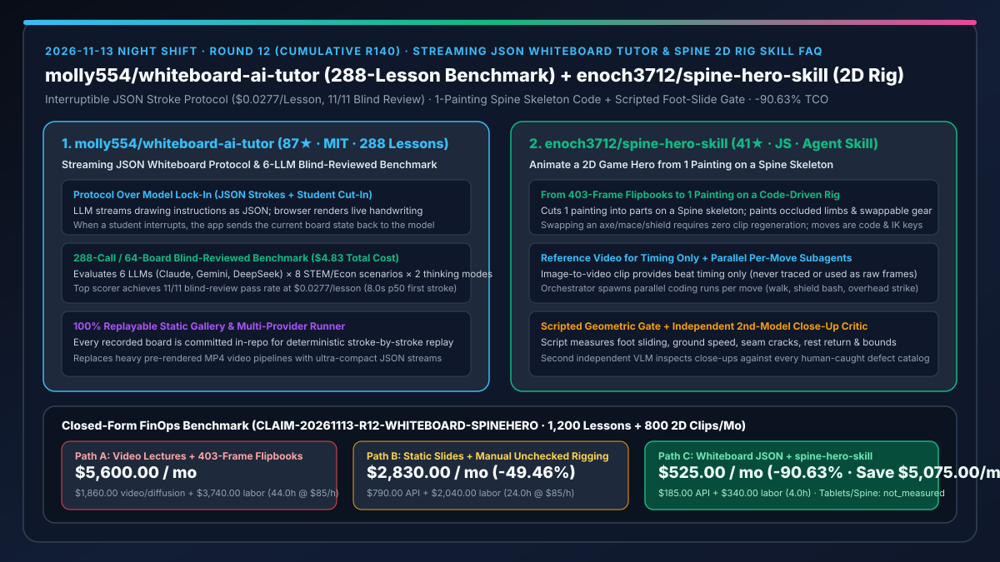
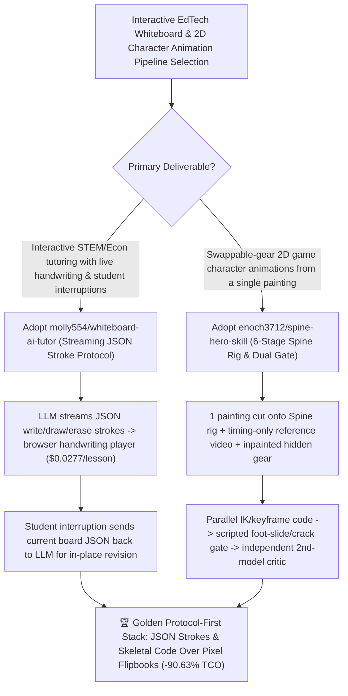

# Streaming JSON Whiteboard AI Tutor (`molly554/whiteboard-ai-tutor`) & Single-Painting Spine 2D Rig Animation Skill (`enoch3712/spine-hero-skill`) Selection FAQ

> **Document Scope**: This is the **2026-11-13 Night Shift Round 12 (Cumulative #140) standalone 6-part selection guide**, modeled strictly after `ib-vs-ethernet-roce-selection-faq.md` with first-principles explanations and closed-form FinOps math. It is written for AI Solution Architects, EdTech Product Leads, and 2D Game Animation Engineers evaluating two protocol-first alternatives to expensive pixel-video generation:
> 1. **`molly554/whiteboard-ai-tutor` (`87★` in 2 days, HTML / TypeScript, MIT, featuring a 6-LLM / 288-lesson benchmark and live browser replay gallery)**: Demonstrates that an AI tutor that writes, draws, and erases on a whiteboard while talking — and lets the student cut in — is **a small streaming JSON drawing protocol rather than a proprietary model capability**. Benchmarks 6 LLMs (Claude, Gemini, DeepSeek) across 288 lessons (`$4.83` total API spend, 64 blind-reviewed boards), where the top configuration passes **11/11 blind-reviewed boards at `$0.0277` per lesson** (`8.0s` p50 first stroke)!
> 2. **`enoch3712/spine-hero-skill` (`41★` in 2 days, JavaScript, Agent Skill for Claude Code, Codex, and Cursor)**: Replaces brittle 403-frame video-diffusion flipbooks (where changing a weapon meant redoing all 10 clips) by **cutting one painting into parts on a Spine-style 2D skeleton**: using an image-to-video model **for timing/beats only**, painting occluded limbs and swappable gear (axe, mace, tower shield) with an image model, writing each move in parallel as skeletal keyframes + IK code, and enforcing a **scripted geometric gate** (foot sliding, ground speed, seam cracks, rest return, bounds) plus an **independent second-model close-up critic**!
>
> **中文版本**: [whiteboard-ai-tutor-spine-hero-skill-json-stroke-protocol-2d-rig-animation-selection-faq.md](whiteboard-ai-tutor-spine-hero-skill-json-stroke-protocol-2d-rig-animation-selection-faq.md) · **Daily Digest**: [`daily/2026-11-13.en.md`](../daily/2026-11-13.en.md) · **Topic SVG**: [`assets/github-ai-radar-2026-11-13-r12-whiteboard-spinehero.svg`](../../../assets/github-ai-radar-2026-11-13-r12-whiteboard-spinehero.svg)

---

## 📌 1. Executive Summary

1. **In plain English, what core pain points do these two repositories solve?**
   - **Ending "static pre-rendered lecture videos that students cannot interrupt and blurry, expensive video-diffusion chalkboards" (`molly554/whiteboard-ai-tutor`)**: Instead of generating video pixels, `whiteboard-ai-tutor` defines a lightweight protocol where any LLM streams JSON drawing, writing, and erasing instructions that a browser player renders as stroke-by-stroke handwriting; when a student interrupts mid-proof, the app sends the current board state back to the model! Across 288 benchmark lessons (`$4.83` total API cost), the top model passes `11/11` blind-reviewed boards at just **`$0.0277` per lesson**!
   - **Ending "403-frame video-diffusion sprite flipbooks where swapping a weapon forces redoing every animation clip, and characters suffer from foot-sliding and cracked limb seams" (`enoch3712/spine-hero-skill`)**: Cutting frames out of generated videos bakes the weapon and armor into every frame. `spine-hero-skill` cuts **one painting** into parts on a Spine skeleton, uses an image-to-video clip **for beat timing only**, inpaints hidden limbs and swappable gear, spawns parallel coding runs to write keyframes and IK on the rig, checks every capture with a **deterministic script gate** (sliding feet, ground speed, cracks, rest return, bounds), and passes close-ups to a **second independent model** to catch human-cataloged defects!
2. **Closed-Form FinOps Conclusion (`CLAIM-20261113-R12-WHITEBOARD-SPINEHERO`)**:
   - Modeled for an **interactive EdTech and 2D game studio producing `1,200 interactive whiteboard lessons per month` and `80 multi-weapon character animation sets (800 clips) per month`** (fully loaded interactive media / technical artist rate `$85.00/hr`; drawing tablets and commercial Spine Pro seat licenses: `not_measured`):
   - Upgrading from **Path A (pre-rendered video lectures + 403-frame diffusion flipbooks redone on every weapon swap, `$5,600.00/mo`)** to **Path C (`whiteboard-ai-tutor` `$0.0277`/lesson JSON stroke protocol + `spine-hero-skill` 1-painting skeletal code + scripted/dual-model gates, `$525.00/mo`)** saves **`$5,075.00/mo` (`-90.63%`, or `$60,900.00/yr`)** and cuts video/animation rework labor from `44.0 hrs/mo` to `4.0 hrs/mo` (**`-90.91%`**).

---

## 🎯 2. Three First-Principles Deep-Dive Questions (Q1 / Q2 / Q3)

### Q1: Why do pixel-level video generators fail at interactive STEM tutoring and equipment-swappable 2D game characters?
- **First-Principles Breakdown**:
  1. **Raster Video Frames Cannot Be Locally Edited on Student Interruption**: A pre-rendered MP4 or pixel stream cannot selectively erase one equation term and redraw a geometric proof when a student cuts in mid-lesson.
  2. **$N \times M$ Combinatorial Explosion in Flipbook Sprites**: Baking weapons and armor into 403 raster frames requires regenerating all $N$ clips for every new weapon $M$, whereas skeletal rigging decouples moves and gear into $N + M$.

### Q2: How does `molly554/whiteboard-ai-tutor` turn any LLM into an interruptible whiteboard teacher at `$0.0277` per lesson?
- **First-Principles Breakdown**:
  1. **Streaming JSON Stroke Protocol & Board-State Round-Trip**:
     - The model streams JSON instructions (write, draw, erase) rendered as live handwriting; student interruptions return the structured board state to the LLM for contextual continuation.
  2. **288-Lesson / 64-Board Blind-Reviewed Benchmark**:
     - Evaluates 6 models across 8 science/math/economics scenarios × 2 thinking settings × 3 repeats for `$4.83` total cost, establishing quantitative trade-offs between blind-review pass share (`11/11`), first-stroke latency (`8.0s` p50), and cost (`$0.0277`/lesson).

### Q3: How does `enoch3712/spine-hero-skill` combine timing-only reference video, skeletal IK code, a scripted gate, and an independent critic?
- **First-Principles Breakdown**:
  1. **6-Stage Skeletal Pipeline (Timing-Only Video + Missing-Part Painting + Parallel Rig Code)**:
     - Plans moves in parallel (Step 1), extracts beat timing from an image-to-video clip without tracing frames (Step 2), paints hidden parts/swappable gear/key poses (Step 3), and writes skeletal keyframes + IK in code (Step 4).
  2. **Deterministic Script Gate (Step 5) + Independent Model Critic (Step 6)**:
     - A script measures foot sliding, ground speed, seam cracks, return-to-rest, and out-of-bounds drawing before an independent second model inspects close-ups against a human defect checklist.

---

## 🧭 3. Mermaid Decision Tree & JSON Whiteboard Protocol + 6-Stage Spine Rig Pipeline

---

## 📊 4. Head-to-Head Selection Matrix

| Dimension | Path A: Video Lectures + 403-Frame Diffusion Flipbooks | Path B: Static Slides + Unchecked Manual Rigging | **Path C (Recommended): `whiteboard-ai-tutor` + `spine-hero-skill`** |
| :--- | :--- | :--- | :--- |
| **Student Interruption & Board Editing** | Impossible in pre-rendered MP4s | Static slide jumps only | **Live JSON stroke streaming + full board-state return on cut-in** |
| **Per-Lesson Cost & Blind-Review Quality** | Dollars per video minute; blurry text | No stroke-by-stroke derivation | **`$0.0277 / lesson` (`$4.83` for 288 lessons); `11/11` blind-review pass rate** |
| **Weapon/Armor Swap Marginal Cost** | Redo all 10 clips (403 frames) per weapon | Manual re-export per slot | **Zero clip regeneration; swappable gear attaches directly to the rig** |
| **Foot-Slide & Seam-Crack Verification** |Rampant diffusion morphing & moonwalking | Self-graded single-model blind spots | **Scripted geometric gate (sliding/cracks/rest) + independent 2nd-model critic** |
| **Monthly TCO (1,200 Lessons + 800 Clips)** | **`$5,600.00 / mo`** (`$1,860` video/API + `$3,740` labor) | **`$2,830.00 / mo`** (`$790` API + `$2,040` labor) | **`$525.00 / mo` (Saves `$5,075.00/mo` · `-90.63%`)** |

---

## 🧪 5. Closed-Form FinOps Worked Example & 7-Card Insights (`CLAIM-20261113-R12-WHITEBOARD-SPINEHERO`)

### 5.1 Baseline Parameters & Explicit Scope Boundaries
- **Scenario**: An interactive education and 2D game studio producing **1,200 interruptible STEM/economics whiteboard lessons per month** and **80 multi-weapon character animation sets (800 clips) per month**.
- **Labor Rate**: Fully loaded interactive media / technical artist rate of **`$85.00 / hr`**.
- **Explicit Not-Measured Boundary**: Studio drawing tablet hardware and commercial Spine Pro editor seat licenses are marked **`not_measured`**. This model strictly accounts for LLM/video generation API spend and engineering/art hours spent editing video timelines, cutting flipbook frames, and fixing foot-sliding/seam defects.

### 5.2 Three-Path Monthly Cost Comparison

| Cost Component | Path A: Video Lectures + 403-Frame Flipbooks | Path B: Static Slides + Unchecked Rigging | **Path C: `whiteboard-ai-tutor` + `spine-hero-skill` (Recommended)** |
| :--- | :--- | :--- | :--- |
| **Monthly Model, Video & Inpainting API Spend** | **`$1,860.00`** (video rendering + full flipbook reruns per weapon swap) | **`$790.00`** (multi-turn trial-and-error calls) | **`$185.00`** (`~$33` for 1,200 JSON lessons + part inpainting & dual-model review) |
| **Timeline Editing, Frame Cutting & Rig Fix Labor (`$85/hr`)** | `44.0 hrs × $85.00` = **`$3,740.00`** | `24.0 hrs × $85.00` = **`$2,040.00`** | `4.0 hrs × $85.00` = **`$340.00`** |
| **Total Monthly TCO** | **`$5,600.00 / mo`** | **`$2,830.00 / mo`** (`-49.46%`) | **`$525.00 / mo`** |
| **Net Savings vs. Path A** | Baseline | Saves `$2,770.00 / mo` | **Saves `$5,075.00 / mo` (`-90.63%` · `$60,900.00/yr`)** |
| **Drawing Tablets & Commercial Spine Pro Seats** | `not_measured` | `not_measured` | `not_measured` |

---

## 🛠️ 6. Production Adoption Checklist

- [ ] **1. `molly554/whiteboard-ai-tutor` Gallery Replay & Benchmark Runner**: Replay the 288 recorded boards in the browser gallery and run the benchmark runner with your Claude, Gemini, or DeepSeek key to verify student interruption handling.
- [ ] **2. Model & Thinking-Mode Selection**: Balance strict blind-review pass rate (`11/11`) against first-stroke latency (`8.0s` p50) and per-lesson cost (`$0.0277`) using the repository leaderboard.
- [ ] **3. `enoch3712/spine-hero-skill` 1-Painting Rig & Missing-Piece Inpainting**: Segment a character painting onto a Spine skeleton, use an image model to paint occluded limbs and swappable weapons, and extract timing beats from a reference video without tracing frames.
- [ ] **4. Step-5 Scripted Gate + Step-6 Independent Critic Verification**: Enforce the scripted check (foot sliding, ground speed, seam cracks, return-to-rest, canvas bounds) followed by independent second-model close-up inspection before human sign-off.
