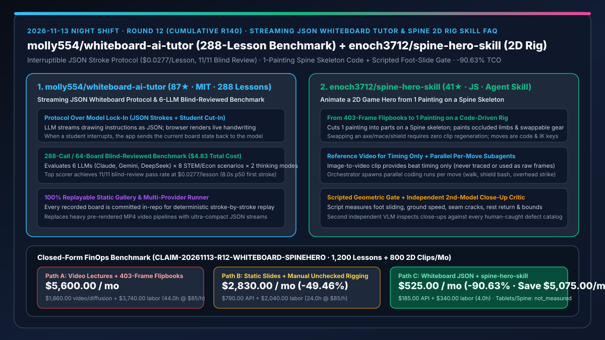
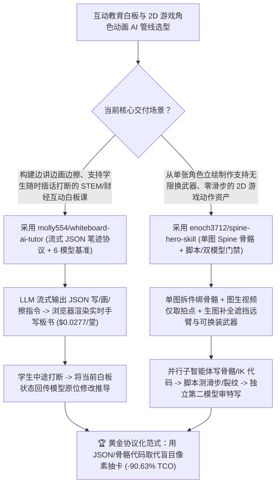

# 流式 JSON 可打断白板 AI 导师（`molly554/whiteboard-ai-tutor`）与单图 Spine 骨骼代码化 2D 角色动画技能（`enoch3712/spine-hero-skill`）深度选型 FAQ

> **文档定位**：本专题是 **2026-11-13 夜班第 12 轮（累计第 140 篇）独立六段式选型指南**，严格对标 `ib-vs-ethernet-roce-selection-faq.md` 的通俗第一性原理与闭式 FinOps 核算规范，面向互动教育（EdTech）产品架构师、2D 游戏与数字人管线负责人及 AI Solution Architect，深度拆解今日新仓爆发榜上用“结构化 JSON 笔迹/骨骼代码协议”彻底取代昂贵且不可控的“视频像素生成抽卡”的两大精巧工程范式：
> 1. **`molly554/whiteboard-ai-tutor`（2 天新建获 `87★`，HTML / TypeScript，MIT，含 6 大模型 × 288 堂课完整基准评测与在线重放画廊）**：一针见血地指出**“边讲课边在白板上写字画图擦除、并允许学生随时插话打断”根本不是某种专有模型能力，而是一套极简的流式 JSON 绘图指令协议**——大模型只需流式输出 JSON 笔迹指令，浏览器播放器将其渲染为实时手写板书与公式推导（如勾股定理证明），学生插话时前端直接把当前白板状态传回模型继续互动！仓库用同一套冻结 Prompt 对 6 款主流模型（Claude、Gemini、DeepSeek 等）跑完 **288 次 API 调用（总花费仅 `$4.83`）并对 64 块白板执行双盲评审**，实证榜首模型拿到 **11/11 盲审全过、首笔延迟 `8.0s`（p50）、单堂课成本仅 `$0.0277`**！
> 2. **`enoch3712/spine-hero-skill`（2 天新建获 `41★`，JavaScript，面向 Claude Code / Codex / Cursor 的 2D 骨骼动画 Agent Skill）**：终结“用视频生成模型切 403 帧序列图（Flipbook）做游戏角色，结果换把武器就要把 10 段动作全部重做一遍”的噩梦——将 **1 张角色立绘拆件绑定到 Spine 风格 2D 骨骼** 上：先用图生视频模型**仅提取动作节奏与拍点（绝不拿生成视频当画面帧）**，用生图模型补全被遮挡的远端手臂与可换装武器（斧、锤、塔盾），再由强编码模型并行把每个动作写成骨骼关键帧与 IK 代码，最后经过**确定性脚本门禁（自动检测滑步、地面移速、接缝裂纹、归位姿态与越界像素）+ 第二独立视觉模型特写挑刺（对照人类历史缺陷清单）**！
>
> **English Version**: [whiteboard-ai-tutor-spine-hero-skill-json-stroke-protocol-2d-rig-animation-selection-faq.en.md](whiteboard-ai-tutor-spine-hero-skill-json-stroke-protocol-2d-rig-animation-selection-faq.en.md) · **关联日报**: [`daily/2026-11-13.md`](../daily/2026-11-13.md) · **专题架构图**: [`assets/github-ai-radar-2026-11-13-r12-whiteboard-spinehero.svg`](../../../assets/github-ai-radar-2026-11-13-r12-whiteboard-spinehero.svg)

---

## 📌 一、核心结论速览（Executive Summary）

1. **一句话大白话讲透这两个项目到底解决了什么痛点？**
   - **终结“做互动 AI 教学视频要么花大价钱预渲染死板的 MP4 录播课（学生没法中途插嘴提问），要么用实时视频流生成烧掉天价 GPU 账单且板书公式全糊成乱码”的痛点（`molly554/whiteboard-ai-tutor`）**：为什么 AI 老师在黑板上边画直角三角形边推公式看起来像魔法？`whiteboard-ai-tutor` 把这层窗户纸捅破了：**不要让模型生成视频像素，让模型流式输出轻量 JSON 笔画指令！** 浏览器端播放器把 JSON 变成一笔一划的动态手写板书；学生一旦在中途打断提问，前端直接把当前黑板快照状态发回给任意 LLM 接着往下画！作者用 288 堂课（覆盖物理、数学、经济学 8 大场景）仅花了 **`$4.83` 总 API 费** 就把 6 个大模型测了个底朝天，证明单堂可打断互动白板课成本最低只需 **`$0.0277`**！
   - **终结“用图生视频大模型切 403 张序列帧做 2D 游戏主角动画，结果主角一旦换把锤子或换面盾牌，10 个动作剪辑全部报废重画，而且角色走路脚底疯狂打滑、关节接缝裂开”的痛点（`enoch3712/spine-hero-skill`）**：很多团队迷信“AI 视频生成直接切帧当游戏 Sprite”，一进生产就发现根本没法换装（Swappable Gear）。`spine-hero-skill` 回归了最扎实的工程第一性原理：**一张画拆零件 + 绑一套 Spine 骨骼 + 所有动作写代码**！它用视频生成模型只拿“时间节奏（Timing Only）”，用生图模型补齐原画被挡住的右臂和可替换武器库，然后派生多个并行子智能体在骨骼上写关键帧和逆动力学（IK）；最绝的是第 5 步**脚本几何门禁**（自动量脚底滑步、接缝裂缝、动作结束是否归位）和第 6 步**换第二个独立大模型看局部特写挑刺**！
2. **闭式 FinOps 投资回报结论（`CLAIM-20261113-R12-WHITEBOARD-SPINEHERO`）**：
   - 以 **互动教育与 2D 游戏工作室每月生产 `1,200 堂` 可打断 STEM 白板互动课、并制作 `80 套` 多武器换装 2D 角色动作集（共 `800 段` 动画剪辑）** 为基准（互动媒体与技术美术工程师全包时薪 `$85.00/hr`；手绘数位屏硬件与商业 Spine Pro 编辑器席位费：`not_measured`）：
   - 从 **Path A（重型视频生成/录播剪辑 + 403 帧视频切图序列帧每次换装全量重做，月均 `$5,600.00`）** 升级至 **Path C（`whiteboard-ai-tutor` `$0.0277`/堂流式 JSON 白板协议 + `spine-hero-skill` 单图骨骼代码化与脚本/双模型门禁，月均 `$525.00`）**，每月净省 **`$5,075.00/mo`（降幅 `-90.63%`，年省 `$60,900.00/yr`）**，并将视频后期与序列帧返工工时从 `44.0 hrs/mo` 压缩至 `4.0 hrs/mo`（节省 **`-90.91%`**）。

---

## 🎯 二、三大灵魂拷问（Q1 / Q2 / Q3 深度原理解析）

### Q1：为什么在互动教学板书和可换装 2D 游戏角色场景中，“像素级视频扩散生成（Video Diffusion）”是一条死胡同？
- **第一性原理拆解**：
  1. **像素流不具备结构化可中断状态（Non-Interruptible State）**：视频生成模型输出的是一串光栅像素帧，当学生在推导第 3 步插入一句“为什么这里角 A 等于角 B？”，像素流无法局部擦除黑板右下角并原位重画几何辅助线。
  2. **序列帧烘焙死了装备耦合度（403-Frame Flipbook Lock-In）**：把武器、盾牌和盔甲直接烘进 403 张序列帧里，意味着 $N$ 套动作 $\times M$ 件武器需要生成 $N \times M$ 套视频并人工抠图对齐；而骨骼蒙皮（Rigging）天然将动作代码与部件贴图解耦为 $N + M$。

### Q2：`molly554/whiteboard-ai-tutor` 的 288 堂课盲审基准揭示了哪些构建低成本互动白板导师的核心规律？
- **第一性原理拆解**：
  1. **JSON 笔画流协议 + 打断态黑板回传闭环**：
     - 模型按统一冻结 Prompt 输出结构化书写、绘图与擦除 JSON 指令，前端播放器按手写轨迹与语速同步回放；学生随时打断时，系统将当前黑板上的存量对象列表回传给模型，使任何通用大模型都能化身白板名师。
  2. **6 模型 × 8 场景 × 64 块盲审白板的实证选型表**：
     - 在涵盖科学、数学、经济学的 288 次实测中，顶配推理模型实现 `11/11` 盲审 100% 通过率，单节课 API 成本仅 `$0.0277`（全套 288 节课总账单仅 `$4.83`），兼顾极低成本与确定性几何准确率。

### Q3：`enoch3712/spine-hero-skill` 是如何通过 6 步流水线把“一张静态原画”变成零滑步、可任意换装的 2D 动作英雄的？
- **第一性原理拆解**：
  1. **只借视频模型的“拍子（Timing）”，绝不用它的“画面（Frames）”**：
     - 第 1 步由编排器按动作（行走、盾击、跳劈等）并发拉起多个子智能体；第 2 步用图生视频模型生成一段参考视频，但**仅提取动作帧率节奏与发力拍点**；第 3 步用生图模型补画原画被遮挡的远端肢体（Far Arm）、可换装武器（斧/锤/盾）及高速挥击关键帧（Key Poses）。
  2. **代码写骨骼 IK + 第 5 步脚本几何门禁 + 第 6 步独立模型特写复核**：
     - 第 4 步由编码模型直接在 Spine 骨骼上编写关键帧与 IK 约束；第 5 步先过**硬核脚本门禁**（自动计算脚底是否打滑 `sliding feet`、地面速度是否匹配、肢体接缝是否裂开 `cracks`、动作结束是否回到待机态 `rest` 以及是否画出画布边界）；第 6 步再请**第二个完全独立的视觉大模型**放大检查局部特写，对照人类历史抓出的缺陷清单逐项过筛，最后才交给人眼终审！

---

## 🧭 三、Mermaid 选型决策树与「流式 JSON 白板 + 6 步 Spine 骨骼代码管线」架构图

---

## 📊 四、同类方案核心能力对比矩阵（Selection Matrix）

| 评估维度 | Path A：预渲染视频课 + 403 帧视频切图 Flipbook | Path B：静态 PPT 课件 + 无门禁裸写动画脚本 | **Path C（推荐）：`whiteboard-ai-tutor` + `spine-hero-skill`** |
| :--- | :--- | :--- | :--- |
| **教学过程学生实时打断与原位改板书** | 视频已烘死，无法中途插入推导或擦改 | 仅能切换死板幻灯片 | **流式 JSON 笔迹协议，随时打断并基于当前白板状态继续作图** |
| **单堂互动课生成成本与盲审质量** | 视频渲染昂贵（数美元/节）且公式易糊 | 缺乏逐步手写推导感 | **`$0.0277 / 堂`（288 堂总计 `$4.83`），榜首模型 11/11 盲审全过** |
| **2D 角色更换武器/护甲的边际成本** | 403 帧全部作废，10 段动作全部重画重抠 | 需美术手工重绑导出 | **骨骼代码与贴图解耦，换斧/锤/盾无需重做任何动作剪辑** |
| **脚底滑步、接缝裂开与归位质量门禁** | 视频生成常见变形与滑步，靠人工逐帧修 | 自写自看，漏掉大量关节穿模 | **确定性脚本测滑步/裂缝/归位 + 第二独立模型对照缺陷库审特写** |
| **月度总拥有成本（1,200 堂课 + 800 段动画）** | **`$5,600.00 / mo`**（`$1,860` 视频/算力 + `$3,740` 工时） | **`$2,830.00 / mo`**（`$790` 资源 + `$2,040` 工时） | **`$525.00 / mo`（净省 `$5,075.00/mo` · `-90.63%`）** |

---

## 🧪 五、定量 FinOps 算例与 7-Card 洞察（`CLAIM-20261113-R12-WHITEBOARD-SPINEHERO`）

### 5.1 测算基准与显式边界（Scope & Boundaries）
- **场景设定**：互动教育与游戏研发工作室每月制作 **1,200 堂可互动 STEM/经济学白板课程**，并为 2D 动作游戏生产 **80 套多武器角色动画（合计 800 段动作剪辑）**。
- **费率假设**：互动媒体与技术美术（TA）工程师全包时薪 **`$85.00 / hr`**。
- **显式边界声明（Explicit Not-Measured Boundary）**：美术设计师数位屏硬件折旧与商业级 Spine Pro 编辑器软件永久许可费标记为 **`not_measured`**，本表严格核算大模型/视频扩散 API 账单及工程师花在视频剪辑、序列帧抠图与修补滑步穿模上的工时。

### 5.2 三路径月度成本闭式对照表

| 成本分项 | Path A：视频流预渲染 + 403 帧 Flipbook 重复抽卡 | Path B：静态课件 + 无脚本门禁手工调帧 | **Path C：`whiteboard-ai-tutor` + `spine-hero-skill`（推荐）** |
| :--- | :--- | :--- | :--- |
| **月度大模型、视频生成与补图 API 净支出** | **`$1,860.00`**（高价视频生成 + 每次换武器重跑全套序列帧） | **`$790.00`**（常规多轮试错 API 消耗） | **`$185.00`**（1,200 堂 JSON 白板课仅 `~$33` + 局部遮挡补图与双模型复核） |
| **视频剪辑、序列帧重抠与滑步穿模返工工时（`$85/hr`）** | `44.0 hrs × $85.00` = **`$3,740.00`** | `24.0 hrs × $85.00` = **`$2,040.00`** | `4.0 hrs × $85.00` = **`$340.00`** |
| **月度总成本（Monthly TCO）** | **`$5,600.00 / mo`** | **`$2,830.00 / mo`**（`-49.46%`） | **`$525.00 / mo`** |
| **相对 Path A 净节省** | 基准线（Baseline） | 净省 `$2,770.00 / mo` | **净省 `$5,075.00 / mo`（`-90.63%` · 年省 `$60,900.00/yr`）** |
| **数位屏硬件与商业 Spine Pro 席位费** | `not_measured` | `not_measured` | `not_measured` |

---

## 🛠️ 六、生产级落地核验 Checklist

- [ ] **1. `molly554/whiteboard-ai-tutor` 288 堂基准回放与自建课程生成**：在浏览器打开在线画廊或本地回放 64 块盲审白板，配置 Claude / Gemini / DeepSeek API Key 运行 Benchmark Runner 生成自定义学科白板课并测试中途学生插话打断重绘。
- [ ] **2. 首笔延迟（p50 First Stroke）与思考档位（Thinking Settings）权衡配置**：根据实时互动或离线备课场景，对照仓库 Leaderboard 选择高通过率模型（11/11 盲审通过）或极速首笔配置。
- [ ] **3. `enoch3712/spine-hero-skill` 单图拆件、遮挡补画与多动作并发编排**：将单张英雄立绘切分为 Spine 骨骼部件，调用生图模型补齐被遮挡远端手臂与可替换武器（斧、锤、盾），并利用图生视频提取动作节奏拍点。
- [ ] **4. 第 5 步几何脚本门禁 + 第 6 步独立第二模型特写挑刺闭环**：在交付人眼终审前，强制跑通脚本自动检测（零滑步、零接缝裂缝、正确归位、不越界）与第二独立视觉模型的局部特写缺陷排查。
