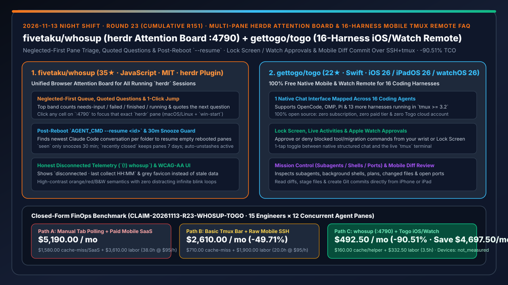
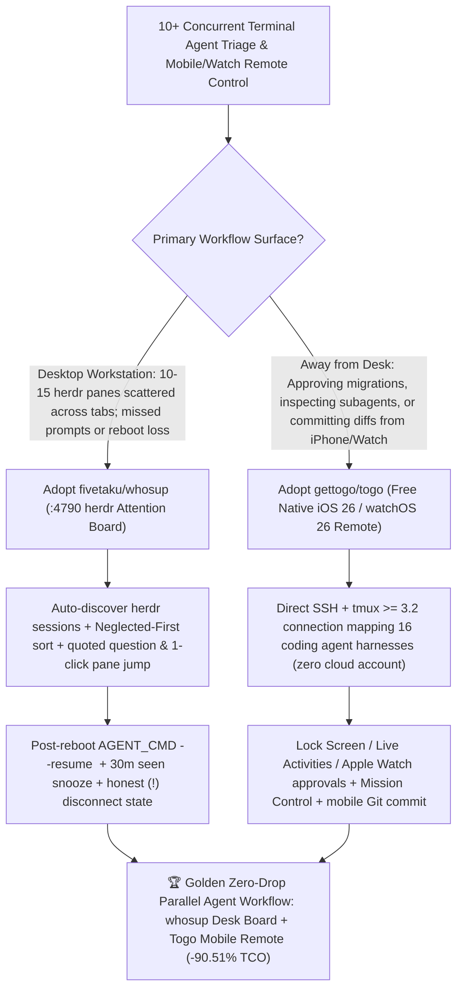

# Multi-Pane `herdr` Attention Board (`fivetaku/whosup`) & Zero-Subscription 16-Harness Native iOS/Watch `tmux` Remote (`gettogo/togo`) Selection FAQ

> **Document Scope**: This is the **2026-11-13 Night Shift Round 23 (Cumulative #151) standalone 6-part selection guide**, modeled strictly after `ib-vs-ethernet-roce-selection-faq.md` with first-principles explanations and closed-form FinOps math. It is written for AI Solution Architects, Parallel-Agent Power Users, and Developer Experience Leads evaluating two desk-and-mobile attention multiplexers:
> 1. **`fivetaku/whosup` (`35★` in 4 days, JavaScript, MIT, macOS / Linux + Windows `win-start` / `win-doctor`)**: A local browser attention board (`http://127.0.0.1:4790`) for `herdr` terminal sessions that automatically discovers every pane across all running `herdr` sessions, flags the exact next pane needing input in orange while quoting its question, sorts by **neglected first**, jumps to the target pane in one click, provides **one-click post-reboot `AGENT_CMD --resume <id>` recovery** from Claude Code conversation logs, enforces a 30-minute `seen` snooze and 7-day `recently closed` retention, and surfaces honest `(!) whosup` disconnected indicators!
> 2. **`gettogo/togo` (`22★` in 3 days, Swift, 100% free & open-source with zero subscription, zero paid tier & zero Togo account)**: A native iOS 26 / iPadOS 26 / watchOS 26 app that connects over SSH + `tmux >= 3.2` to **16 coding agent harnesses** (OpenCode, OMP, Pi, Claude Code, Codex, etc.) on your own Mac or Linux machine — mapping hooks, session logs, and local APIs into one native chat with **Lock Screen, Live Activities, and Apple Watch approval actions**, one-tap toggle to the live `tmux` terminal, Mission Control for subagents/shells/plans/ports, and mobile diff staging and Git commits!
>
> **中文版本**: [whosup-togo-herdr-multipane-attention-board-16-harness-ios-watch-tmux-remote-selection-faq.md](whosup-togo-herdr-multipane-attention-board-16-harness-ios-watch-tmux-remote-selection-faq.md) · **Daily Digest**: [`daily/2026-11-13.en.md`](../daily/2026-11-13.en.md) · **Topic SVG**: [`assets/github-ai-radar-2026-11-13-r23-whosup-togo.svg`](../../../assets/github-ai-radar-2026-11-13-r23-whosup-togo.svg)

---

## 📌 1. Executive Summary

1. **In plain English, what core pain points do these two repositories solve?**
   - **Ending "running 10–15 coding agents in scattered `herdr` panes where one pane sits unnoticed on a permission prompt for 45 minutes (blowing past the 5-minute prompt cache TTL), or losing every active conversation after a machine reboot" (`fivetaku/whosup`)**: Installed via `herdr plugin install fivetaku/whosup --yes`, `whosup` (`http://127.0.0.1:4790`) puts every pane of every running `herdr` session onto one WCAG-AA board. The top band names the next pane to look at and quotes the exact question it is asking; clicking a cell jumps `herdr` straight to that pane; **neglected first** slides the longest-waiting panes to the front; and after a reboot, empty cells get a **resume** button that locates the newest Claude Code conversation for that folder and runs `AGENT_CMD --resume <id>`!
   - **Ending "stepping away for coffee right when an agent stops to ask approval for a database migration — or paying monthly SaaS subscriptions and creating cloud accounts just to check your own local `tmux` agents from your phone" (`gettogo/togo`)**: `Togo` is 100% free and open source (no subscription, no paid tier, no Togo account). It connects over SSH to `tmux >= 3.2` on your Mac or Linux machine, mapping **16 coding agent harnesses** (OpenCode, OMP, Pi, etc.) into one native iPhone/iPad chat with **Lock Screen, Live Activities, and Apple Watch approval buttons**, one-tap switch to the real `tmux` terminal, Mission Control (subagents, background shells, plans, ports), and mobile diff staging and Git commits!
2. **Closed-Form FinOps Conclusion (`CLAIM-20261113-R23-WHOSUP-TOGO`)**:
   - Modeled for a **15-engineer parallel-agent team running `12 concurrent terminal agent panes per engineer`** across desktop `herdr` and `tmux` devboxes (fully loaded senior engineer rate `$95.00/hr`; personal iPhone/Watch devices and workstation capex: `not_measured`):
   - Switching from **Path A (manual terminal tab polling with expired prompt caches + post-reboot session loss + paid mobile SaaS subscriptions, `$5,190.00/mo`)** to **Path C (`whosup` `:4790` neglected-first board + `--resume <id>` recovery + `Togo` zero-subscription 16-harness iOS/Watch remote, `$492.50/mo`)** saves **`$4,697.50/mo` (`-90.51%`, or `$56,370.00/yr`)** and cuts multi-pane polling and mobile approval latency from `38.0 hrs/mo` to `3.5 hrs/mo` (**`-90.79%`**).

---

## 🎯 2. Three First-Principles Deep-Dive Questions (Q1 / Q2 / Q3)

### Q1: Why does missing a waiting permission prompt in a 12-pane agent workflow directly inflate LLM API bills?
- **First-Principles Breakdown**:
  1. **5-Minute Ephemeral Prompt Cache Expiry**: When a blocked pane sits unnoticed for more than 5 minutes, its warm prefix cache expires, forcing the next turn to pay full cache-write or uncached input pricing across hundreds of thousands of tokens.
  2. **Post-Reboot Context Reconstruction Waste**: Terminal multiplexers restore working directories after a reboot without re-attaching the underlying conversation ID, causing engineers to restart sessions from scratch.

### Q2: How does `fivetaku/whosup` prevent abandoned panes and lost sessions across `herdr` workspaces?
- **First-Principles Breakdown**:
  1. **Zero-Config Discovery, Quoted Questions & Neglected-First Triage**:
     - Automatically discovers every `herdr --session` without manual lists, highlights the next actionable cell in orange while quoting its prompt, updates tab titles (`(3) whosup`) and favicons, and explicitly flags collector disconnects (`(!) whosup` with `last collect HH:MM`).
  2. **30-Minute `seen` Snooze, 7-Day Closed Row & `--resume <id>` Recovery**:
     - Resurfaces `seen` panes after 30 minutes if still waiting, keeps closed panes for 7 days, auto-restores stashed panes that resume activity, and attaches the newest folder-matched Claude Code session via `AGENT_CMD --resume <id>` after reboots.

### Q3: How does `gettogo/togo` unify 16 coding harnesses on iOS, iPadOS, and Apple Watch with zero cloud relay?
- **First-Principles Breakdown**:
  1. **Direct SSH + `tmux >= 3.2` Harness Mapping**:
     - Runs a lightweight helper alongside `tmux` on your Mac/Linux host to map OpenCode, OMP, Pi, and 13 other harnesses' hooks, logs, and local APIs into a single native Swift UI while keeping the raw `tmux` terminal one tap away.
  2. **Lock Screen / Watch Approvals & Native Diff Commits**:
     - Delivers actionable tool approvals to iOS notifications, Live Activities, and watchOS 26, exposes subagents/shells/ports in Mission Control, and lets developers stage diffs and commit from their phone.

---

## 🧭 3. Mermaid Decision Tree & whosup + Togo Desk-to-Mobile Architecture

---

## 📊 4. Head-to-Head Selection Matrix

| Dimension | Path A: Manual Tab Polling + Paid Mobile SaaS | Path B: Basic Tmux Bar + Raw Mobile SSH | **Path C (Recommended): `whosup` + `gettogo/togo`** |
| :--- | :--- | :--- | :--- |
| **Desktop Multi-Pane Triage & Focus** | Manual Alt-Tabbing across 12+ panes; missed prompts | Status-bar bell only; no quoted question preview | **Top band quotes exact question + `neglected first` sort + 1-click jump to `herdr` pane** |
| **Post-Reboot Session Recovery** | Manual transcript directory hunting | Restores empty shell panes only | **1-click `resume` button runs `AGENT_CMD --resume <id>` for the folder's newest Claude session** |
| **Mobile Multi-Agent Experience** | Paid monthly SaaS tier & mandatory cloud account | Tiny raw terminal font; painful diff reading | **100% free & open source ($0/mo); unified native chat for 16 harnesses + 1-tap `tmux` toggle** |
| **Wrist/Lock-Screen Approvals & Diff Commit** | No Apple Watch support or single-harness lock-in | Unlock phone + type `y/n` in SSH client | **Lock Screen, Live Activities & Apple Watch approvals + Mission Control & native mobile Git commit** |
| **Monthly TCO (15 Engineers × 12 Panes)** | **`$5,190.00 / mo`** (`$1,580` cache/SaaS + `$3,610` labor) | **`$2,610.00 / mo`** (`$710` cache + `$1,900` labor) | **`$492.50 / mo` (Saves `$4,697.50/mo` · `-90.51%`)** |

---

## 🧪 5. Closed-Form FinOps Worked Example & 7-Card Insights (`CLAIM-20261113-R23-WHOSUP-TOGO`)

### 5.1 Baseline Parameters & Explicit Scope Boundaries
- **Scenario**: A 15-engineer parallel-agent software team where each engineer runs **12 concurrent terminal coding agent panes** across desktop `herdr` and `tmux` devboxes.
- **Labor Rate**: Fully loaded senior software engineer rate of **`$95.00 / hr`**.
- **Explicit Not-Measured Boundary**: Personal iPhone / iPad / Apple Watch hardware and Mac/Linux workstation capex are marked **`not_measured`**. This model strictly accounts for prompt-cache rebuild penalties from unnoticed waiting prompts (>5 min TTL), commercial mobile remote SaaS fees, and engineering hours spent polling panes, recovering rebooted sessions, and handling mobile approvals.

### 5.2 Three-Path Monthly Cost Comparison

| Cost Component | Path A: Manual Tab Polling + Paid Mobile SaaS | Path B: Basic Tmux Bar + Raw Mobile SSH | **Path C: `whosup (:4790)` + `Togo` (Recommended)** |
| :--- | :--- | :--- | :--- |
| **Monthly Expired-Cache Rebuild & Mobile SaaS Spend** | **`$1,580.00`** (>5m idle cache expiry + paid SaaS seats) | **`$710.00`** (partial cache expiry & rerun waste) | **`$160.00`** (fast prompt turnaround preserves warm cache + `$0` Togo subscription) |
| **Pane Polling, Reboot Recovery & Mobile Approval Labor (`$95/hr`)** | `38.0 hrs × $95.00` = **`$3,610.00`** | `20.0 hrs × $95.00` = **`$1,900.00`** | `3.5 hrs × $95.00` = **`$332.50`** |
| **Total Monthly TCO** | **`$5,190.00 / mo`** | **`$2,610.00 / mo`** (`-49.71%`) | **`$492.50 / mo`** |
| **Net Savings vs. Path A** | Baseline | Saves `$2,580.00 / mo` | **Saves `$4,697.50 / mo` (`-90.51%` · `$56,370.00/yr`)** |
| **iPhone / Apple Watch & Workstation Capex** | `not_measured` | `not_measured` | `not_measured` |

---

## 🛠️ 6. Production Adoption Checklist

- [ ] **1. `fivetaku/whosup` Plugin Install & `:4790` Board Launch**: Run `herdr plugin install fivetaku/whosup --yes` and `herdr plugin action invoke fivetaku.whosup.start` (or `win-start` on Windows) to open the unified board at `http://127.0.0.1:4790`.
- [ ] **2. `Neglected First` Triage & `--resume` Reboot Test**: Verify one-click pane focus from orange cells, 30-minute `seen` snooze behavior, and post-reboot `AGENT_CMD --resume <id>` session restoration.
- [ ] **3. `gettogo/togo` SSH + `tmux >= 3.2` Connection**: Install the Togo app (iOS/iPadOS 26+ & watchOS 26+) and connect to your Mac/Linux host running `tmux 3.2+` across OpenCode, OMP, Pi, Claude Code, or Codex.
- [ ] **4. Lock Screen / Apple Watch Approval & Mobile Diff Commit**: Trigger a tool approval prompt, approve or deny it from the Lock Screen or Apple Watch, and test staging and committing a file diff in the Review tab.
