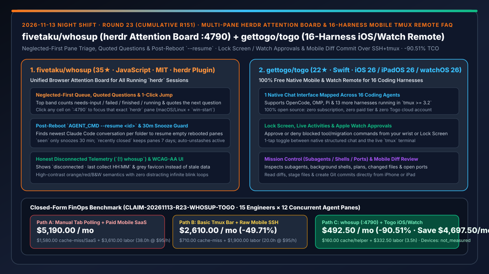
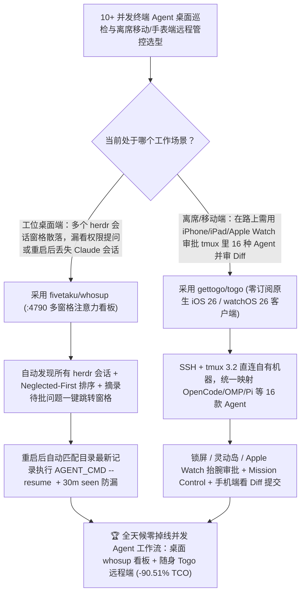

# 多窗格 `herdr` 智能体防遗忘看板（`fivetaku/whosup`）与零订阅 16 宿主原生 iOS/iPad/Watch 远程控制端（`gettogo/togo`）深度选型 FAQ

> **文档定位**：本专题是 **2026-11-13 夜班第 23 轮（累计第 151 篇）独立六段式选型指南**，严格对标 `ib-vs-ethernet-roce-selection-faq.md` 的通俗第一性原理与闭式 FinOps 核算规范，面向高并发 Agent 开发者、远程研发效能架构师与 AI Solution Architect，深度拆解今日新仓榜上解决“桌面端同时开 15 个 `herdr` 终端窗格找不到哪个在等授权且重启后丢会话”与“离开工位买咖啡时无法用手机锁屏/Apple Watch 审批 `tmux` 里 16 种不同 Coding Agent”的两大协同工具：
> 1. **`fivetaku/whosup`（4 天新建获 `35★`，JavaScript，MIT，支持 macOS / Linux 与 Windows `win-start`）**：面向 `herdr` 多终端会话的本地浏览器单页注意力看板（`http://127.0.0.1:4790`）——自动发现所有运行中的 `herdr` 会话窗格，顶部状态带直接摘录**当前最需要你处理的窗格及其正在提问的原话**，支持 **Neglected First（最久等待优先）** 排序、点击单元格一键跳转激活目标窗格、**电脑重启后自动匹配目录最新 Claude Code 会话一键执行 `AGENT_CMD --resume <id>` 恢复**、`seen` 30 分钟贪睡防漏、7 天已关闭窗格挽回，以及断连时诚实显示 `(!) whosup` 灰标！
> 2. **`gettogo/togo`（3 天新建获 `22★`，Swift，100% 免费开源、零订阅、零付费档位、无需注册账号，已上架 App Store 与 TestFlight）**：运行在 iPhone / iPad（iOS/iPadOS 26+）与 Apple Watch（watchOS 26+）上的**原生多 Agent 远程操控客户端**——通过 SSH + `tmux >= 3.2` 直连你自己的 Mac 或 Linux 开发机，把 **OpenCode、OMP、Pi 等 16 款编码智能体**的 Hooks、日志与本地 API 统一映射为同一套原生聊天界面，支持**锁屏 / 灵动岛实时活动（Live Activities） / Apple Watch 手表抬腕审批**、一键切换真实 `tmux` 终端、Mission Control 查看子智能体/后台 Shell/端口，以及在手机端直接看 Diff 暂存并提交 Git Commit！
>
> **English Version**: [whosup-togo-herdr-multipane-attention-board-16-harness-ios-watch-tmux-remote-selection-faq.en.md](whosup-togo-herdr-multipane-attention-board-16-harness-ios-watch-tmux-remote-selection-faq.en.md) · **关联日报**: [`daily/2026-11-13.md`](../daily/2026-11-13.md) · **专题架构图**: [`assets/github-ai-radar-2026-11-13-r23-whosup-togo.svg`](../../../assets/github-ai-radar-2026-11-13-r23-whosup-togo.svg)

---

## 📌 一、核心结论速览（Executive Summary）

1. **一句话大白话讲透这两个项目到底解决了什么痛点？**
   - **终结“在 `herdr` 里同时跑 10–15 个 Coding Agent 窗格时，某个角落的窗格卡在权限确认上干等了半小时（连 5 分钟 Prompt 缓存都过期作废了），或者电脑重启后 `herdr` 只恢复了空壳窗格却把里面的 Claude Code 会话弄丢了”的痛点（`fivetaku/whosup`）**：一行 `herdr plugin install fivetaku/whosup --yes` 启动 `:4790` 看板，所有新开的 `herdr --session` 自动上墙；只用高对比黑白底色 + **唯一橙色高亮当前最该看的那个窗格并直接引用它的提问**，支持按“冷落最久优先（Neglected First）”排序，点一下卡片直接跳进对应终端窗格；更贴心的是，重启机器后空窗格上会出现 **Resume 按钮**，自动检索该目录最新的 Claude Code 对话 ID 执行 `AGENT_CMD --resume <id>` 原地复活！
   - **终结“下楼买咖啡时 Agent 刚好停下来问‘能不能跑数据库迁移’，用普通手机 SSH 终端字小得根本没法看 Diff，而市面远程 Agent App 又要收月费、强制注册云账号中转代码”的痛点（`gettogo/togo`）**：`Togo` 100% 免费开源、无账号无云端中转，直接通过 SSH 连上你开发机的 `tmux`，把 **OpenCode、OMP、Pi 等 16 种不同 Agent** 变成统一的 iOS / iPadOS 原生聊天窗 + Mission Control（监控子智能体、后台 Shell 与端口）+ 手机原生 Git Diff 审查提交，还能直接在 **iPhone 锁屏、灵动岛或 Apple Watch 手表**上一键点 Approve / Deny！
2. **闭式 FinOps 投资回报结论（`CLAIM-20261113-R23-WHOSUP-TOGO`）**：
   - 以 **15 人高并发研发团队（每人并行维护 `12 个终端智能体窗格`）** 为基准（高级工程师全包时薪 `$95.00/hr`；iPhone / Apple Watch 个人移动设备与开发机硬件折旧：`not_measured`）：
   - 从 **Path A（人工轮询十几个终端标签页导致超时缓存失效 + 重启丢会话重跑 + 付费远程 Agent SaaS 订阅，月均 `$5,190.00`）** 升级至 **Path C（`whosup` `:4790` 防遗忘看板/一键 `--resume` + `Togo` 零订阅 16 宿主 iOS/Watch 远程端，月均 `$492.50`）**，每月净省 **`$4,697.50/mo`（降幅 `-90.51%`，年省 `$56,370.00/yr`）**，并将轮询找窗格、恢复重启会话与苦等工位审批的工时从 `38.0 hrs/mo` 压缩至 `3.5 hrs/mo`（节省 **`-90.79%`**）。

---

## 🎯 二、三大灵魂拷问（Q1 / Q2 / Q3 深度原理解析）

### Q1：为什么并发运行 10+ 个终端 Agent 时，“找不到哪个窗格在等输入”不仅耽误时间，还会直接导致 API 账单暴涨？
- **第一性原理拆解**：
  1. **5 分钟 Prompt 缓存过期惩罚（Cache TTL Expiry）**：主流模型（如 Claude 5 分钟 Ephemeral Cache）一旦因为你在十几个窗格里没看见它的权限提问而闲置超过 5 分钟，下一轮回答时几十万上下文被迫重新全价写入缓存，单次滞留即可多花数美元。
  2. **系统重启后的孤儿窗格损耗**：终端复用器重启后往往只恢复工作目录而不恢复 Agent 进程，工程师手动翻找历史 Session ID 极易找错或被迫从头重跑。

### Q2：`fivetaku/whosup` 是如何通过“零维护自动发现 + 30 分钟贪睡防漏 + 一键 `--resume`”管理 `herdr` 窗格矩阵的？
- **第一性原理拆解**：
  1. **克制的视觉语义与 Neglected-First 排序**：
     - 全盘黑白基底（WCAG AA 对比度），仅用橙色标记下一个待处理项、红色标记失败，绝不搞满屏闪烁；标签页标题实时显示 `(3) whosup`，断开连接时诚实变为 `(!) whosup` 灰标并注明最后采集时间。
  2. **防遗忘状态机与重启会话复活**：
     - 点 `seen` 仅暂缓 30 分钟（未处理完自动重回队列），关闭窗格保留在 `recently closed` 达 7 天，暂存（`stash`）窗格一旦后台重新活动自动浮出；针对重启后的空窗格自动检索该文件夹最新 Claude Code 记录并注入 `AGENT_CMD --resume <id>`。

### Q3：`gettogo/togo` 是如何在不经过任何第三方云服务器的前提下，把 16 种不同终端 Agent 统一成原生 iOS/Watch 体验的？
- **第一性原理拆解**：
  1. **SSH + `tmux >= 3.2` 轻量 Helper 直连**：
     - 你的 Agent 始终跑在自家 Mac/Linux 的 `tmux` 会话里（桌面前与手机端随时无缝接力）；Togo 通过机器上的轻量 Helper 解析 16 款 Harness（OpenCode、OMP、Pi 等）的 Hooks、日志或本地 API，映射为统一原生聊天流，且随时可一键切回真实 `tmux` 终端。
  2. **全场景审批与掌上代码审查（Lock Screen / Watch / Diff Review）**：
     - 危险命令（如数据库迁移或 `npm test`）直接推送至锁屏、Live Activities 与 Apple Watch 表盘一键批准/拒绝；内置 Mission Control 汇总子智能体、后台 Shell、计划与端口，并提供原生 Diff 视图在手机上完成 Stage 与 Commit。

---

## 🧭 三、Mermaid 选型决策树与「whosup 桌面多窗格看板 + Togo 移动/手表远程端」协同架构图

---

## 📊 四、同类方案核心能力对比矩阵（Selection Matrix）

| 评估维度 | Path A：手动切终端标签页 + 商业付费远程 SaaS | Path B：简易状态栏脚本 + 手机裸连 SSH 终端 | **Path C（推荐）：`whosup` + `gettogo/togo`** |
| :--- | :--- | :--- | :--- |
| **桌面多窗格提问感知与跳转** | 靠肉眼挨个翻标签页，常漏看导致缓存过期 | 仅有简单响铃提示，看不到具体提问内容 | **顶部直接引用待答问题 + `Neglected First` 排序 + 点击卡片直跳目标 `herdr` 窗格** |
| **系统重启后会话恢复能力** | 手动翻查历史目录找 ID，极易丢失上下文 | 仅恢复空目录窗格 | **自动匹配目录最新 Claude Code 会话并提供一键 `AGENT_CMD --resume <id>` 按钮** |
| **离席移动端多 Agent 交互体验** | 需绑定云账号并按月付费订阅 | 手机小屏敲纯文本 SSH，无法高效看 Diff | **100% 免费开源零账号，统一适配 16 款 Agent 原生聊天 + 一键切真实 `tmux` 终端** |
| **锁屏/手表审批与子智能体监控** | 不支持 Apple Watch，或仅支持单一工具 | 必须解锁手机打开终端手动输入 `y/n` | **iPhone 锁屏 / 灵动岛 / Apple Watch 抬腕审批 + Mission Control 看子智能体与 Diff 提交** |
| **月度总拥有成本（15 人 × 12 窗格）** | **`$5,190.00 / mo`**（`$1,580` 缓存/SaaS + `$3,610` 工时） | **`$2,610.00 / mo`**（`$710` 缓存 + `$1,900` 工时） | **`$492.50 / mo`（净省 `$4,697.50/mo` · `-90.51%`）** |

---

## 🧪 五、定量 FinOps 算例与 7-Card 洞察（`CLAIM-20261113-R23-WHOSUP-TOGO`）

### 5.1 测算基准与显式边界（Scope & Boundaries）
- **场景设定**：15 人规模的高并发 AI 研发团队，每位工程师日常在 `herdr` 与 `tmux` 中并行运行 **12 个终端编码智能体窗格**。
- **费率假设**：高级软件工程师全包时薪 **`$95.00 / hr`**。
- **显式边界声明（Explicit Not-Measured Boundary）**：工程师个人 iPhone / iPad / Apple Watch 移动硬件与开发工作站主机硬件折旧标记为 **`not_measured`**，本表严格核算因窗格提问滞留超过 5 分钟导致的 Prompt 缓存重建差价、商业远程软件订阅费，以及工程师花在轮询找窗格、重启恢复会话与移动端审批操作上的工时。

### 5.2 三路径月度成本闭式对照表

| 成本分项 | Path A：手动翻找窗格 + 付费远程 SaaS | Path B：简易状态脚本 + 手机裸连 SSH | **Path C：`whosup (:4790)` + `Togo`（推荐）** |
| :--- | :--- | :--- | :--- |
| **月度超时缓存重建损耗与远程软件订阅支出** | **`$1,580.00`**（窗格干等超 5m 缓存作废 + 商业月费） | **`$710.00`**（部分缓存超时与重跑损耗） | **`$160.00`**（秒级响应保住热缓存 + Togo `$0` 零订阅费） |
| **多窗格轮询、重启恢复与离席审批工时（`$95/hr`）** | `38.0 hrs × $95.00` = **`$3,610.00`** | `20.0 hrs × $95.00` = **`$1,900.00`** | `3.5 hrs × $95.00` = **`$332.50`** |
| **月度总成本（Monthly TCO）** | **`$5,190.00 / mo`** | **`$2,610.00 / mo`**（`-49.71%`） | **`$492.50 / mo`** |
| **相对 Path A 净节省** | 基准线（Baseline） | 净省 `$2,580.00 / mo` | **净省 `$4,697.50 / mo`（`-90.51%` · 年省 `$56,370.00/yr`）** |
| **iPhone / Apple Watch 与工作站硬件折旧** | `not_measured` | `not_measured` | `not_measured` |

---

## 🛠️ 六、生产级落地核验 Checklist

- [ ] **1. `fivetaku/whosup` 插件安装与 `:4790` 看板自启**：执行 `herdr plugin install fivetaku/whosup --yes` 与 `herdr plugin action invoke fivetaku.whosup.start`（Windows 使用 `win-start` / `win-doctor`），验证 `http://127.0.0.1:4790` 自动汇聚所有 `herdr --session` 窗格。
- [ ] **2. `Neglected First` 排序与重启 `--resume` 恢复演练**：切换顶部排序至 `neglected first` 点击橙色单元格测试一键跳窗格，并在模拟重启后点击空窗格 `resume` 按钮验证 `AGENT_CMD --resume <id>` 自动续接会话。
- [ ] **3. `gettogo/togo` Helper 部署与 `tmux 3.2+` 对接**：在 Mac/Linux 开发机配置 SSH 与 `tmux >= 3.2`，在 iPhone/iPad（iOS 26+）安装 Togo 连接 OpenCode、Claude Code、Codex、Pi 等 16 款 Agent。
- [ ] **4. 锁屏/Apple Watch 抬腕审批与手机端 Diff Commit 核验**：触发一条待审批命令（如数据库迁移或测试执行），在锁屏或 Apple Watch 上测试一键 Deny/Approve，并在 Review 视图核对文件 Diff 与提交功能。
