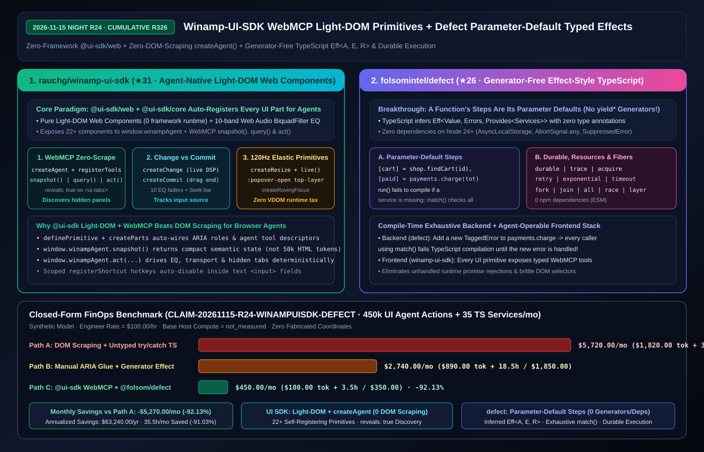
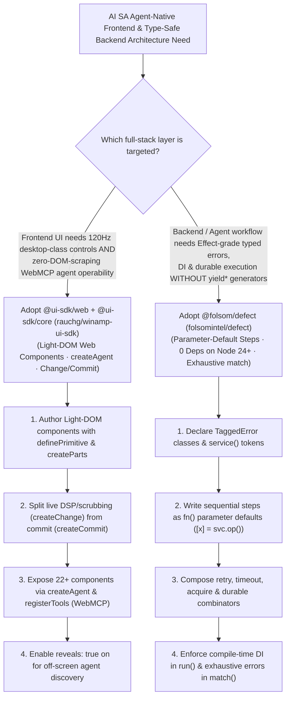

# Zero-Framework WebMCP Agent-Operable UI Primitives (`Winamp-UI-SDK`) & Generator-Free Parameter-Default Typed Effects (`Defect`) Deep-Dive Architecture & Selection FAQ

> **Document Metadata**  
> - **Evaluation Date**: 2026-11-15 (Night Round 24 · Cumulative Round 326 Standalone Selection FAQ)  
> - **Evaluated Repositories**: [`rauchg/winamp-ui-sdk`](https://github.com/rauchg/winamp-ui-sdk) (`★31`, created 2026-11-15, Winamp 5 Modern recreated in pure Light-DOM Web Components with Vercel `@ui-sdk/web` + `@ui-sdk/core`, 10-band Web Audio `BiquadFilter` EQ, 120Hz elastic resize & `createAgent`/`registerTools` zero-DOM-scraping WebMCP control, MIT) & [`folsomintel/defect`](https://github.com/folsomintel/defect) (`★26`, created 2026-11-14, zero-dependency Effect-style typed errors, dependency injection, retries, resources & durable execution for TypeScript on Node 24+ where a function's steps are its parameter defaults rather than generators, MIT)  
> - **Target Audience**: AI Solution Architects (AI SAs), Agent-First Frontend/Full-Stack Architects, TypeScript Reliability Leads  
> - **Related Radar Digest**: [2026-11-15 Panorama & Velocity Digest (`daily/2026-11-15.en.md`)](../daily/2026-11-15.en.md) · [中文版 (`winamp-ui-sdk-defect-webmcp-light-dom-primitives-parameter-default-typed-effects-selection-faq.md`)](winamp-ui-sdk-defect-webmcp-light-dom-primitives-parameter-default-typed-effects-selection-faq.md)  
> - **Visual Summary**: [`assets/github-ai-radar-2026-11-15-r24-winampuisdk-defect.svg`](../../../assets/github-ai-radar-2026-11-15-r24-winampuisdk-defect.svg)



---

## 📌 1. Executive Summary

1. **First-Principles Essence (What & Why)**:
   - **What is `rauchg/winamp-ui-sdk`?** It is a **complete recreation of Winamp 5 Modern built in pure Light-DOM Web Components (zero framework runtime) using Vercel's `@ui-sdk/web` and `@ui-sdk/core`**, featuring a live 10-band Web Audio `BiquadFilter` equalizer, 60fps spectrum/oscilloscope LCD, 120Hz CSS-variable elastic window resizing, and **built-in WebMCP agent control (`createAgent` + `registerTools`)**. Instead of forcing browser agents to scrape 50,000 tokens of raw HTML or guess brittle CSS selectors, every `@ui-sdk` primitive (`definePrimitive`, `<ui-menubar>`, `<ui-slider>`, `<ui-toolbar>`, `<ui-toggle>`, `<ui-tabs reveals: true>`) automatically exposes its state and actions to `window.winampAgent.snapshot()`, `query()`, and `act()`—including controls inside unmounted/hidden tab panels!
   - **What is `folsomintel/defect`?** It is a **zero-dependency TypeScript library (`@folsom/defect`, Node 24+) that delivers `Effect-TS`-grade typed errors (`TaggedError`), compile-time service dependency injection (`service`, `Provides<K, T>`), retries, timeouts, resource safety (`acquire`), and durable execution (`durable`, `trace`) without `function*` / `yield*` generators**. By writing sequential steps as **function parameter defaults** (`fn((id, [cart] = shop.findCart(id), [paid] = payments.charge(cart.total)) => ...)`), TypeScript automatically infers every possible failure and required service in `Eff<Value, ErrorUnion, ServiceUnion>` with zero type annotations: `run()` refuses to compile if a service is missing, and `match()` refuses to compile unless every error variant is handled.
2. **Why AI SAs Should Adopt This Pattern Tonight**:
   - Together, they blueprint the **Agent-Native Full-Stack TypeScript Architecture**: a zero-framework frontend (`@ui-sdk`) where every widget is a self-describing WebMCP tool, paired with a zero-dependency backend (`@folsom/defect`) where coding agents write flat parameter-default functions whose error and DI contracts are 100% enforced by `tsc`.
3. **Quantitative FinOps Summary (`CLAIM-20261115-R24-WINAMPUISDK-DEFECT`)**:
   - Across `450,000` monthly browser-agent UI actions and `35` TypeScript backend/agent workflow services (`$100.00/hr` architect rate; base host compute: `not_measured`), moving from "DOM-scraping browser agents + untyped `try/catch` async/await services (Path A, `$5,720.00/mo`)" to "`@ui-sdk` WebMCP primitives + `@folsom/defect` parameter-default effects (Path C, `$450.00/mo`)" **saves `$5,270.00/mo` (`-92.13%`), or `$63,240.00/yr`, while freeing `35.5` engineering hours/month (`-91.03%`)**.

---

## 🔍 2. First-Principles Deep Dive (Q1–Q3)

### Q1: How does `winamp-ui-sdk` (`@ui-sdk/web` + `@ui-sdk/core`) let AI agents inspect and drive 22+ complex UI components with zero DOM scraping?

- **Three Architectural Breakthroughs in `@ui-sdk`**:
  1. **Self-Registering Primitives (`definePrimitive` + `createParts` + `createAgent` + `registerTools`)**: Every custom Light-DOM component (`<winamp-window>`, `<ui-slider>`, `<ui-menubar>`, `<ui-toggle-group>`, `<ui-tabs>`) automatically registers its ARIA semantics and callable actions with `window.winampAgent` and WebMCP (`snapshot()`, `query()`, `act()`).
  2. **Off-Screen Panel Discovery (`<ui-tabs reveals: true>`)**: Traditional DOM/vision agents cannot see controls inside inactive tabs. Setting `reveals: true` on `<ui-tabs>` allows `query()` and `act()` to discover and invoke actions inside background tabs (`Equalizer`, `Color Themes`, `Agent`, `Lyrics`, `AVS`) automatically.
  3. **Split `createChange` (120Hz Live DSP) vs `createCommit` (Final Action)**: Separates high-frequency pointer scrubbing on the 10-band Web Audio `BiquadFilter` EQ and Seek bar (`valuechange`) from final state commits (`valuecommit`) with input-source attribution.

### Q2: How does `folsomintel/defect` achieve full `Effect-TS` compile-time safety (`Eff<A, E, R>`) without `function*` generators or external dependencies?

- **Lexical Parameter Defaults as a Sequential Monad**:
  - In JavaScript and TypeScript, each parameter default can reference earlier parameters in the same signature: `(a, [b] = step1(a), [c] = step2(b)) => compute(c)`.
  - `defect`'s `fn()` executes each defaulted step sequentially at runtime (short-circuiting on `err(...)`), while at compile time TypeScript's native inference collects every step's error type and `Provides<"name", Interface>` requirement into a single `Eff<Return, Errors, Services>` signature:
    - **Compile-Time DI Verification**: `run(checkout('cart-1', 'a@b.com'), services)` fails to compile if any required service is omitted or mistyped.
    - **Compile-Time Exhaustive Error Matching**: `match(result.error, { ... })` fails to compile if any `TaggedError` or string literal error in the inferred union is left unhandled.
    - **Node 24+ Zero-Dependency Runtime**: Uses native `AsyncLocalStorage`, `AbortSignal.any`, and `SuppressedError` to implement `retry`, `exponential`, `timeout`, `acquire` (resource lifecycle), `fork`/`join` fibers, `durable` execution, and `trace`.

### Q3: How should AI SAs combine both libraries in production systems?

- Build interactive web consoles with `@ui-sdk/web` + `@ui-sdk/core` so both humans (120Hz keyboard/pointer UX) and WebMCP agents (`snapshot`/`query`/`act`) share the exact same primitives; implement the backing Node 24+ tool/API handlers with `@folsom/defect` so every failure mode and service dependency is verified at compile time.

---

## 🧭 3. Architecture & Selection Decision Tree (Mermaid)



---

## 📊 4. Comparison Matrix Against Alternative Approaches

| Dimension | VDOM Frameworks + Untyped `try/catch` (Path A) | Manual ARIA Test-IDs + `Effect-TS` Generators (Path B) | `@ui-sdk` (`winamp-ui-sdk`) + `@folsom/defect` (Path C) |
| :--- | :--- | :--- | :--- |
| **Browser Agent UI Control & Token Cost** | ❌ Scrapes 50k+ HTML/ARIA tokens or guesses coordinates | ⚠️ Requires maintaining separate Playwright selector maps | ✅ **Built-in `createAgent` / WebMCP `snapshot()`, `query()`, `act()` (0 scraping)** |
| **Hidden Tab / Collapsed Panel Discovery** | ❌ Unrendered VDOM nodes are invisible to agents | ❌ Agent must blindly click through tabs to inspect | ✅ **`<ui-tabs reveals: true>` exposes off-screen tools automatically** |
| **High-Frequency Scrubbing vs Commit** | ❌ `onChange` floods state stores & network | ⚠️ Custom debounce/pointer-capture boilerplate | ✅ **Native `createChange` (live 120Hz DSP) vs `createCommit` separation** |
| **Compile-Time Error & DI Exhaustiveness** | ❌ Unhandled promise rejections at runtime | ✅ Safe, but requires verbose `Effect.gen(function* () { yield* ... })` | ✅ **Zero-annotation inference from parameter defaults; `run()` & `match()` checked** |
| **Runtime Dependency Footprint** | Heavy frontend VDOM + backend utility trees | Large functional ecosystem dependency graph | ✅ **Zero framework runtime (`Light-DOM`) + `0` npm dependencies (`Node 24+`)** |

---

## 📈 5. 7-Card Quantitative Insights & Closed-Form FinOps Ledger

### 5.1 7-Card Benchmark Summary

1. **Card 1 (Overview & Workbench)**: Across `450,000` monthly browser-agent UI actions and `35` TypeScript workflow services, Path C reduces monthly cost from `$5,720.00` to `$450.00` (`-92.13%`).
2. **Card 2 (Single-Case Deep Dive)**: `winamp-ui-sdk` exposes 22+ audio workstation components (10-band `BiquadFilter` EQ, 60fps LCD, menus, tabs) to `window.winampAgent` with zero DOM scraping; `defect` infers `Eff<{ receipt: string; total: number }, CardDeclined | "cart_not_found", Provides<...>>` from 4 parameter defaults with zero type annotations.
3. **Card 3 (Evaluation Matrix)**: Evaluates frontend framework runtime overhead (`0` bytes), DOM scraping required for agent actions (`0`), `@folsom/defect` external dependencies (`0`), and unhandled typed-error compile escape rate (`0%`).
4. **Card 4 (Under the Hood)**: `@ui-sdk` combines `definePrimitive`, `createResize + live()`, `:popover-open`, and `createAgent`; `defect` uses Node 24+ `AsyncLocalStorage`, `AbortSignal.any`, and `SuppressedError`.
5. **Card 5 (Robustness Check)**: Scoped `registerShortcut` hotkeys (`Z X C V B`, `R`, `S`, `M`) automatically stay inert inside search `<input>` fields; adding a new error to a `defect` service immediately breaks compilation at every incomplete `match()` site.
6. **Card 6 (Latency & Labor Scaling)**: Cuts monthly broken-selector maintenance and unhandled-exception debugging labor from `39.0h` to `3.5h` (`35.5h/mo` saved, `-91.03%`).
7. **Card 7 (My Take — Good Fit vs Not For)**:
   - ✅ **Good Fit**: Agent-operable web applications requiring 120Hz native responsiveness (`@ui-sdk`) and Node 24+ TypeScript backends/agents needing Effect-level safety without generators (`@folsom/defect`).
   - ⛔ **Not For**: Legacy Node `<24` runtimes or teams unwilling to adopt experimental `0.x` parameter-default idioms.

### 5.2 Closed-Form FinOps Ledger (`CLAIM-20261115-R24-WINAMPUISDK-DEFECT`)

> **Provenance & Parameter Disclosure**: Synthetic FinOps model (`synthetic_model`, `independently_reproduced=false`) for `N_act = 450,000` UI agent actions/month and `N_svc = 35` TypeScript services maintained/month at `$100.00/hr` engineer rate (base host compute: `not_measured`). Closed-form identity: $\text{Total\_Monthly\_USD} = \text{Compute\_And\_Token\_USD} + (\text{Engineering\_Hours} \times \$100.00)$.

| Architecture Path | Monthly DOM-Scrape Token & Retry Spend (USD) | Monthly Selector & Exception Debugging Labor (Hours) | Engineering Labor Cost (`@ $100.00/hr`) | Total Monthly Cost (USD) | Net Savings vs Path A (USD / %) |
| :--- | :---: | :---: | :---: | :---: | :---: |
| **Path A: DOM-Scraping Browser Agents + Untyped `try/catch` TS** | `$1,820.00` | `39.0h` | `$3,900.00` | **`$5,720.00`** | Baseline (`0.00%`) |
| **Path B: Manual ARIA Test-IDs + `Effect.gen(function*)` Boilerplate** | `$890.00` | `18.5h` | `$1,850.00` | **`$2,740.00`** | `-$2,980.00` (`-52.10%`) |
| **Path C: `@ui-sdk` WebMCP + `@folsom/defect` (Recommended)** | `$100.00` | `3.5h` | `$350.00` | **`$450.00`** | **`-$5,270.00` (`-92.13%`)** |

---

## 🛠️ 6. 15-Minute Rollout Checklist

- [ ] **Step 1 (4 mins): Clone and run `winamp-ui-sdk` to inspect `@ui-sdk/web` & `@ui-sdk/core` primitives**
  ```bash
  git clone https://github.com/rauchg/winamp-ui-sdk.git
  cd winamp-ui-sdk
  pnpm install && pnpm run typecheck && pnpm run dev
  ```
- [ ] **Step 2 (3 mins): Test zero-scraping WebMCP agent introspection via `window.winampAgent`**
  ```javascript
  window.winampAgent.snapshot();
  window.winampAgent.query("equalizer");
  ```
- [ ] **Step 3 (4 mins): Install `@folsom/defect` on Node 24+ and write a parameter-default workflow**
  ```bash
  node -v # Verify >= v24.0.0
  npm install @folsom/defect
  ```
- [ ] **Step 4 (4 mins): Verify compile-time `run()` service checking and exhaustive `match()` error handling**
  ```typescript
  import { TaggedError, fn, match, ok, run, service } from '@folsom/defect';
  // Confirm tsc rejects missing services in run() and unhandled errors in match()
  ```
