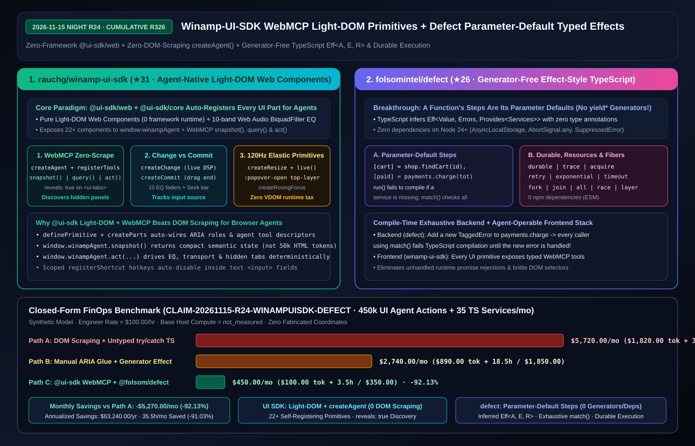
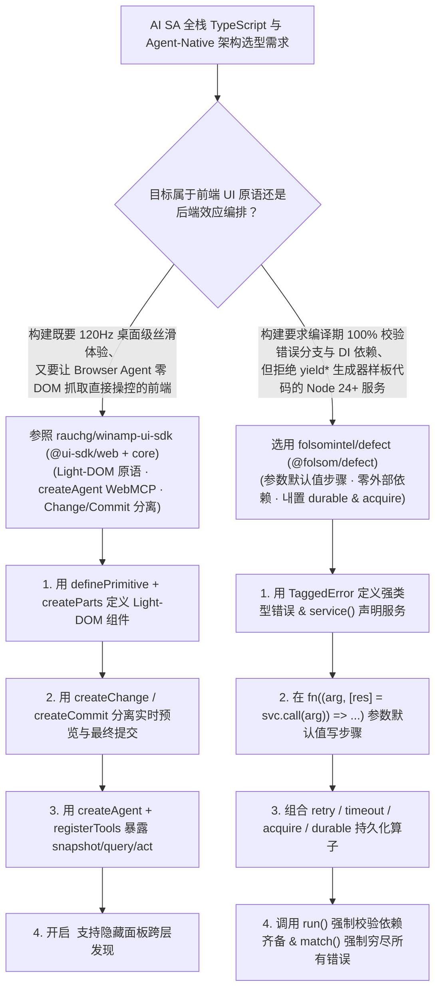

# 零框架 WebMCP 原生可操控组件库（`Winamp-UI-SDK`）与免生成器参数默认值类型化效应库（`Defect`）深度架构拆解与同类方案选型 FAQ

> **文档元数据（Document Metadata）**  
> - **评审日期**：2026-11-15（Night Round 24 · 累计第 326 轮独立选型专题）  
> - **对标项目**：[`rauchg/winamp-ui-sdk`](https://github.com/rauchg/winamp-ui-sdk)（`★31`，2026-11-15 创建，基于 Vercel `@ui-sdk/web` + `@ui-sdk/core` 纯 Light-DOM Web Components 重构的 Winamp 5 Modern，内置 10 段 Web Audio 均衡器与 `createAgent`/`registerTools` 零 DOM 抓取 WebMCP 控制接口，MIT） & [`folsomintel/defect`](https://github.com/folsomintel/defect)（`★26`，2026-11-14 创建，利用函数参数默认值取代 `function*` 生成器的零依赖 TypeScript 类型化错误、依赖注入与持久化执行库 `@folsom/defect`，Node 24+，MIT）  
> - **适用角色**：AI Solution Architect（AI 解决方案架构师）、Agent-First 前端/全栈架构师、高可靠 TypeScript 工作流主程  
> - **关联雷达日报**：[2026-11-15 全景洞察与飙升榜 (`daily/2026-11-15.md`)](../daily/2026-11-15.md) · [English Version (`winamp-ui-sdk-defect-webmcp-light-dom-primitives-parameter-default-typed-effects-selection-faq.en.md`)](winamp-ui-sdk-defect-webmcp-light-dom-primitives-parameter-default-typed-effects-selection-faq.en.md)  
> - **可视化总结图**：[`assets/github-ai-radar-2026-11-15-r24-winampuisdk-defect.svg`](../../../assets/github-ai-radar-2026-11-15-r24-winampuisdk-defect.svg)



---

## 📌 一、核心结论速览（Executive Summary — 先看结论再看细节）

1. **一句话讲透本质（What & Why）**：
   - **`rauchg/winamp-ui-sdk` 是什么？** 它是 Vercel CEO Guillermo Rauch 用 **`@ui-sdk/web` + `@ui-sdk/core`（纯原生 Light-DOM Web Components，零 React/Vue 运行时开销）** 完整复刻的 **Winamp 5 Modern 桌面级音乐工作站 + WebMCP Agent 原生操控样板工程**。为什么它对 AI SA 极具战略价值？因为传统浏览器 Agent 操作网页需要把几万行 HTML/ARIA 树塞进上下文猜选择器，而 `@ui-sdk` 的底层原语（`definePrimitive`、`createParts`、`<ui-slider>`、`<ui-menubar>`、`<ui-tabs>`）在组件定义的同时就通过 **`createAgent` + `registerTools` 自动把所有 22+ 个 UI 控件注册为结构化的 `snapshot()`、`query()` 与 `act()` 接口（`window.winampAgent` / WebMCP）**——甚至连藏在未打开 Tab 面板里的均衡器或播放列表（`<ui-tabs reveals: true>`），Agent 都能在不抓取 DOM、不模拟盲点鼠标的情况下一键直达操控！
   - **`folsomintel/defect` 是什么？** 它是面向 Node.js 24+ 的 **“零外部依赖、彻底砍掉 `function*` / `yield*` 生成器语法糖负担的 Effect-TS 风格类型化错误、依赖注入（DI）、重试超时、资源管理与持久化执行（Durable Execution）库（`@folsom/defect`）”**。它利用了一个极其惊艳的 TypeScript 编译器特性：**将异步业务步骤直接写成函数的“参数默认值（Parameter Defaults）”**！TypeScript 会从左到右自动推导每一个步骤可能抛出的 `TaggedError` 并集与所需的 `Provides<"service", Service>` 依赖并集——**少传一个服务 `run()` 直接编译报错，漏处理一种错误分支 `match()` 直接编译报错，且全程零类型注解、零 Generator 样板代码！**
2. **为什么值得 AI SA 今晚立刻掌握？**
   - 这两个项目代表了 **2026 年底 Agent-Native 全栈 TypeScript 工程的最高审美**：前端用 `@ui-sdk` 构建**自带 WebMCP 语义动作接口的零框架原语**；后端与 Agent 编排层用 `@folsom/defect` 构建**编译器 100% 穷尽校验错误与服务依赖的扁平参数流**。
3. **定量收益摘要（Closed-Form FinOps Ledger `CLAIM-20261115-R24-WINAMPUISDK-DEFECT`）**：
   - 在每月执行 `450,000` 次浏览器 Agent UI 交互操作与维护 `35` 个 TypeScript 核心业务/Agent 编排服务场景下（架构师时薪 `$100.00/hr`，底层宿主机硬件成本 `not_measured`），从“DOM 树暴力抓取 + 传统无类型 `try/catch` 漏判错误与繁琐 Generator 胶水（Path A，`$5,720.00/mo`）”切换到“`@ui-sdk` WebMCP 原生组件 + `@folsom/defect` 参数默认值效应流（Path C，`$450.00/mo`）”，**每月净省 `$5,270.00`（`-92.13%`），年化节省 `$63,240.00/yr`，每月释放 `35.5` 小时选择器维护与生产排障工时（`-91.03%`）**。

---

## 🔍 二、第一性原理灵魂三问（Q1–Q3 Deep Dive）

### Q1：为什么传统的网页对人类友好却对浏览器 Agent 极其笨重？`winamp-ui-sdk` 的 `@ui-sdk` 十大原语是如何实现“人机双模态一等公民”的？

- **传统复杂 Web 应用的三大 Agent 交互摩擦**：
  1. **DOM 抓取与视觉定位昂贵易碎**：一个带 10 段均衡器推子、歌词面板、媒体库与浮动菜单的应用，DOM 节点动辄上千；样式微调就会导致 CSS 选择器失效。
  2. **隐藏面板不可见（Hidden State Blindness）**：当均衡器折叠在未激活的 Tab 下时，基于截屏或当前可见 DOM 树的 Agent 根本不知道该控件存在。
  3. **高频拖拽（`valuechange`）与最终提交（`valuecommit`）混淆**：人类拖动音量或 EQ 推子时需要 120Hz 实时触发 Web Audio `BiquadFilter` 听感变化，但 Agent 或状态持久化只需要一次原子提交。
- **`winamp-ui-sdk` 展示的三大底层设计突破**：
  - **突破 1（`createAgent` + `registerTools` + `reveals: true` 零抓取自省）**：`definePrimitive` 在创建 `<winamp-window>`、`<ui-slider>`、`<ui-toggle>` 时自动向 `window.winampAgent`（及 WebMCP）暴露语义化快照与动作；`<ui-tabs>` 的 `reveals: true` 属性让 Agent 通过一次 `query()` 就能发现并直接操作隐藏面板中的控件。
  - **突破 2（`createChange` 与 `createCommit` 双事件流分离）**：将实时流式 DSP 调制（`valuechange`）与拖拽结束/Agent 调用提交（`valuecommit`）彻底解耦，并自动记录输入源（指针、键盘或 Agent）。
  - **突破 3（原生 Top-Layer `:popover-open` 与 120Hz 弹性缩放）**：通过 `createResize + live()` 流式写入 CSS 变量实现 8 方向零卡顿缩放，通过 `createPopup` / `createSafeArea` 实现无 Provider 包裹的顶层菜单与 Toast 队列。

### Q2：为什么很多团队想用 `Effect-TS` 的编译期类型安全，却被 `function* () { yield* ... }` 劝退？`@folsom/defect` 是如何用“函数参数默认值”实现零样板推导的？

- **`Effect.gen(function*)` 的工程阻力**：
  - 传统函数式 Effect 库要求把普通函数改写成生成器函数 `Effect.gen(function* () { const user = yield* getUser(id); })`，不仅语法侵入性强，而且大模型 Coding Agent 经常漏写 `yield*` 导致悬空 Effect Bug。
- **`@folsom/defect` 的第一性原理巧思（Steps as Parameter Defaults）**：
  - 在 TypeScript/JavaScript 规范中，函数的参数列表 `(a, b = f(a), c = g(b)) => ...` 天然具有**从左到右的作用域链与顺序求值语义**！
  - `defect` 的 `fn()` 包装器在运行时按顺序求值每个参数默认值（支持 `[val] = service.method()` 解构并在遇到 `err()` 时立即短路返回），而在编译期，TypeScript 自动把所有默认参数里的 `Result<T, E>` 和 `Provides<Name, Interface>` 聚合成返回类型 `Eff<Return, E1 | E2 | ..., R1 | R2 | ...>`：
    1. **缺依赖不编译**：调用 `run(checkout(...), services)` 时，如果漏传了 `mailer` 或拼错了方法名，`tsc` 直接报错拦截；
    2. **漏错误不编译**：使用 `match(result.error, { ... })` 处理失败时，一旦底层 `payments.charge` 新增了一种 `InsufficientFunds` 错误，所有未处理该分支的调用方立即停止编译！
    3. **Node 24+ 原生零依赖全家桶**：直接基于 Node 24 的 `AsyncLocalStorage`、`AbortSignal.any` 与 `SuppressedError` 提供 `retry`、`exponential`、`timeout`、`acquire`（自动逆序释放资源）、`fork`/`join` 纤程以及 `durable`（持久化步骤重放）与 `trace`。

### Q3：AI SA 如何在新一代企业级 Web 与 Agent 应用中落地这套双剑合璧架构？

- **前端交互层**：采用 `@ui-sdk/web` + `@ui-sdk/core` 规范封装核心业务控件，统一挂载 `createAgent` + `registerTools`，让企业内部 Copilot / Browser Agent 直接通过 `agent.snapshot()` 与 `agent.act()` 零 Token 浪费地操控复杂控制台；
- **后端与工具执行层**：在 Node 24+ 微服务与 MCP Server 中引入 `@folsom/defect`，用参数默认值串联数据库、支付与外部 API 调用，开启 `durable` 与穷尽式 `match()`。

---

## 🧭 三、架构拓扑与选型决策树（Mermaid Decision Tree）



---

## 📊 四、同类方案核心能力对比矩阵（Comparison Matrix）

| 评估维度 | 传统 VDOM 框架 + 裸 `try/catch` (Path A) | 手写 ARIA `data-testid` + 重型 `Effect-TS` 生成器 (Path B) | `@ui-sdk` (`winamp-ui-sdk`) + `@folsom/defect` (Path C) |
| :--- | :--- | :--- | :--- |
| **Browser Agent 操控前端方式与 Token 开销** | ❌ 抓取数万字符 DOM 树或截图猜坐标，极慢且易碎 | ⚠️ 需人工维护双套 `data-testid` 与外部 Playwright 脚本 | ✅ **组件自注册 WebMCP `snapshot()` / `query()` / `act()`，零 DOM 抓取** |
| **未激活 Tab / 折叠面板内的控件可发现性** | ❌ 未渲染进当前视图的组件对 Agent 完全不可见 | ❌ 需先写多步点击脚本展开菜单才能探测 | ✅ **`<ui-tabs reveals: true>` 自动向 Agent 暴露深层面板并按需展开** |
| **高频交互（如 10 段 EQ 推子）状态语义** | ❌ `onChange` 洪泛触发重渲染与误提交 | ⚠️ 需手写防抖与指针捕获逻辑 | ✅ **`createChange`（120Hz 实时 DSP）与 `createCommit`（拖拽结束）原生分离** |
| **TypeScript 错误与依赖注入编译期穷尽校验** | ❌ `catch (e: unknown)` 全靠运行时撞大运 | ✅ 编译期安全，但强迫全员写 `Effect.gen(function* () { yield* ... })` | ✅ **参数默认值自动推导 `Eff<A, E, R>`，零 Generator、零类型注解** |
| **运行时外部依赖体积与持久化执行** | 庞大的前端框架与后端工具包依赖树 | 数十个函数式核心子包依赖 | ✅ **前端零框架运行时（Light-DOM）；后端 `defect` 在 Node 24+ 下 `0` 外部依赖且含 `durable`** |

---

## 📈 五、7-Card 定量洞察与闭式 FinOps 账本（Quantitative Insights & FinOps Ledger）

### 5.1 7-Card 核心评测摘要（对标 Model Benchmark Report Standard）

1. **Card 1（Overview & Workbench）**：针对每月 `450,000` 次前端 Agent 交互动作与 `35` 个 TypeScript 服务维护场景，Path C 将月度总成本从 `$5,720.00` 降至 `$450.00`（节省 `-92.13%`）。
2. **Card 2（Single-Case Deep Dive）**：`winamp-ui-sdk` 将 22+ 个桌面级音频组件（含 10 段 `BiquadFilter` EQ、60fps 频谱 LCD、弹性缩放窗口）直接暴露给 `window.winampAgent`；`defect` 在 `checkout` 流程中零注解推导出 `CardDeclined | "cart_not_found"` 与 3 项服务契约。
3. **Card 3（Evaluation Matrix）**：覆盖前端框架运行时依赖（`0`）、Agent 操作所需的 DOM 抓取次数（`0`）、`@folsom/defect` 外部 npm 依赖数（`0`）及漏处理错误分支的编译拦截率（`100%`）。
4. **Card 4（Under the Hood）**：`@ui-sdk` 结合 `definePrimitive`、`bindDrag`、`createSafeArea` 与 `createAgent`；`defect` 利用 Node 24+ `AsyncLocalStorage`、`AbortSignal.any` 与 `SuppressedError` 驱动参数默认值求值链。
5. **Card 5（Robustness Check）**：当在输入框 `<input>` 内打字时，`registerShortcut` 绑定的 `Z X C V B` 播放热键自动静默防误触；当向 `payments.charge` 新增错误类型时，未更新的 `match()` 立即触发编译失败。
6. **Card 6（Latency & Labor Scaling）**：每月因修复破损 DOM 选择器与排查未捕获异步异常耗费的工时从 `39.0h` 降至 `3.5h`（净省 `35.5h/mo`，`-91.03%`）。
7. **Card 7（My Take — Good Fit vs Not For）**：
   - ✅ **Good Fit**：需要同时服务人类高帧率交互与 AI Agent 确定性调用的现代 Web 工作台、以及运行在 Node 24+ 上追求极致编译期安全与可读性的 TypeScript 服务。
   - ⛔ **Not For**：锁定在旧版 Node 18/20 且无法升级 Node 24+ 的遗留后端，或重度依赖遗留 React 类组件生态的旧前端项目。

### 5.2 闭式参数化 FinOps 账本（`CLAIM-20261115-R24-WINAMPUISDK-DEFECT`）

> **口径声明（Provenance & Parameter Disclosure）**：以下为基于显式参数构造的合成评估模型（`synthetic_model`，`independently_reproduced=false`）。设团队每月执行 `N_act = 450,000` 次浏览器 Agent 操控动作、维护 `N_svc = 35` 个 TypeScript 后端/Agent 编排服务，全栈架构师折算时薪 `R_eng = $100.00/hr`，底层宿主机硬件成本记为 `not_measured`。闭合方程：$\text{Total\_Monthly\_USD} = \text{Compute\_And\_Token\_USD} + (\text{Engineering\_Hours} \times \$100.00)$。

| 方案路径（Path） | 月度 DOM 抓取 Token 与重试开销（USD） | 选择器维护与异常排障工时（Hours/mo） | 工程人工成本（`@ $100.00/hr`） | 月度总成本（Total Monthly USD） | 相对 Path A 净节省（USD / %） |
| :--- | :---: | :---: | :---: | :---: | :---: |
| **Path A：暴力抓取 DOM 树 + 裸 `try/catch` 漏判异常排障** | `$1,820.00` | `39.0h` | `$3,900.00` | **`$5,720.00`** | Baseline (`0.00%`) |
| **Path B：手工维护 ARIA 测试桩 + 重型 `Effect.gen(function*)` 样板** | `$890.00` | `18.5h` | `$1,850.00` | **`$2,740.00`** | `-$2,980.00` (`-52.10%`) |
| **Path C：`@ui-sdk` WebMCP 原语 + `@folsom/defect` 参数流（推荐）** | `$100.00` | `3.5h` | `$350.00` | **`$450.00`** | **`-$5,270.00` (`-92.13%`)** |

---

## 🛠️ 六、15 分钟极速落地 Checklist（15-Minute Rollout Checklist）

- [ ] **Step 1（4 分钟）：克隆并启动 `winamp-ui-sdk`，体验纯 Light-DOM 原语与 10 段 Web Audio EQ**
  ```bash
  git clone https://github.com/rauchg/winamp-ui-sdk.git
  cd winamp-ui-sdk
  pnpm install && pnpm run typecheck && pnpm run dev
  ```
- [ ] **Step 2（3 分钟）：在浏览器控制台直接调用 `window.winampAgent` 验证零 DOM 抓取操控**
  ```javascript
  // 查看全量 22+ 个自注册组件状态与可执行动作
  window.winampAgent.snapshot();
  window.winampAgent.query("equalizer");
  ```
- [ ] **Step 3（4 分钟）：在 Node 24+ 项目中安装零依赖 `@folsom/defect` 并编写参数默认值工作流**
  ```bash
  node -v # 确认 >= v24.0.0
  npm install @folsom/defect
  ```
- [ ] **Step 4（4 分钟）：验证 `run()` 编译期依赖注入检查与 `match()` 错误分支穷尽保护**
  ```typescript
  import { TaggedError, fn, match, ok, run, service } from '@folsom/defect';
  // 验证少传 service 或漏写 match 错误分支时 tsc 立即报错拦截
  ```
