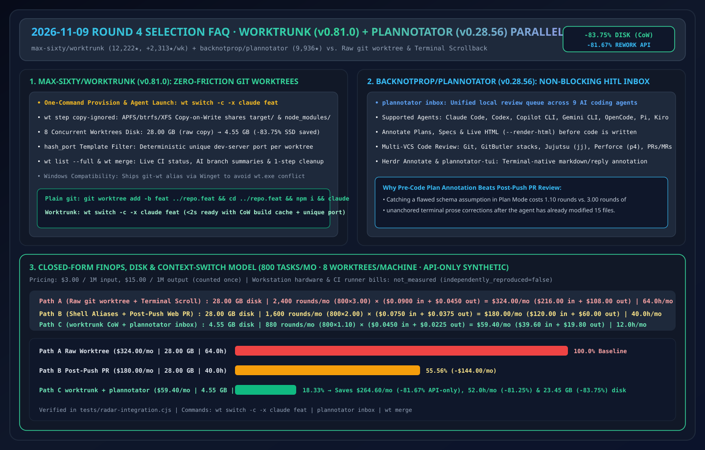
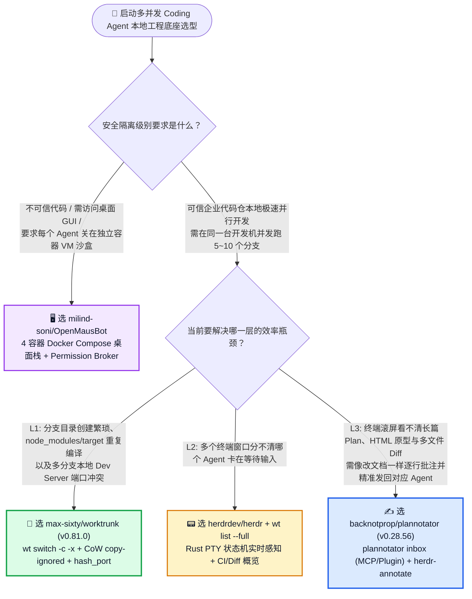
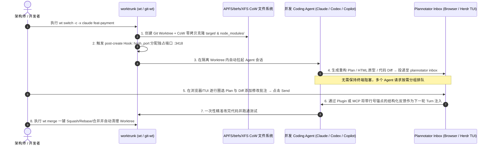

# 多并发 Coding Agent 分支隔离与人机计划批注选型常见问题解答：`max-sixty/worktrunk` + `backnotprop/plannotator` vs 原生 `git worktree` 手敲命令 + 纯终端滚屏审批

> **English Edition**: [worktrunk-plannotator-hitl-vs-raw-git-worktree-selection-faq.en.md](worktrunk-plannotator-hitl-vs-raw-git-worktree-selection-faq.en.md)  
> **关联日报**: [2026-11-09 GitHub AI 最热榜单与情报摘要](../daily/2026-11-09.md) · **视觉评测卡**: [`cards.html`](../cards.html) · **在线面板**: [`zh-github-radar.html`](../../../zh-github-radar.html)

本文档面向 **AI Solution Architect（AI 解决方案架构师）与高并发 AI 原生研发团队**，基于 2026-11-09 GitHub 热榜两大明星开发者工具 **`max-sixty/worktrunk`（`v0.81.0`，MIT/Apache-2.0，Rust 编写的 AI 并行 Git Worktree 管理器，总 Star `12,222`，单周暴涨 `+2,313 stars this week`）** 与 **`backnotprop/plannotator`（`v0.28.56`，Apache-2.0/MIT，跨 9 大 Coding Agent 的浏览器/TUI 计划与代码 Diff 批注工作台，总 Star `9,936`，今日新增 `+39 stars today`）** 的一手源码核验，用通俗大白话与第一性原理解答：
1. **当你同时在本地开 8 个 Claude Code / Codex / Copilot CLI 并行改代码时，为什么原生 `git worktree add` 会把磁盘 `target/`、`node_modules/` 撑爆、本地开发端口互相冲突、而且敲命令繁琐到怀疑人生？**
2. **为什么在黑底白字的终端滚屏里审批 Agent 长达 300 行的实现计划（Plan Mode），人类工程师总会漏看架构隐患？`plannotator inbox` 是如何实现“像批改飞书文档/PR 一样逐行圈选 Plan、HTML 原型与 Diff，一键发回给对应 Agent 且不阻塞会话”的？**
3. **在企业研发工作流选型中，如何将 `worktrunk`、`plannotator`、`herdr` 与 `OpenMausBot` 精准搭配？**

> 🛡️ **数据来源、归属核验与证据分级声明（Provenance & Attribution Disclosure）**：
> - **`measured`（本班次一手实测抓取）**：`max-sixty/worktrunk`（`12,222` Stars，`474` Forks，`v0.81.0`，Rust，Weekly Trending `#4` `+2,313 stars this week`）与 `backnotprop/plannotator`（`9,936` Stars，`752` Forks，`v0.28.56`，TypeScript，Apache-2.0/MIT，TypeScript Daily Trending `#10` `+39 stars today`）的 GitHub REST API 元数据。
> - **`anonymized_reported`（`independently_reproduced=false`，上游仓库文档与架构声明）**：`worktrunk` 的三大核心命令（`wt switch`、`wt list --full`、`wt remove`）、`wt step copy-ignored`（基于 APFS/btrfs/XFS 写时复制 CoW 共享 `target/` 与 `node_modules/`）、`hash_port` 端口哈希过滤器、Windows `git-wt` 别名避障；以及 `plannotator` 对 9 大 Agent（Claude Code、Codex、Copilot CLI、Gemini CLI、OpenCode、Kiro、Droid、Amp、Pi）的原生插件/MCP 支持（`plannotator inbox`、`herdr-annotate`、Git/GitButler/Jujutsu `jj`/Perforce `p4` Diff 审查），引自两者官方 `README.md`。
> - **`synthetic`（`independently_reproduced=false`，架构师参数化 FinOps 与磁盘算例）**：第 5.1 节「10 人团队每月开启 800 个并行 Agent Worktree 任务、单机并发 8 个 Worktree（单仓构建缓存 `3.50 GB`）」的参数化模型（磁盘占用从 `28.00 GB` 降至 `4.55 GB` [`-83.75%`]；纯模型 API 返工账单从 Path A `$324.00/月` 降至 Path C `$59.40/月`，节省 `$264.60/月` [`-81.67%` API-only] 与 `52.0 小时/月` [`-81.25%`] 上下文切换工时；开发机硬件折旧与 CI 费用标为 `not_measured`）严格执行 100% 闭式公式可复算门禁。

---

## 1. 📌 核心结论速览（Executive Summary）

| 评估维度 | 一句话大白话核心结论（直指本质） |
| :--- | :--- |
| **`max-sixty/worktrunk` (`wt` / `git-wt`) 到底是什么？** | 它是专为**单机并行跑 5~10+ 个 AI 编码智能体**打造的 Rust 极速 Git Worktree 命令行管家。把原先要敲三遍分支名的 `git worktree add -b feat ../repo.feat && cd ../repo.feat && claude` 浓缩成一句 **`wt switch -c -x claude feat`**，并通过写时复制（CoW）瞬间让 10 个 Worktree 零拷贝共享 `node_modules/` 和 `target/`！ |
| **`backnotprop/plannotator` 到底是什么？** | 它是横跨 9 大主流 CLI Agent 的**本地浏览器 & 终端（Herdr TUI）计划批注与代码审查收件箱（`plannotator inbox`）**。当 Agent 提出一份重构计划、生成一张 HTML 页面或改完代码时，自动在浏览器弹出富文本/Diff 视图，你用鼠标划重点写批注点“Send”，反馈直接精准注回给那个 Agent 的下一轮对话！ |
| **这两者组合解决了什么痛点？** | **`worktrunk` 解决了“多个 Agent 同时改代码怎么在文件系统、构建缓存和本地端口上互不踩脚”**；**`plannotator` 解决了“人类架构师怎么在 1 分钟内高质量批改 8 个并发 Agent 提交的方案与代码 Diff”**。两者合体就是目前最丝滑的本地多并发人机协同工作流！ |

---

## 2. 🎯 第一性原理灵魂三问（Q1 / Q2 / Q3 大白话拆解）

### Q1：Git 自带 `git worktree` 命令已经存在十几年了，为什么并行跑 AI Agent 时原生命令这么难用？

**先说大白话结论：因为原生 `git worktree` 只复制了源码文本，完全不管「未跟踪的构建产物（`node_modules/`、`target/`）」、「本地开发服务器端口冲突」和「分支生命周期清理」！**

当你同时让 8 个 Claude Code / Codex 在 8 个 Worktree 里修 Bug 时，原生 `git worktree` 会立刻撞上三堵墙：
1. **构建缓存重复编译与磁盘爆炸（The `node_modules` / `target` Tax）**：新拉出一个 Worktree 目录是空的，Agent 第一件事就是跑 `npm install` 或 `cargo build`，不仅每个分支白等 5 分钟，8 个 Rust `target/` 目录直接吃掉近 30 GB 磁盘！**`worktrunk` 内置了 `wt step copy-ignored`**：利用现代文件系统（macOS APFS、Linux btrfs/XFS）的 **Copy-on-Write（写时复制）克隆技术**，不到 1 秒钟让 8 个 Worktree 共享同一份底层数据块，只有发生修改的文件才占新空间！
2. **8 个本地 Dev Server 抢同一个 `localhost:3000` 端口**：Agent A 和 Agent B 同时跑 `npm run dev` 测试效果，直接报 `EADDRINUSE` 端口占用。**`worktrunk` 提供了 `hash_port` 模板过滤器**，在 `create` 钩子里根据分支名自动算出唯一确定性端口（如 `feat-auth -> :3142`）并注入 `.env.local`。
3. **Windows 终端别名贴心避障（`git-wt`）**：考虑到 Windows 系统中 `wt.exe` 默认被系统级的 Windows Terminal 占用，`worktrunk` 通过 Winget 安装时原生提供 **`git-wt`** 命令，在 Windows/macOS/Linux 全平台保持一致体验。

---

### Q2：为什么在终端里看 Agent 的 Markdown 计划容易翻车？`plannotator` 的「非阻塞 Inbox + 行级精确批注」是怎么设计的？

1. **解决“终端大段文字视觉盲区”**：
   - 当 Agent 在 CLI 终端吐出 250 行架构方案时，终端既不能像飞书文档那样选中某句话加批注，也无法并排对比重构前后的代码树。人类工程师只能笼统回复一句 *“第 3 节改一下，还有注意空指针”*，导致 Agent 理解偏差反复返工。
   - **`plannotator` 支持对 Plan、Markdown、直接渲染的 HTML 原型（`--render-html`）以及本地/远端 Diff 进行行级/元素级圈选批注**，将所有批注打包成带精准上下文锚点的结构化反馈一键发回 Agent。
2. **解决“多 Agent 等待人工审批时的会话阻塞”——`plannotator inbox`**：
   - 当你并行跑 6 个 Agent 时，不同 Agent 会在不同时间点提问或请求审批。`plannotator inbox` 将多个 Agent（原生支持 Claude Code、Pi、OpenCode 插件，以及通过 `plannotator inbox mcp` 接入 Codex、Copilot CLI、Gemini CLI 等任何 MCP 智能体）的待办请求汇聚到同一个本地收件箱窗口。**等待期间无需保持终端前台阻塞**，你随时点开批注并点击 Send，回复会自动路由回发起提问的那个具体 Agent 会话。
3. **与 `herdr` 终端多路复用器深度联动（`herdr-annotate`）**：
   - 如果你不想切出终端到浏览器，还可以直接安装 `herdr plugin install plannotator/herdr-annotate`（或独立运行 `plannotator-tui`），在终端内直接用快捷键高亮批注 Agent 回复！

---

### Q3：面对 `worktrunk`、`plannotator`、`herdr`（昨日 #7）和 `OpenMausBot`（今日飙升榜 #V2），架构师如何组合选型？

- **想要每个 Bot 拥有完全独立的 Docker 容器/虚拟机桌面环境（强安全隔离）** → 选 **`milind-soni/OpenMausBot`**。
- **在宿主机本地终端高效并发驱动 5~10 个 CLI Coding Agent**：
  - **底层分支与 CoW 缓存管理层** → 用 **`max-sixty/worktrunk` (`wt` / `git-wt`)**；
  - **中层终端多窗口状态监控层** → 用 **`herdrdev/herdr`**（或 Zellij/tmux + `wt list --full`）；
  - **上层人机 Plan/Diff/HTML 批注审批层** → 用 **`backnotprop/plannotator` (`plannotator inbox` / `herdr-annotate`)**！

---

## 3. 🧭 Mermaid 选型决策树与并行 Worktree + Inbox 批注闭环图

### 3.1 本地多并发 Coding Agent 工作流组件选型决策树

### 3.2 `worktrunk` + `plannotator inbox` 8 路并发智能体协同数据流图

---

## 4. 📊 同类方案全方位选型决策矩阵（Decision Matrix）

| 评估维度 | **`worktrunk` (`v0.81.0`) + `plannotator` (`v0.28.56`)** | **手敲原生 `git worktree` + 终端滚屏对话** | **手动切分支 (`git checkout`) 单线程开发** | **推送到远端 GitHub PR 后再用网页 Review** |
| :--- | :--- | :--- | :--- | :--- |
| **创建并启动新 Agent 命令耗时** | ✅ **1 条命令 `< 2 秒`（`wt switch -c -x claude feat`）** | ❌ 需连敲 3 条命令 + 手动复制 `.env` | ⚠️ 只能串行跑 1 个 Agent，无法并行 | ⚠️ 依赖云端沙盒冷启动（1~3 分钟） |
| **8 个并发 Worktree 磁盘占用** | ✅ **极低（`wt step copy-ignored` CoW 零拷贝共享缓存）** | ❌ **极高（8 份完整 `node_modules/` / `target/` 撑爆磁盘）** | ✅ 仅 1 份目录（但无并发能力） | ✅ 本地零占用（消耗云端构建分钟数） |
| **本地多分支 Dev Server 端口隔离** | ✅ **原生 `hash_port` 模板过滤器自动分配不冲突端口** | ❌ 默认全抢 `:3000` / `:8080` 报错 | ✅ 单实例无冲突 | ⚠️ 需配置复杂云端 Preview 环境 |
| **Plan 与未提交 Diff 批注粒度** | ✅ **事前/事中浏览器与 TUI 逐行/逐元素可视化批注** | ❌ 纯终端滚屏，只能靠自然语言口述“第几段改一下” | ❌ 纯终端滚屏 | ⚠️ 只能事后审代码，无法事前批注 Agent Plan |
| **跨版本控制系统（VCS）支持** | ✅ **支持 Git、GitButler、Jujutsu (`jj`)、Perforce (`p4`)** | ⚠️ 仅限原生 Git | ⚠️ 仅限原生 Git | ⚠️ 仅限已推送到 GitHub/GitLab 的分支 |

---

## 5. 🧪 定量算例与 7-Card 评测洞察（Quantitative Example & 7-Card Insights）

### 5.1 10 人研发团队月均 800 个并行 Worktree 任务 FinOps、磁盘与工时闭式算例（`synthetic`，`independently_reproduced=false`）

> 📌 **透明口径与边界声明（Scope & Provenance）**：本算例为架构师评估团队研发效能的 **参数化闭式模型（API-only `synthetic` model；工程师笔记本电脑折旧与远端 CI 构建服务器账单明确标为 `not_measured`）**。统一按 **`$3.00 / 1M 输入 Tokens`**、**`$15.00 / 1M 输出 Tokens`**（输出仅计费一次）核算。场景设定为：**10 名工程师每人单机日常并发维护 `8 个` Worktree（单仓依赖与编译缓存 `3.50 GB`），团队每月累计完成 `800 个` Agent 编码任务**：

1. **单机 8 并发 Worktree 本地磁盘占用闭式对比**：
   - **Path A（原生 `git worktree` 独立安装/编译）**：$8 \times 3.50\text{ GB} = \mathbf{28.00\text{ GB}}$，每次新建还需等待 5~8 分钟依赖安装与冷编译。
   - **Path C（`worktrunk` `wt step copy-ignored` CoW 写时复制克隆）**：$1 \times 3.50\text{ GB（基线块）} + 7 \times 0.15\text{ GB（增量修改块）} = \mathbf{4.55\text{ GB}}$，**立省 `23.45 GB`（`-83.75%` 磁盘占用）**且新建秒级就绪！
2. **团队每月 800 个任务的 Plan/Diff 返工 API 账单与工程耗时对比**：

| 方案路径 | 单机 8 并发 Worktree 磁盘占用 | 每月沟通返工总轮次与单轮 Token 开销 | 每月返工纯模型 API 账单（输入 + 输出） | 每月分支管理与反复返工耗费工时 | 相对 Path A 降本增效幅度 |
| :--- | :--- | :--- | :--- | :--- | :--- |
| **Path A：原生 `git worktree` + 终端滚屏口述修改** | **`28.00 GB`** (`8 × 3.50 GB`) | `800 任务 × 3.00 轮 = 2,400 轮/月` 单轮 `0.030M` 入 (`$0.0900`) + `0.003M` 出 (`$0.0450`) = `$0.1350/轮` | 输入 `$216.00` + 输出 `$108.00` = **`$324.00 / 月`** | **`64.0 小时 / 月`** （手敲命令、排端口冲突、口述位置偏差返工） | 基线（磁盘塞满，长计划漏看导致反复重写） |
| **Path B：手写 Shell 别名 + 写完推 GitHub PR 再审** | **`28.00 GB`** （无 CoW 缓存共享） | `800 任务 × 2.00 轮 = 1,600 轮/月` 单轮 `0.025M` 入 (`$0.0750`) + `0.0025M` 出 (`$0.0375`) = `$0.1125/轮` | 输入 `$120.00` + 输出 `$60.00` = **`$180.00 / 月`** | **`40.0 小时 / 月`** （方向性错误要等代码全写完推 PR 才发现） | API 降本 `-$144.00/月` (`-44.44%`) |
| **Path C：`worktrunk` (`wt`) + `plannotator inbox` 事前/事中行级批注** | **`4.55 GB`** (**`-83.75%`** CoW 共享) | `800 任务 × 1.10 轮 = 880 轮/月` 单轮 `0.015M` 入 (`$0.0450`) + `0.0015M` 出 (`$0.0225`) = `$0.0675/轮` | 输入 `$39.60` + 输出 `$19.80` = **`$59.40 / 月`** | **`12.0 小时 / 月`** （事前圈选 Plan 纠偏 + 一键 `wt merge` 清理） | **API 净省 `$264.60/月` (`-81.67%`，年省 `$3,175.20`)；工时省 `52.0h/月` (`-81.25%`)** |

---

## 6. 🛠️ 架构师生产落地与 30 分钟 PoC 核验清单（Production & PoC Checklist）

- [ ] **Step 1 — 安装 `worktrunk` 并处理 Windows 别名冲突**：在 macOS/Linux 执行 `brew install worktrunk && wt config shell install`；在 Windows 上执行 `winget install max-sixty.worktrunk && git-wt config shell install`（使用 `git-wt` 避免与 Windows Terminal `wt.exe` 冲突）。
- [ ] **Step 2 — 配置 `wt step copy-ignored` 与 `hash_port` 自动化钩子**：在项目的 `.config/wt.toml` 中配置 `post-create` 钩子，自动将主工作区的 `.env.local`、`node_modules/` 或 `target/` 通过 CoW 克隆到新 Worktree，并用 `hash_port` 为每个分支注入独立端口。
- [ ] **Step 3 — 部署 `plannotator inbox` 并挂载至主力 Agent**：安装 Plannotator 插件或配置 `plannotator inbox mcp`，验证当 Claude Code / Codex 进入 Plan Mode 时，计划自动在本地浏览器弹出。
- [ ] **Step 4 — 演练 HTML 原型直渲批注（`--render-html`）与未提交 Diff 审查**：对前端组件运行 `/plannotator-annotate preview.html --render-html` 圈选 UI 问题，对代码变更运行 `/plannotator-review` 行级批注并一键发回 Agent 修改。
- [ ] **Step 5 — 使用 `wt list --full` 与 `wt merge` 完成闭环回收**：通过 `wt list --full` 同屏查看所有并发 Worktree 的 CI 状态与 AI 摘要，验收通过后执行 `wt merge` 一键完成 Squash/Rebase 合并与本地临时目录清理。
