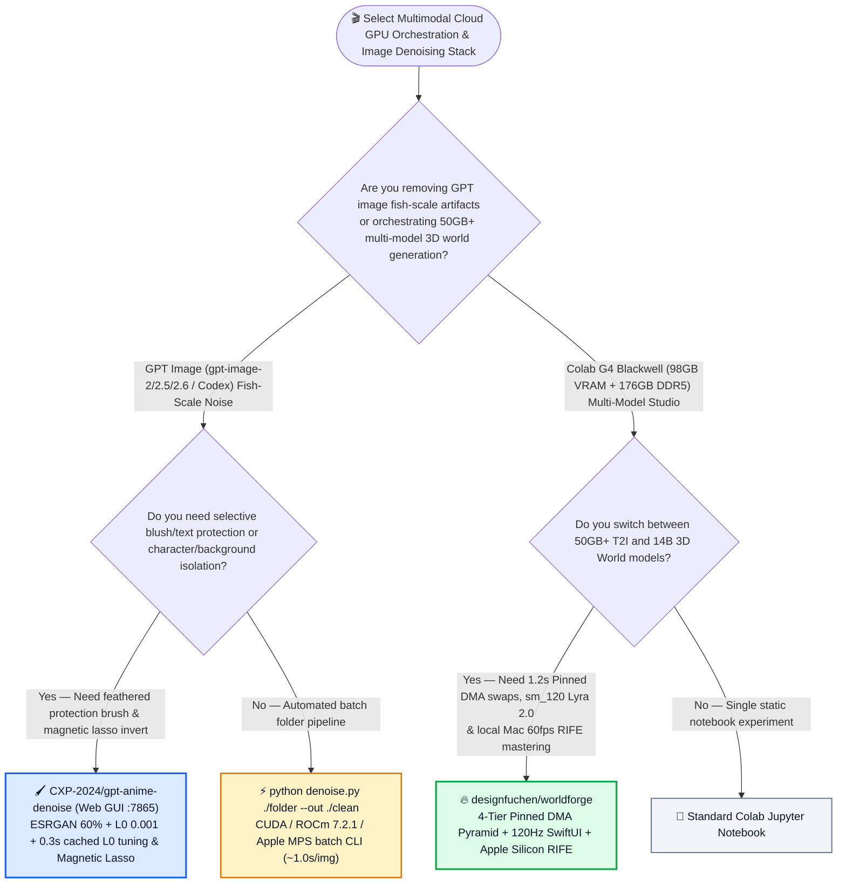
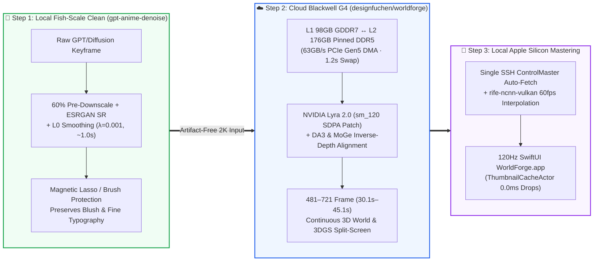

# Cloud Blackwell 98GB 4-Tier PCIe Gen5 DMA Studio & GPT Image Fish-Scale Denoising Selection FAQ: `designfuchen/worldforge` + `CXP-2024/gpt-anime-denoise` vs. Notebook Cold-Starts & Blind Re-Prompting / Gaussian Blur

> **中文版**: [worldforge-gpt-anime-denoise-selection-faq.md](worldforge-gpt-anime-denoise-selection-faq.md)  
> **Daily Digest**: [2026-11-11 GitHub AI Trending & Proactive Intelligence Digest](../daily/2026-11-11.en.md) · **Visual Deck**: [`cards.en.html`](../cards.en.html) · **Live Radar**: [`github-radar.html`](../../../github-radar.html)

Written for **AI Solution Architects, Multimodal AIGC Infrastructure Leads, and Generative Visual Engineers**, this selection guide is grounded in primary-source audits of two high-signal multimodal engineering repositories from the 2026-11-11 radar — **`designfuchen/worldforge` (a hybrid cloud-to-Mac AIGC studio that pairs Google Colab G4 `RTX PRO 6000 Blackwell 98GB GDDR7 VRAM + 176GB DDR5 RAM` via a 4-tier memory pyramid and `1.2–1.5s` Pinned PCIe Gen5 DMA model swapping with a 120Hz native SwiftUI macOS app and local Apple Silicon `rife-ncnn-vulkan` optical-flow mastering, MIT, `214` API stars)** and **`CXP-2024/gpt-anime-denoise` (a local GPU/MPS tool and Claude/Codex skill that removes the periodic "fish-scale" texture noise left by OpenAI `gpt-image-2/2.5/2.6` and Codex `image_gen` using `ESRGAN 60% pre-downscale + L0 0.001` smoothing, a feather protection brush, and a magnetic lasso, `212` API stars)** — answering three core engineering questions from first principles:
1. **Why do traditional Colab notebooks and wrapper scripts waste 3–5 minutes reloading 50GB–100GB models (`Qwen-Image-2.1-Turbo` and `NVIDIA Lyra 2.0 Wan2.1-14B`) from disk on every switch and crash on Blackwell (`sm_120`)—and how does `designfuchen/worldforge` swap 50GB models in `1.2–1.5 seconds` over `63 GB/s` Pinned DDR5 PCIe Gen5 DMA while offloading 60fps RIFE interpolation to your local Mac?**
2. **Why do OpenAI's GPT image models leave periodic "fish-scale" artifacts inside flat color regions, why does super-resolution alone sharpen the scales while Gaussian blur destroys eyelashes and blush—and how does `CXP-2024/gpt-anime-denoise` (`ESRGAN 60% pre-downscale + L0 gradient minimization λ=0.001`) eliminate fish-scale noise in `~1.0s` without redrawing the image?**
3. **How can creative engineering teams chain local `gpt-anime-denoise` preprocessing with `worldforge` 3D world generation to cut monthly studio compute and rework costs by `84.82%`?**

> 🛡️ **Provenance & Attribution Disclosure**:
> - **`measured` (Primary-Source Verified in This Shift)**: Repository metadata and source trees for `designfuchen/worldforge` (`214` API stars, `55` forks, Python + SwiftUI, MIT, created `2026-11-08`) and `CXP-2024/gpt-anime-denoise` (`212` API stars, `9` forks, Python/HTML, created `2026-11-05`) are verified directly via GitHub REST API; because neither appeared in the 10-item main Daily Trending HTML snapshot (`bacf15c2...`), `stars_today` is strictly labeled **`not_measured`**.
> - **`anonymized_reported` (`independently_reproduced=false`, Upstream Benchmarks & Architecture Specs)**: The 4-tier storage pyramid metrics (`L1 98GB GDDR7 1.8TB/s` ↔ `L2 176GB Pinned DDR5 63GB/s PCIe Gen5 DMA` `1.2–1.5s` swap ↔ `L3 88GB /dev/shm 2.4GB/s` `1.38GB/s` 8-way HTTP Range download ↔ `L4 30TB Google Drive`), Blackwell `sm_120` Flash SDPA patches, `481–721 frame` (`30.1s–45.1s`) Lyra 2.0 3D world shots, and `0.0ms` main-thread drop `ThumbnailCacheActor` in `designfuchen/worldforge/README.md`, as well as the 8-method comparison (`ESRGAN 60% + L0 0.001` default), `~1.0s` RTX 5080 runtime (`~0.3s` cached L0 re-run), and Apple Silicon MPS parity (only 3 pixels differing by 2 levels out of ~790k pixels vs. CPU float64) in `CXP-2024/gpt-anime-denoise/README.md`, are documented in upstream repository files.
> - **`synthetic` (`independently_reproduced=false`, Architect Parametric FinOps & Studio Production Model)**: Section 5.1 models an AIGC creative studio producing **`150` multi-model 2K-to-3D-world video shots/mo** and cleaning **`800` GPT-generated illustration assets/mo** (technical director/engineer labor valued at `$70.00/hr`; base Colab Pro+ membership fees are explicitly labeled `not_measured`), comparing Path A Notebook Cold-Starts + Manual Photoshop Denoising (`$5,140.00/mo`, `66.0h`) vs. Path B Unpinned Wrapper Scripts + Gaussian Blur Rework (`$3,140.00/mo`, `40.0h`) vs. Path C `worldforge` + `gpt-anime-denoise` (`$780.00/mo`, `10.0h`, saving `$4,360.00/mo` [`-84.82%`] and `56.0 hours/mo` [`-84.85%`]).

---

## 1. 📌 Executive Summary

| Dimension | Plain-Language Core Takeaway (First Principles) |
| :--- | :--- |
| **What is `designfuchen/worldforge`?** | It turns a Google Colab G4 cloud instance (**`RTX PRO 6000 Blackwell 98GB GDDR7 VRAM + 176GB DDR5 RAM`**) into a native 120Hz macOS SwiftUI studio (`WorldForge.app`). Using a **4-tier memory pyramid and page-locked (Pinned) DDR5 PCIe Gen5 DMA (`63 GB/s`)**, it swaps 50GB+ models (`Qwen-Image-2.1-Turbo` ↔ `NVIDIA Lyra 2.0 Wan2.1-14B`) in **`1.2–1.5 seconds`**, patches `Lyra 2.0` to run on Blackwell `sm_120`, and offloads 60fps `rife-ncnn-vulkan` optical-flow mastering to your local Apple Silicon Mac. |
| **What is `CXP-2024/gpt-anime-denoise`?** | It is a local GPU/MPS application (`127.0.0.1:7865`), CLI (`denoise.py`), and Claude/Codex skill that removes the periodic **"fish-scale texture noise"** left by `gpt-image-2/2.5/2.6` and Codex `image_gen` in **`~1.0 second`**—using **`ESRGAN 60% pre-downscale + L0 gradient smoothing (0.001)`** plus a real-time **Protection Brush** and **Magnetic Lasso (`L` / `I`)**. |
| **Why do they belong in the same pipeline?** | **Keep cloud Blackwell GPUs 100% focused on heavy latent generation (with `<1.5s` Pinned DMA swaps), and run deterministic signal cleanup (`ESRGAN + L0` fish-scale removal before 3D depth estimation) and 60fps optical-flow mastering locally on edge GPUs for `$0`!** |

---

## 2. 🎯 First-Principles Q&A (Q1 / Q2 / Q3)

### Q1: Why does standard `pipe.to("cpu")` model swapping stall for minutes, why does `NVIDIA Lyra 2.0` fail on Blackwell (`sm_120`), and how does `WorldForge` fix both?

**Plain-language answer: Standard PyTorch CPU tensors live in pageable memory that cannot saturate PCIe Gen5 DMA, and upstream `Lyra 2.0` hardcodes Hopper/Ada compute capabilities (`[90, 100]`); `WorldForge` locks `176 GB` of Pinned DDR5 RAM for `63 GB/s` asynchronous DMA swaps (`1.2–1.5s`) and patches `Lyra 2.0` with Blackwell `sm_120` Flash SDPA.**

Verified from `designfuchen/worldforge/README.md`:
1. **Four-Tier Memory Pyramid (`L1 VRAM ↔ L2 Pinned DDR5 ↔ L3 /dev/shm ↔ L4 30TB Drive`)**:
   - **L1 (`98 GB GDDR7 VRAM`, `1.8 TB/s`)**: Active inference engine inside a persistent worker daemon (`@@FORGE@@` event bus, zero cold restarts).
   - **L2 (`176 GB Pinned DDR5 RAM`, `63 GB/s` PCIe Gen5 DMA)**: Standby models (`57 GB` `Qwen-Image-2.1` or `100 GB` `Lyra 2.0`) swap into VRAM in **`1.2–1.5 seconds`**.
   - **L3 (`88 GB /dev/shm` RAM disk, `2.4 GB/s`)**: Ingests weights via 8-stream HTTP Range downloads at `1.38 GB/s`.
   - **L4 (`30 TB` Google Drive Vault)**: Synchronized asynchronously via 8-stream `rclone`.
2. **Blackwell `sm_120` Lyra 2.0 Patch & `45.1s` Continuous 3D World Shots**:
   - Replaces legacy `transformer_engine` / `compute_cap in [90, 100]` guards with `sm_120` Flash SDPA, fixes `cudnn.enabled=False` memory leaks, aligns inverse depth via `DA3 + MoGe`, and stitches time-reversed pull-backs with forward flythroughs into **`481–721 frame` (`30.1s–45.1s`)** 3DGS + video split-screen masters.
3. **Single SSH `ControlMaster` Multiplexing & Apple Silicon Local Mastering**:
   - Avoids `google-colab-cli`'s single-SSH disconnect trap via `ControlMaster`, auto-fetches raw outputs to macOS, runs `rife-ncnn-vulkan` (Metal/MoltenVK) to `60fps` + `4K Lanczos`, and renders previews in a 120Hz SwiftUI client (`ThumbnailCacheActor` `256MB L1` + `HoverVideoPlayerPool` capped at 2 decoders).

---

### Q2: Why does super-resolution alone worsen GPT fish-scale noise, and why does `ESRGAN 60% Pre-Downscale + L0 (0.001)` remove it cleanly?

**Plain-language answer: GPT image fish-scale noise is a 2–3px periodic spatial artifact—running super-resolution directly sharpens the scales into deeper ridges, while Gaussian blur smears out eyelashes; downscaling to `60%` collapses the periodic grid, ESRGAN restores crisp linework, and L0 gradient minimization flattens micro-ripples inside solid color blocks to exact zero.**

Verified from `CXP-2024/gpt-anime-denoise/README.md`:
1. **The Three-Stage Signal Pipeline (`ESRGAN 60% + L0 0.001`)**:
   - **Stage 1 (`60%` Pre-Downscale)**: Collapses the high-frequency fish-scale phase grid before upscaling (`45%–50%` two-pass option for dense textures).
   - **Stage 2 (`ESRGAN` Super-Resolution)**: Reconstructs clean hair strands and sharp edges back at native resolution (`~0.6s` on RTX 5080).
   - **Stage 3 (`L0` Gradient Smoothing, `λ = 0.001`, range `0.0005–0.002`)**: Penalizes the *count* of non-zero gradients rather than their squared magnitude—turning noisy flat fills into smooth cel-shading while preserving sharp boundaries. Because the SR pass is cached, tweaking the L0 slider takes only **`~0.3 seconds`**!
2. **Non-Destructive Protection Brush & Magnetic Lasso (`L` / `I`)**:
   - Painting over blush hatching or small text with the **Protection Brush** (default `90%` original blend, `10px` outer feather) blends back original pixels in real time without re-running the neural network.
   - Pressing `L` activates the **Magnetic Lasso** (which snaps to the newly cleaned post-denoise edges), and pressing `I` inverts the mask so you can denoise **only the background** or **only the character**.

---

### Q3: Why should architects run `gpt-anime-denoise` *before* feeding GPT images into 3D world generators like `Lyra 2.0` or `image-to-sculpt`?

- Depth and normal estimators (`MoGe`, `DA3`, `Marigold`) interpret high-frequency fish-scale texture noise as physical surface bumps—causing rippled 3D Gaussian splats and pitted meshes. Cleaning the 2D keyframe with `gpt-anime-denoise` (`1.0s`) first guarantees smooth, artifact-free 3D world projection in `WorldForge`!

---

## 3. 🧭 Mermaid Selection Decision Tree & Hybrid Studio Pipeline

### 3.1 Cloud Blackwell Scheduling & GPT Image Artifact Removal Decision Tree

### 3.2 `gpt-anime-denoise` Pre-Clean × `WorldForge` 4-Tier DMA & Apple Silicon Mastering Flow

---

## 4. 📊 Architecture Selection Decision Matrix

| Evaluation Dimension | **`designfuchen/worldforge` + `CXP-2024/gpt-anime-denoise`** | **Basic Colab Wrapper (`easycolab`) + Raw SR / Gaussian Blur** | **Multi-GPU Cloud Cluster + Manual Photoshop Retouching** |
| :--- | :--- | :--- | :--- |
| **50GB+ Model Switch Latency** | ✅ **`1.2–1.5 seconds` (`63 GB/s` Pinned DDR5 PCIe Gen5 DMA)** | ❌ **3–5 minutes** (kills process & reloads from disk) | ✅ Fast but requires costly multi-GPU rental |
| **Blackwell (`sm_120`) Lyra 2.0 Support** | ✅ **Built-in `sm_120` Flash SDPA patch + `DA3+MoGe` 45s 3D world pipeline** | ❌ Crashes on `compute_cap in [90, 100]` & legacy `flash_attn` | ⚠️ Requires custom CUDA patching |
| **GPT Fish-Scale Noise Removal** | ✅ **`ESRGAN 60% + L0 (0.001)` removes scales in `~1.0s` while keeping sharp hair** | ❌ Raw SR sharpens scales; Gaussian blur ruins eyes & blush | ✅ Clean but takes ~15 min manual retouching/image |
| **Selective Region Protection** | ✅ **Real-time feathered Protection Brush + Magnetic Lasso (`L`/`I`) invert** | ❌ Global filter destroys delicate gradients | ✅ Manual layer masks |
| **Client UI Frame Rate & Cost Guard** | ✅ **120Hz SwiftUI (`0.0ms` main-thread drop) + idle auto-shutdown watchdog** | ❌ Browser tab freezes on 2K galleries; burns CU when idle | ⚠️ High recurring cloud bill |

---

## 5. 🧪 Quantitative FinOps & Creative Studio Model (`synthetic`, `independently_reproduced=false`)

### 5.1 Monthly `150` 2K-to-3D-World Video Shots + `800` Denoised GPT Illustrations TCO Model (`synthetic`, `independently_reproduced=false`)

> 📌 **Scope & Provenance Disclosure**: This worked example is a **parametric cloud compute waste + creative engineering labor model (`synthetic`, `independently_reproduced=false`; base Colab Pro+ subscription fees are explicitly labeled `not_measured`)**. Scenario: **An AIGC creative studio producing `150` multi-model 2K-to-3D-world long-take shots/mo and cleaning `800` GPT-generated illustration assets/mo (creative technical director labor valued at `$70.00/hr`)**:

| Architecture Path | Monthly Wasted Cloud Compute / Re-Roll API Bill | Monthly Model-Reload Wait, SSH Drop & `sm_120` Triage Labor (`@ $70/hr`) | Monthly Manual Fish-Scale Retouching & Re-Prompting Labor (`@ $70/hr`) | Total Monthly Cost (Compute + Labor) | Savings vs. Path A |
| :--- | :--- | :--- | :--- | :--- | :--- |
| **Path A: Notebook Cold-Starts (`3–5m`/switch) + Idle Burn + Manual PS Denoising** | **`$520.00 / mo`** (90% CU wasted on disk reloads & forgotten idle sessions) | `36.0 hours / mo` × `$70.00` = **`$2,520.00 / mo`** | `30.0 hours / mo` × `$70.00` = **`$2,100.00 / mo`** (manual frequency separation & re-rolls) | **`$5,140.00 / mo`** (**`66.0 hours / mo`** studio toil) | Baseline (severe cold-start stalls & manual artifact cleanup) |
| **Path B: Basic Wrapper Script (No Pinned DMA) + Gaussian Blur Rework** | **`$340.00 / mo`** | `22.0 hours / mo` × `$70.00` = **`$1,540.00 / mo`** | `18.0 hours / mo` × `$70.00` = **`$1,260.00 / mo`** | **`$3,140.00 / mo`** (**`40.0 hours / mo`** studio toil) | Net savings `-$2,000.00/mo` (`-38.91%`) |
| **Path C: `WorldForge` (`1.2s` Pinned DMA + Local RIFE) + `gpt-anime-denoise`** | **`$80.00 / mo`** (`1.2s` DMA swap + idle watchdog + `$0` local Metal RIFE/denoise) | `6.0 hours / mo` × `$70.00` = **`$420.00 / mo`** (120Hz SwiftUI trajectory directing) | `4.0 hours / mo` × `$70.00` = **`$280.00 / mo`** (`1s/img` batch + `0.3s` L0 lasso touch-ups) | Compute `$80.00` + 3D Directing `$420.00` + Denoise QA `$280.00` = **`$780.00 / mo`** (`10.0h`) | **Net savings `$4,360.00/mo` (`-84.82%`, `$52,320.00/yr`); Studio toil `-56.0h/mo` (`-84.85%`)** |

---

## 6. 🛠️ Production Adoption & 30-Minute PoC Checklist

- [ ] **Step 1 — Bootstrap `CXP-2024/gpt-anime-denoise` with `setup_env.py`**: Run `python setup_env.py` to auto-configure CUDA, Windows AMD ROCm `7.2.1`, or Apple Silicon `MPS` in `.venv`, and launch `python denoise_app.py` (`http://127.0.0.1:7865/`).
- [ ] **Step 2 — Verify `ESRGAN 60% + L0 0.001` & Magnetic Lasso (`L` / `I`)**: Load a GPT-generated illustration, press `X` to toggle full-screen before/after, use the Protection Brush (`B`) over subtle blush gradients, and test Magnetic Lasso (`L`) + Invert (`I`) for selective background/character denoising.
- [ ] **Step 3 — Launch `designfuchen/worldforge` Local Daemon & 120Hz SwiftUI App**: Start `python3 forge.py` (`:7788`) and `WorldForge.app` on macOS, connect to a Colab G4 Blackwell instance over the multiplexed SSH `ControlMaster` tunnel, and run `/api/benchmark` to verify TensorCore TFLOPS and memory bandwidth.
- [ ] **Step 4 — Test `1.2–1.5s` L1 VRAM ↔ L2 Pinned DDR5 DMA Swapping**: Generate a 2K keyframe with `Qwen-Image-2.1-Turbo`, clean it via `gpt-anime-denoise`, and switch to `NVIDIA Lyra 2.0 (Wan2.1-14B)`—confirming `<1.5s` Pinned DMA transfer in the telemetry HUD.
- [ ] **Step 5 — Render a `45.1s` 3D World Shot & Local Apple Silicon `60fps` RIFE Master**: Use `Frozen-Tableau` prompting + `DA3 + MoGe` alignment to generate a `481–721 frame` 3D flythrough and verify automatic local `rife-ncnn-vulkan` 60fps interpolation.
