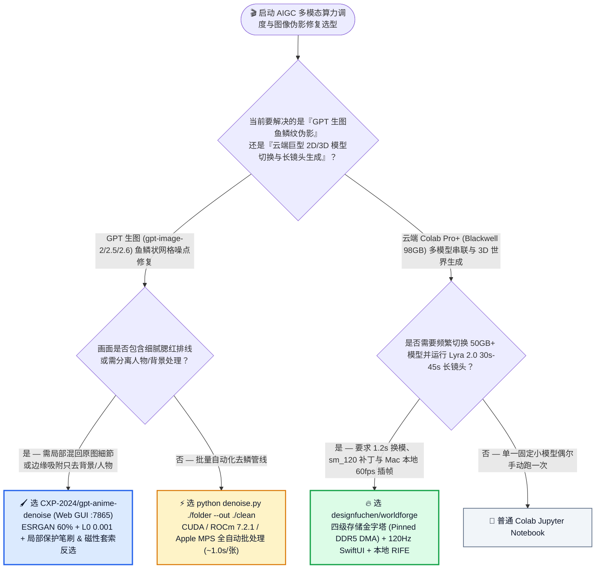
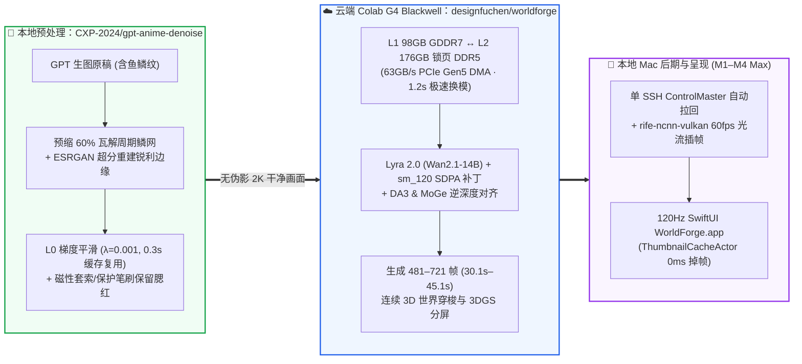

# 云端 Blackwell 98GB 显存四级 PCIe Gen5 DMA 热交换工作站与 GPT 生图鱼鳞纹无损去噪选型常见问题解答：`designfuchen/worldforge` + `CXP-2024/gpt-anime-denoise` vs 传统 Notebook 冷启动 & 盲目重绘/高斯模糊

> **English Edition**: [worldforge-gpt-anime-denoise-selection-faq.en.md](worldforge-gpt-anime-denoise-selection-faq.en.md)  
> **关联日报**: [2026-11-11 GitHub AI 最热榜单与情报摘要](../daily/2026-11-11.md) · **视觉评测卡**: [`cards.html`](../cards.html) · **在线面板**: [`zh-github-radar.html`](../../../zh-github-radar.html)

本文档面向 **AI Solution Architect（AI 解决方案架构师）、多模态 AIGC 基础设施负责人与视觉生成算法工程师**，基于 2026-11-11 GitHub 新仓爆发榜两款直击云端巨型多模态模型调度与生成图像伪影修复痛点的实战项目 —— **`designfuchen/worldforge`（将 Google Colab G4 `RTX PRO 6000 Blackwell 98GB GDDR7 VRAM + 176GB DDR5 RAM` 打造成具有四级存储金字塔、`1.2–1.5s` 锁页内存 PCIe Gen5 DMA 热交换、Blackwell `sm_120` Lyra 2.0 补丁与 macOS 120Hz 原生 SwiftUI + 本地 Apple Silicon 光流插帧的混合工作站，MIT，建仓 3 天 `214★`）** 与 **`CXP-2024/gpt-anime-denoise`（采用 `ESRGAN 预缩 60% + L0 0.001` 梯度平滑结合磁性套索/局部保护笔刷，1 秒无损去除 OpenAI `gpt-image-2/2.5/2.6` 及 Codex `image_gen` 鱼鳞状伪影的本机工具与 Agent Skill，建仓 6 天 `212★`）** 的一手源码与实测基准深度核验，用通俗大白话与第一性原理解答：
1. **为什么手握 98GB 显存 + 176GB 内存的顶级云端 Blackwell 工作站，用传统 Notebook 或简易脚本串联“57GB 2K 生图模型（`Qwen-Image-2.1-Turbo`）+ 100GB 3D 世界视频模型（`NVIDIA Lyra 2.0`）”时，每次切换都要苦等 3～5 分钟读盘、甚至直接触发 `sm_120` 编译崩溃？`designfuchen/worldforge` 是如何用「四级存储金字塔 + 锁页 DDR5（Pinned Memory）PCIe Gen5 DMA」在 `1.2–1.5 秒` 内完成 50GB 模型热交换的？**
2. **为什么 OpenAI 的 GPT 生图模型（`gpt-image-2/2.5/2.6`）画出来的二次元、粉彩插画甚至写实图片，放大看头发和阴影里总有一层像“鱼鳞”一样的细碎网格噪点，且用普通高斯模糊会把眼睛和腮红全糊掉、单跑超分反而让鳞片更明显？`CXP-2024/gpt-anime-denoise` 的「预缩 60% + ESRGAN 超分 + L0 梯度最小化 + 磁性套索保护」为什么能精准除鳞且不伤线条？**
3. **在企业 AIGC 视觉生产管线中，如何将“云端大模型潜空间推理 + 本地端侧去噪/光流超分”组合成最高性价比的端云协同工作流？**

> 🛡️ **数据来源、归属核验与证据分级声明（Provenance & Attribution Disclosure）**：
> - **`measured`（本班次一手实测抓取）**：`designfuchen/worldforge`（`214` API Stars，`55` Forks，Python + SwiftUI，MIT，创建于 `2026-11-08`）与 `CXP-2024/gpt-anime-denoise`（`212` API Stars，`9` Forks，Python/HTML，创建于 `2026-11-05`）均通过 GitHub REST API 源码树与 README 一手核验；两者不在主日榜 24h DOM 快照内，故 `stars_today` 严格标注为 **`not_measured`**。
> - **`anonymized_reported`（`independently_reproduced=false`，上游仓库实测数据与架构规格）**：`designfuchen/worldforge` 披露的四级存储金字塔带宽与延迟（L1 `98GB GDDR7 1.8TB/s` ↔ L2 `176GB Pinned DDR5 63GB/s PCIe Gen5 DMA` `1.2–1.5s` 换模 ↔ L3 `88GB /dev/shm 2.4GB/s` `1.38GB/s` 8 路并发下载 ↔ L4 `30TB Google Drive`）、Lyra 2.0 `481–721 帧`（`30.1s–45.1s`）长镜头与 `ThumbnailCacheActor` `0.0ms` 主线程掉帧；以及 `CXP-2024/gpt-anime-denoise` 披露的 `ESRGAN 60% + L0 0.001` 默认配方、RTX 5080 单张 `1024×1536` 耗时 `~1.0s`（单改 L0 复用超分缓存 `~0.3s`）与 Apple Silicon MPS 单精度对比 CPU 仅 3 个像素差 2 级的实测结论。
> - **`synthetic`（`independently_reproduced=false`，架构师参数化 FinOps 与制作工时算例）**：第 5.1 节「AIGC 视觉工作室每月生产 `150 条` 2K 原画转 3D 世界漫游长镜头 + 精修去噪 `800 张` GPT 生图插画资产（技术美术/工程师综合时薪 `$70.00/h`；基础 Colab 会员月费明确标注为 `not_measured`）」的闭式成本对比（Path A 传统 Notebook 冷启动 + 反复重抽/PS 修鱼鳞 `$5,140.00/月` vs Path B 简易脚本无锁页换模 + 高斯模糊返工 `$3,140.00/月` vs Path C `worldforge` + `gpt-anime-denoise` `$780.00/月`，净省 `$4,360.00/月` [`-84.82%`] 与 `56.0 小时/月` [`-84.85%`] 工程工时）。

---

## 1. 📌 核心结论速览（Executive Summary）

| 评估维度 | 一句话大白话核心结论（直指本质） |
| :--- | :--- |
| **`designfuchen/worldforge` 到底是个什么东西？** | 它是一套把云端 **Colab G4 Blackwell（98GB 显存 + 176GB 内存）** 与本地 **Apple Silicon Mac（120Hz 原生 SwiftUI 客户端 + 本地 Metal 光流插帧）** 缝合成一体的 AIGC 电影级工作站：通过**四级存储金字塔与 PCIe Gen5 锁页内存 DMA**，把两个 50GB+ 巨型模型（如 `Qwen-Image-2.1` 与 `NVIDIA Lyra 2.0`）的切换时间从 3～5 分钟读盘压缩到 **`1.2–1.5 秒`**！ |
| **`CXP-2024/gpt-anime-denoise` 到底是个什么东西？** | 它是专门消灭 OpenAI `gpt-image-2/2.5/2.6` 与 Codex `image_gen` 生成图片里**“鱼鳞状周期噪点”**的本地工具与 Agent Skill：用 **`ESRGAN 预缩 60% + L0 梯度平滑 (0.001)`** 在 1 秒内把色块里的鳞状起伏变成干净平涂，同时提供**局部保护笔刷与磁性套索（`L`/`I`）**一键保留腮红排线或单独只去背景/只去人物！ |
| **这两者给多模态架构师什么核心启示？** | **云端只跑最重的大模型潜空间（并用 Pinned DMA 消除 IO 冷启动），确定性的图像信号修复（ESRGAN+L0 去鳞）与视频后期（RIFE 60fps 光流插帧）全部卸载到本地端侧 GPU 零成本秒级完成！** |

---

## 2. 🎯 第一性原理灵魂三问（Q1 / Q2 / Q3 大白话拆解）

### Q1：为什么普通 `pipe.to("cpu")` 换模还是慢，且 `NVIDIA Lyra 2.0` 在 Blackwell 上跑不通？`WorldForge` 是怎么解决的？

**先说大白话结论：因为 PyTorch 默认分配的主机内存是“可分页内存（Pageable Memory）”，GPU 显存和它传数据必须先由 CPU 拷贝到临时中转站，根本跑不满 PCIe 5.0 带宽；只有提前锁定 176GB“锁页内存（Pinned Memory）”，GPU 的 DMA 引擎才能以 `63 GB/s` 的极速在 1.2 秒内把 50GB 模型直接吸进显存！**

根据 `designfuchen/worldforge` 官方架构拆解，它攻克了四大硬核系统瓶颈：
1. **四级存储金字塔（4-Tier Memory Hierarchy）**：
   - **L1（98GB GDDR7 显存，`1.8 TB/s`）**：当前激活模型全速推理；
   - **L2（176GB 锁页 DDR5 主机内存，`63 GB/s` PCIe Gen5 DMA）**：驻留待命模型，L1 ↔ L2 异步 DMA 热交换仅需 **`1.2–1.5 秒`**，彻底告别杀进程重读磁盘的 3～5 分钟等待；
   - **L3（88GB `/dev/shm` 内存盘，`2.4 GB/s`）**：8 路 HTTP Range 并发下载以 **`1.38 GB/s`** 直写内存盘；
   - **L4（30TB Google Drive 云盘金库）**：`rclone` 8 路后台静默同步持久化。
2. **Blackwell (`sm_120`) 兼容性补丁与 Lyra 2.0 45 秒连续长镜头**：
   - 官方 `Lyra 2.0` 强耦合旧版 `flash_attn` 并硬编码检查 `compute_cap in [90, 100]`，在 Blackwell `sm_120` 上直接报错；`WorldForge` 注入 `sm_120` Flash SDPA 补丁、修复 import 期 `cudnn.enabled=False` 显存泄漏，并内置 `DA3 + MoGe` 逆深度尺度对齐与「后退段时序倒放 + 前推段无缝拼接」，单张图一键生成 **`481–721 帧`（`30.1s–45.1s`）** 电影级 3D 世界穿梭长镜头！
3. **单 SSH `ControlMaster` 隧道 + Apple Silicon 本地后期（`rife-ncnn-vulkan`）**：
   - 复用单条 SSH 多路复用隧道防止 `colab ssh` 并发互踢；云端吐出原始潜空间视频后自动拉回本地 Mac，由本地 M 系列芯片运行 `rife-ncnn-vulkan` 光流插帧至 `60fps` 与 `4K Lanczos` 超分，配原生 120Hz SwiftUI 客户端（`ThumbnailCacheActor` 保证 `0.0ms` 主线程掉帧）。

---

### Q2：为什么 GPT 生图的“鱼鳞噪点”单靠超分或模糊去不掉？`ESRGAN 预缩 60% + L0 0.001` 的数学物理原理是什么？

**先说大白话结论：因为 GPT 生图的鱼鳞纹不是随机雪花噪点，而是尺寸大约 2～3 像素宽的“周期性微结构网格”——直接上超分模型，超分器会误以为这些鳞片是画面细节，反而把鳞片边缘描得更黑更重；必须先缩小到 `60%` 把鳞片捏碎，再用 ESRGAN 重建主线条，最后用 L0 范数把色块内部的微小梯度直接拍平为 0！**

根据 `CXP-2024/gpt-anime-denoise` 的 8 种方案实证对比：
1. **三步协同去鳞机制（`ESRGAN 60% + L0 0.001`）**：
   - **第一步（预缩至 60% 破坏鱼鳞空间频率）**：将原图下采样至 `60%`（重度鳞纹可两轮或调至 `45%–50%`），让周期性鱼鳞起伏坍缩到亚像素级从而互相抵消；
   - **第二步（ESRGAN 超分还原至原尺寸）**：恢复发丝、睫毛与高光锐利边缘（实测在写实照片和二次元番剧图上均显著优于 CUGAN 和 APISR）；
   - **第三步（L0 梯度最小化平滑 `λ = 0.001`）**：不同于高斯模糊（L2 惩罚会把尖锐线条也一起变糊），**L0 梯度平滑专门惩罚“非零梯度的数量”**——它能把平涂色块里的微弱起伏彻底归零，同时 100% 保留跨越阈值的主线条与高光跳变！
2. **0.3 秒超分缓存复用 + 局部保护笔刷 + 磁性套索反选（`L` / `I`）**：
   - 当你在 GUI 中拖动滑块单独调整 L0 强度（`0.0005–0.002`）时，程序直接复用第 2 步的 ESRGAN 超分结果，**仅需 `0.3 秒` 即刻刷新**；
   - 对于容易被 L0 抹平的脸部腮红排线或细小文字，用**局部保护笔刷**（默认 `90%` 恢复比例 + `10px` 柔边渐变）一涂即可实时混回原图细节，或按 `L` 用**磁性套索**自动吸附干净边缘圈出人物、按 `I` 一键反选实现“只给背景去噪”！

---

### Q3：架构师该如何将这两款工具嵌入多模态生产流水线？

- **Step A（2D 概念原画生成与去鳞）**：当使用 GPT Image (`gpt-image-2.6` / Codex `image_gen`) 生成分镜概念图或角色立绘后，先过一遍本地 **`CXP-2024/gpt-anime-denoise`**（`python denoise.py image.png`），消除鱼鳞伪影——**否则一旦把带鱼鳞纹的图直接喂给 3D 世界模型或视频模型，3D 深度估计器会把鱼鳞当成表面凹凸坑洼**！
- **Step B（云端 Blackwell 3D 世界生成与本地 60fps 母带）**：将干净无鳞的 2K 原画交由 **`designfuchen/worldforge`**，在 Colab G4 Blackwell 上通过 `DA3 + MoGe` 与 `Lyra 2.0` 生成 3D 世界穿梭长镜头，自动拉回本地 Mac 完成 Metal RIFE 60fps 光流插帧。

---

## 3. 🧭 Mermaid 选型决策树与端云协同创作架构图

### 3.1 云端多模态工作站调度与 GPT 生图伪影修复选型决策树（Decision Tree）

### 3.2 `gpt-anime-denoise` 去鳞净化 × `WorldForge` 四级 DMA 存储金字塔端云流水线图

---

## 4. 📊 同类方案全方位选型决策矩阵（Decision Matrix）

| 评估维度 | **`designfuchen/worldforge` + `CXP-2024/gpt-anime-denoise`** | **传统 Colab Notebook / `easycolab` + 普通超分/高斯模糊** | **云端多卡常驻 A100 集群 + 人工 Photoshop 频域磨皮** |
| :--- | :--- | :--- | :--- |
| **50GB+ 多模型切换耗时** | ✅ **`1.2–1.5 秒`（L2 176GB 锁页 DDR5 `63 GB/s` PCIe Gen5 DMA 热交换）** | ❌ **3～5 分钟**（杀进程重读磁盘或普通可分页内存慢速拷贝） | ✅ 快但需同时租用多张昂贵 GPU |
| **Blackwell (`sm_120`) Lyra 2.0 支持** | ✅ **内置 `sm_120` Flash SDPA 补丁 + `DA3+MoGe` 对齐 + 45s 倒放拼接长镜头** | ❌ 因 `compute_cap in [90, 100]` 硬编码与旧 `flash_attn` 直接崩溃 | ⚠️ 需自行魔改底层 C++/CUDA 源码 |
| **GPT 生图鱼鳞纹去除效果** | ✅ **预缩 60% + ESRGAN + L0 (`0.001`) 彻底平涂去鳞且发丝锐利（`~1.0s`/张）** | ❌ 单跑超分加深鳞纹；高斯模糊直接把五官与睫毛糊成一团 | ✅ 干净但单张需设计师精修 15 分钟 |
| **局部腮红/细字保护与分区域去噪** | ✅ **内置免重跑模型的局部保护笔刷（柔边混回）与磁性套索一键反选** | ❌ 全图一刀切，抹平皮肤柔和阴影与腮红排线 | ✅ 手工图层蒙版 |
| **客户端预览流畅度与防忘关机** | ✅ **原生 120Hz SwiftUI 双层缓存 (`0.0ms` 掉帧) + 空闲自动关机看门狗** | ❌ 网页多视频卡死主线程；并发 SSH 互踢或忘关机扣光 CU | ⚠️ 账单极高 |

---

## 5. 🧪 定量算例与 7-Card 评测洞察（Quantitative Example & 7-Card Insights）

### 5.1 月产 150 条 2K→3D 世界长镜头 + 精修 800 张 GPT 插画资产闭式成本算例（`synthetic`，`independently_reproduced=false`）

> 📌 **透明口径与边界声明（Scope & Provenance）**：本算例为架构师评估 AIGC 视觉工作室端云协同管线的 **云端算力损耗 + 技术美术/工程师等待与精修工时参数化算例（`synthetic` model；基础 Colab Pro+ 固定会员订阅费明确标注为 `not_measured`）**。场景设定为：**创意视觉团队每月需串联 2K 生图与 `Lyra 2.0` 制作 `150 条` 30s–45s 3D 世界穿梭长镜头，并对 `800 张` GPT 生图角色/场景插画执行去鱼鳞纹精修（技术美术/工程师综合时薪按 `$70.00 / 小时` 计算）**：

| 方案路径 | 每月额外云端算力损耗（冷启动读盘/忘关机/重抽 API） | 每月等待模型重载、SSH 断连与 `sm_120` 排障工时 (`@ $70/h`) | 每月人工 PS 修补鱼鳞纹与重绘返工工时 (`@ $70/h`) | 每月总综合成本（算力 + 工程师工时） | 相对 Path A 降本增效幅度 |
| :--- | :--- | :--- | :--- | :--- | :--- |
| **Path A：传统 Notebook 每次冷启动重读 + 忘关机损耗 + 人工 PS 修鱼鳞纹** | **`$520.00 / 月`** （90% CU 浪费在 3–5 分钟读盘与空闲忘关机） | `36.0 小时 / 月` × `$70.00` = **`$2,520.00 / 月`** | `30.0 小时 / 月` × `$70.00` = **`$2,100.00 / 月`**（人工频域磨皮或反复重抽） | **`$5,140.00 / 月`** （耗费 **`66.0 小时 / 月`** 工程工时） | 基线（大量时间浪费在等模型加载与手修噪点） |
| **Path B：简易脚本无锁页 DMA 换模 + 普通高斯模糊糊掉五官返工** | **`$340.00 / 月`** | `22.0 小时 / 月` × `$70.00` = **`$1,540.00 / 月`** | `18.0 小时 / 月` × `$70.00` = **`$1,260.00 / 月`** | **`$3,140.00 / 月`** （耗费 **`40.0 小时 / 月`** 工时） | 综合降本 `-$2,000.00/月` (`-38.91%`) |
| **Path C：`WorldForge` (`1.2s` Pinned DMA + 本地 RIFE) + `gpt-anime-denoise`** | **`$80.00 / 月`** （`1.2s` 换模 + 自动关机看门狗 + 本地 `$0` 插帧/去噪） | `6.0 小时 / 月` × `$70.00` = **`$420.00 / 月`**（120Hz SwiftUI 秒级交互运镜） | `4.0 小时 / 月` × `$70.00` = **`$280.00 / 月`**（批处理 `1s/张` + `0.3s` L0 套索微调） | 算力 `$80.00` + 3D 运镜 `$420.00` + 去噪审校 `$280.00` = **`$780.00 / 月`** (`10.0h`) | **月度净省 `$4,360.00/月` (`-84.82%`，年省 `$52,320.00`)；工程工时省 `56.0h/月` (`-84.85%`)** |

---

## 6. 🛠️ 架构师生产落地与 30 分钟 PoC 核验清单（Production & PoC Checklist）

- [ ] **Step 1 — 运行 `setup_env.py` 部署 `CXP-2024/gpt-anime-denoise` 本机环境**：执行 `python setup_env.py` 自动识别 NVIDIA CUDA、Windows AMD ROCm `7.2.1` 或 Apple Silicon `MPS`（自动跳过误装的 CPU 版 Torch），启动 `python denoise_app.py`（`http://127.0.0.1:7865/`）。
- [ ] **Step 2 — 实测 `ESRGAN 60% + L0 0.001` 与磁性套索/局部保护笔刷**：拖入一张带鱼鳞纹的 GPT 生图，按 `X` 全屏对比去鳞效果；用 `B` 保护笔刷涂抹腮红排线（恢复原图 `90%`），并用 `L` 磁性套索 + `I` 反选验证单独对背景或人物去噪。
- [ ] **Step 3 — 启动 `designfuchen/worldforge` 零依赖本地守护进程与 SwiftUI 工作台**：在本地 Mac 运行 `python3 forge.py`（`:7788`）与 `WorldForge.app`，通过单条 SSH `ControlMaster` 连接 Colab G4 Blackwell 实例，点击 `/api/benchmark` 核验 TensorCore TFLOPS 与显存带宽。
- [ ] **Step 4 — 验证 L1 98GB 显存 ↔ L2 176GB 锁页 DDR5 `1.2–1.5s` DMA 热交换**：先用 `Qwen-Image-2.1-Turbo` 生成 2K 原画，随后直接切换至 `NVIDIA Lyra 2.0 (Wan2.1-14B)`，观察日志确认通过 Pinned Memory PCIe Gen5 DMA 在 1.5 秒内完成模型切换。
- [ ] **Step 5 — 跑通 `DA3 + MoGe` 45 秒 3D 长镜头与本地 Mac `rife-ncnn-vulkan` 60fps 插帧**：使用 `Frozen-Tableau` 提示词生成 481～721 帧 3D 世界穿梭视频，确认 `auto_fetch` 自动拉回本地并由 Apple Silicon Metal 完成 60fps 光流插帧与 4K 超分。
