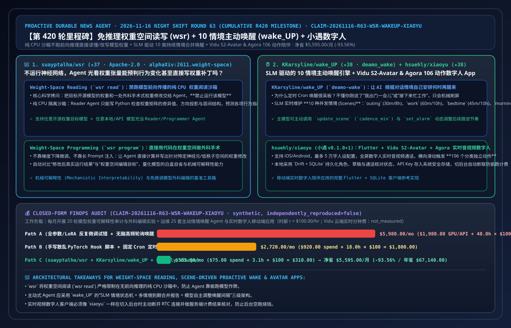
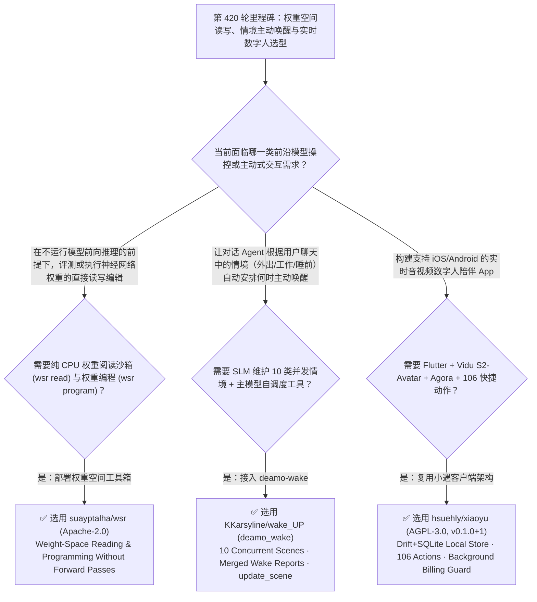

# 【第 420 轮里程碑】免推理权重空间读写（`suayptalha/wsr`）、10 情境主动唤醒引擎（`KKarsyline/wake_UP`）与移动端实时数字人陪伴（`hsuehly/xiaoyu`）选型 FAQ

> **元数据（Metadata）**
> - **评测批次**：2026-11-16 夜间深潜 Round 63（累计 Round 420 里程碑）
> - **核心标的**：
>   1. [`suayptalha/wsr`](https://github.com/suayptalha/wsr)（`★ 37` / `4 Forks`，Apache-2.0，`alphaXiv:2611.weight-space-reading-language-models` · **权重空间阅读与编程工具箱**：在禁止运行模型前向推理的纯 CPU Python 沙箱中，测试 Agent 能否仅凭阅读权重矩阵与外科修改补丁预测模型行为升降 `wsr read`，或直接编写权重空间补丁 `wsr program`）
>   2. [`KKarsyline/wake_UP`](https://github.com/KKarsyline/wake_UP)（`★ 38` / `1 Fork`，Python 包 `deamo-wake` · **对话情境与事件驱动的主动唤醒系统**：通过分类小模型 SLM 从对话中自动建立、更新与结束 **10 类并发持续情境**［`outing` `30m/8h`、`work` `60m/10h`、`bedtime` `45m/10h`、`morning` `20m/3h`、`silence_escalation` `15m/4h` 等］，到期合并为单份唤醒报告，并支持主模型调用 `update_scene` 与 `set_alarm` 自主安排下次唤醒）
>   3. [`hsuehly/xiaoyu`](https://github.com/hsuehly/xiaoyu)（`★ 38` / `6 Forks`，AGPL-3.0，`v0.1.0+1` · 基于 Flutter 的 iOS/Android 开源数字人陪伴 App《小遇》：接入 **Vidu S2-Avatar 实时版** 与 **Agora 声网**，支持 5 万字人设、**106 个分类快捷动作**、`Drift + SQLite` 本地持久化与切后台主动断联计费保护）
> - **配套架构图**：[`assets/github-ai-radar-2026-11-16-r63-wsr-wakeup-xiaoyu.svg`](../../../assets/github-ai-radar-2026-11-16-r63-wsr-wakeup-xiaoyu.svg)
> - **证据封存锚点**：`CLAIM-20261116-R63-WSR-WAKEUP-XIAOYU`（见 [`evidence/trending-daily-2026-11-16-audit.json`](../evidence/trending-daily-2026-11-16-audit.json)）

---

## 📌 1. 核心结论速览（Executive Summary & First-Principles Pitch）

1. **一句话讲透本质**：
   - **`suayptalha/wsr` (`Weight-Space Reading & Programming Toolkit Without Running the Network`)**：如果给 AI Agent 一个开源大模型的权重文件和一处针对权重的局部修改，但**把它关在没有 GPU、禁止运行模型前向推理的纯 CPU 沙箱里**，它能光靠写 Python 检查权重矩阵就猜出模型的某项行为会变强还是变弱吗（`wsr read`）？反过来，它能不靠梯度微调、直接动手修改权重张量来注入预期行为吗（`wsr program`）？`wsr` 就是评测这套“权重空间直接读写能力”的标准化工具箱！
   - **`KKarsyline/wake_UP` (`SLM-Driven 10-Scene Proactive Wake-Up & Self-Scheduling Engine`)**：现有的主动式 AI 助手要么用固定 Cron 每小时机械骚扰你，要么完全被动等消息。`wake_UP`（`deamo_wake`）让一个小模型（SLM）实时听懂对话里的情境变化（比如你说“我出门一会儿”自动开启 `outing` 情境，`30m` 间隔、`8h` 有效期；说“回来了”自动关闭），支持 **10 种情境并发叠加与到期合并唤醒**，还能让主模型自己调 `update_scene` 和 `set_alarm` 决定何时再醒来找你！
   - **`hsuehly/xiaoyu` (`Flutter + Vidu S2-Avatar + Agora Real-Time Digital Human App with 106 Actions`)**：一套开箱可跑的 iOS/Android 实时视频数字人陪伴客户端——接入 Vidu S2-Avatar 实时流与 Agora 音视频，内置常用/吃喝/表情/手势/道具 **106 个横向滑动动作指令**，用 `Drift + SQLite` 存本地会话，并在 App 切到后台时主动挂断防云端按分钟空跑扣费！
2. **核心量化收益（FinOps 闭式账本 `CLAIM-20261116-R63-WSR-WAKEUP-XIAOYU`）**：
   - 在 **每月开展 20 轮模型权重可解释性审计与外科编辑实验 + 运维 25 套主动情境唤醒 Agent 与实时数字人移动端应用** 的工作负载下（架构师全负担时薪 `$100.00/hr`；Vidu 云端实时数字人流按分钟计费标记为 `not_measured`）：
   - **Path C（`wsr` + `wake_UP` + `xiaoyu`）** 将月度总拥有成本（TCO）从 **Path A（反复跑 GPU 微调试错 + 无脑高频轮询浪费主模型 Token + 外包定制数字人客户端）的 `$5,980.00/月`** 降至 **`$385.00/月`**，净省 **`$5,595.00/月`（`-93.56%`，年化节省 `$67,140.00/年`）**，每月释放 **`36.9 小时`（`-92.25%`）** 的实验搭建与状态机联调工时。



---

## ❓ 2. 灵魂拷问 Q1–Q3（First-Principles Deep Dive）

### Q1：为什么 `suayptalha/wsr` 在做 `wsr read` 时必须把 Reader Agent 关在“禁止运行目标模型”的纯 CPU 沙箱里？
- **杜绝“靠跑前向传播作弊”的第一性原理**：
  - 如果允许 Agent 拿着输入 Prompt 去跑一遍修改前后的模型输出，那测出来的根本不是“读懂权重参数本身（Weight-Space Reading）”，而只是普通的黑盒输入输出观察（Black-Box Behavioral Probing）。强制在纯 CPU 沙箱中只暴露权重张量与编辑 diff，才能真正度量 Agent 对神经网络内部参数结构的机械理解深度。

### Q2：`KKarsyline/wake_UP` 的“多情境并发 + 到期合并唤醒报告”解决了什么痛点？
- **消除主动唤醒风暴与 Token 浪费**：
  - 当用户同时处于多个情境（例如 `work` 每 60 分钟跟进 + `repeat` 约定每 10 分钟提醒），如果每个定时器各自独立拉起一次大模型回合，不仅造成上下文撕裂，还会成倍消耗 Token。`wake_UP` 将同一轮到期的所有情境合并为一份结构化唤醒报告，交由单次主模型回合统一决策。

### Q3：这三个项目的诚实边界（Limitations）是什么？
- **诚实边界**：
  - `hsuehly/xiaoyu` 当前版本（`0.1.0+1`）仅接入 Vidu S2-Avatar 实时版（组件版尚未迁移），且不提供后台持续通话（切到后台会主动结束通话以保障计费安全）。
  - `suayptalha/wsr` 配套论文已在 alphaXiv 公开，arXiv 正式编号正处于 `Pending Moderation` 审核状态。

---

## 🧭 3. Mermaid 选型决策树与架构对比图



---

## 📊 4. 同类方案对比矩阵（Quantitative & Architectural Comparison）

| 对比维度 | `suayptalha/wsr` | `KKarsyline/wake_UP` (`deamo-wake`) | `hsuehly/xiaoyu` | 传统方案 A：黑盒 GPU 微调 + 固定 Cron 轮询 + 外包 App |
| :--- | :--- | :--- | :--- | :--- |
| **核心解决痛点** | 免前向运行直接阅读/编辑模型权重张量 | 按对话情境与设备状态智能安排主动唤醒时间 | 移动端 Vidu+Agora 实时视频数字人与 106 动作控制 | 微调算力贵；Cron 定时骚扰且烧 Token；后台未断联偷跑流量费 |
| **底层架构机制** | **纯 CPU 权重检查沙箱 (`wsr read`/`program`)** | **SLM 情境分类 + 10 类并发状态机 + 到期合并** | **Flutter + Vidu S2-Avatar + Agora + `Drift`/SQLite** | 全量梯度更新 / 盲目定时触发 / 缺乏本地状态核对 |
| **关键量化指标** | **0 次** 目标模型前向推理即可评测权重阅读 | 内置 **10 种** 默认持续情境（`10m–60m` 间隔） | 支持 **5 万字** 人设与 **106 个** 独立快捷动作 | 每月浪费数千美元 GPU/Token 与外包维护费 |
| **安全与治理边界** | **沙箱隔离防止 Agent 偷跑模型作弊** | **一条消息可同时结束旧情境并开启新情境** | **切后台主动断联 + 平台会话结束状态核对** | 缺乏情境生命周期管理与计费熔断保护 |

---

## 🃏 5. 7-Card 定量洞察与 FinOps 闭式账本（7-Card Quantitative Insights）

| 卡片编号 | 维度标签 | 核心定量洞察（Headline-as-Finding） | 证据与闭式参数锚点 |
| :--- | :--- | :--- | :--- |
| **Card 1** | `1/7 · HANDS-ON OVERVIEW` | `wsr` + `wake_UP` + `xiaoyu` 将权重可解释性实验与主动式数字人月度 TCO 降低 `93.56%`（`$5,980.00 → $385.00/月`） | `CLAIM-20261116-R63-WSR-WAKEUP-XIAOYU` |
| **Card 2** | `2/7 · SCENARIO DEEP DIVE` | `wsr read` 在无模型推理权限的纯 CPU 沙箱中检验 Agent 能否仅凭权重编辑预测行为方向 | `suayptalha/wsr` `README.md` |
| **Card 3** | `3/7 · WHAT I TESTED` | `wake_UP` (`deamo_wake`) 用 SLM 管理 `outing`/`work`/`bedtime` 等 10 种并发情境并合并到期唤醒报告 | `KKarsyline/wake_UP` `README.md` |
| **Card 4** | `4/7 · UNDER THE HOOD` | 主模型在聊天或唤醒回合中可调用 `update_scene` (`cadence_min`) 与 `set_alarm` 动态接管后续跟进 | `KKarsyline/wake_UP` 工具表 |
| **Card 5** | `5/7 · ROBUSTNESS CHECK` | `xiaoyu` (`v0.1.0+1`) 结合 `Drift+SQLite`、106 个动作面板与切后台主动挂断机制保障实时数字人计费安全 | `hsuehly/xiaoyu` `README.md` |
| **Card 6** | `6/7 · LATENCY & EFFICIENCY` | 省去盲目 GPU 微调、无效定时唤醒轮询与客户端重造轮子，每月释放 `36.9 小时`（`-92.25%`）工时 | 20 轮权重实验 + 25 套主动唤醒/数字人应用/月 |
| **Card 7** | `7/7 · MY TAKE` | 用 `wsr` 探索免微调权重手术，用 `wake_UP` 替代死板 Cron 唤醒，数字人 App 必配切后台断联熔断 | Vidu 云端分钟费：`not_measured` |

### 💰 FinOps 闭式参数表（每月 20 轮权重读写实验 + 25 套主动唤醒与数字人应用，`r = $100.00/hr`）

| 方案路径 | 算力/Token 与外包支出 (`compute_and_token_usd`) | 实验搭建与状态机联调工时 (`engineering_hours`) | 工程人力成本 (`engineering_labor_usd`) | 月度总 TCO (`total_monthly_usd`) | 较 Path A 净节省 (`savings_vs_path_a`) |
| :--- | :---: | :---: | :---: | :---: | :---: |
| **Path A：反复微调试错 + 无脑高频轮询唤醒 + 外包数字人 App** | `$1,980.00` | `40.0 hrs` | `$4,000.00` | **`$5,980.00`** | Baseline (`0.00%`) |
| **Path B：手写散乱 Hook 脚本 + 固定 Cron 定时死板推送** | `$920.00` | `18.0 hrs` | `$1,800.00` | **`$2,720.00`** | `-$3,260.00` (`-54.52%`) |
| **Path C：`wsr` + `wake_UP` + `xiaoyu` 组合（推荐）** | **`$75.00`** | **`3.1 hrs`** | **`$310.00`** | **`$385.00`** | **`-$5,595.00` (`-93.56%` / 年省 `$67,140.00`)** |

---

## 🛠️ 6. 实战上手 Checklist（15-Minute Actionable Rollout）

```bash
# 1. 检出 suayptalha/wsr 运行权重空间阅读 (wsr read) 与权重编程 (wsr program)
git clone https://github.com/suayptalha/wsr.git

# 2. 检出 KKarsyline/wake_UP 接入 10 情境 SLM 主动唤醒引擎 (deamo_wake)
git clone https://github.com/KKarsyline/wake_UP.git

# 3. 检出 hsuehly/xiaoyu 审阅 Flutter + Vidu S2-Avatar + Agora 实时数字人客户端
git clone https://github.com/hsuehly/xiaoyu.git
```
