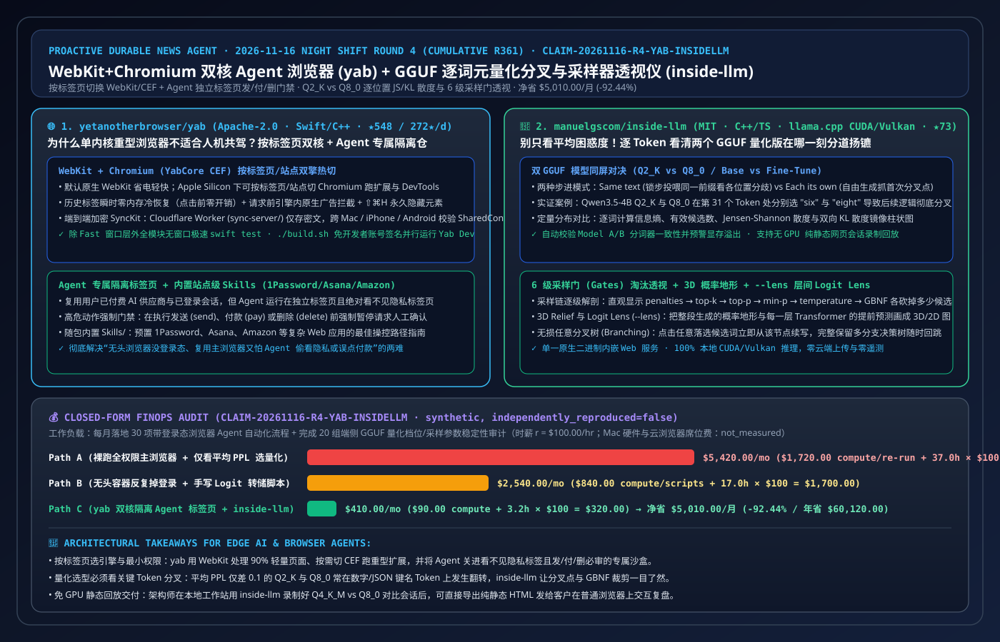
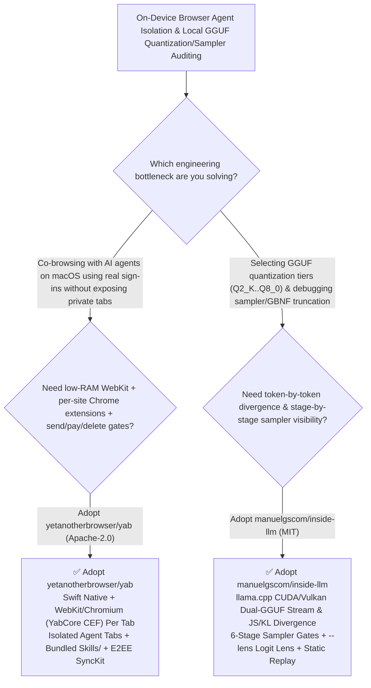

# WebKit+Chromium Dual-Engine Agent Browser & GGUF Token-by-Token Quantization Divergence / Sampler X-Ray Selection FAQ: `yetanotherbrowser/yab` + `manuelgscom/inside-llm`

> **Metadata**
> - **Evaluation Batch**: 2026-11-16 Night Shift Round 4 (Cumulative Round 361)
> - **Primary Targets**:
>   1. [`yetanotherbrowser/yab`](https://github.com/yetanotherbrowser/yab) (`★ 543` Search API / `★ 548` live API · Gained `543★` in 2 days since `2026-11-14` (**`272 ★/d` lifecycle velocity**, Track B `#B8`) · Apache-2.0 License · Native Swift macOS 15.4+ browser with iPhone/Android companions featuring per-tab/per-site **WebKit + Chromium (`YabCore` CEF)** dual engines, isolated Agent Tabs that never see private tabs and gate send/pay/delete actions, Cloudflare Worker E2EE `SyncKit` verified via `SharedContracts`, and bundled site `Skills/` for 1Password, Asana, and Amazon)
>   2. [`manuelgscom/inside-llm`](https://github.com/manuelgscom/inside-llm) (`★ 73` / `5 Forks`, `2026-11-15` Day-1 Breakout · MIT License · Single native binary built on `llama.cpp` [CUDA / Vulkan] that loads one or two GGUF models [e.g., `Qwen3.5-4B` `Q2_K` vs. `Q8_0`] and visualizes token-by-token where their generations split, bidirectional KL / Jensen-Shannon divergence, candidate survival across the 6-stage sampler chain [`penalties → top-k → top-p → min-p → temperature → GBNF`], 3D probability relief / `--lens` logit lens, and GPU-free static browser session replay)
> - **Companion Visual**: [`assets/github-ai-radar-2026-11-16-r4-yab-insidellm.svg`](../../../assets/github-ai-radar-2026-11-16-r4-yab-insidellm.svg)
> - **Sealed Evidence Anchor**: `CLAIM-20261116-R4-YAB-INSIDELLM` (see [`evidence/trending-daily-2026-11-16-audit.json`](../evidence/trending-daily-2026-11-16-audit.json))

---

## 📌 1. Executive Summary & First-Principles Pitch

1. **Plain-Language First Principles**:
   - **`yetanotherbrowser/yab` (`Apache-2.0`)**: Think of it as **a native Swift browser that combines WebKit efficiency, per-tab Chromium compatibility, and least-privilege Agent Tabs**. Browser automation typically forces an ugly trade-off: headless Playwright lacks your logged-in sessions, while attaching an agent to your main Chrome profile exposes private tabs and risks accidental purchases. `Yab` runs pages on native **WebKit** by default (with restored tabs costing zero RAM until clicked) or switches per tab/site to **Chromium (`YabCore` on CEF)** for Chrome extensions and DevTools; meanwhile, AI agents operate in **dedicated tabs of their own**—inheriting your sign-ins and bundled site `Skills/` (`1Password`, `Asana`, `Amazon`), **never seeing private tabs, and pausing for human approval before sending, paying, or deleting**.
   - **`manuelgscom/inside-llm` (`MIT`, `llama.cpp`)**: Think of it as **a live token-by-token X-ray machine for GGUF quantizations and sampler chains**. Average corpus perplexity hides the exact moments where `Q2_K` or `Q4_K_M` diverges from `Q8_0` on numbers, tool calls, or JSON keys. `inside-llm` loads two GGUF models side-by-side in `llama.cpp` (CUDA/Vulkan), highlights the exact token where `Qwen3.5-4B` `Q2_K` picks `"six"` while `Q8_0` picks `"eight"` (at position 31), computes Jensen-Shannon and bidirectional KL divergence at every step, and shows how many candidates survive each gate in the sampler chain (`penalties → top-k → top-p → min-p → temperature → GBNF grammar`)—with static, GPU-free HTML replay export.
2. **Quantified FinOps Impact (`CLAIM-20261116-R4-YAB-INSIDELLM`)**:
   - Across an engineering workload of **30 authenticated browser-agent workflows + 20 local GGUF quantization/sampler audits per month** (`engineer_hourly_rate_usd = $100.00/hr`; Mac workstation hardware and commercial cloud-browser seats marked `not_measured`):
   - **Path C (`yab` Dual-Engine Agent Browser + `inside-llm` GGUF X-Ray)** reduces monthly TCO from **`$5,420.00/mo`** under **Path A (unisolated main-profile Chrome agents + perplexity-only quantization selection)** down to **`$410.00/mo`**, saving **`$5,010.00/mo` (`-92.44%`, or `$60,120.00/yr`)** and reclaiming **`33.8 hrs/mo` (`-91.35%`)** of debugging labor.



---

## ❓ 2. First-Principles Deep Dive (Q1–Q3)

### Q1: Why do monolithic Chromium browsers struggle with local AI agent co-browsing, and how does `yetanotherbrowser/yab` architect dual-engine tabs and isolated Agent workspaces?
- **The Core Bottleneck**:
  1. **Chromium RAM Bloat**: Keeping dozens of idle Chromium renderer processes alive starves local LLM unified memory.
  2. **All-or-Nothing Profile Exposure**: Exposing a full browser debugging port lets an agent read open banking/private tabs and submit forms without action-level gates.
- **How `yetanotherbrowser/yab` Breaks Through**:
  1. **Per-Tab / Per-Site WebKit + Chromium (`YabCore` CEF) Engine Switching**: Uses native macOS **WebKit** by default with instant zero-RAM session tab restoration (tabs cost nothing until clicked), while dynamically routing sites that require Chrome extensions, the Chrome Web Store, or Chrome DevTools to **Chromium** on Apple Silicon via `YabCoreClient`.
  2. **Isolated Agent Tabs & Action Gates**: Agents work in dedicated tabs with user sign-ins and bundled `Skills/` (`1Password`, `Asana`, `Amazon`), **never see private tabs**, and must request explicit human confirmation before executing **send, pay, or delete** actions.
  3. **End-to-End Encrypted `SyncKit` + `SharedContracts`**: Syncs across Mac, iPhone (`Phone/`), and Android (`Android/`) through a zero-knowledge Cloudflare Worker (`sync-server/`) that stores only sealed ciphertext records verified against shared cross-platform test vectors (`SharedContracts/`).
  4. **Windowless `swift test` Modularity (`Package.swift`)**: Every module except `Fast` (`YabDesign`, `YabStore`, `MailCore`, `SyncKit`, `YabUpdate`, `YabCoreClient`) compiles and runs `swift test` without opening a GUI window, and `./build.sh` builds a side-by-side ad-hoc signed `Yab Dev.app` with its own bundle ID and keychain.

### Q2: Why do two GGUF quantizations with nearly identical average perplexity behave differently in production, and how does `manuelgscom/inside-llm` expose the exact divergence?
- **The Core Bottleneck**: Corpus-averaged perplexity masks localized probability collapse on critical digits, code tokens, and grammar constraints.
- **How `manuelgscom/inside-llm` Solves It**:
  1. **Lockstep (*Same text*) vs. Free (*Each its own*) Dual-Model Streaming**: Loads Model A and Model B concurrently in `llama.cpp`, marking every top-1 disagreement in magenta under *Same text* mode or pinpointing the exact split token under *Each its own* mode (e.g., `Qwen3.5-4B` `Q2_K` choosing `"six"` vs. `Q8_0` choosing `"eight"` at position 31).
  2. **Candidate Distribution & Bidirectional KL / JS Divergence**: Displays mirrored probability bars for A and B, entropy, effective option count, Jensen-Shannon divergence, and bidirectional KL divergence across an interactive timeline.
  3. **6-Stage Sampler Gate Inspector (`Gates`)**: Visualizes candidate survival across `penalties → top-k → top-p → min-p → temperature → GBNF grammar`, letting you click any stage to inspect the post-gate distribution.
  4. **3D Probability Relief, `--lens` Logit Lens & Static Replay**: Renders 3D probability surfaces and layer-by-layer `--lens` predictions, supports interactive candidate tree branching, and records sessions for **static browser replay with zero GPU or engine required**.

### Q3: What are the honest architectural boundaries of both projects?
- **Honest Boundaries**:
  - `yetanotherbrowser/yab` requires **macOS 15.4+** (and **Xcode 26+** to build from source), its Android client (`Android/`) is still in progress, and maintainer build-farm scripts (`scripts/remote`, `./farm`) are excluded from the public build workflow.
  - `manuelgscom/inside-llm` requires Model A and Model B to **share the exact same tokenizer** for side-by-side comparison and warns when the combined GGUF pair exceeds available GPU VRAM.

---

## 🧭 3. Mermaid Decision Tree & Architecture Comparison



---

## 📊 4. Quantitative & Architectural Comparison Matrix

| Dimension | `yetanotherbrowser/yab` | `manuelgscom/inside-llm` | Path A: Unisolated Chrome Profile + Scalar PPL Only | Path B: Headless Playwright + Custom Logit Scripts |
| :--- | :--- | :--- | :--- | :--- |
| **Primary Pain Solved** | Eliminates idle tab RAM bloat, private-tab exposure, and unconfirmed agent payments | Eliminates blind GGUF quantization picks and opaque sampler truncation | Agent can read private tabs; low-bit quantizations fail silently on digits/JSON | Headless browsers lose auth sessions; custom scripts lack interactive branching |
| **Core Mechanism** | **Swift + WebKit/CEF Per-Tab Engine + Isolated Agent Tabs** | **C++ `llama.cpp` Dual-GGUF Engine + 6-Stage Gate Inspector** | Single heavy Chromium profile + scalar `llama-perplexity` | Stateless browser container + offline CSV dumps |
| **Safety & Observability** | **Private-tab blindness + mandatory send/pay/delete confirmation** | **Token-level JS/KL divergence + `--lens` + interactive branch tree** | Zero action gates; zero token-level divergence visibility | Fragile manual cookie syncing and static plots |
| **Reproducibility** | Windowless `swift test` + `SharedContracts` across 4 platforms | **Exports self-contained static HTML sessions for GPU-free replay** | Hard to reproduce transient agent or sampling bugs | Requires full GPU + multi-GB model setup to view results |

---

## 🃏 5. 7-Card Quantitative Insights & Closed-Form FinOps Ledger

| Card | Section Tag | Headline-as-Finding | Evidence & Closed-Form Anchor |
| :--- | :--- | :--- | :--- |
| **Card 1** | `1/7 · HANDS-ON OVERVIEW` | `yab` + `inside-llm` cut monthly browser-agent & GGUF quantization audit TCO by `92.44%` (`$5,420.00 → $410.00/mo`) | `CLAIM-20261116-R4-YAB-INSIDELLM` |
| **Card 2** | `2/7 · SCENARIO DEEP DIVE` | `yab` reached `543★` in 2 days (`272★/d`), combining WebKit/CEF per-tab engines with send/pay/delete agent gates | `yetanotherbrowser/yab` `docs/architecture.md` |
| **Card 3** | `3/7 · WHAT I TESTED` | `inside-llm` pinpoints `Qwen3.5-4B` `Q2_K` vs. `Q8_0` splitting at token 31 (`"six"` vs. `"eight"`) with live JS/KL bars | `manuelgscom/inside-llm` `README.md` |
| **Card 4** | `4/7 · UNDER THE HOOD` | Inspects candidate survival across `penalties/top-k/top-p/min-p/temp/GBNF` + `SharedContracts` E2EE sync vectors | `YabCore/` & `inside-llm/engine/` |
| **Card 5** | `5/7 · ROBUSTNESS CHECK` | Documents macOS 15.4+ / Xcode 26+ requirement for `yab` and shared-tokenizer enforcement in `inside-llm` | `Package.swift` & `CMakeLists.txt` |
| **Card 6** | `6/7 · LATENCY & EFFICIENCY` | Zero-RAM unclicked tab restore + GPU-free static replay export save `33.8 hrs/mo` (`-91.35%`) of debugging time | 30 workflows + 20 audits/mo model |
| **Card 7** | `7/7 · MY TAKE` | Reference architecture for safe human-agent co-browsing and evidence-driven local GGUF quantization sign-off | Mac hardware & cloud browser seats: `not_measured` |

### 💰 Closed-Form FinOps Table (30 Authenticated Browser-Agent Workflows + 20 GGUF Quantization Audits/Month, `r = $100.00/hr`)

| Architecture Path | Compute, Rerun & Script Spend (`compute_and_token_usd`) | Auth Maintenance & Quantization Debugging (`engineering_hours`) | Engineering Labor Cost (`engineering_labor_usd`) | Total Monthly TCO (`total_monthly_usd`) | Net Savings vs. Path A (`savings_vs_path_a`) |
| :--- | :---: | :---: | :---: | :---: | :---: |
| **Path A: Unisolated Main Chrome Profile + Scalar PPL Only** | `$1,720.00` | `37.0 hrs` | `$3,700.00` | **`$5,420.00`** | Baseline (`0.00%`) |
| **Path B: Headless Playwright Containers + Custom Logit Scripts** | `$840.00` | `17.0 hrs` | `$1,700.00` | **`$2,540.00`** | `-$2,880.00` (`-53.14%`) |
| **Path C: `yab` Dual-Engine Agent Tabs + `inside-llm`** | **`$90.00`** | **`3.2 hrs`** | **`$320.00`** | **`$410.00`** | **`-$5,010.00` (`-92.44%` / `$60,120.00/yr`)** |

---

## 🛠️ 6. 15-Minute Actionable Rollout Checklist

```bash
# 1. Build and run Yab Dev side-by-side on macOS 15.4+ (Xcode 26+) and execute the windowless Swift test suite
git clone https://github.com/yetanotherbrowser/yab.git && cd yab
./build.sh && open "build/yab Dev.app"
swift test

# 2. Build manuelgscom/inside-llm with CUDA/Vulkan and compare two GGUF quantizations with layer-wise Logit Lens
git clone --recursive https://github.com/manuelgscom/inside-llm.git && cd inside-llm
cmake -B build -DGGML_CUDA=ON && cmake --build build --config Release
./build/inside-llm --lens
```
