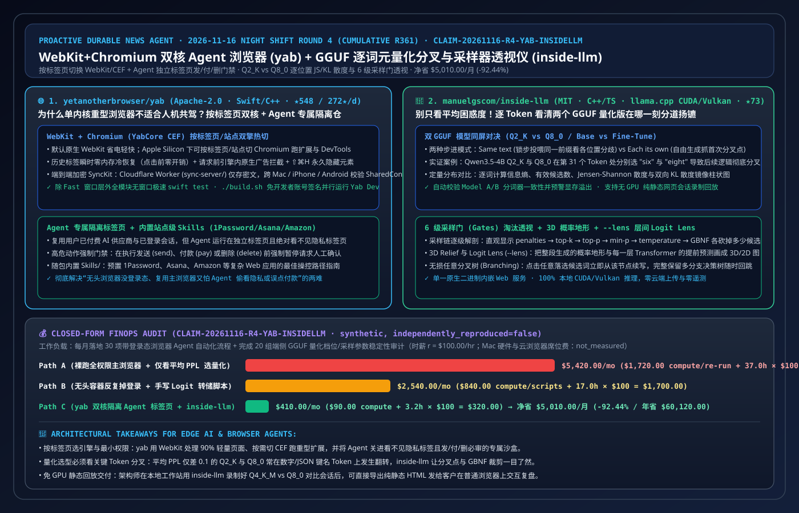
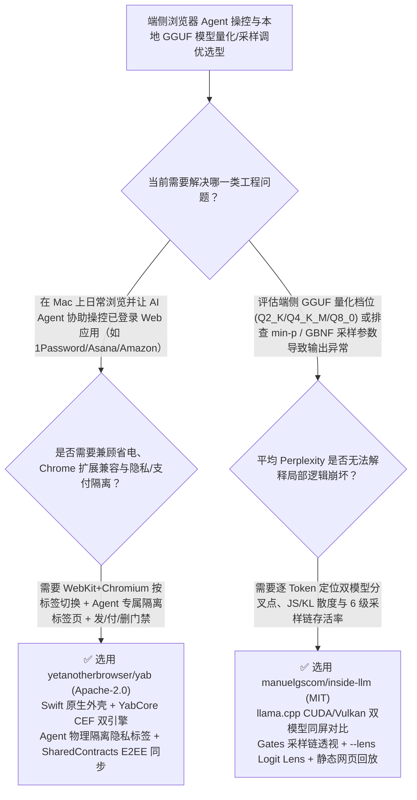

# WebKit+Chromium 双擎隔离 Agent 浏览器与 GGUF 逐词元量化分叉/采样器透视工作台选型 FAQ：`yetanotherbrowser/yab` + `manuelgscom/inside-llm`

> **元数据（Metadata）**
> - **评测批次**：2026-11-16 夜间深潜 Round 4（累计 Round 361）
> - **核心标的**：
>   1. [`yetanotherbrowser/yab`](https://github.com/yetanotherbrowser/yab)（`★ 543` Search API / `★ 548` 实时 API · `2026-11-14` 新建 2 天狂揽 `543★`（生命周期日均 **`272 ★/d`**，居今日 Track B 新仓斜率榜 `#B8`）· Apache-2.0 协议 · 原生 Swift 编写的 macOS 15.4+ 与 iPhone/Android 跨端浏览器：支持按标签页或按站点在 **WebKit** 与 **Chromium (`YabCore` CEF)** 双引擎间自由切换，内置与隐私标签物理隔离且发送/付款/删除必经人工确认的 **Agent 专属标签页**、端到端加密 `SyncKit`（`SharedContracts` 跨四端测试向量）以及随包内置的 `Skills/` 站点操控指南）
>   2. [`manuelgscom/inside-llm`](https://github.com/manuelgscom/inside-llm)（`★ 73` / `5 Forks`，`2026-11-15` 新建首日黑马 · MIT 协议 · 基于 `llama.cpp`（CUDA / Vulkan）构建的单二进制 GGUF 模型内部概率与量化分叉显微镜：支持同时加载两个 GGUF 模型［如 `Qwen3.5-4B` 的 `Q2_K` vs `Q8_0` 或 Base vs Fine-Tune］，在浏览器内逐 Token 展示两者首次分叉位置、双向 KL / Jensen-Shannon 散度、6 级采样链 `penalties → top-k → top-p → min-p → temperature → GBNF` 的候选淘汰过程、3D 概率地形与 `--lens` 层间 Logit Lens，并支持导出免 GPU 纯静态网页回放）
> - **配套架构图**：[`assets/github-ai-radar-2026-11-16-r4-yab-insidellm.svg`](../../../assets/github-ai-radar-2026-11-16-r4-yab-insidellm.svg)
> - **证据封存锚点**：`CLAIM-20261116-R4-YAB-INSIDELLM`（见 [`evidence/trending-daily-2026-11-16-audit.json`](../evidence/trending-daily-2026-11-16-audit.json)）

---

## 📌 1. 核心结论速览（Executive Summary & First-Principles Pitch）

1. **一句话讲透本质**：
   - **`yetanotherbrowser/yab` (`Apache-2.0`)**：就是**把“WebKit 的省电轻快 + Chromium 的扩展生态 + 受控 Agent 专属工作标签页”融进同一个原生 Swift 外壳的下一代浏览器**。平时做浏览器 Agent 自动化总是陷入两难：起无头 Playwright 没登录态、过不了验证码；直接接管用户的主 Chrome 又怕 Agent 偷看隐私页面或手滑把购物车结账了。`Yab` 给出了极其优雅的解法——平时默认用 Mac 原生 **WebKit**（历史标签页点击前零内存开销），遇到必须用 Chrome 扩展或 DevTools 的网站可**按标签页/按站点无缝切到内置 `YabCore` (CEF Chromium)**；更重要的是，它让 AI Agent 运行在**专属隔离标签页**里，既能复用你的登录态和内置站点 `Skills/`（1Password、Asana、Amazon），又**绝对看不见隐私标签页，且一旦涉及发送、付款或删除动作必须弹窗等你点头**！
   - **`manuelgscom/inside-llm` (`MIT`, `llama.cpp`)**：就是**专治“只看平均 Perplexity 盲选量化档位，结果上线后模型在关键数字和 JSON 语法上莫名抽风”的 GGUF 逐词元 X 光机**。很多架构师以为 `Q4_K_M` 或 `Q2_K` 的平均困惑度和 `Q8_0` 差不多就可以放心替用，直到生产上出现诡异的数字幻觉。`inside-llm` 编译为一个内嵌 Web 界面的原生单二进制，同时加载两个共享分词器的 GGUF 模型（A 与 B），逐个位置实时对比两者的候选词分布（直观看到 `Qwen3.5-4B` 的 `Q2_K` 与 `Q8_0` 在第 31 个 Token 处一个选 `"six"`、一个选 `"eight"` 从此分道扬镳），并把 **`penalties → top-k → top-p → min-p → temperature → GBNF grammar`** 每一级采样门到底砍掉了哪几个候选词画得一清二楚！
2. **核心量化收益（FinOps 闭式账本 `CLAIM-20261116-R4-YAB-INSIDELLM`）**：
   - 在 **每月落地 30 项带登录态浏览器 Agent 自动化流程 + 完成 20 组端侧 GGUF 量化档位与采样参数稳定性审计** 的工程工作负载下（工程师全负担时薪 `$100.00/hr`；Mac 工作站硬件折旧与商业云浏览器席位费标记为 `not_measured`）：
   - **Path C（`yab` 双擎隔离 Agent 浏览器 + `inside-llm` 逐词元分叉透视台）** 将月度总拥有成本（TCO）从 **Path A（裸跑全权限主浏览器引发的误操作修复 + 仅看平均 PPL 盲选量化导致的线上 Bad Case 排障）的 `$5,420.00/月`** 降至 **`$410.00/mo`**，净省 **`$5,010.00/月`（`-92.44%`，年化节省 `$60,120.00/年`）**，每月释放 **`33.8 小时`（`-91.35%`）** 的排障与复现工时。



---

## ❓ 2. 灵魂拷问 Q1–Q3（First-Principles Deep Dive）

### Q1：为什么用全量 Chromium 衍生浏览器跑本地 Agent 既吃内存又不安全？`yetanotherbrowser/yab` 的模块化架构是怎么做到“双核按需切换 + Agent 权限硬隔离”的？
- **传统痛点**：
  1. **全量 Chromium 常驻内存黑洞**：开 50 个标签页动辄吃掉 8GB+ 内存，留给本地大模型的统一内存所剩无几。
  2. **Agent 与人类共享全部上下文的隐私与资金风险**：把整个主浏览器 Profile 暴露给 CDP 端口时，Agent 随时能读取你正打开的网银/私密邮件标签页，甚至直接触发下单按钮。
- **`yetanotherbrowser/yab` 的四大工程破局**：
  1. **按标签页/按站点的 WebKit + Chromium (`YabCore` CEF) 混合双擎**：默认使用 macOS 原生 `WebKit` 引擎，且恢复上一次会话的历史标签页在被点击激活前**消耗零内存**；在 Apple Silicon 上，针对必须依赖 Chrome 扩展、Chrome Web Store 或 Chrome DevTools 的特定站点，通过 `YabCoreClient` 动态唤起基于 C++/ObjC++ CEF 定制补丁的 Chromium Helper。
  2. **Agent 专属隔离标签页与高危动作门禁**：AI Agent 在专属标签页中工作，**物理级禁止访问任何隐私标签页（Private Tabs）**；在调用任何触发 `send`（发送消息/邮件）、`pay`（支付结账）或 `delete`（删除数据）的操作前，强制弹出确认门禁，并随包在 `Skills/` 目录下内置了针对 1Password、Asana、Amazon 等高频复杂站点的操控技能规范。
  3. **零明文 Cloudflare Worker 同步（`SyncKit` + `SharedContracts`）**：跨 Mac、iPhone (`Phone/` WKWebView) 与 Android (`Android/` GeckoView) 的同步通过端到端加密完成，`sync-server/` 上的 Cloudflare Worker 只存储无法解密的密文记录，且四端共同校验同一套 `SharedContracts/` 测试向量。
  4. **无窗口极速可测性设计（`Package.swift`）**：将应用拆解为 `Fast`（UI 窗口层）、`YabDesign`、`YabStore`、`MailCore`、`SyncKit`、`YabUpdate` 与 `YabCoreClient`——**除 `Fast` 外的所有模块均可在不拉起 GUI 窗口的情况下直接运行 `swift test`**，且 `./build.sh` 生成拥有独立 Bundle ID 与 Keychain 的 `Yab Dev.app`，无需 Apple 付费开发者账号即可与正式版并存调试。

### Q2：为什么两个平均 Perplexity 几乎一样的 GGUF 量化模型，在实际 Agent 工具调用中一个百发百中、另一个却频繁崩溃？`manuelgscom/inside-llm` 是怎么定位病灶的？
- **传统痛点**：传统的 `llama-perplexity` 只给出一个全语料平均标量（比如 `5.42` vs `5.51`），完全掩盖了低比特量化（如 `Q2_K`、`Q3_K_S`）在关键语法分界点、数字计算或 JSON 键名处发生的**局部概率塌缩与 Top-1 翻转**。
- **`manuelgscom/inside-llm` 的四大架构破局**：
  1. **双模型同屏锁步 vs. 自由分叉对比（Stream A | B）**：同时加载共享同一 Tokenizer 的两个 GGUF 模型（如 `Qwen3.5-4B` 的 `Q2_K` 与 `Q8_0`，或基座模型与微调版）。支持 **Same text（锁步模式：强制两模型读取相同前缀，用洋红色高亮标出每一处 Top-1 选择不一致的位置）** 与 **Each its own（自由模式：各自顺着自己的选择生成，精准定格第 31 个 Token 处 A 选 `"six"` 而 B 选 `"eight"` 的首次分道扬镳瞬间）**。
  2. **双向 KL 散度与 Jensen-Shannon 分布显微镜（Candidates & Timeline）**：在任意 Token 位置并排展示 A 与 B 的候选词概率镜像条形图、信息熵（Entropy）、有效选项数（Effective Options）、Jensen-Shannon 散度与正反双向 KL 散度，鼠标划过底部时间轴即可联动复盘整段推理的置信度与惊讶度（Surprise）曲线。
  3. **6 级采样门逐步解剖（Gates Panel）**：将 `penalties → top-k → top-p → min-p → temperature → GBNF grammar` 串联成可视化的漏斗，点击任意一级即可查看该采样器执行后的剩余候选词分布与存活数量，一眼揪出是 `min-p` 设太高还是 `GBNF` 语法规则把正确答案裁掉了。
  4. **3D 概率地形、`--lens` 层间 Logit Lens 与无 GPU 静态回放**：不仅能用 `--lens` 查看 Transformer 每一层中间表示会预测什么词，还能把任意候选词点击展开为持久化的多分支树（Branching），并将整场对比录制保存为**无需 GPU、无需安装引擎即可在任意普通浏览器回放的静态页面**！

### Q3：这两个工具各自的诚实边界（Limitations）在哪里？
- **诚实边界**：
  - `yetanotherbrowser/yab` 要求 **macOS 15.4+**（本地源码构建需 **Xcode 26+**），其 Android 客户端（Kotlin + Compose + GeckoView）目前仍处于 `in progress` 开发阶段，且维护者自用的远程编译农场脚本（`scripts/remote`、`./farm`）不包含在公开构建依赖中。
  - `manuelgscom/inside-llm` 要求参与双模型对比的 Model A 与 Model B **必须共享完全相同的 Tokenizer**（模型选择器会自动过滤不兼容分词器的模型，并在两模型总大小超出 GPU 显存时发出预警）。

---

## 🧭 3. Mermaid 选型决策树与架构对比图



---

## 📊 4. 同类方案对比矩阵（Quantitative & Architectural Comparison）

| 对比维度 | `yetanotherbrowser/yab` | `manuelgscom/inside-llm` | 传统方案 A：全权限主浏览器 CDP + 只看平均 PPL | 传统方案 B：无头 Playwright + 手写 Logit 脚本 |
| :--- | :--- | :--- | :--- | :--- |
| **核心解决痛点** | 消除 Chromium 内存暴涨与 Agent 越权偷看隐私/误点付款 | 消除量化盲选黑盒与采样器参数（`min-p`/GBNF）盲调 | 主浏览器暴露全部隐私；上线低比特量化模型频繁暴雷 | 无头容器频繁触发人机验证；手写脚本无交互分叉树 |
| **底层架构机制** | **Swift + WebKit/CEF 双核 + 独立 Agent 标签页 + `SyncKit`** | **C++ `llama.cpp` (CUDA/Vulkan) + 双模型锁步/自由流对比** | 单一重型 Chromium 进程 + 粗粒度标量评测脚本 | 独立无状态容器 + 离线 JSON/CSV 概率转储 |
| **安全与可解释护栏** | **Agent 看不见 Private Tab + 发送/支付/删除强制确认** | **逐词 JS/KL 散度 + 6 级采样门存活数 + `--lens` 层间透视** | 零操作门禁；零逐 Token 分叉定位能力 | 需人工维护 Cookie 注入与大量 Matplotlib 绘图代码 |
| **团队协作与交付** | `./build.sh` 免账号构建 `Yab Dev.app` + 无窗口 `swift test` | **一键录制并导出免 GPU、免安装的纯静态网页回放** | 无法复现瞬态推理异常 | 别人复现必须重配全套 CUDA 环境与几十 GB 权重 |

---

## 🃏 5. 7-Card 定量洞察与 FinOps 闭式账本（7-Card Quantitative Insights）

| 卡片编号 | 维度标签 | 核心定量洞察（Headline-as-Finding） | 证据与闭式参数锚点 |
| :--- | :--- | :--- | :--- |
| **Card 1** | `1/7 · HANDS-ON OVERVIEW` | `yab` + `inside-llm` 将月度浏览器 Agent 落地与 GGUF 量化审计 TCO 降低 `92.44%`（`$5,420.00 → $410.00/月`） | `CLAIM-20261116-R4-YAB-INSIDELLM` |
| **Card 2** | `2/7 · SCENARIO DEEP DIVE` | `yab` 建仓 2 天狂揽 `543★`（`272★/d`），实现按标签页切换 WebKit/Chromium 与 Agent 发/付/删硬门禁 | `yetanotherbrowser/yab` `docs/architecture.md` |
| **Card 3** | `3/7 · WHAT I TESTED` | `inside-llm` 实测捕捉 `Qwen3.5-4B` `Q2_K` 与 `Q8_0` 在第 31 个 Token 处（`"six"` vs `"eight"`）的精确分叉 | `manuelgscom/inside-llm` `README.md` |
| **Card 4** | `4/7 · UNDER THE HOOD` | 6 级采样门（`penalties/top-k/top-p/min-p/temp/GBNF`）逐级展示存活候选词 + `SharedContracts` 四端加密同步校验 | `YabCore/` & `inside-llm/engine/` |
| **Card 5** | `5/7 · ROBUSTNESS CHECK` | 诚实披露 `yab` 需 macOS 15.4+ / Xcode 26+，且 `inside-llm` 强制校验 A/B 模型共享相同 Tokenizer | `Package.swift` & `CMakeLists.txt` |
| **Card 6** | `6/7 · LATENCY & EFFICIENCY` | 历史标签页点击前零内存开销 + 免 GPU 静态网页回放复盘，每月省下 `33.8 小时`（`-91.35%`）排障工时 | 30 流程 + 20 组量化审计/月模型 |
| **Card 7** | `7/7 · MY TAKE` | 端侧人机共驾浏览器的安全隔离范本，以及本地大模型量化/采样调参不可或缺的视觉听诊器 | Mac 硬件折旧与云浏览器席位：`not_measured` |

### 💰 FinOps 闭式参数表（每月 30 项浏览器 Agent 流程 + 20 组 GGUF 量化/采样审计，`r = $100.00/hr`）

| 方案路径 | 重跑算力与脚本维护开销 (`compute_and_token_usd`) | 登录态维护与量化 Bad Case 排障工时 (`engineering_hours`) | 工程人力成本 (`engineering_labor_usd`) | 月度总 TCO (`total_monthly_usd`) | 较 Path A 净节省 (`savings_vs_path_a`) |
| :--- | :---: | :---: | :---: | :---: | :---: |
| **Path A：裸跑全权限主浏览器 + 仅看平均 PPL 盲选量化** | `$1,720.00` | `37.0 hrs` | `$3,700.00` | **`$5,420.00`** | Baseline (`0.00%`) |
| **Path B：无头 Playwright 容器 + 手写 Logit 转储脚本** | `$840.00` | `17.0 hrs` | `$1,700.00` | **`$2,540.00`** | `-$2,880.00` (`-53.14%`) |
| **Path C：`yab` 双擎隔离浏览器 + `inside-llm`（推荐）** | **`$90.00`** | **`3.2 hrs`** | **`$320.00`** | **`$410.00`** | **`-$5,010.00` (`-92.44%` / 年省 `$60,120.00`)** |

---

## 🛠️ 6. 实战上手 Checklist（15-Minute Actionable Rollout）

```bash
# 1. 在 macOS (15.4+ / Xcode 26+) 上构建并运行独立沙盒版 Yab Dev，并执行无窗口单元测试套件
git clone https://github.com/yetanotherbrowser/yab.git && cd yab
./build.sh && open "build/yab Dev.app"
swift test

# 2. 编译或启动 manuelgscom/inside-llm，加载同一模型的 Q4_K_M 与 Q8_0 GGUF 权重对比逐词分叉与采样链
git clone --recursive https://github.com/manuelgscom/inside-llm.git && cd inside-llm
cmake -B build -DGGML_CUDA=ON && cmake --build build --config Release
./build/inside-llm --lens
```
