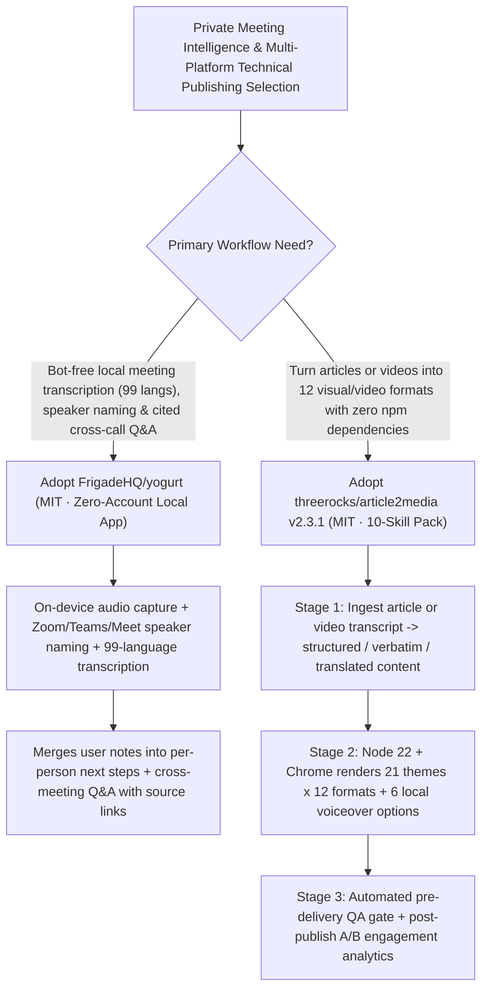

# Bot-Free Local Private AI Meeting Notes (`FrigadeHQ/yogurt`) & Zero-npm-Dependency 10-Skill Omni-Media Publishing Suite (`threerocks/article2media` `v2.3.1`) Selection FAQ

> **Document Scope**: This is the **2026-11-12 Night Shift Round 6 (Cumulative #105) standalone 6-part selection guide**, modeled strictly after `ib-vs-ethernet-roce-selection-faq.md` with first-principles explanations and closed-form FinOps math. It is written for AI Solution Architects and Developer Relations (DevRel) Leads evaluating two breakout repositories for private meeting intelligence and automated multi-platform technical publishing:
> 1. **`FrigadeHQ/yogurt` (`784★` in 2 days, `~392★/day`, TypeScript, MIT, macOS / Windows / Linux)**: Free, open-source private AI meeting notes that **record your calls without adding a bot to the meeting** — keeping all audio, 99-language live transcripts, and AI processing on your computer with zero account required, speaker naming for Zoom/Teams/Meet (macOS), per-person next steps, and **cross-meeting Q&A with source links**!
> 2. **`threerocks/article2media` (`287★` in 4 days, JavaScript, MIT, `v2.3.1`)**: A **zero-npm-dependency (`npm dependencies: 0`, Node.js 22 + Chrome only)** 10-skill Claude Code / Codex plugin that turns any article (X, Web, WeChat, Markdown) or video (YouTube, Bilibili, Douyin) into **12 ready-to-publish formats** (3:4 cards, magazine long-images, WeChat HTML, vertical narrated videos with 6 local AI voices & word-exact subtitles, whiteboard explainers, B&W comics across 21 themes) with **automated pre-delivery QA gates** and post-publish A/B analytics!
>
> **中文版本**: [yogurt-article2media-botfree-private-meeting-notes-zero-dep-media-skills-selection-faq.md](yogurt-article2media-botfree-private-meeting-notes-zero-dep-media-skills-selection-faq.md) · **Daily Digest**: [`daily/2026-11-12.en.md`](../daily/2026-11-12.en.md) · **Architecture Summary SVG**: [`assets/github-ai-radar-2026-11-12-r6-yogurt-article2media.svg`](../../../assets/github-ai-radar-2026-11-12-r6-yogurt-article2media.svg)

---

## 📌 1. Executive Summary

1. **In plain English, what core pain points do these two repositories solve?**
   - **Ending "intrusive cloud notetaker bots joining sensitive customer Zoom/Teams calls and uploading NDA audio to third-party servers" (`FrigadeHQ/yogurt`)**: Commercial meeting assistants (Otter, Fireflies) inject visible recording bots into calls and store transcripts in vendor clouds. Built by Frigade under the MIT license, `Yogurt` captures audio locally on macOS, Windows, and Linux with no account and no meeting bot — transcribing 99 languages live, naming speakers from Zoom/Teams/Meet, combining your typed notes into per-person action items, and answering questions across meetings with direct links to source transcripts!
   - **Ending "spending 4+ hours manually reformatting one technical post or video into social cards, long-images, and narrated vertical shorts across bloated npm toolchains" (`threerocks/article2media` `v2.3.1`)**: Turning a deep technical write-up into visual social formats usually requires tedious manual layout, TTS dubbing, and video editing. `article2media` ships **10 composable skills with zero `npm` dependencies** (requiring only Node.js 22 and Chrome): it digests articles or video transcripts into a style-agnostic representation, renders 12 visual/video outputs across 21 themes (including narrated vertical MP4s with 6 built-in voices), automatically verifies every output before delivery, and tracks post-publish engagement metrics!
2. **Closed-Form FinOps Conclusion (`CLAIM-20261112-R6-YOGURT-ARTICLE2MEDIA`)**:
   - Modeled for a **15-person AI Solution Architect & DevRel team conducting `120 customer/technical meetings` and publishing `40 multi-platform technical explainers` per month** (fully loaded senior SA/DevRel rate `$90.00/hr`; paid social ad promotion spend and studio camera hardware: `not_measured`):
   - Upgrading from **Path A (commercial cloud meeting-bot SaaS seats + manual multi-platform card/video editing, `$5,640.00/mo`)** to **Path C (`FrigadeHQ/yogurt` local private meeting notes + `article2media v2.3.1` zero-dep 10-skill rendering & auto-QA, `$660.00/mo`)** saves **`$4,980.00/mo` (`-88.30%`, or `$59,760.00/yr`)** and cuts meeting recap and multi-platform production labor from `46.0 hrs/mo` to `5.0 hrs/mo` (**`-89.13%`**).

---

## 🎯 2. Three First-Principles Deep-Dive Questions (Q1 / Q2 / Q3)

### Q1: How does `FrigadeHQ/yogurt` deliver speaker-attributed notes and cross-meeting cited Q&A without a meeting bot or cloud account?
- **First-Principles Breakdown**:
  1. **Bot-Free Local Audio Capture & Call Detection**:
     - Captures system audio and microphone streams directly on macOS 14.4+ (Apple Silicon), Windows 10/11 (x64), and Ubuntu 22.04+, offering recording reminders when a call starts and identifying speakers from Zoom, Teams, and Meet on macOS.
  2. **99-Language Live Transcription & Source-Linked Cross-Meeting Q&A**:
     - Merges live transcripts with user-typed notes into structured plans and per-person next steps, while indexing folders so cross-meeting queries return answers linked directly to the exact transcript source.

### Q2: How does `threerocks/article2media` (`v2.3.1`) render 12 visual and video formats with zero `npm` dependencies and automated QA?
- **First-Principles Breakdown**:
  1. **3-Stage Read → Render → Auto-Verify Pipeline**:
     - **Read**: Claude Code / Codex extracts a style-agnostic structured representation (or verbatim / translated text) from articles or transcribed videos;
     - **Render**: Pure Node.js 22 + local Chrome renders 21 visual themes into long-images, 3:4 cards, WeChat HTML, whiteboard diagrams, B&W comics, and narrated vertical MP4s (6 voices);
     - **Auto-Verify & Track**: Automated pre-delivery checks reject malformed outputs before handoff, and built-in analytics compare engagement across published variants.

### Q3: How should AI Solution Architects combine `Yogurt` and `article2media`?
- **Golden-Combo Pattern**:
  - Capture customer architecture workshops privately on-device with **`FrigadeHQ/yogurt`** and query recurring customer questions across meetings;
  - Feed anonymized architectural FAQs into **`/article2media`** to automatically produce executive summary cards, whiteboard explainers, and 60-second narrated vertical briefings!

---

## 🧭 3. Mermaid Decision Tree & Private-Notes-to-Omni-Media Pipeline

---

## 📊 4. Head-to-Head Selection Matrix

| Dimension | Path A: Cloud Meeting-Bot SaaS + Manual Editing | Path B: Raw Whisper CLI + Manual Canva/CapCut | **Path C (Recommended): `FrigadeHQ/yogurt` + `article2media v2.3.1`** |
| :--- | :--- | :--- | :--- |
| **Meeting Privacy & Customer UX** | Intrusive bot joins call; audio uploaded to cloud | Local CLI, but no speaker naming or cross-call Q&A | **Bot-free, account-free 100% local + speaker naming & cited Q&A** |
| **Multi-Platform Output Breadth** | 2–3 hours of manual reformatting per platform | Plain text only; manual graphic/video layout | **10 skills -> 12 formats (cards, long-images, whiteboard, narrated MP4)** |
| **Dependency Footprint & Supply Chain** | Proprietary SaaS | Hundreds of fragile `npm` packages | **`npm dependencies: 0` (Node.js 22 + Chrome only)** |
| **Quality Assurance & A/B Telemetry** | Manual visual inspection | None | **Automated pre-delivery QA gate + post-publish comparison reports** |
| **Monthly TCO (120 Calls + 40 Posts)** | **`$5,640.00 / mo`** (`$1,500` SaaS/API + `$4,140` labor) | **`$2,860.00 / mo`** (`$880` API + `$1,980` labor) | **`$660.00 / mo` (Saves `$4,980.00/mo` · `-88.30%`)** |

---

## 🧪 5. Closed-Form FinOps Worked Example & 7-Card Insights (`CLAIM-20261112-R6-YOGURT-ARTICLE2MEDIA`)

### 5.1 Baseline Parameters & Explicit Scope Boundaries
- **Scenario**: A 15-person AI Solution Architect & DevRel team running **120 customer/technical meetings** and publishing **40 multi-platform technical explainers per month**.
- **Labor Rate**: Fully loaded senior SA/DevRel engineering rate of **`$90.00 / hr`**.
- **Explicit Not-Measured Boundary**: Paid social media ad promotion budgets and studio camera hardware costs are marked **`not_measured`**. This model strictly accounts for meeting SaaS/LLM token spend and engineering hours spent on meeting recaps, graphic layout, dubbing, and video editing.

### 5.2 Three-Path Monthly Cost Comparison

| Cost Component | Path A: Cloud Bot SaaS + Manual Editing | Path B: Raw Whisper CLI + Manual Canva/CapCut | **Path C: `Yogurt` + `article2media v2.3.1` (Recommended)** |
| :--- | :--- | :--- | :--- |
| **Monthly Meeting SaaS & Content LLM Token Spend** | **`$1,500.00`** | **`$880.00`** | **`$210.00`** (`Yogurt` $0 local execution + `article2media` structuring tokens) |
| **Meeting Recap, Graphic Layout & Video Editing Labor (`$90/hr`)** | `46.0 hrs × $90.00` = **`$4,140.00`** | `22.0 hrs × $90.00` = **`$1,980.00`** | `5.0 hrs × $90.00` = **`$450.00`** |
| **Total Monthly TCO** | **`$5,640.00 / mo`** | **`$2,860.00 / mo`** (`-49.29%`) | **`$660.00 / mo`** |
| **Net Savings vs. Path A** | Baseline | Saves `$2,780.00 / mo` | **Saves `$4,980.00 / mo` (`-88.30%` · `$59,760.00/yr`)** |
| **Paid Social Ad Spend & Studio Hardware** | `not_measured` | `not_measured` | `not_measured` |

---

## 🛠️ 6. Production Adoption Checklist

- [ ] **1. `FrigadeHQ/yogurt` Local Install & Zero-Egress Verification**: Install `Yogurt` on macOS, Windows, or Linux and verify bot-free recording, 99-language transcription, and local storage without an account.
- [ ] **2. Cross-Meeting Source-Linked Q&A Test**: Query across multiple meeting folders and verify that answers link directly back to source transcript segments.
- [ ] **3. `threerocks/article2media` (`v2.3.1`) Zero-Dep Setup**: Verify Node.js 22+ and Chrome, install the skill/plugin in Claude Code or Codex, and test `/article2media` across the 21 built-in themes.
- [ ] **4. Automated QA Gate & Multi-Format Export Check**: Render a technical Markdown post into 3:4 cards, a long-image, a whiteboard diagram, and a narrated vertical video, confirming automated pre-delivery verification passes.
