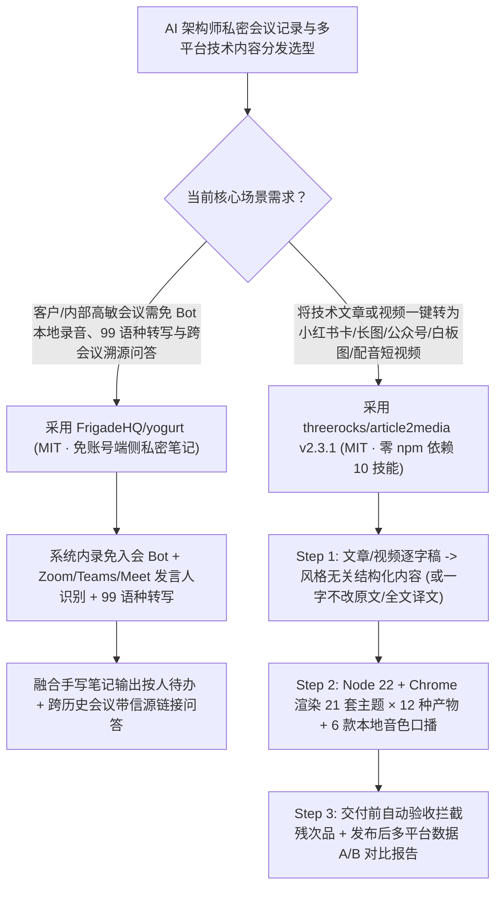

# 免入会 Bot 端侧私有 AI 会议纪要（`FrigadeHQ/yogurt`）与零 npm 依赖 10 技能全平台视觉/口播工厂（`threerocks/article2media` `v2.3.1`）深度选型 FAQ

> **文档定位**：本专题是 **2026-11-12 夜班第 6 轮（累计第 105 篇）独立六段式选型指南**，严格对标 `ib-vs-ethernet-roce-selection-faq.md` 的通俗第一性原理与闭式 FinOps 核算规范，面向 AI 解决方案架构师（SA）与技术布道（DevRel）团队，深度拆解今日在本地隐私会议纪要与多平台技术内容自动化生产赛道爆发的两大开源利器：
> 1. **`FrigadeHQ/yogurt`（建仓 2 天狂揽 `784★`，日均 `≈392★/天`，TypeScript，MIT，支持 macOS / Windows / Linux）**：无需注册账号、**绝不往会议室里塞尴尬的录音机器人（Records your calls without adding a bot to the meeting）**的端侧私有 AI 会议笔记——所有音频、实时转写（支持 99 种语言）与 AI 总结默认留在本地电脑，支持 Zoom / Microsoft Teams / Google Meet 发言人姓名识别（macOS）、按人拆解下一步待办（Next steps by person）以及**跨历史会议带精确信源链接的问答（Answers with sources）**！
> 2. **`threerocks/article2media`（建仓 4 天 `287★`，JavaScript，MIT，最新 `v2.3.1`）**：**零 `npm` 依赖（`npm dependencies: 0`，仅需 Node.js 22 + Chrome）**的 10 合 1 开源 Claude Code / Codex 技能与插件——输入一篇 X 长文/公众号/Markdown 或一条抖音/B 站/YouTube 视频，一键渲染出 **12 种可直接发布的视觉产物**（小红书 3:4 卡片、杂志长图、公众号排版、带 6 款本地 AI 音色与逐字字幕的竖屏口播短视频、白板论证图、黑白漫画等，内置 21 套主题），且每件产出在交付前强制跑**自动化验收（不合格直接报错重做）**并追踪多平台发布转化数据！
>
> **English Version**: [yogurt-article2media-botfree-private-meeting-notes-zero-dep-media-skills-selection-faq.en.md](yogurt-article2media-botfree-private-meeting-notes-zero-dep-media-skills-selection-faq.en.md) · **关联日报**: [`daily/2026-11-12.md`](../daily/2026-11-12.md) · **架构总结图**: [`assets/github-ai-radar-2026-11-12-r6-yogurt-article2media.svg`](../../../assets/github-ai-radar-2026-11-12-r6-yogurt-article2media.svg)

---

## 📌 一、核心结论速览（Executive Summary）

1. **一句话大白话讲透这两个项目到底解决了什么痛点？**
   - **终结“和客户开架构评审会时，第三方云笔记往 Teams/Zoom 里拉进一个显眼的『AI Notetaker Bot』惹客户反感、且敏感客户语音上传云端违反保密协议”的痛点（`FrigadeHQ/yogurt`）**：作为 AI 架构师，每天要开多场高保密级别的客户沟通会。传统云端会议助手（Otter / Fireflies）不仅按席位收高额月费，还必须以虚拟参会者身份挤进会议室并把录音传到外部服务器。`Yogurt` 由知名开源团队 Frigade 打造（MIT 协议），直接在本机采集音频与麦克风（零入会 Bot、零账号登录、100% 本地存储），支持 99 种语言实时转写、自动融合你手敲的重点笔记生成按人归类的 Action Items，还能跨几十场历史会议提问并直接跳转到原话出处！
   - **终结“写完一篇深度技术博客或录完一段分享视频后，还要花四五个小时手动截图、去 Canva 排小红书卡片、去剪映配音加字幕、且传统媒体脚本装几百个 npm 包动辄报错”的痛点（`threerocks/article2media` `v2.3.1`）**：好技术文章在移动端信息流里极难被读完。`article2media` 用**零 `npm` 依赖**的纯正工程设计（只需 Node.js 22 和本地 Chrome），把“文章抓取、视频转文字、结构化总结/一字不改原文模式、全文翻译、杂志长图、小红书 3:4 卡片、公众号排版、本地 6 音色配音竖屏口播视频、白板论证图、黑白漫画”拆成 **10 个可独立调用也可 `/article2media` 一键联动的 Skill**，交付前自动检查版面与音画质量，并内置发布数据对比报告帮你找出转化率最高的封面与主题！
2. **闭式 FinOps 投资回报结论（`CLAIM-20261112-R6-YOGURT-ARTICLE2MEDIA`）**：
   - 以 **15 人解决方案架构师（SA）与技术布道团队每月开展 `120 场` 客户技术会议、并将 `40 篇` 核心架构方案转化为全平台图文/短视频矩阵** 为基准（高级架构师与内容工程师全包时薪 `$90.00/hr`；外部社交媒体商业买量投流费与专业摄影棚硬件采购：`not_measured`）：
   - 从 **Path A（购买商业云会议 Bot SaaS 席位 + 人工使用多款排版/剪辑软件逐平台重制内容，月均 `$5,640.00`）** 升级至 **Path C（`FrigadeHQ/yogurt` 本地零成本私密会议纪要 + `article2media v2.3.1` 零依赖 10 技能一键出片与自动验收，月均 `$660.00`）**，每月净省 **`$4,980.00/mo`（降幅 `-88.30%`，年省 `$59,760.00/yr`）**，并将会议纪要整理与多平台视觉/视频制作工时从 `46.0 hrs/mo` 压缩至 `5.0 hrs/mo`（节省 **`-89.13%`**）。

---

## 🎯 二、三大灵魂拷问（Q1 / Q2 / Q3 深度原理解析）

### Q1：`FrigadeHQ/yogurt` 为什么能做到“免入会 Bot、免账号注册”却依然识别 Zoom/Teams/Meet 发言人并支持跨会议溯源问答？
- **第一性原理拆解**：
  1. **系统音频内录 + 桌面会议窗口元数据联动**：
     - `Yogurt` 在 macOS 14.4+、Windows 10/11 与 Ubuntu 22.04+ 上直接捕获系统输出流与本地麦克风流，无需通过 WebRTC 机器人加入远端房间；在 macOS 上结合 Zoom、Teams 与 Google Meet 的活跃发言态识别（Who said what），并在检测到通话开始时自动弹出录音提醒。
  2. **手写笔记 + 99 语种转写融合与带出处的跨会议检索（Answers with Sources）**：
     - 会中架构师随手记下的几句关键锚点会与完整语音转写融合生成结构化纪要（含计划、按人分配的 Next Steps 与个人提醒）；会后可按文件夹、标题或正文全文检索，跨会议提问时每条回答均附带指向原始转写段落的精确链接。

### Q2：`threerocks/article2media` (`v2.3.1`) 是如何在“零 npm 依赖”约束下跑通 10 大技能、12 种视觉/视频产出与自动验收的？
- **第一性原理拆解**：
  1. **语义内容与视觉主题彻底解耦的三步流水线（Read → Render → Auto-Verify）**：
     - **Step 1（读懂与重组）**：由 Claude Code / Codex 将输入链接（X 长文、公众号、Markdown 或先转逐字稿的抖音/B 站/YouTube 视频）提炼为与风格无关的结构化中间表达（或开启“一字不改原文模式”/“逐段全文翻译模式”）；
     - **Step 2（零依赖 Chrome 确定性渲染 + 本地 6 音色合成）**：仅利用 Node.js 22 原生 API 与本地 Chrome 将中间表达套入 **21 套高审美主题**，一次性生成长图、3:4 卡片、公众号排版、白板论证图、黑白漫画以及带逐字字幕的竖屏口播 MP4；
     - **Step 3（交付前自动验收 + 发布数据闭环）**：每种产出均内置自动化检查器（检查截断、留白異常或字幕脱节），不合格直接报错拦截；发布后还可记录各平台阅读/完播数据生成 A/B 对比报告。

### Q3：AI 架构师如何将 `Yogurt` 与 `article2media` 串联成“客户会议洞察 → 脱敏技术干货全网分发”的飞轮？
- **黄金组合落地范式**：
  - 白天使用 **`FrigadeHQ/yogurt`** 零打扰记录客户架构咨询与内部技术讨论，利用跨会议问答提炼出高频共性架构痛点；
  - 晚上在 Claude Code / Codex 中调用 **`/article2media`** 将脱敏后的架构 FAQ 一键渲染为公众号深度排版、小红书 3:4 图文卡、白板逻辑图与 60 秒竖屏口播视频！

---

## 🧭 三、Mermaid 选型决策树与「私密纪要 → 全平台视觉工厂」流水线

---

## 📊 四、同类方案核心能力对比矩阵（Selection Matrix）

| 评估维度 | Path A：商业云会议 Bot SaaS + 人工排版剪辑 | Path B：裸 Whisper 脚本 + 手工 Canva/剪映 | **Path C（推荐）：`FrigadeHQ/yogurt` + `article2media v2.3.1`** |
| :--- | :--- | :--- | :--- |
| **会议私密性与客户体感** | 强行拉入外部 Bot 招致客户反感，录音上传第三方云 | 本地转写，但无会议提醒、无发言人区分与跨会检索 | **零入会 Bot、零账号、100% 本地私密 + 发言人识别与带出处跨会问答** |
| **多平台内容转换广度** | 每换一个平台需人工重排 2–3 小时 | 仅能生成纯文本摘要，图文视频全靠手搓 | **10 技能一键产出小红书卡、长图、公众号、白板图、漫画与配音短视频** |
| **依赖体积与供应链安全** | 闭源 SaaS | 开源转换工具常依赖数百个脆弱 npm 包 | **`npm dependencies: 0`（仅需 Node.js 22 + Chrome），零依赖腐烂风险** |
| **成品质量门禁与效果复盘** | 靠肉眼检查排版错位 | 无自动验收与发布数据追踪 | **内置交付前自动验收（不合格直接报错）+ 发布数据对比分析报告** |
| **月度总拥有成本（120 会议 + 40 篇分发）** | **`$5,640.00 / mo`**（`$1,500` SaaS/API + `$4,140` 工时） | **`$2,860.00 / mo`**（`$880` API + `$1,980` 工时） | **`$660.00 / mo`（净省 `$4,980.00/mo` · `-88.30%`）** |

---

## 🧪 五、定量 FinOps 算例与 7-Card 洞察（`CLAIM-20261112-R6-YOGURT-ARTICLE2MEDIA`）

### 5.1 测算基准与显式边界（Scope & Boundaries）
- **场景设定**：15 人 AI 解决方案架构师与技术布道团队，每月进行 **120 场客户与技术评审会议**，并将 **40 篇技术文章/分享视频转化为多平台图文卡片与口播短视频**。
- **费率假设**：高级架构师与内容工程师全包时薪 **`$90.00 / hr`**。
- **显式边界声明（Explicit Not-Measured Boundary）**：外部社交媒体平台商业投流推广费与专业摄影棚硬件购置成本标记为 **`not_measured`**，本表严格核算商业会议 SaaS 席位/大模型 Token 支出与人工会议纪要整理、跨平台排版、配音剪辑工时。

### 5.2 三路径月度成本闭式对照表

| 成本分项 | Path A：商业云会议 SaaS + 人工排版剪辑 | Path B：裸 Whisper 脚本 + 手工 Canva/剪映 | **Path C：`Yogurt` + `article2media v2.3.1`（推荐）** |
| :--- | :--- | :--- | :--- |
| **月度会议 SaaS 席位与内容改写 Token 支出** | **`$1,500.00`** | **`$880.00`** | **`$210.00`**（`Yogurt` 本地免费运行 + `article2media` 结构化提炼与本地配音） |
| **会议纪要整理、跨平台排版、配音与剪辑工时（`$90/hr`）** | `46.0 hrs × $90.00` = **`$4,140.00`** | `22.0 hrs × $90.00` = **`$1,980.00`** | `5.0 hrs × $90.00` = **`$450.00`** |
| **月度总成本（Monthly TCO）** | **`$5,640.00 / mo`** | **`$2,860.00 / mo`**（`-49.29%`） | **`$660.00 / mo`** |
| **相对 Path A 净节省** | 基准线（Baseline） | 净省 `$2,780.00 / mo` | **净省 `$4,980.00 / mo`（`-88.30%` · 年省 `$59,760.00/yr`）** |
| **外部社媒买量投流与摄影棚硬件** | `not_measured` | `not_measured` | `not_measured` |

---

## 🛠️ 六、生产级落地核验 Checklist

- [ ] **1. `FrigadeHQ/yogurt` 本地安装与零出境核查**：在 macOS / Windows / Linux 工作站安装 `Yogurt`，验证在不登录任何云账号的情况下完成通话内录、99 语种转写与本地目录存储。
- [ ] **2. 跨会议带信源问答（Answers with Sources）验证**：对多个历史会议文件夹发起联合提问，验证每条生成的结论与待办均附带可点击回溯的原始对话时间戳链接。
- [ ] **3. `threerocks/article2media` (`v2.3.1`) 零 npm 依赖环境检查**：确认本机安装 Node.js 22+ 与 Chrome，加载 Claude Code / Codex 插件并测试 `/article2media` 渲染 21 套主题。
- [ ] **4. 12 种视觉/视频产出自动验收与发布对比归档**：输入一篇 Markdown 技术报告，验证长图、小红书 3:4 卡片、公众号排版、白板论证图与竖屏口播视频自动通过交付前质量门禁。
