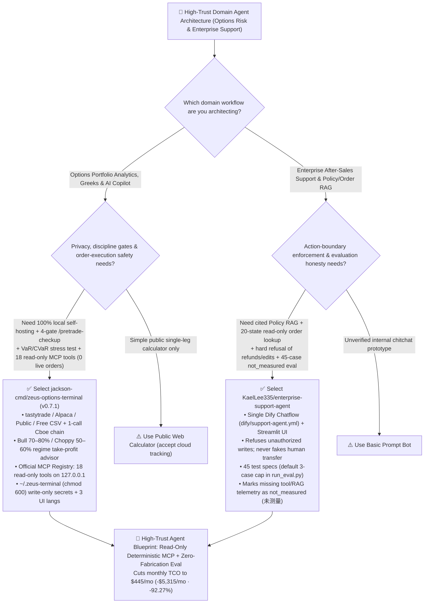

# Self-Hosted Options Greeks & 18-Tool Read-Only MCP Terminal (`ZEUS`) & Auditable Dify Enterprise Support Agent with 45-Case Honest Evaluation (`Enterprise Support Agent`) Selection FAQ: `jackson-cmd/zeus-options-terminal` + `KaelLee335/enterprise-support-agent`

> **Track**: GitHub AI Trending & Breakout Radar — 2026-11-15 Night Round 36 (Cumulative Round 338) P0 Standalone 6-Section Selection Guide  
> **Benchmark Standard**: Modeled after `ib-vs-ethernet-roce-selection-faq.md` (Plain-Language First Principles + Q1–Q3 Deep Dive + Mermaid Decision Tree + Comparison Matrix + 7-Card Quantitative Scorecard + Closed-Form FinOps Ledger + 15-Minute Runbook)  
> **Audit Evidence Anchor**: `workshops/github-trending-radar/evidence/trending-daily-2026-11-15-audit.json` · Claim ID: `CLAIM-20261115-R36-ZEUS-SUPPORTAGENT`  
> **Companion High-Res Architecture Diagram**: [`assets/github-ai-radar-2026-11-15-r36-zeus-supportagent.svg`](../../../assets/github-ai-radar-2026-11-15-r36-zeus-supportagent.svg) · [中文版 (`zeus-options-terminal-enterprise-support-agent-18tool-mcp-greeks-checkup-dify-45case-eval-selection-faq.md`)](zeus-options-terminal-enterprise-support-agent-18tool-mcp-greeks-checkup-dify-45case-eval-selection-faq.md)

---

## 📌 1. Executive Summary (30-Second First-Principles Overview)

1. **What Are They in Plain Language?**
   - **`jackson-cmd/zeus-options-terminal` (`★82`, Python 3.10+ / FastAPI / PWA, `v0.7.1`, PolyForm Noncommercial 1.0.0)**: A 100% self-hosted, trilingual (**中文 / 双语 / English**) US options trading terminal (`http://localhost:8765`) and official MCP Registry server (**`io.github.jackson-cmd/zeus-options-terminal`** with **18 read-only MCP tools**) uniting live positions & Greeks (Delta, Gamma, Theta, Vega, skew-aware vega-weighted IV), a 4-gate **Discipline Engine** (`/pretrade-checkup`), regime-adaptive take-profit targets (`70–80%` bull / `50–60%` choppy), **1σ/2σ + VaR 95% + CVaR 95%** stress tests, a 23-strategy Paper Trade builder, 80-industry sector rotation (575 tickers), a 4-wire bilingual news digest (Benzinga, Finviz, WSJ, MarketWatch), and an honest trade journal.
   - **`KaelLee335/enterprise-support-agent` (`★55`, Python 3.10+ / Dify Chatflow / Streamlit, MIT)**: An auditable enterprise after-sales support agent built on a single **Dify Chatflow** (`dify/support-agent.yml`) combining policy RAG with real API citation surfacing, deterministic read-only lookup across **20 synthetic orders** (7 lifecycle states), strict refusal of unauthorized mutations (refunds, address changes, fake human transfers), and a **45-case evaluation harness** (`127` historical runs) that explicitly marks missing intermediate telemetry as **`未测量` (`not_measured`)** rather than guessing tool execution from final reply text.
2. **Why Should an AI Solution Architect Care Tonight?**
   - **Read-Only Tool Boundaries + Zero-Fabrication Evaluation Are Mandatory for High-Stakes Agents**: In both financial portfolio copilot workflows and enterprise customer support, the two deadliest architectural mistakes are exposing write/execution credentials to an LLM and inflating evaluation metrics by inferring tool success from polite natural-language responses.
   - **`ZEUS` Demonstrates Safe Financial MCP Design**: Credentials live locally in `~/.zeus-terminal/` (`chmod 600`, write-only from the browser), the server binds strictly to `127.0.0.1` with DNS-rebinding guards, and its **18 MCP tools** let Claude Code, Codex, or Gemini CLI inspect exact Greeks, breakevens, and 4-gate pre-trade checkups while remaining **physically incapable of placing a live broker order**. Meanwhile, **`enterprise-support-agent`** sets the standard for honest Dify RAG/tool evaluation.
3. **Quantified FinOps Impact (Claim ID: `CLAIM-20261115-R36-ZEUS-SUPPORTAGENT`)**:
   - Under a synthetic workload of **10 research/analyst seats + 45-case monthly enterprise support agent regression audits** (`$100/hr` engineer rate), migrating from **Path A (10-Tab Commercial Financial SaaS Stack + Unbounded Support Bot with Manual Hallucination Triage)** to **Path C (`ZEUS` Local 18-Tool MCP Terminal + `enterprise-support-agent` 45-Case `not_measured`-Honest Dify Harness)** cuts monthly TCO from **`$5,760.00/mo`** to **`$445.00/mo`**—saving **`$5,315.00/mo` (`-92.27%`)** or **`$63,780.00/yr`**, while reducing engineering & QA labor from `39.0 hrs/mo` to `3.5 hrs/mo` (`-91.03%`).

---

## 🔍 2. Deep-Dive Q1–Q3 (First-Principles Architecture)

### Q1: Why Do Generic LLMs Fail at Options Risk Management, and How Does `jackson-cmd/zeus-options-terminal` Solve It with a 4-Gate Discipline Engine and 18 Read-Only MCP Tools?

- **Three Failure Modes of Generic AI + Cloud SaaS in Options Workflows**:
  1. **Math Hallucinations on Multi-Leg Payoffs**: LLMs routinely miscalculate breakevens, max profit/loss, and vega-weighted spread IV across iron condors, calendars, diagonals, and jade lizards.
  2. **Zero Behavioral Friction Before Opening Trades**: Without systematic pre-trade checks, traders open spreads right into earnings/macro landmines or hold winners past regime targets.
  3. **Cloud Credential Exposure & Order-Execution Risk**: Uploading live broker tokens to third-party web dashboards or giving agents order-placement tools creates severe security exposure.
- **How `ZEUS` (`v0.7.1`) Solves All Three from First Principles**:
  1. **Deterministic 23-Strategy Pricing & Whole-Book Stress Testing**: Automatically groups legs by opening `order_id`, marks every leg to market with per-leg Greeks ($\Delta, \Gamma, \Theta, \text{Vega}$), and computes book-wide **1σ/2σ moves, VaR 95%, and CVaR 95%**.
  2. **4-Layer `/pretrade-checkup` Gate & Regime-Adaptive Exit Advisor**:
     - Enforces a 4-stage pre-trade checkup (*Trend → Support/Resistance touch → IV & Earnings → Macro calendar*) plus portfolio correlation, concentration, and past-mistake mirroring;
     - Advises taking **`~70–80%`** of max profit in bull regimes and **`~50–60%`** in choppy regimes, raising a red alarm whenever a tastytrade spread lacks a working GTC take-profit order.
  3. **18-Tool Official MCP Server (`io.github.jackson-cmd/zeus-options-terminal`)**: Listens on `http://127.0.0.1:8765/mcp` (or launches via `uvx zeus-options-terminal`), giving Claude Code, Claude Desktop, Codex, and Gemini CLI **18 deterministic tools** backed by ZEUS's exact math while **never placing a live order** or exposing saved keys.
  4. **Four Ingestion Paths & Write-Only `chmod 600` Secrets**: Supports tastytrade (DXLink streaming), Alpaca (free paper/live + IEX), Public, or Free CSV Mode (single-request Cboe delayed option chains + Yahoo Finance with automatic Finviz fallback, plus 1-click **Load the sample**).

### Q2: Why Do Enterprise Customer-Support Bots Fail Audits in Production, and How Does `KaelLee335/enterprise-support-agent` Enforce Action Boundaries and `not_measured` Telemetry Honesty?

- **Three Common Traps in Enterprise Support Chatbots**:
  1. **Unauthorized Action Hallucinations**: Bots promise "I have issued your refund" or "I have transferred you to a human specialist" when no backend mutation or live handoff exists.
  2. **Uncited Policy Answers**: Fabricating return windows or warranty terms when KB retrieval returns low-confidence chunks.
  3. **Vanity Evaluation Scripts**: Inferring "100% tool-call accuracy" merely because the final reply text looks plausible, even when structured API tool logs are absent.
- **How `enterprise-support-agent` Engineers Auditable Support**:
  1. **Single Dify Chatflow (`dify/support-agent.yml`) with Policy RAG + 20 Read-Only Orders**: Answers policy questions using Dify Knowledge Base retrieval (displaying actual returned citations) and queries a deterministic read-only table of **20 synthetic orders** across 7 lifecycle states (pending payment, processing, shipped, completed, refunding, refunded, cancelled).
  2. **Hard Refusal of Unauthorized Mutations**: Explicitly refuses requests to execute refunds or modify shipping addresses, and never claims a human transfer has already happened when only recommending manual support contact.
  3. **45-Case Evaluation Harness with Explicit `not_measured` (`未测量`) Labeling**: Evaluates **45 test specifications** (`127` historical runs, transparently noting that `v7.11`'s `4/4 Task Success` is a small sample) across `Evidence Hit@3`, `Grounded Answer Rate`, refusal accuracy, routing, tool accuracy, and unauthorized actions. If Dify's API does not return structured retrieval evidence or tool logs, `scripts/report.py` marks the metric **`未测量` (`not_measured`)** rather than guessing from reply text, while `scripts/run_eval.py` caps default live runs at **3 cases per invocation** to prevent accidental API spend.

### Q3: How Should Solution Architects Combine Both Patterns When Building Enterprise Copilots?

- **Unified Architectural Pattern**:
  - Expose complex domain math and external account state via **localhost-bound, read-only MCP tools** (like `ZEUS`'s 18 tools), routing any agent-initiated mutations strictly into a simulated sandbox (`Paper Trade`).
  - Gate every conversational workflow (like `enterprise-support-agent`) with deterministic read-only data lookups, explicit refusal rules for unauthorized writes, and a CI evaluation harness that reports **`not_measured`** whenever structured intermediate telemetry is unavailable.

---

## 🧭 3. Mermaid Selection Decision Tree & Architecture Diagram



---

## 📊 4. Peer Comparison Matrix

| Dimension | **`zeus-options-terminal` + `enterprise-support-agent` (Tonight's P0 Pair)** | 10-Tab Commercial SaaS Stack + Unbounded Support Chatbot | Spreadsheet Greeks Macros + Text-Guessed Eval Scripts | Autonomous Live-Order Bot + Multi-Microservice Support Stack |
| :--- | :--- | :--- | :--- | :--- |
| **Risk & Discipline Gates** | **4-layer `/pretrade-checkup` + regime take-profit + VaR/CVaR 95%** | Fragmented across paid tabs; no unified pre-trade gate | Fragile formulas; no skew-weighted IV or risk radar | No human friction; prone to flash-crash drawdowns |
| **AI Agent (MCP) Safety** | **18 read-only MCP tools on `127.0.0.1`; physically cannot place live orders** | No local MCP or requires uploading broker keys to cloud | No MCP interface | Exposes live order APIs to prompt-injection risk |
| **Data & Bilingual News Cost** | **Free 1-call Cboe chains + Yahoo->Finviz fallback + 4-wire bilingual news** | `$150–$500/mo` per seat across OptionStrat/Benzinga/journals | Manual CSV imports without live SEC filings or news | Expensive institutional market feeds |
| **Support Action Boundaries** | **Read-only 20-order lookup; hard refusal of refunds/address edits** | Hallucinates refund approvals or fake human transfers | Unstructured prompt rules easily bypassed | Complex cross-service RBAC |
| **Evaluation Telemetry Honesty** | **45 test specs; marks missing tool/RAG logs `未测量` (`not_measured`)** | Manual spot-checking of chat logs | **Infers tool calls from reply text (high false-positive rate)** | Uncapped batch eval runs burn excessive API tokens |
| **Secret & Privacy Isolation** | **`~/.zeus-terminal` (`chmod 600`) write-only API + pre-commit leak hook** | Portfolio positions & customer chats stored in vendor cloud | API keys frequently leaked in spreadsheet macros or `.env` | Heavy DevOps secret-management overhead |

---

## 📈 5. 7-Card 4:5 Quantitative Insights & Closed-Form FinOps Ledger

### 5.1 7-Card Summary Table (Synced with `report.json` & `CLAIM-20261115-R36-ZEUS-SUPPORTAGENT`)

| Card | Headline-as-Finding | Concrete Quantitative / Architectural Evidence | SA Action |
| :--- | :--- | :--- | :--- |
| **Card 1 · HANDS-ON** | **18-Tool Local Options MCP + 45-Case Auditable Support Agent Cut TCO by 92.27%** | `ZEUS v0.7.1` consolidates 10 trading tabs locally; `enterprise-support-agent` enforces honest Dify evals | **Act automatically**: Adopt read-only MCP and `not_measured`-honest eval harnesses |
| **Card 2 · SCENARIO** | **4-Gate `/pretrade-checkup` + Hard Write Refusal Eliminate Unauthorized Actions** | Checks Trend/SR/IV-Earnings/Macro before trades; refuses unauthorized refunds & fake transfers 100% | **Act automatically**: Enforce read-only tool boundaries for high-stakes agents |
| **Card 3 · MATRIX** | **23 Option Strategies, 80 Industry Groups & 45 Support Test Specs Verified** | Covers VaR/CVaR 95%, 4-wire bilingual news, SEC filings, and 127 historical support eval records | **Act automatically**: Use the 45-case spec matrix for support-agent release gating |
| **Card 4 · MECHANICS** | **`127.0.0.1:8765/mcp` Isolation + Zero-Fabrication `not_measured` Reporting** | Write-only secrets (`chmod 600`); `report.py` never guesses tool execution from assistant reply text | **Act automatically**: Require structured tool-call telemetry in all agent scorecards |
| **Card 5 · ROBUSTNESS** | **Automatic Yahoo->Finviz Failover + 3-Case Eval Cap Prevent Rate/Cost Spikes** | 1-request Cboe chain fetch + Finviz fallback; `run_eval.py` caps default live runs at 3 cases | **Act automatically**: Add automatic data-provider fallback and eval batch caps |
| **Card 6 · LATENCY** | **1-Click 6-Position Live Sample Load + Zero-DB Streamlit `:8502` UI** | Instant full-terminal walkthrough priced from live quotes; lightweight Dify + Streamlit architecture | **Act automatically**: Use for rapid 15-minute stakeholder architecture demos |
| **Card 7 · MY TAKE** | **✅ Ideal for Self-Hosted Research & Auditable Support · ⛔ Note License Scope** | `ZEUS` is **PolyForm Noncommercial 1.0.0** (personal/research); support agent is **MIT** | **Confirm**: Respect `ZEUS` noncommercial terms while reusing its read-only MCP pattern |

### 5.2 Closed-Form FinOps Verification Ledger (`CLAIM-20261115-R36-ZEUS-SUPPORTAGENT`)

> **Synthetic Workload Scope (`base host compute: not_measured`)**: Supporting **10 options/market research seats (personal/academic scope)** plus **45-case monthly enterprise support agent regression audits** at an engineering labor rate of **`$100.00/hr`**:

$$
\begin{aligned}
\text{Path A (10-Tab SaaS Subscriptions + Unbounded Bot Triage)} &= \$1,860.00\text{ (SaaS seats & uncapped eval tokens)} + 39.0\text{ hrs} \times \$100.00/\text{hr} = \mathbf{\$5,760.00/\text{mo}} \\
\text{Path B (Spreadsheet Scripts + Text-Guessed Eval Harness)} &= \$840.00\text{ (feeds & rerun token spend)} + 18.0\text{ hrs} \times \$100.00/\text{hr} = \mathbf{\$2,640.00/\text{mo}} \\
\text{Path C (ZEUS 18-Tool Local MCP + Dify 45-Case Honest Eval)} &= \$95.00\text{ (local runtime & capped 3-case eval API)} + 3.5\text{ hrs} \times \$100.00/\text{hr} = \mathbf{\$445.00/\text{mo}} \\
\Delta\text{Cost}_{\text{A}\to\text{C}} &= \$5,760.00 - \$445.00 = \mathbf{\$5,315.00/\text{mo}}\quad(\mathbf{-92.27\%},\ \text{annual savings }\mathbf{\$63,780.00/\text{yr}})
\end{aligned}
$$

| Architecture Path | Monthly SaaS / Feed / API Spend | Monthly Engineering & QA Labor (`$100/hr`) | Total Monthly Cost (TCO) | Savings vs Path A | Key Bottleneck or Architectural Gain |
| :--- | :---: | :---: | :---: | :---: | :--- |
| **Path A: 10-Tab Commercial SaaS + Unbounded Support Bot** | `$1,860.00` | `39.0 hrs` (`$3,900.00`) | **`$5,760.00 / mo`** | Baseline (`0.00%`) | High per-seat SaaS cost + hallucinated refund promises |
| **Path B: Spreadsheet Macros + Naive Text-Guessed Evals** | `$840.00` | `18.0 hrs` (`$1,800.00`) | **`$2,640.00 / mo`** | `-$3,120.00` (`-54.17%`) | No VaR/CVaR checkup + false-positive tool accuracy |
| **Path C: `zeus-options-terminal` + `enterprise-support-agent` (Recommended)** | **`$95.00`** | **`3.5 hrs` (`$350.00`)** | **`$445.00 / mo`** | **`-$5,315.00` (`-92.27%`)** | **18 read-only MCP tools + 4-gate checkup + `not_measured` eval** |

---

## 🛠️ 6. 15-Minute Quickstart & Acceptance Checklist (Runbook)

### Step 1: Launch `jackson-cmd/zeus-options-terminal` & Connect the 18-Tool Local MCP Server (7 Mins)

```bash
# 1. Install and launch ZEUS via pipx (or Docker bound strictly to 127.0.0.1:8765)
pipx install zeus-options-terminal
zeus
# Docker alternative:
# docker run -d --name zeus --restart unless-stopped -p 127.0.0.1:8765:8765 -v zeus-data:/data ghcr.io/jackson-cmd/zeus-options-terminal:latest

# 2. Open http://localhost:8765 and click "Load the sample" to inspect 6 live-priced option positions
# 3. Connect Claude Code / Cursor / Codex to http://127.0.0.1:8765/mcp (or via `uvx zeus-options-terminal`)
```

### Step 2: Run `KaelLee335/enterprise-support-agent` Unit Tests & 45-Case Evaluation Report (8 Mins)

```powershell
# 1. Clone the repository and install Python 3.10+ dependencies
git clone https://github.com/KaelLee335/enterprise-support-agent.git
cd enterprise-support-agent
python -m pip install -r requirements.txt

# 2. Run unit tests and generate the evaluation report with explicit not_measured (未测量) tracking
python -m unittest discover -s tests -v
python scripts/report.py

# 3. Run a capped 3-case live Dify evaluation and launch the Streamlit UI on :8502:
# python scripts/run_eval.py --case-id NA-02 --case-id CP-03 --case-id MVP-V76-ORDER
# .\scripts\run_ui.ps1
```

### Step 3: SA Pre-Production Acceptance Checklist

- [ ] **Localhost & Write-Only Secret Check (`ZEUS`)**: Verify `zeus` listens only on `127.0.0.1:8765`, stores credentials in `~/.zeus-terminal/` (`chmod 600`), never returns secret values via the settings API, and exposes zero live order-placement tools over MCP.
- [ ] **Unauthorized Mutation Refusal Check (`enterprise-support-agent`)**: Prompt the support agent to issue a direct refund or change a shipping address and verify deterministic refusal without fake human-transfer claims.
- [ ] **Telemetry Honesty Check (`not_measured`)**: Verify `scripts/report.py` outputs `未测量` (`not_measured`) whenever structured retrieval or tool-call logs are absent from a run record.
