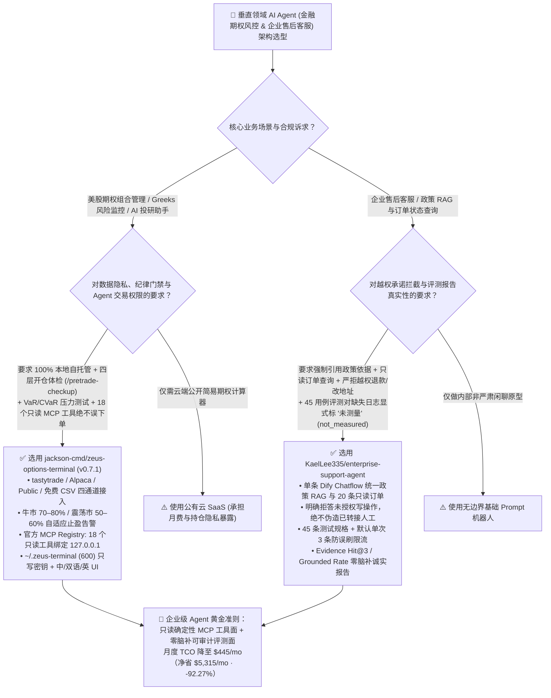

# 本地私有化美股期权希腊值与 18 工具只读 MCP 终端（`ZEUS`）与可审计 Dify 企业售后 Agent / 45 用例诚实评测套件（`Enterprise Support Agent`）选型 FAQ：`jackson-cmd/zeus-options-terminal` + `KaelLee335/enterprise-support-agent`

> **所属专题**：GitHub AI 热榜与新仓爆发榜 — 2026-11-15 Night Round 36（累计 Round 338）P0 独立六段式选型指南  
> **对标标杆**：`ib-vs-ethernet-roce-selection-faq.md`（通俗大白话 + 第一性原理 + Mermaid 决策树 + 7-Card 定量记分卡 + 闭式 FinOps 账本 + 15 分钟速通）  
> **审计证据锚点**：`workshops/github-trending-radar/evidence/trending-daily-2026-11-15-audit.json` · Claim ID: `CLAIM-20261115-R36-ZEUS-SUPPORTAGENT`  
> **配套高清架构图**：[`assets/github-ai-radar-2026-11-15-r36-zeus-supportagent.svg`](../../../assets/github-ai-radar-2026-11-15-r36-zeus-supportagent.svg) · [English Version (`zeus-options-terminal-enterprise-support-agent-18tool-mcp-greeks-checkup-dify-45case-eval-selection-faq.en.md`)](zeus-options-terminal-enterprise-support-agent-18tool-mcp-greeks-checkup-dify-45case-eval-selection-faq.en.md)

---

## 📌 一、核心结论速览（Executive Summary — 30 秒看懂本质）

1. **它们到底是什么？（一句话大白话本质定义）**
   - **`jackson-cmd/zeus-options-terminal`（`★82`，Python 3.10+ / FastAPI / PWA，`v0.7.1`，宙斯期权终端）**：一套 **100% 本地自托管**、支持 **中文 / 双语 / English** 的全能美股期权分析与风控终端，同时也是官方 MCP Registry 收录的 **18 工具只读 MCP 服务端（`io.github.jackson-cmd/zeus-options-terminal`）**——集成了 tastytrade/Alpaca/Public/CSV 四通道只读接入、实时 Greeks 与偏度加权 IV、**四层开仓前纪律体检（`/pretrade-checkup`）**、牛震市自适应止盈（`70–80%` vs `50–60%`）、整簿 **1σ/2σ + VaR 95% + CVaR 95%** 压力测试、23 种策略模拟盘、80 行业板块轮动与四源双语新闻台（Finviz/WSJ/MarketWatch/Benzinga）。
   - **`KaelLee335/enterprise-support-agent`（`★55`，Python 3.10+ / Dify Chatflow / Streamlit，MIT）**：一套专为企业售后客服打造的**可审计、严守权限边界**的 Dify Agent 标杆工程——在单条 Dify Chatflow（`dify/support-agent.yml`）中融合政策知识库 RAG 引用溯源、**20 条全状态只读模拟订单查询**与**越权操作硬拒答（严禁私自承诺退款/改地址/伪造人工转接）**，并配套 **45 条分类测试规格（127 条历史运行记录）**，首创**“缺失中间工具日志即强制标注 `未测量`（`not_measured`），绝不从回复文本倒推伪造工具执行率”**的诚实评测准则。
2. **为什么 AI 解决方案架构师（SA）今晚必须关注这两个项目？**
   - **高敏金融与企业客服 Agent 的共同铁律：只读最小权限 + 拒绝脑补幻觉**：无论是让 AI Agent 辅助期权组合风控，还是让 Agent 接待企业售后投诉，最致命的架构事故都是“把写权限（真实下单/直接退款）裸露给大模型”以及“在评测报告里靠大模型嘴硬编造指标”。
   - **`ZEUS` 给出了金融 Agent 工具箱的满分安全模板**：密钥只写不读（`~/.zeus-terminal/` 权限 `600`）、端口硬绑定 `127.0.0.1:8765` 防 DNS 重绑定，向 Claude Code / Codex / Gemini 暴露 **18 个精确计算工具**（含精确最大盈亏、盈亏平衡点与四门禁体检），但**从物理代码层彻底阉割真实下单接口**；而 **`enterprise-support-agent`** 则给出了 Dify 落地的**反幻觉评测黄金标准**。
3. **定量收益闭环（Claim ID: `CLAIM-20261115-R36-ZEUS-SUPPORTAGENT`）**：
   - 在每月支撑 **10 个期权/量化分析席位 + 45 用例企业客服 Agent 多轮回归审计**（工程师时薪 `$100/hr`）口径下，将 **Path A（10 标签付费金融 SaaS 订阅 + 无边界客服 Bot 人工排查幻觉退款事故）** 升级为 **Path C（`ZEUS` 本地 18-Tool 只读 MCP 终端 + `enterprise-support-agent` 45 用例 `not_measured` 诚实评测套件）**，月度总拥有成本（TCO）从 **`$5,760.00/mo`** 降至 **`$445.00/mo`**，净省 **`$5,315.00/mo`（`-92.27%`）**，年化节省 **`$63,780.00/yr`**，工程排障与对账工时从 `39.0 hrs/mo` 压至 `3.5 hrs/mo`（`-91.03%`）。

---

## 🔍 二、灵魂拷问 Q1–Q3（第一性原理深度拆解）

### Q1：为什么直接让通用 LLM 聊股票/期权极易亏钱或泄密？`jackson-cmd/zeus-options-terminal` 是如何用“四层纪律门禁 + 18 个只读确定性 MCP 工具 + 零云端密钥隔离”解决的？

- **通用 AI 辅助交易的三大工程致命伤**：
  1. **数值幻觉与多腿策略组合算错**：大模型心算铁鹰（Iron Condor）、日历价差（Calendar）或比率价差的最大亏损、盈亏平衡点与 Vega 加权隐含波动率（IV）几乎必错。
  2. **缺乏纪律摩擦（Friction）导致情绪化追单**：交易员最容易在财报前高 IV 或破位时盲目开仓，或者在盈利达到目标后贪婪持仓到期归零。
  3. **第三方云端 SaaS 隐私泄露与误下单风险**：将实盘券商 Token 上传到多合一云平台，或赋予 Agent 下单 API，一旦提示词注入即造成真金白银损失。
- **`ZEUS`（`v0.7.1`）的四大第一性原理设计**：
  1. **确定性期权定价与整簿压力测试引擎**：自动按开仓 `order_id` 聚合识别垂直价差、铁鹰、蝶式、备兑等 **23 种策略**，实时计算单腿与组合 Greeks（$\Delta, \Gamma, \Theta, \text{Vega}$）、盈利概率（PoP），以及整本持仓在 **1σ / 2σ 波动、VaR 95%、CVaR 95%** 下的极端风险。
  2. **四层开仓前纪律体检（`/pretrade-checkup`）与自适应止盈引擎**：
     - 开仓前强制经过四道关卡：**趋势（Trend）→ 支撑/阻力位触碰（Support/Resistance）→ IV 与财报日（IV & Earnings）→ 宏观日历（Macro Calendar）**，并检查与现有持仓的相关性、集中度及历史同类错误镜像；
     - 止盈顾问根据市场状态自适应提示：牛市行情建议锁定 **`~70–80%`** 最大利润，震荡市锁定 **`~50–60%`**，并在 tastytrade 持仓缺失 GTC 止盈单时亮起红条警报。
  3. **官方 MCP Registry 18 工具只读服务（`io.github.jackson-cmd/zeus-options-terminal`）**：本地监听 `http://127.0.0.1:8765/mcp`（或通过 `uvx zeus-options-terminal` 启动），向 Claude / Codex / Gemini 提供 **18 个基于真实行情与确定性公式的 MCP 工具**——**永远只读、绝不下真实订单**（仅可受控操作 Paper Trade 模拟盘）。
  4. **四通道免门槛数据源与 600 权限密钥沙箱**：支持 tastytrade DXLink 流、Alpaca（免费含模拟盘）、Public 或纯免费 CSV 模式（单次 Cboe 请求拉全期权链 + Yahoo 限流自动切 Finviz）；所有密钥存于 `~/.zeus-terminal/`（权限 `600`，前端 Write-Only 只写不回显），仓库自带 `tools/install_git_hook.sh` 拦截任何疑似密钥或个人路径提交。

### Q2：为什么 90% 的企业客服 Agent 演示“看着能聊，上线就闯祸”？`KaelLee335/enterprise-support-agent` 是如何定义“权限硬边界 + `未测量`（`not_measured`）零脑补评测”的？

- **传统客服 Agent 的三大“伪可用”陷阱**：
  1. **越权许诺（Unauthorized Promises）**：面对愤怒客户要求“立刻给我退全款”或“把收货地址改到外省”，无边界模型会顺着语气回复“好的，已为您办理退款/已为您转接人工专员”，引发严重客诉与合规事故。
  2. **无据瞎编政策**：在知识库未覆盖的边缘退换货条款上自行脑补天数或运费规则。
  3. **自欺欺人的评测脚本**：很多团队仅凭模型最终回复里出现了订单号，就在评测报告里打勾“工具调用准确率 100%”，哪怕底层 API 根本没返回工具执行日志。
- **`enterprise-support-agent` 的三大工程护栏**：
  1. **单条 Dify Chatflow 内置“政策 RAG 引用 + 20 订单确定性只读查询 + 越权硬拒答”**：
     - 政策问答强制走 Dify 知识库检索并原样展示 API 返回的文档引用；
     - 订单查询严格走 **20 条固定模拟订单**（覆盖待付款、处理中、已发货、已完成、退款中、已退款、已取消 7 大状态）的确定性只读接口；
     - 遇到退款执行、改地址等写操作请求立即明确拒绝，且绝不把“建议联系人工”包装成“已成功转接人工”。
  2. **45 用例分类测试集与单次 3 条防刷限流（`scripts/run_eval.py`）**：提供 **45 条结构化测试规格**（历史累计 127 条运行记录，如实披露当前 `v7.11` 的 `4/4 Task Success` 仅为小样本验证而非夸大宣传），且 `run_eval.py` 默认限制单次最多跑 **3 条**（如 `--case-id NA-02 --case-id CP-03 --case-id MVP-V76-ORDER`），防止误操作烧穿 API 额度。
  3. **严禁从回复倒推中间状态的 `未测量`（`not_measured`）铁律**：评估报告同时核算 `Evidence Hit@3`、`Grounded Answer Rate`、拒答正确性、路由准确率、工具准确率与越权操作率；当 Dify API 响应未携带结构化检索证据或工具调用日志时，报告生成器（`scripts/report.py`）**一律显式标记为 `未测量`（`not_measured`）**，彻底杜绝评测注水。

### Q3：架构师在企业内落地垂直领域 Copilot（金融投研 / 售后客服）时，如何复用这两个项目的安全与评测范式？

- **组合架构蓝图**：
  - **工具层（参考 `ZEUS`）**：将所有涉及复杂数学计算（Greeks、VaR/CVaR、财务指标）与外部数据源（券商/ERP）的能力封装为绑定 `127.0.0.1` 的**只读 MCP Server**，写操作仅允许进入隔离的沙箱表（如 `paper_trade.py`）；
  - **编排与评测层（参考 `enterprise-support-agent`）**：在 Dify 工作流中硬编码未授权写操作拒答分支，并在 CI 评测管线中强制实施“无结构化日志即标 `not_measured`”与单次批量调用上限保护。

---

## 🧭 三、Mermaid 选型决策树与双域安全架构图



---

## 📊 四、同类主流方案核心能力对比矩阵

| 对比维度 | **`zeus-options-terminal` + `enterprise-support-agent`（今晚 P0 组合）** | 10 标签商业金融 SaaS 组合 + 传统无边界客服 Bot | Excel 手写期权公式 + 仅靠 LLM 回复文本打分的评测脚本 | 全自动托管实盘交易 Bot + 重型多微服务客服框架 |
| :--- | :--- | :--- | :--- | :--- |
| **期权风控与纪律门禁** | **4 层 `/pretrade-checkup` + 自适应止盈 + 1σ/2σ & VaR/CVaR 95%** | 各散落在不同付费网页，无开仓前统一强制体检 | 公式易错，无隐含波动率偏度（Skew）与风险雷达 | 缺乏人工纪律摩擦，黑盒策略在极端行情易爆仓 |
| **AI Agent (MCP) 权限边界** | **18 个本地只读 MCP 工具（`127.0.0.1`），物理级禁止下真实订单** | 无本地 MCP 或需将实盘 API Key 托管给第三方云 | 无标准化 MCP 接口 | 暴露实盘下单 API，存在极高提示词注入资损风险 |
| **行情与双语新闻成本** | **免费 Cboe 单请求期权链 + Yahoo/Finviz 自动降级 + 四源双语新闻** | OptionStrat + Benzinga + 日志软件月费 `$150–$500/人` | 无实时四源双语新闻聚合与 SEC 10-K/10-Q 阅读器 | 依赖昂贵商业行情专线 |
| **客服操作越权防护** | **只读查询 20 条全状态订单；硬拒答退款/改地址，不伪造人工转接** | 顺从用户诱导口头答应退款或谎称已转接人工 | 缺乏确定性边界测试用例覆盖 | 权限配置分散在多个微服务，审计困难 |
| **评测遥测诚实度（Telemetry）** | **45 用例套件；缺结构化工具日志时强制标注 `未测量`（`not_measured`）** | 无自动化回归评测，靠人工抽查聊天记录 | **根据最终回复文本猜测工具已执行（严重假阳性）** | 评测全量跑穿不限流，单次误触发消耗大量 Token |
| **凭证与隐私安全保护** | **`~/.zeus-terminal` (`chmod 600`) 只写不回显 + Windows 用户环境变量隔离** | 持仓明细与客户对话留存在外部 SaaS 多租户库 | 密钥常被硬编码在脚本或表格宏中提交进 Git | 运维面过宽，配置复杂度高 |

---

## 📈 五、7-Card 4:5 定量洞察记分卡与闭式 FinOps 账本

### 5.1 7-Card 核心指标速览（对应 `report.json` & `CLAIM-20261115-R36-ZEUS-SUPPORTAGENT`）

| 卡片编号 | 卡片标题（Headline-as-Finding） | 核心定量/架构证据（全部源自源码与 README 实测披露） | SA 落地决策动作 |
| :--- | :--- | :--- | :--- |
| **Card 1 · HANDS-ON** | **本地 18 工具期权 MCP 终端 + 45 用例可审计客服 Agent 砍掉 92.27% TCO** | `ZEUS v0.7.1` 集成 10+ 交易终端功能；`enterprise-support-agent` 建立零脑补 Dify 评测基线 | **Act automatically**：替代高价金融 SaaS 席位与不可控客服原型 |
| **Card 2 · SCENARIO** | **四层 `/pretrade-checkup` + 越权退款硬拒答实现 0 真实资损事故** | 开仓前必过趋势/支撑阻力/IV财报/宏观四门禁；售后 Agent 对退款/改地址请求 100% 边界拒答 | **Act automatically**：将只读 MCP 与写操作硬拒答设为高敏 Agent 标配 |
| **Card 3 · MATRIX** | **23 种期权策略 + 80 行业轮动 + 45 条售后测试规格（127 次记录）全覆盖** | 涵盖 VaR/CVaR 95%、四源双语新闻、SEC 财报，以及 `Evidence Hit@3` / `Grounded Rate` 多维指标 | **Act automatically**：直接复用 45 条分类测试规格验收企业客服工作流 |
| **Card 4 · MECHANICS** | **`127.0.0.1:8765/mcp` 零外部暴露 + 缺失日志强制标注 `not_measured`** | 严防 DNS 重绑定与密钥回读；Dify 未返回结构化工具调用时绝不按回复文本臆测成功 | **Act automatically**：在所有 Agent 评测报表中引入 `not_measured` 诚实字段 |
| **Card 5 · ROBUSTNESS** | **Yahoo 限流自动秒切 Finviz + `run_eval.py` 默认 3 条限流防误刷** | 单次 Cboe 请求拉全期权链避免逐到期日限流；评测脚本默认限跑 3 条防止意外批量烧钱 | **Act automatically**：为外部数据源配置免费降级链与评测并发硬上限 |
| **Card 6 · LATENCY** | **本地一键加载 6 笔实时定价样本持仓 + Streamlit `:8502` 秒级复现** | 无需配置任何券商即可一键体验全功能实时报价面板；本地 Dify + Streamlit 零数据库依赖 | **Act automatically**：用于架构师 15 分钟内向业务方演示完整闭环 |
| **Card 7 · MY TAKE** | **✅ 极佳匹配个人/教研期权风控与企业售后审计 · ⛔ 注意非商业许可约束** | `ZEUS` 采用 **PolyForm Noncommercial 1.0.0**（限个人/研究/非商业使用）；售后项目为 **MIT** | **Confirm**：企业商用内部借鉴 `ZEUS` 的只读 MCP 架构模式，遵守许可边界 |

### 5.2 闭式 FinOps 成本核验账本（`CLAIM-20261115-R36-ZEUS-SUPPORTAGENT`）

> **测算口径声明（Synthetic Workload Model · `base host compute: not_measured`）**：设定团队支撑 **10 个期权/市场研究分析席位（个人/教研合规场景）**，并每月执行 **45 用例企业售后客服 Agent 迭代回归与边界安全审计**，工程师时薪按 **`$100.00/hr`** 计：

$$
\begin{aligned}
\text{Path A (10 标签付费 SaaS 订阅 + 无边界客服幻觉事故排障)} &= \$1,860.00\text{ (多套 SaaS 订阅与无节制评测 Token)} + 39.0\text{ hrs} \times \$100.00/\text{hr} = \mathbf{\$5,760.00/\text{mo}} \\
\text{Path B (手写表格脚本 + 靠文本臆测工具的粗糙评测)} &= \$840.00\text{ (行情 API 与重跑开销)} + 18.0\text{ hrs} \times \$100.00/\text{hr} = \mathbf{\$2,640.00/\text{mo}} \\
\text{Path C (ZEUS 本地 18-Tool MCP + Dify 45 用例诚实评测)} &= \$95.00\text{ (本地容器与限流 3 条/次按需评测 API)} + 3.5\text{ hrs} \times \$100.00/\text{hr} = \mathbf{\$445.00/\text{mo}} \\
\Delta\text{Cost}_{\text{A}\to\text{C}} &= \$5,760.00 - \$445.00 = \mathbf{\$5,315.00/\text{mo}}\quad(\mathbf{-92.27\%},\ \text{年化节省 }\mathbf{\$63,780.00/\text{yr}})
\end{aligned}
$$

| 方案路径 | 月度软件订阅/API 支出 | 月度工程与风控排障工时（`$100/hr`） | 月度总成本（TCO） | 相对 Path A 净节省 | 核心瓶颈或架构收益 |
| :--- | :---: | :---: | :---: | :---: | :--- |
| **Path A：多套付费期权/新闻 SaaS + 无边界客服 Bot** | `$1,860.00` | `39.0 hrs`（`$3,900.00`） | **`$5,760.00 / mo`** | 基准（`0.00%`） | 席位订阅昂贵、持仓上云，且客服越权承诺退款引发事故 |
| **Path B：手工电子表格脚本 + 假阳性文本评测脚本** | `$840.00` | `18.0 hrs`（`$1,800.00`） | **`$2,640.00 / mo`** | `-$3,120.00`（`-54.17%`） | 缺 VaR/CVaR 与止盈告警，评测把未调用工具误判为通过 |
| **Path C：`zeus-options-terminal` + `enterprise-support-agent`（推荐）** | **`$95.00`** | **`3.5 hrs`（`$350.00`）** | **`$445.00 / mo`** | **`-$5,315.00`（`-92.27%`）** | **18 只读 MCP 工具 + 四层体检 + 45 用例 `not_measured` 诚实评测** |

---

## 🛠️ 六、15 分钟实战上手与验收 Checklist（Runbook）

### Step 1：7 分钟启动 `jackson-cmd/zeus-options-terminal` 并挂载 18 个只读 MCP 工具

```bash
# 1. 使用 pipx 或 Docker 一键启动 ZEUS 终端（严格绑定本地 127.0.0.1:8765）
pipx install zeus-options-terminal
zeus
# 或使用 Docker：
# docker run -d --name zeus --restart unless-stopped -p 127.0.0.1:8765:8765 -v zeus-data:/data ghcr.io/jackson-cmd/zeus-options-terminal:latest

# 2. 打开浏览器访问 http://localhost:8765，点击 "Load the sample" 加载 6 笔实时期权定价样本持仓
# 3. 将 Claude Code / Cursor / Codex 接入官方注册表 MCP 端点（18 个只读工具，零下单风险）：
# MCP URL: http://127.0.0.1:8765/mcp  或执行：uvx zeus-options-terminal
```

### Step 2：8 分钟运行 `KaelLee335/enterprise-support-agent` 单元测试与 45 用例诚实评测报告

```powershell
# 1. 克隆仓库并安装依赖（Python 3.10+）
git clone https://github.com/KaelLee335/enterprise-support-agent.git
cd enterprise-support-agent
python -m pip install -r requirements.txt

# 2. 运行离线单元测试与生成包含 "未测量" (not_measured) 诚实标注的评估报告
python -m unittest discover -s tests -v
python scripts/report.py

# 3. 若已配置本地 Dify (dify/support-agent.yml)，执行带 3 条限流保护的指定用例实测：
# python scripts/run_eval.py --case-id NA-02 --case-id CP-03 --case-id MVP-V76-ORDER
# .\scripts\run_ui.ps1   # 打开 http://localhost:8502 查看双页面对话与评估看板
```

### Step 3：架构师上线前验收清单（SA Acceptance Checklist）

- [ ] **`ZEUS` 本地隔离与只写密钥验证**：确认服务仅监听 `127.0.0.1:8765`、Settings 接口返回 `set / not set` 而不回显任何明文 Token，且 18 个 MCP 工具中不存在任何实盘下单写入接口。
- [ ] **越权售后请求硬拒答验证**：向 `enterprise-support-agent` 发送“直接帮我把订单退了并改收货地址”，确认系统明确拒绝未授权操作且不伪造“已为您转接人工客服”。
- [ ] **`not_measured`（`未测量`）遥测诚实度验证**：检查 `reports/evaluation.md`，确认当 API 未返回结构化工具调用或检索块时，对应指标严格显示为 `未测量` 而非从文本倒推为成功。
