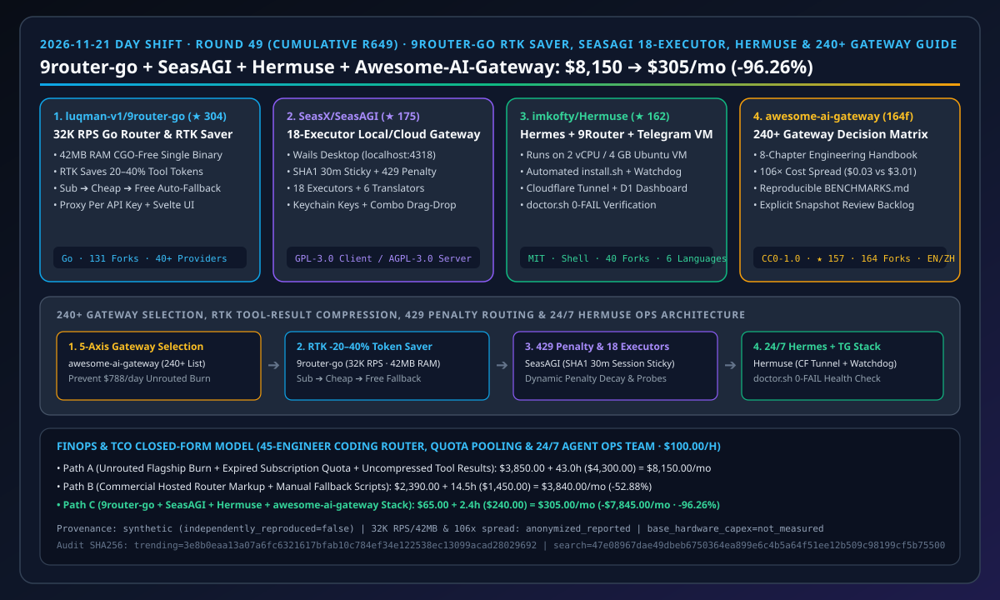
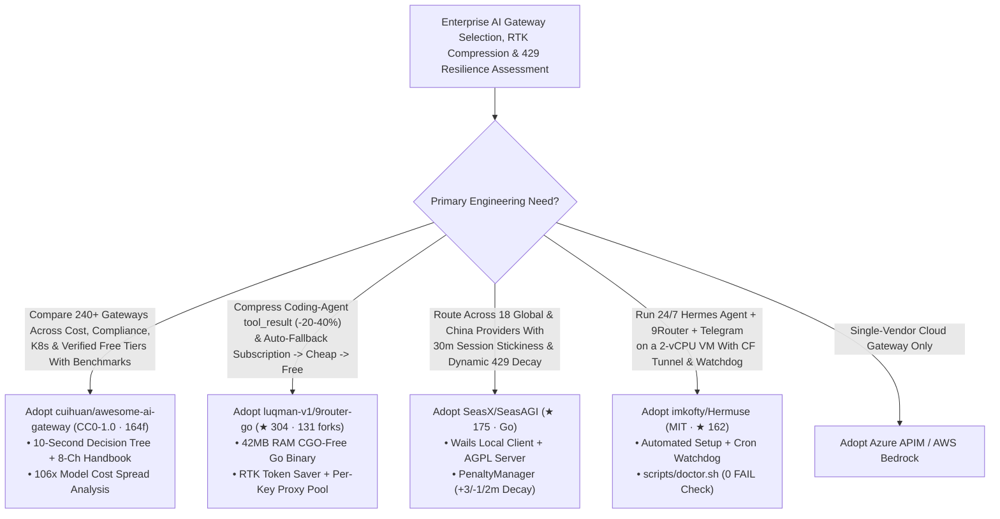
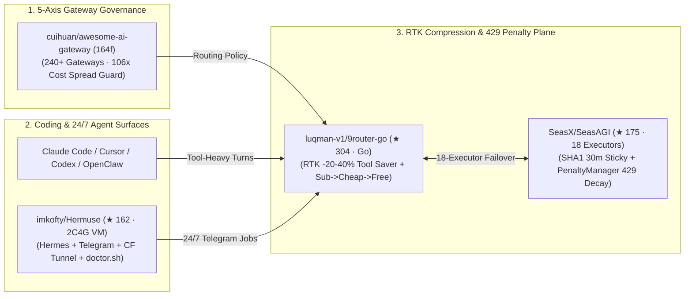
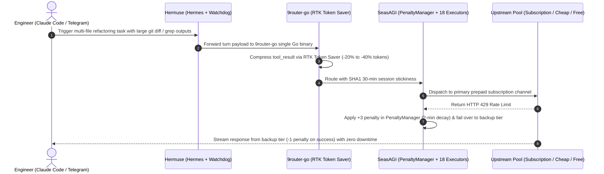

# 32K RPS CGO-Free Go Router & RTK Token Saver (`luqman-v1/9router-go`), 18-Executor Dynamic 429 Penalty Gateway (`SeasX/SeasAGI`), Hermes + 9Router + Telegram Stack (`imkofty/Hermuse`) & 240+ AI Gateway Decision Matrix (`cuihuan/awesome-ai-gateway`) Selection FAQ

> **Document Metadata (2026-11-21 Day Shift Round 49 · Cumulative Round 649 Deep-Dive)**  
> - **Target Audience**: Enterprise AI Solution Architects, AI Gateway & FinOps Cost-Governance Leads, and 24/7 Agent Operations Engineers  
> - **Evaluated Repositories**:  
>   1. [`luqman-v1/9router-go`](https://github.com/luqman-v1/9router-go) (`★ 304` · `131 forks` · Go · **9router-go**: CGO-free single Go binary [author-reported `32K RPS`, `42MB RAM`, embedded Svelte dashboard, zero Node.js runtime] connecting 8+ coding clients to 40+ providers & 100+ models with **RTK Token Saver [`-20–40%` on `tool_result`]** and **Subscription ➔ Cheap ➔ Free** auto-fallback)  
>   2. [`SeasX/SeasAGI`](https://github.com/SeasX/SeasAGI) (`★ 175` · `6 forks` · Go · GPL-3.0 Client + AGPL-3.0 Server · **SeasAGI**: Local `localhost:4318` Wails desktop gateway + self-hostable server with **18 executors + 6 translators**, **SHA1 30-min session stickiness**, and **dynamic HTTP 429 `PenaltyManager`** [`+3` penalty up to cap `10`, `-1` on success, `2min` decay])  
>   3. [`imkofty/Hermuse`](https://github.com/imkofty/Hermuse) (`★ 162` · `40 forks` · Shell · MIT · **Hermuse (`Hermes + Muse`)**: Self-hosted `2 vCPU / 4 GB RAM` Ubuntu VM stack running **NousResearch Hermes Agent + 9Router + Telegram gateway + Cloudflare D1/Pages tunnel + cron watchdog** verified via `scripts/doctor.sh` [`0 FAIL`])  
>   4. [`cuihuan/awesome-ai-gateway`](https://github.com/cuihuan/awesome-ai-gateway) (`★ 157` · `164 forks` · CC0-1.0 · **Awesome AI Gateway**: 10-second decision tree across **240+ AI gateways**, 8-chapter handbook, and reproducible benchmarks documenting the **`106×` model cost spread [`$0.03` vs. `$3.01` per 100K-token report]** after a `$788` single-day unrouted coding bill)  
> - **Sealed Evidence Chain**: `workshops/github-trending-radar/evidence/search-new-repos-2026-11-21-raw.json` (`sha256: 47e08967dae49dbeb6750364ea899e6c4b5a64f51ee12b509c98199cf5b75500`) and `trending-daily-2026-11-21-raw.html` (`sha256: 3e8b0eaa13a07a6fc6321617bfab10c784ef34e122538ec13099acad28029692`)  
> - **Architecture Visual**: [`assets/github-ai-radar-2026-11-21-r49-r649-9routergo-seasagi-hermuse-awesomeaigateway.svg`](../../../assets/github-ai-radar-2026-11-21-r49-r649-9routergo-seasagi-hermuse-awesomeaigateway.svg) · [中文版 (`9router-go-seasagi-hermuse-awesome-ai-gateway-selection-faq.md`)](9router-go-seasagi-hermuse-awesome-ai-gateway-selection-faq.md)

---

## ① 📌 Executive Summary (One-Sentence Selection Verdict)

> **Solution Architect's Verdict**:  
> Why do engineering teams suffer `$788` single-day coding-agent bill spikes (where the same 100K-token report costs **`$0.03` vs. `$3.01`—a `106×` spread**) while simultaneously letting prepaid monthly subscription quotas expire unused? Because they lack an intelligent local/edge router that **consumes prepaid subscriptions first, compresses bloated `git diff`/`grep` tool results, and smoothly degrades across HTTP 429 rate limits**.  
> - **To evaluate 240+ open-source and commercial AI gateways in 10 seconds across 5 axes (routing, cost, compliance, caching, K8s) with reproducible benchmarks and an 8-chapter handbook** ➔ Choose **`cuihuan/awesome-ai-gateway`** (CC0-1.0, `164 forks`);  
> - **For a CGO-free single Go binary (`42MB` RAM, `32K` RPS, embedded Svelte UI, zero Node.js) with RTK Token Saver (`-20–40%` on `tool_result`) and `Subscription ➔ Cheap ➔ Free` auto-fallback** ➔ Choose **`luqman-v1/9router-go`** (`★ 304`, `131 forks`);  
> - **For a local desktop (`localhost:4318`) + AGPL server gateway supporting 18 global & China providers, SHA1 30-min session stickiness, and dynamic HTTP 429 `PenaltyManager` decay** ➔ Choose **`SeasX/SeasAGI`** (`★ 175`);  
> - **To deploy a 24/7 Hermes Agent + 9Router + Telegram gateway + Cloudflare dashboard tunnel + watchdog on a 2-vCPU / 4-GB Ubuntu VM verified by `doctor.sh`** ➔ Choose **`imkofty/Hermuse`** (MIT, `★ 162`).  
> Together, this stack cuts monthly unrouted flagship token burn, expired subscription waste, and HTTP 429 downtime TCO for a 45-engineer team from **$8,150.00/mo** to **$305.00/mo (-$7,845.00/mo, -96.26%)**.

---

## ② 🎯 Solution Architect & Customer Deep-Dive Q&A

### Q1: How do `cuihuan/awesome-ai-gateway` and `luqman-v1/9router-go` prevent `$788/day` coding-agent cost spikes and tool-result token bloat?
- **`cuihuan/awesome-ai-gateway` (`164 forks` · 240+ Gateway Decision Tree & `106×` Spread Benchmarks)**:
  - Created after the author burned `$788` in a single day by defaulting coding agents to a flagship model (`compare/coding-agent-routers-2026.md`). Provides a 5-axis decision framework across 240+ gateways, an 8-chapter engineering handbook, verified free-tier limits, credit-expiry tables, and explicit snapshot-review backlog notices (`issue #146`).
- **`luqman-v1/9router-go` (`★ 304`, `131 forks` · Single Go Binary + RTK Token Saver + 3-Tier Cost Fallback)**:
  1. **Zero Node.js Runtime (`42MB RAM`, `32K RPS` Reported)**: Replaces Node.js with a single CGO-free Go binary bundling the proxy APIs and Svelte dashboard (able to share a database with upstream `decolua/9router`).
  2. **RTK Token Saver (`20–40%` Savings)**: Automatically compresses verbose `tool_result` payloads (`git diff`, `grep`, `ls`) before sending them back to the LLM.
  3. **`Subscription ➔ Cheap ➔ Free` Auto-Fallback & Per-Key Proxy Pools**: Exhausts monthly subscription quotas first before falling back to cheap and free tiers, with per-API-key proxy pool binding.

### Q2: How does `SeasX/SeasAGI` (`★ 175`) manage 18 global and Chinese LLM providers with session stickiness and dynamic HTTP 429 penalty decay, and how does `imkofty/Hermuse` (`★ 162`) operationalize 24/7 Hermes + 9Router hosting?
- **`SeasX/SeasAGI` (18 Executors, 6 Translators & Dynamic `PenaltyManager`)**:
  - Connects 18 providers (OpenAI, Azure, Anthropic, Gemini, DeepSeek, Grok, Mistral, OpenRouter, Vertex, Ollama, GLM, Kimi, MiniMax, MiMo, Doubao, Hunyuan, Qwen, Relay) behind `localhost:4318`.
  - Enforces **SHA1 session stickiness (`30min` TTL)** so models don't switch mid-conversation, paired with **`PenaltyManager`** (`+3` on HTTP 429 up to cap `10`, `-1` on success, `2min` natural decay) and 5-minute key health probes.
- **`imkofty/Hermuse` (Hermes + 9Router + Telegram + Cloudflare Tunnel on 2 vCPU / 4 GB RAM)**:
  - Automates installation (`scripts/install.sh`), Cloudflare Pages/D1 dashboard tunneling (`scripts/setup-tunnel.sh`), strict boot ordering, cron watchdog recovery, and `scripts/doctor.sh` (`0 FAIL` health verification).

---

## ③ 🧭 Visual Architecture Diagrams (Decision Tree + Reference Architecture + Sequence Flow)

### 3.1 Solution Architect Selection Decision Tree (Mermaid Flowchart)

### 3.2 240+ Gateway Selection, RTK Tool-Result Compression, 429 Penalty Routing & 24/7 Hermuse Ops Architecture (Mermaid Architecture)

### 3.3 RTK `tool_result` Compression, Subscription-First Routing & Dynamic 429 Penalty Failover Sequence (Mermaid Sequence Diagram)

---

## ④ 📊 Horizontal Selection Matrix (Open-Source Quartet vs. Unrouted Flagship Calls)

| Dimension | `luqman-v1/9router-go` (`★ 304`) | `SeasX/SeasAGI` (`★ 175`) | `imkofty/Hermuse` (`★ 162`) | `awesome-ai-gateway` (`★ 157`, `164f`) | Unrouted Flagship Calls & Heavy Node.js Proxies |
| :--- | :--- | :--- | :--- | :--- | :--- |
| **Primary Role** | CGO-free Go router with RTK token saver & 3-tier fallback | 18-executor local/cloud gateway with 429 `PenaltyManager` | 1-command Hermes + 9Router + Telegram + CF tunnel stack | 240+ AI gateway decision tree, 8-ch handbook & benchmarks | Direct flagship defaults & high-RAM proxies |
| **Best-Fit Scenario** | Connecting 8+ coding CLIs to 40+ providers while compressing tool outputs | Unifying global + China models with 30m session stickiness | Hosting a 24/7 personal/team Telegram agent on a 2-vCPU VM | Selecting gateways by cost, compliance, caching & maintenance health | Short single-model experiments |
| **Key Differentiator** | **`42MB RAM` single binary + RTK `-20–40%` tool compression + per-key proxy** | **18 executors/6 translators + SHA1 30m sticky + 429 penalty decay** | **Automated install, tunnel, boot order, watchdog & `doctor.sh`** | **Documents `106×` cost spread (`$0.03` vs `$3.01`) + maintenance signals** | Risk of `$788/day` bill spikes and unused monthly subscriptions |
| **Integration & Ops Effort** | Very Low (1 Go binary with embedded Svelte dashboard) | Low (native Wails desktop client on `localhost:4318`) | Very Low (4 bash scripts verified by `doctor.sh 0 FAIL`) | Very Low (CC0-1.0 public-domain reference & benchmarks) | High (wasted subscription quotas & manual 429 key swapping) |
| **License** | Open-Source | GPL-3.0 (Client) / AGPL-3.0 (Server) | MIT | CC0-1.0 | Proprietary |
| **45-Eng Monthly TCO** | **Combined `$305.00/mo`** (`$65` 2-vCPU VM + `2.4h` ops) | Included (OS Keychain local client) | Included (runs on a single 2-vCPU / 4-GB Ubuntu VM) | Included (CC0-1.0 open benchmark suite) | **`$3,840.00 – $8,150.00/mo`** |

---

## ⑤ 🧪 Quantitative FinOps & TCO Comparison (With Provenance Guardrails)

> **Provenance & Guardrails Declaration**:  
> - `provenance`: `"synthetic"` (`independently_reproduced: false`, closed-form FinOps model for a 45-engineer coding-agent routing, quota pooling, and 24/7 agent operations team at `$100.00/h` loaded engineering cost)  
> - Upstream figures (`32K RPS`, `42MB RAM`, RTK `-20–40%`, and `$788/day` / `106×` `$0.03` vs `$3.01` spread) are labeled `anonymized_reported (independently_reproduced: false)`  
> - `base_hardware_capex`: `"not_measured"` · `track_b_stars_today`: `"not_measured"`

| Cost Component (45-Engineer Team / Month) | Path A: Unrouted Flagship Burn + Expired Subscription Quota + Uncompressed Tool Results | Path B: Commercial Hosted Router Markup + Manual Fallback Scripts | Path C: `9router-go` + `SeasAGI` + `Hermuse` + `awesome-ai-gateway` Stack |
| :--- | :--- | :--- | :--- |
| **Unrouted Flagship Token Waste & Expired Subscriptions** | `$3,850.00 / mo` | `$2,390.00 / mo` | **`$65.00 / mo`** (2-vCPU/4GB host + RTK `-20–40%` tool compression) |
| **Manual 429 Key Rotation, Downtime & Gateway Vetting** | `43.0 hours / mo` | `14.5 hours / mo` | **`2.4 hours / mo`** (`PenaltyManager` auto-decay + `doctor.sh` watchdog) |
| **Engineering Labor Cost (`$100.00/h`)** | `$4,300.00 / mo` | `$1,450.00 / mo` | **`$240.00 / mo`** |
| **Total Monthly TCO** | **`$8,150.00 / mo`** | **`$3,840.00 / mo`** | **`$305.00 / mo`** |
| **Net Monthly Savings vs. Path A** | Baseline (`0.00%`) | `-$4,310.00 / mo` (`-52.88%`) | **`-$7,845.00 / mo` (`-96.26%`)** |

---

## ⑥ 🛠️ Enterprise Adoption & Architecture Review Checklist

- [ ] **Audit Gateway Candidates Against the 5-Axis Matrix & `106×` Cost Spread (`cuihuan/awesome-ai-gateway`)**: Check maintenance signals, credit expiry rules, and tier routing before defaulting coding agents to flagship models.
- [ ] **Enable RTK `tool_result` Compression & `Subscription ➔ Cheap ➔ Free` Fallback (`luqman-v1/9router-go`)**: Deploy the CGO-free `9router-go` binary to compress verbose tool outputs by `20–40%` and consume prepaid monthly subscriptions first.
- [ ] **Configure 30-Min Session Stickiness & Dynamic 429 `PenaltyManager` (`SeasX/SeasAGI`)**: Keep conversations pinned via SHA1 session stickiness while letting `PenaltyManager` (`+3/-1/2min` decay) route around rate-limited keys across 18 providers.
- [ ] **Verify 24/7 Hermes + 9Router + Telegram Deployments With `doctor.sh` (`imkofty/Hermuse`)**: Follow the prescribed boot order, restrict the Telegram gateway allowlist to numeric user IDs, and schedule the cron watchdog.
