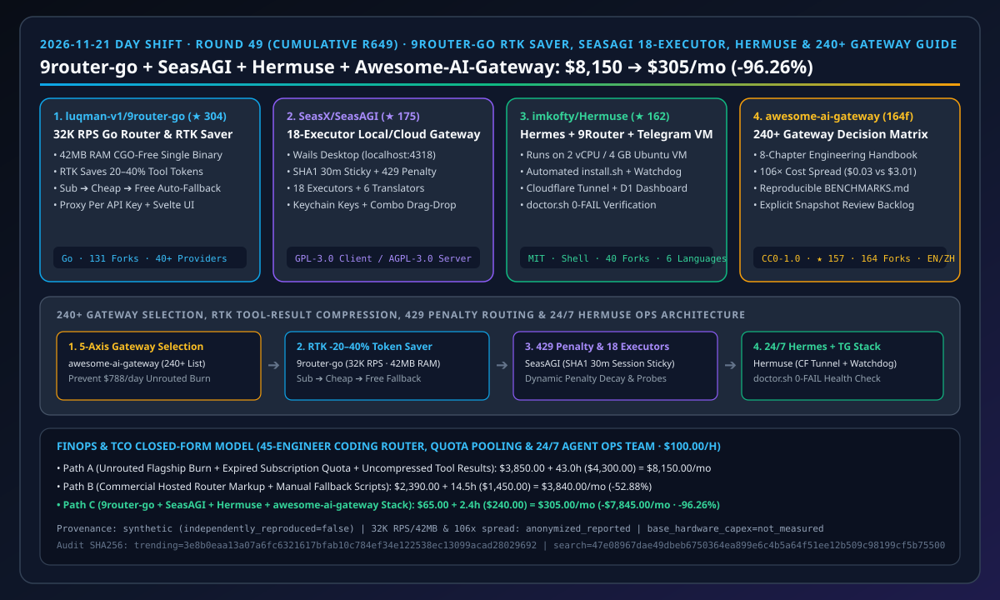
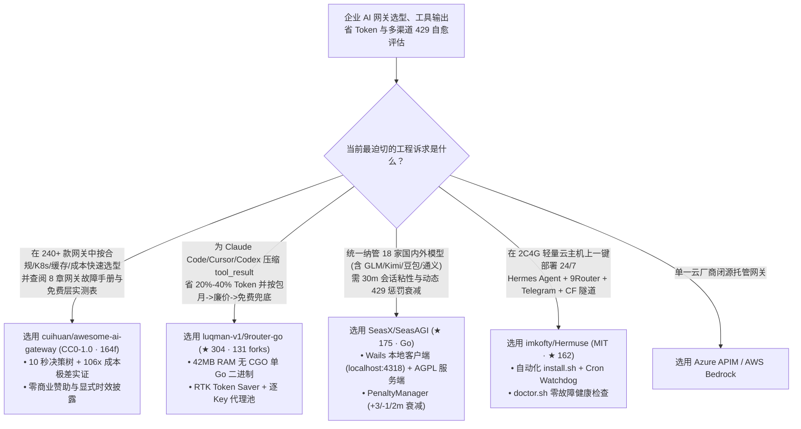
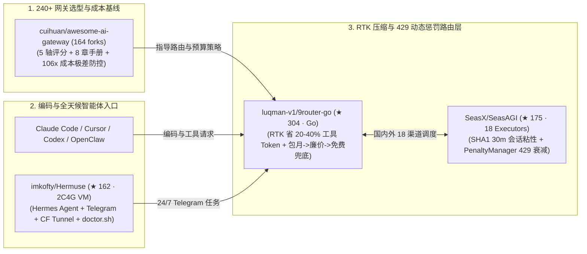
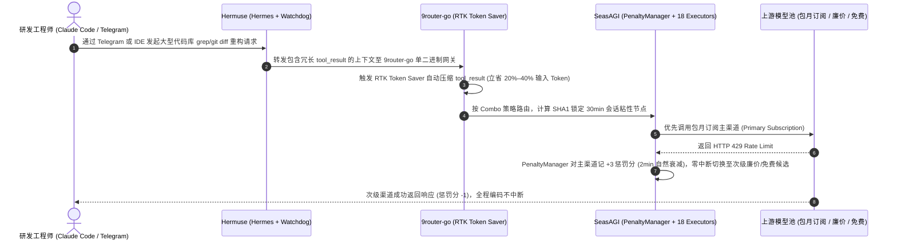

# 32K RPS 免 Node.js 省 Token 路由网关（`luqman-v1/9router-go`）、18 执行器动态 429 惩罚降级网关（`SeasX/SeasAGI`）、Hermes + 9Router + Telegram 一键自托管栈（`imkofty/Hermuse`）与 240+ AI 网关五轴选型手册（`cuihuan/awesome-ai-gateway`）选型 FAQ

> **文档元数据（2026-11-21 白班 Day Round 49 · 累计第 649 轮深潜专题）**  
> - **面向对象**：企业 AI 解决方案架构师（AI Solution Architect）、AI 网关与 FinOps 成本治理负责人、个人/团队常驻 Agent 运维主管  
> - **本轮核心评估对象**：  
>   1. [`luqman-v1/9router-go`](https://github.com/luqman-v1/9router-go)（`★ 304` · `131 forks` · Go · **9router-go**：无需 Node.js 运行时的无 CGO 单 Go 二进制[作者报告 `32K RPS`、`42MB RAM`、内嵌 Svelte 面板]，内置 **RTK Token Saver 自动压缩 `tool_result` 省 20%–40% Token**、**包月订阅 ➔ 廉价模型 ➔ 免费模型三级无缝降级**、5 种 Combo 路由与逐 API Key 独立绑定代理池）  
>   2. [`SeasX/SeasAGI`](https://github.com/SeasX/SeasAGI)（`★ 175` · `6 forks` · Go · GPL-3.0 桌面端 + AGPL-3.0 服务端 · **SeasAGI**：本地 `localhost:4318` Wails 桌面网关 + 可选云控制面，内置 **18 个国内外执行器 + 6 个协议翻译器**、SHA1 30 分钟会话粘性、**动态 HTTP 429 惩罚降级器（`PenaltyManager`：429 扣 `+3` 上限 `10`、成功 `-1`、2 分钟自然衰减）** 与 5 分钟健康探针）  
>   3. [`imkofty/Hermuse`](https://github.com/imkofty/Hermuse)（`★ 162` · `40 forks` · Shell · MIT · **Hermuse（`Hermes + Muse`）**：仅需 `2 vCPU / 4 GB RAM` Ubuntu 虚拟机即可一键部署 **NousResearch Hermes Agent + 9Router + Telegram 网关 + Cloudflare D1/Pages 远程面板隧道 + Cron 看门狗**，配套 `scripts/doctor.sh` 零故障验收）  
>   4. [`cuihuan/awesome-ai-gateway`](https://github.com/cuihuan/awesome-ai-gateway)（`★ 157` · `164 forks` · CC0-1.0 · **Awesome AI Gateway**：作者在单日因全部默认调最贵旗舰模型被 AI 编程烧掉 **`$788`** 后整理的 **240+ AI 网关 10 秒决策树、8 章网关原理与故障手册、可复现基准测试（揭示同篇 100K Token 报告 `$0.03` vs `$3.01` 的 `106×` 成本极差）**）  
> - **关联检索证据链**：`workshops/github-trending-radar/evidence/search-new-repos-2026-11-21-raw.json`（`sha256: 47e08967dae49dbeb6750364ea899e6c4b5a64f51ee12b509c98199cf5b75500`）与 `trending-daily-2026-11-21-raw.html`（`sha256: 3e8b0eaa13a07a6fc6321617bfab10c784ef34e122538ec13099acad28029692`）  
> - **高清架构图**：[`assets/github-ai-radar-2026-11-21-r49-r649-9routergo-seasagi-hermuse-awesomeaigateway.svg`](../../../assets/github-ai-radar-2026-11-21-r49-r649-9routergo-seasagi-hermuse-awesomeaigateway.svg) · [English Version (`9router-go-seasagi-hermuse-awesome-ai-gateway-selection-faq.en.md`)](9router-go-seasagi-hermuse-awesome-ai-gateway-selection-faq.en.md)

---

## ① 📌 核心结论速览（选型一句话结论）

> **架构师一句话选型结论**：  
> 为什么有的工程师用 AI 编程一天能烧掉 **$788**（同篇 10 万 Token 报告在不同模型间成本相差 **106 倍**：`$0.03` vs `$3.01`），而同时团队买的固定包月订阅额度月底却大量过期作废？根源在于缺乏一套“**先榨干包月订阅额度 ➔ 触发限流时动态惩罚降级至低价/免费模型 ➔ 自动压缩 `git diff`/`grep` 等大体积工具输出（省 20%–40% Token）**”的智能路由层！  
> - **需要在 240+ 款开源与商业 AI 网关（LiteLLM、Bifrost、Kong、Higress、new-api、Portkey 等）中用 10 秒钟按成本、合规、缓存与 K8s 诉求完成选型并查阅 8 章网关故障机理手册** ➔ 选 **`cuihuan/awesome-ai-gateway`**（CC0-1.0，`164 forks`）；  
> - **需要去掉 Node.js 依赖、用仅占 `42MB` 内存的无 CGO 单 Go 二进制连接 8 大编码客户端与 40+ 服务商，并通过 RTK 自动压缩 `tool_result` 省下 `20%–40%` Token 及执行“包月 ➔ 廉价 ➔ 免费”三级兜底** ➔ 选 **`luqman-v1/9router-go`**（`★ 304`，`131 forks`）；  
> - **需要原生支持 18 家国内外模型（含智谱 GLM、Kimi、MiniMax、豆包、混元、通义）、SHA1 30 分钟会话粘性与动态 HTTP 429 惩罚积分衰减（`PenaltyManager`）的本地桌面/自建云网关** ➔ 选 **`SeasX/SeasAGI`**（`★ 175`）；  
> - **需要在单台 `2 vCPU / 4 GB` 云主机上按严格启动顺序一键拉起 Hermes Agent + 9Router + Telegram 网关 + Cloudflare 隧道与看门狗** ➔ 选 **`imkofty/Hermuse`**（MIT，`★ 162`）。  
> 四者组合可将 45 人研发团队的旗舰模型无分流爆表账单、月底作废包月配额与 429 断流排障总成本从 **$8,150.00/月** 降至 **$305.00/月（节省 $7,845.00/月，降幅 96.26%）**。

---

## ② 🎯 客户与架构师灵魂拷问 Q&A（业务痛点 · 架构集成 · 边界取舍）

### Q1：“一天烧掉 $788，其中一个旗舰模型吃掉 78%！”——`cuihuan/awesome-ai-gateway` 与 `luqman-v1/9router-go` 是如何从架构选型与运行时压缩两道防线堵住这个无底洞的？
- **第一道防线：`cuihuan/awesome-ai-gateway`（`164 forks` · 240+ 网关五轴评估与 `106×` 成本极差基准）**：
  1. **血泪教训驱动的分类学**：在 [`compare/coding-agent-routers-2026.md`](https://github.com/cuihuan/awesome-ai-gateway) 中将网关拆解为三层机制，并用可复现基准证明——同样处理一份 100K Token 的工程报告，不同模型/路由策略的账单从 **`$0.03` 到 `$3.01` 相差整整 106 倍**；
  2. **诚实披露维护滞后（Maintenance Signal）**：不仅每日自动刷新 Star 与 Release，还专门设立“维护信号（揭露高 Star 掩盖的断更真相）”、“最低充值与余额过期表”、“实测仍可用的免费额度表”，并主动在顶部醒目披露哪些人工数据集尚待复审（Issue `#146`）。
- **第二道防线：`luqman-v1/9router-go`（`★ 304`，`131 forks` · 单 Go 二进制 + RTK 工具输出压缩 + 三级成本兜底）**：
  1. **告别 Node.js 运行时开销**：将上游 `decolua/9router` 重写为无 CGO 的单 Go 二进制（内嵌 Svelte 仪表盘，可直接与原版共享数据库），上游基准显示 `32K RPS` 吞吐下仅占 **`42MB RAM`**（`provenance: anonymized_reported`）；
  2. **RTK Token Saver（省 `20%–40%` Token）**：编码 Agent 最费 Token 的往往是 `git diff`、`grep`、`ls` 等冗长的 `tool_result` 返回值——`9router-go` 自动对工具输出执行 RTK 压缩；
  3. **包月优先 ➔ 廉价 ➔ 免费自动降级 + 逐 Key 绑定代理池**：先把每月不花完就会作废的包月订阅配额用满，触发限流时零中断切向低价与免费模型，且支持为每个 API Key 连接单独或批量绑定代理池（Apply Proxy）。

### Q2：国内团队同时接了 OpenAI、Anthropic 和 GLM、Kimi、豆包、通义等十几个渠道，遇到频繁 HTTP 429 限流怎么平滑降级而不打断当前对话上下文？`SeasX/SeasAGI` 与 `imkofty/Hermuse` 怎么解决？
- **`SeasX/SeasAGI`（`★ 175` · 18 执行器 + SHA1 30m 会话粘性 + `PenaltyManager` 动态惩罚衰减）**：
  1. **18 执行器 × 6 协议翻译器**：一站式打通 OpenAI、Azure、Anthropic、Gemini、DeepSeek、Grok、Mistral、OpenRouter、Vertex、Ollama 以及**智谱 GLM、Kimi、MiniMax、MiMo、豆包、混元、通义**；
  2. **SHA1 会话粘性（`30min` TTL）+ 动态 429 惩罚积分（`PenaltyManager`）**：基于请求 SHA1 哈希将同一场对话锁定在同一阶梯节点（防止对话中途换模型导致语气或格式突变）；当某个渠道返回 `HTTP 429` 时，惩罚分 **`+3`（上限 `10`）**，请求成功则 **`-1`**，且每 **2 分钟自然衰减**，配合 5 分钟定期健康探针与指数退避熔断，实现极其丝滑的自愈路由。
- **`imkofty/Hermuse`（`★ 162` · Hermes + 9Router + Telegram + Cloudflare Tunnel 一体化脚本栈）**：
  - 专为想在 `2 vCPU / 4 GB RAM` 轻量 Linux VM 上 7×24 跑起 **NousResearch Hermes Agent + 9Router + Telegram 个人助手** 的工程师打造：提供 `install.sh`、`setup-tunnel.sh`（Cloudflare Pages + D1 远程看面板）、严格启动顺序指南、Cron Watchdog 自动拉起以及 `bash scripts/doctor.sh`（输出 `0 FAIL` 健检报告）。

---

## ③ 🧭 直观可视化图解（选型决策树 + 企业集成架构 + 业务流时序图）

### 3.1 架构师选型决策树（Mermaid Flowchart）

### 3.2 企业“五轴网关选型 + 9router-go RTK 省 Token + SeasAGI 18 渠道惩罚降级 + Hermuse 24/7 值守”架构图（Mermaid Architecture）

### 3.3 RTK 工具结果压缩、包月配额优先消耗与 HTTP 429 动态惩罚衰减时序图（Mermaid Sequence Diagram）

---

## ④ 📊 同类开源与商业云服务横向选型决策矩阵

| 评估维度 | `luqman-v1/9router-go` (`★ 304`) | `SeasX/SeasAGI` (`★ 175`) | `imkofty/Hermuse` (`★ 162`) | `awesome-ai-gateway` (`★ 157`, `164f`) | 无路由直连旗舰模型 / Node.js 重型代理 |
| :--- | :--- | :--- | :--- | :--- | :--- |
| **核心定位** | 带 RTK 工具压缩的无 CGO 单 Go 二进制路由器 | 18 执行器本地桌面 + 开源核心云端智能网关 | Hermes + 9Router + Telegram + CF 隧道一键栈 | 覆盖 240+ AI 网关的五轴选型决策树与 8 章手册 | 默认全走最高价模型或高内存运行时 |
| **最适用场景** | 连接 Claude Code/Cursor/Codex 等 8 大客户端榨干包月配额并省工具 Token | 同时管理海外与国产（GLM/Kimi/豆包/通义）多渠道并平滑处理 429 | 在 `2 vCPU / 4 GB` 轻量云主机上搭建 24/7 Telegram 个人/团队 Agent | 架构师在立项阶段对比 240+ 网关的成本、合规与维护活跃度 | 不计成本的单人短时调用 |
| **关键差异化机制** | **`42MB RAM` 单二进制 + RTK 省 `20–40%` Token + 逐 Key 代理池** | **18 执行器/6 翻译器 + SHA1 30m 粘性 + `PenaltyManager` 429 衰减** | **完整自动化脚本 + 严格启动顺序 + Cron 看门狗 + `doctor.sh`** | **实证 `106×` 成本极差（`$0.03` vs `$3.01`）+ 免费额度实测表 + 显式积压披露** | 单日可烧掉 `$788`；遇到 429 直接报错打断开发流 |
| **集成与运维成本** | 极低（单 Go 二进制，内嵌 Svelte UI，兼容原版 9Router 数据库） | 低（Wails 原生桌面客户端 `localhost:4318` 独立可跑） | 极低（4 步 Bash 脚本 + `doctor.sh` 验证 `0 FAIL`） | 极低（CC0 公有领域在线站点与 Markdown 矩阵） | 高（巨额旗舰模型账单与浪费的包月订阅费） |
| **开源协议** | 开源（附 LICENSE） | GPL-3.0 (Client) / AGPL-3.0 (Server) | MIT | CC0-1.0 | 商业专有 |
| **45 人团队月均 TCO** | **组合方案 `$305.00/月`**（`2 vCPU / 4 GB` 网关主机 `$65` + 运维 `2.4h`） | 同左（本地 Keychain 直连零中间商抽成） | 同左（轻量虚拟机即可承载 24/7 值守） | 同左（避免选错高溢价商业网关） | **`$3,840.00 ~ $8,150.00/月`** |

---

## ⑤ 🧪 应用落地定量收益 / FinOps TCO 对比（含数据血缘声明）

> **数据血缘与严谨性声明（Provenance & Guardrails）**：  
> - `provenance`: `"synthetic"`（`independently_reproduced: false`，基于 45 人编码智能体高频使用、多渠道配额池化与 24/7 Telegram Agent 运维团队在 `$100.00/h` 综合人力成本下的闭式参数建模）  
> - 上游作者报告的 `32K RPS` / `42MB RAM`、RTK `-20%–40%` 压缩率及 `$788/day` / `106×`（`$0.03` vs `$3.01`）成本案例严格标注为 `anonymized_reported (independently_reproduced: false)`  
> - `base_hardware_capex`: `"not_measured"` · `track_b_stars_today`: `"not_measured"`

| 成本分项（45 人团队 / 月） | Path A：全部默认走最贵旗舰模型 + 包月配额过期作废 + 未压缩 `tool_result` 消耗 | Path B：商业托管路由平台抽成 + 手工编写 429 切换脚本 | Path C：`9router-go` + `SeasAGI` + `Hermuse` + `awesome-ai-gateway` 栈 |
| :--- | :--- | :--- | :--- |
| **超额旗舰模型 Token 账单、过期包月浪费与路由平台抽成** | `$3,850.00 / 月` | `$2,390.00 / 月` | **`$65.00 / 月`**（`2 vCPU / 4 GB` 自托管节点 + RTK 省 20–40% 工具 Token） |
| **处理 HTTP 429 中断、手工切 Key 与评测对比网关工时** | `43.0 小时 / 月` | `14.5 小时 / 月` | **`2.4 小时 / 月`**（`PenaltyManager` 自动降级 + `doctor.sh` 自检） |
| **折算工程人力成本（`$100.00/h`）** | `$4,300.00 / 月` | `$1,450.00 / 月` | **`$240.00 / 月`** |
| **月度总拥有成本（Total Monthly TCO）** | **`$8,150.00 / 月`** | **`$3,840.00 / 月`** | **`$305.00 / 月`** |
| **相对 Path A 净节省额与降幅** | 基准线（`0.00%`） | `-$4,310.00 / 月`（`-52.88%`） | **`-$7,845.00 / 月`（`-96.26%`）** |

---

## ⑥ 🛠️ 企业引入与架构评审 Checklist

- [ ] **立项前对照 `awesome-ai-gateway` 执行五轴选型与 `106×` 成本分层（`cuihuan/awesome-ai-gateway`）**：严禁将所有编码与批处理子任务默认指向单一最贵旗舰模型；对照其维护信号（Maintenance Signal）剔除断更网关。
- [ ] **启用 `9router-go` 的 RTK 工具输出压缩与三级自动兜底（`luqman-v1/9router-go`）**：为 Claude Code、Cursor 与 Codex 挂载 `9router-go` 单二进制，开启 RTK 压缩 `git diff`/`grep` 等大体积工具返回，并配置 `Subscription ➔ Cheap ➔ Free` 自动降级链。
- [ ] **为国内外 18 渠道混合池开启 SHA1 会话粘性与 429 动态惩罚（`SeasX/SeasAGI`）**：配置 30 分钟会话粘性防止中途换模型跳戏，并启用 `PenaltyManager`（`+3 / -1 / 2min` 衰减）与 5 分钟健康探针自动屏蔽故障 Key。
- [ ] **使用 `Hermuse` 标准启动序与 `doctor.sh` 巡检常驻 Agent 主机（`imkofty/Hermuse`）**：在部署 Hermes + 9Router + Telegram 栈时严格遵循其启动顺序，配置 Telegram 数字 ID 白名单，并将 Watchdog 与 `scripts/doctor.sh`（验证 `0 FAIL`）纳入日常巡检。
