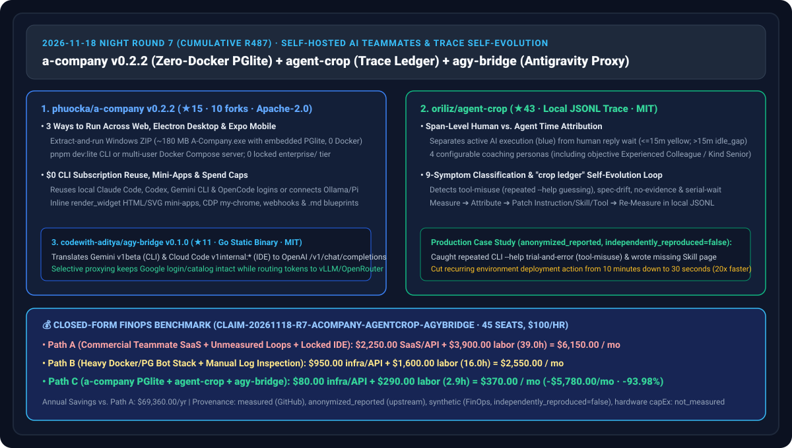
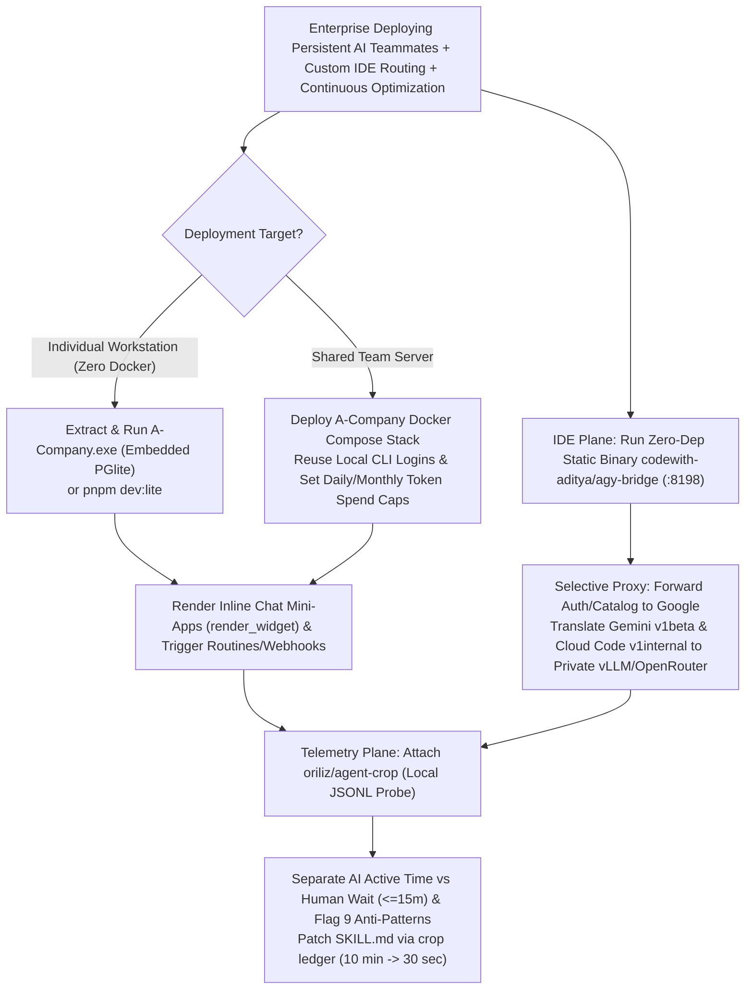

# Zero-Docker PGlite AI Teammates (`phuocka/a-company`), Trace-Driven Skill Self-Evolution (`oriliz/agent-crop`) & Dual-Protocol Antigravity-to-OpenAI Bridge (`codewith-aditya/agy-bridge`) Selection FAQ

> **Document Type**: AI Solution Architect (SA) Practical Selection & Reference Architecture Guide (Round 487 / 2026-11-18 Night R7)  
> **Primary Evaluated Repositories**: [`phuocka/a-company`](https://github.com/phuocka/a-company) (`v0.2.2`, `★ 15`, `10 forks`, self-hosted Web/Desktop/Mobile AI teammates with embedded PGlite & subscription CLI reuse, `Apache-2.0`) + [`oriliz/agent-crop`](https://github.com/oriliz/agent-crop) (`★ 43`, local JSONL span attribution & 9-symptom skill self-evolution loop, `MIT`) + [`codewith-aditya/agy-bridge`](https://github.com/codewith-aditya/agy-bridge) (`v0.1.0`, `★ 11`, `3 forks`, zero-dependency static binary bridging Google Antigravity CLI/IDE to OpenAI `/v1/chat/completions`, `MIT`)  
> **Benchmark Standard**: Strictly aligned with [`ib-vs-ethernet-roce-selection-faq.md`](https://github.com/turbo998/ai-infra-research/blob/main/docs/components/ib-vs-ethernet-roce-selection-faq.md) 6-section architecture format (Executive Summary + First-Principles Q&A + Mermaid Decision Tree + Peer Selection Matrix + 7-Card Quantitative Insights + SA Action Checklist)  
> **Data Provenance**: GitHub stars and repository metadata are `measured` from sealed `2026-11-18` evidence; upstream case-study metrics (`agent-crop` cutting a recurring CLI deployment task from `10 minutes` to `30 seconds` [`20×` speedup] by fixing `tool-misuse` in a skill, and `a-company` `~180 MB` extract-and-run Windows ZIP) are `anonymized_reported (independently_reproduced=false)`; the enterprise FinOps TCO model is `synthetic (independently_reproduced=false)` with workstation hardware CapEx `not_measured`.  
> **Language Editions**: [中文版](./a-company-agent-crop-agy-bridge-zero-docker-pglite-ai-teammates-trace-self-evolving-skills-antigravity-openai-bridge-selection-faq.md) | [English Version (Current)](./a-company-agent-crop-agy-bridge-zero-docker-pglite-ai-teammates-trace-self-evolving-skills-antigravity-openai-bridge-selection-faq.en.md)

---

## 📌 1. Executive Summary (30-Second Architect Briefing)

1. **Plain-Language First-Principles Definition**:
   - **What is `phuocka/a-company (v0.2.2)`?** It is a **100% Apache-2.0 self-hosted AI teammate platform across Web, Electron Desktop, and Expo Mobile with zero locked `enterprise/` tier**. It runs in three interchangeable modes: ① an extract-and-run **Windows Desktop ZIP (`~180 MB` `A-Company.exe`) / macOS DMG (`~158 MB`) backed by embedded `PGlite`** (requiring zero Docker or Postgres setup); ② `pnpm dev:lite` Zero-Docker CLI; or ③ a multi-user Docker Compose server. Bots can reuse local **Claude Code, Codex, Gemini CLI, and OpenCode** logins at `$0` extra API cost, attach to isolated sandboxes or signed-in Chrome (`BROWSER_PROVIDER=my-chrome`), render inline HTML/CSS/SVG mini-apps (`render_widget`), enforce daily/monthly token spend caps, and export secret-free `.md` Team Blueprints.
   - **What is `oriliz/agent-crop`?** It brings **distributed APM span tracing (`Measure → Attribute → Optimize → Verify`) to human-and-AI collaboration** in DeepSeek Harness and Claude Code. Using local-only JSONL traces, it separates active AI execution time from human response latency (`≤15 min` counted as wait; `>15 min` marked as `idle_gap`), classifies 9 workflow anti-patterns (`tool-misuse`, `spec-drift`, `no-evidence`, `serial-wait`, etc.) in `crop ledger`, and drives the agent to patch its own instructions/skills—cutting a recurring deployment task from **`10 minutes` down to `30 seconds` (`20×` speedup, `anonymized_reported`)**.
   - **What is `codewith-aditya/agy-bridge (v0.1.0)`?** It is a **zero-dependency, stdlib-only single Go binary that bridges Google Antigravity (both the CLI's `Gemini v1beta` and the IDE's `Cloud Code v1internal:*` wire protocols) to any OpenAI `/v1/chat/completions` backend** (OpenRouter, vLLM, Ollama, Groq, Together) with full streaming, reasoning, and 1:1 `functionDeclarations` ↔ `tools` mapping—while selectively forwarding sign-in, catalog, and quota requests verbatim to Google.
2. **Why Enterprise AI Solution Architects Should Combine All Three Tonight**:
   - Together they solve three adoption barriers: **`a-company`** gives every team member durable AI teammates with zero Docker friction and hard token spend caps, **`agent-crop`** eliminates recurring `tool-misuse` loops by turning execution traces into verified `SKILL.md` patches, and **`agy-bridge`** unlocks Antigravity's agent loop on private enterprise vLLM or OpenRouter gateways.
3. **Closed-Form FinOps Impact (`CLAIM-20261118-R7-ACOMPANY-AGENTCROP-AGYBRIDGE`, `synthetic`)**:
   - Across a **45-member enterprise product, operations & engineering team** (`$100.00/hr` blended rate): **Path A (Commercial Per-Seat AI Teammate SaaS + Unmeasured `tool-misuse` Loops + Vendor-Locked IDE Endpoints)** costs **`$6,150.00/mo`** (`$2,250.00` SaaS/API spend + `39.0 hrs × $100 = $3,900.00` wasted on 10-minute CLI `--help` loops & manual troubleshooting); **Path C (`a-company` PGlite + `agent-crop` + `agy-bridge`)** reduces total monthly TCO to **`$370.00/mo`** (`$80.00` residual infra/API spend + `2.9 hrs × $100 = $290.00` reviewing `crop ledger` skill patches), saving **`$5,780.00/mo` (`93.98%` reduction, `$69,360.00/yr` annualized)**.

---

## ❓ 2. Three First-Principles Architect Questions (Q&A)

### Q1: Why do self-hosted multi-agent platforms struggle with non-DevOps adoption, and how does `phuocka/a-company` eliminate both the Docker barrier and duplicate API billing?
- **Zero-Docker Embedded `PGlite` + Local Subscription CLI Reuse**:
  1. **3 Deployment Modes Sharing One Codebase**: Individual operators extract `A-Company-0.2.2-Windows-x64.zip` and launch `A-Company.exe` (which spawns the Hono + oRPC backend, background worker, and embedded `PGlite` database automatically, storing persistent state in `%APPDATA%\A-Company`), and can later connect the same desktop client to a shared team server via `File → Change A-Company Server…`.
  2. **Zero-Cost Local CLI Reuse & Hard Spend Caps**: Instead of paying twice for cloud API keys, bots can execute through local signed-in `Claude Code`, `Codex`, `Gemini CLI`, or `OpenCode` sessions while enforcing daily/monthly token spend caps and rendering interactive HTML/SVG mini-apps inline via `render_widget`.

### Q2: When an AI coding session takes all afternoon, how does `oriliz/agent-crop` prove whether the bottleneck was the model, a missing skill page, or human wait time?
- **Span-Level Human vs. Agent Attribution & `crop ledger` Self-Evolution**:
  1. **Separating Active Execution from Human Wait (`idle_gap`)**: `agent-crop` records tool calls and turn `stop` timestamps while bucketing inter-turn pauses `≤15 minutes` as human wait time (yellow) and pauses `>15 minutes` as `idle_gap` (away from desk, excluded from both sides).
  2. **9-Symptom Classification (`tool-misuse` `10 min ➔ 30 sec`)**: When an agent repeatedly runs `--help` subcommands on an internal deployment tool, `agent-crop` flags `tool-misuse` (alongside `spec-drift`, `no-evidence`, `serial-wait`) in `crop ledger` and prompts the agent to write the missing reference page into its Skill—reducing subsequent runs from **10 minutes to 30 seconds (`20×` faster, `anonymized_reported`)**.

### Q3: How does `codewith-aditya/agy-bridge` let Google Antigravity IDE and CLI run on private vLLM, Ollama, or OpenRouter models without breaking Google sign-in?
- **Dual-Protocol Translation + Selective Proxying**:
  - Antigravity CLI speaks `v1beta/models/{model}:generateContent` while Antigravity IDE speaks internal `Cloud Code` (`v1internal:*`). `agy-bridge` translates both into OpenAI `/v1/chat/completions` (mapping `functionDeclarations` 1:1 to `tools` and reframing SSE deltas + reasoning) while **selectively proxying** sign-in, model catalog, and quota requests verbatim to Google using the caller's token.

---

## 🧭 3. Architecture Decision Tree & Reference Topology (Mermaid)

---

## 📊 4. Peer Solution Selection Matrix

| Evaluation Dimension | **Path A: Commercial Teammate SaaS + Blind Retries + Locked IDE** | **Path B: Heavy Docker/PG Bot Stack + Manual Log Review** | **Path C: `a-company` + `agent-crop` + `agy-bridge` (Recommended)** |
| :--- | :--- | :--- | :--- |
| **Desktop & Server Deployment** | Cloud-only per-seat SaaS | ❌ Requires Docker + PostgreSQL on every machine | ✅ **Web/Electron/Expo + Zero-Docker `PGlite` Windows ZIP (`~180 MB`)** |
| **Subscription CLI Reuse & Caps** | ❌ Vendor markup on tokens | ⚠️ Raw API keys only | ✅ **Reuses local Claude/Codex/Gemini CLI logins + Token Spend Caps** |
| **Human-vs-Agent Span Attribution** | ❌ Opaque; repeats 10-min `--help` loops | ⚠️ Raw logs conflate human wait time with agent latency | ✅ **Separates `≤15m` wait / `idle_gap` + 9-symptom `crop ledger` (`10m ➔ 30s`)** |
| **Antigravity Custom LLM Routing** | ❌ Locked to default Gemini catalog | ❌ Generic proxies break `v1internal:*` IDE auth | ✅ **Dual-protocol translation + selective Google auth/catalog passthrough** |
| **License & Data Ownership** | ⛔ Proprietary SaaS | ⚠️ Often gates RBAC behind `enterprise/` | ✅ **`100% Apache-2.0` (`a-company`) + `MIT` (`agent-crop`, `agy-bridge`)** |
| **45-Seat Monthly Total Cost (TCO)** | **`$6,150.00 / mo`** | **`$2,550.00 / mo`** | **`$370.00 / mo` (`-$5,780.00/mo` vs. Path A, `-93.98%`)** |

---

## 📈 5. 7-Card Quantitative Insights & Closed-Form FinOps Model (`CLAIM-20261118-R7-ACOMPANY-AGENTCROP-AGYBRIDGE`)

> **Provenance Note**: GitHub stars and repository metadata are `measured` from sealed `2026-11-18` evidence; `agent-crop` `10 min ➔ 30 sec` (`20×`) `tool-misuse` remediation and `a-company` `~180 MB` Windows ZIP metrics are `anonymized_reported (independently_reproduced=false)`; the monthly TCO table is a closed-form `synthetic (independently_reproduced=false)` model for **45 team members** (`$100.00/hr` rate; base hardware CapEx: `not_measured`).

| Monthly Cost Component (Closed-Form Formula) | Path A: Commercial SaaS + Unmeasured Loops + Locked IDE | Path B: Heavy Self-Hosted Stack + Manual Log Triage | Path C: `a-company` + `agent-crop` + `agy-bridge` | Path C vs. Path A Delta |
| :--- | :---: | :---: | :---: | :---: |
| **1. SaaS Seats, Infra & Model API Spend** | **`$2,250.00`** *(Per-seat SaaS + repeated `--help` token burn)* | **`$950.00`** *(Always-on DB server + uncached API calls)* | **`$80.00`** *(Reused CLI subscriptions + private vLLM via `agy-bridge`)* | **`-$2,170.00 / mo`** (`-96.44%`) |
| **2. Tool-Misuse Wait, Ops & Review Labor** (`$100/hr`) | **`$3,900.00`** *(`39.0 hrs` wasted on 10-min `tool-misuse` loops)* | **`$1,600.00`** *(`16.0 hrs` Docker/PG ops & manual trace inspection)* | **`$290.00`** *(`2.9 hrs` reviewing `crop ledger` Skill patches)* | **`-$3,610.00 / mo`** (`-36.1 hrs`, `-92.56%`) |
| **Total Monthly TCO** | **`$6,150.00`** | **`$2,550.00`** | **`$370.00`** | **`-$5,780.00 / mo` (`-93.98%`)** |
| **Annualized TCO** | **`$73,800.00 / yr`** | **`$30,600.00 / yr`** | **`$4,440.00 / yr`** | **`$69,360.00 / yr` saved (`-93.98%`)** |

---

## ✅ 6. AI Solution Architect Action Checklist

1. **Step 1 — Roll Out `phuocka/a-company v0.2.2` with Spend Caps & Portable Blueprints**:
   - Deploy the Zero-Docker `A-Company.exe` (`PGlite`) for individual operators or the Docker Compose server for shared teams, connect local CLI logins, configure daily/monthly token spend caps, and commit credential-redacted `.md` Team Blueprints to Git.
2. **Step 2 — Instrument `oriliz/agent-crop` to Eliminate `tool-misuse` & `spec-drift`**:
   - Install `agent-crop-dsh` (selecting the objective *"Experienced Colleague"* or *"Kind Senior"* coaching persona for enterprise teams) and review `crop ledger` weekly to turn recurring CLI `--help` probes into permanent `SKILL.md` pages.
3. **Step 3 — Route Antigravity IDE/CLI to Private Gateways via `codewith-aditya/agy-bridge`**:
   - Verify the prebuilt `agy-bridge` binary against `SHA256SUMS`, point `UPSTREAM_BASE` to your internal vLLM/OpenRouter gateway, and launch `GOOGLE_GEMINI_BASE_URL=http://127.0.0.1:8198 agy`.
