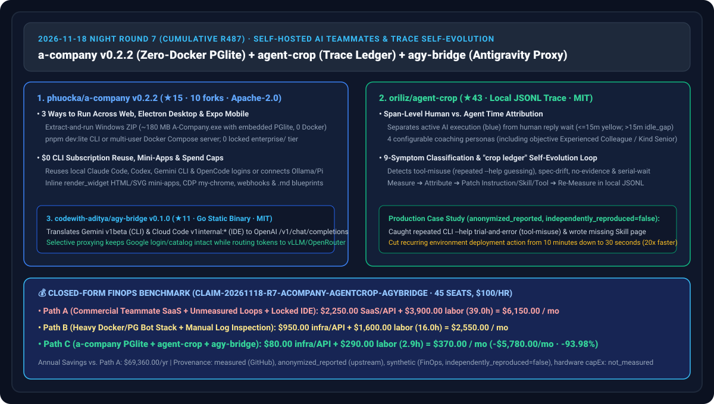
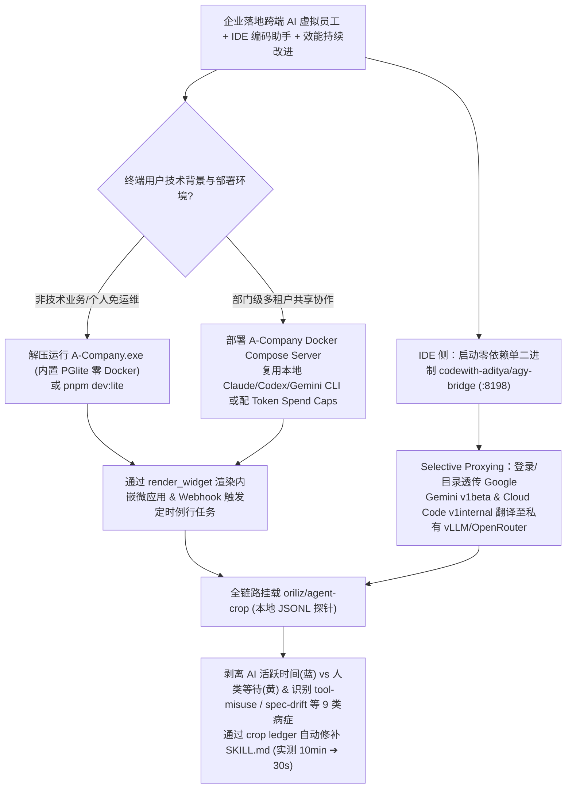

# 免 Docker 嵌入式 PGlite 自托管 AI 团队工作台（`phuocka/a-company`）、人机耗时归因与技能自进化闭环（`oriliz/agent-crop`）及 Antigravity 双协议自定义模型网关（`codewith-aditya/agy-bridge`）选型 FAQ

> **文档类型**：AI Solution Architect (SA) 实战选型与参考架构指南（Round 487 / 2026-11-18 Night R7）  
> **核心评估对象**：[`phuocka/a-company`](https://github.com/phuocka/a-company)（`v0.2.2`，`★ 15`，`10 forks`，支持免 Docker PGlite 与复用本地订阅 CLI 的全平台 AI 队友工作台，`Apache-2.0`） + [`oriliz/agent-crop`](https://github.com/oriliz/agent-crop)（`★ 43`，基于本地 JSONL Trace 的 9 类症状归因与技能自进化闭环，`MIT`） + [`codewith-aditya/agy-bridge`](https://github.com/codewith-aditya/agy-bridge)（`v0.1.0`，`★ 11`，`3 forks`，零依赖单二进制 Google Antigravity 转 OpenAI 协议桥，`MIT`）  
> **对标范式**：严格遵循 [`ib-vs-ethernet-roce-selection-faq.md`](https://github.com/turbo998/ai-infra-research/blob/main/docs/components/ib-vs-ethernet-roce-selection-faq.md) 六段式结构（核心结论速览 + 三大灵魂拷问 + Mermaid 决策树 + 选型对比矩阵 + 7-Card 定量洞察 + SA 落地 Checklist）  
> **数据溯源分级（Provenance）**：GitHub 星标与目录元数据为 `measured`；上游实证案例（如 `agent-crop` 捕获 `tool-misuse` 补齐缺失 Skill 页将部署耗时从 `10 分钟` 压缩至 `30 秒` 即 `20x` 提速，以及 `a-company` `~180 MB` Windows 免安装 ZIP）标注为 `anonymized_reported (independently_reproduced=false)`；企业 FinOps 成本算例为 `synthetic (independently_reproduced=false)`，硬件折旧 `not_measured`。  
> **语言版本**：[中文版 (当前)](./a-company-agent-crop-agy-bridge-zero-docker-pglite-ai-teammates-trace-self-evolving-skills-antigravity-openai-bridge-selection-faq.md) | [English Version](./a-company-agent-crop-agy-bridge-zero-docker-pglite-ai-teammates-trace-self-evolving-skills-antigravity-openai-bridge-selection-faq.en.md)

---

## 📌 一、核心结论速览（Executive Summary — 30 秒看懂）

1. **大白话本质定义**：
   - **`phuocka/a-company (v0.2.2)` 是什么？** 它是 **100% Apache-2.0 开源、无任何 `enterprise/` 阉割付费墙、横跨 Web / Electron 桌面 / Expo 移动端的自托管“常驻 AI 虚拟员工（AI Teammates）”平台**。它不仅支持多用户 Docker 部署，还独创了 **免安装免 Docker 的 Windows ZIP（`~180 MB`，内嵌 `PGlite` 数据库，解压双击 `A-Company.exe` 即用）** 与 `pnpm dev:lite` 轻量模式；更支持直接复用本机已登录的 **Claude Code、Codex、Gemini CLI、OpenCode 订阅账号（`$0` 额外 API 账单）**，提供独立沙盒电脑、`BROWSER_PROVIDER=my-chrome` 复用已登录浏览器、`render_widget` 对话内嵌交互式微应用、日/月度 Token 预算上限与无密钥 `.md` 团队蓝图（Team Blueprints）。
   - **`oriliz/agent-crop` 是什么？** 它是把互联网大厂做了二十年的 **“分布式调用链性能优化（Span Trace）”迁移到“人与 AI 协同干活”上的本地耗时归因与技能自进化插件**（支持 DeepSeek Harness 与 Claude Code）。它用本地 JSONL 精确剥离“AI 活跃执行耗时（蓝色）”与“等人类回答耗时（黄色，轮间 `≤15 分钟` 计入等待，`>15 分钟` 记为 `idle_gap` 离开）”，自动归因 `tool-misuse`（反复翻 `--help` 试错）、`spec-drift`（没问清就瞎干）、`no-evidence`（无证据硬改）、`serial-wait`（串行傻等）等 **9 大病症**，并在 `crop ledger` 中驱动 Agent 自动修补指令/技能（实测将一项反复翻 help 的部署任务从 **`10 分钟` 压缩至 `30 秒`**）。
   - **`codewith-aditya/agy-bridge (v0.1.0)` 是什么？** 它是用 Go 标准库编写的 **零依赖单文件静态二进制网关，将 Google Antigravity（CLI 的 `Gemini v1beta` 与 IDE 的 `Cloud Code v1internal:*` 双协议）无损翻译为标准 OpenAI `/v1/chat/completions` 接口**。通过“选择性代理（Selective Proxying）”——仅将生成与工具调用（`functionDeclarations` 1:1 映射 `tools`）重定向至企业自建 vLLM、Ollama、OpenRouter 或 DeepSeek，而将登录、模型目录与配额查询原样透传给 Google，让团队保留 Antigravity 优秀工程体验的同时彻底掌控底层模型与成本。
2. **为什么企业 AI 解决方案架构师（SA）今晚要把这三者组合成“自主可控 AI 研发与运营工作台”？**
   - 企业推广 AI 助手最头疼三件事：① 普通运营/产品人员不会装 Docker 和 PostgreSQL，而商业 AI 员工 SaaS 按人头收费且锁死数据；② Agent 跑了一下午没出活，分不清是模型慢、技能文档缺页还是人在卡点；③ Google Antigravity IDE 体验好但被绑定在官方模型列表上，无法切入企业内网私有 vLLM/DeepSeek 集群。
3. **闭式 FinOps 量化收益（`CLAIM-20261118-R7-ACOMPANY-AGENTCROP-AGYBRIDGE`，`synthetic`）**：
   - 以 **45 人企业产品运营与研发团队**（工程师时薪 `$100.00/hr`）计：**Path A（商业按席位 AI 团队 SaaS + 放任 `tool-misuse` 盲试 + 厂商绑定 IDE 模型）** 月均总成本 **`$6,150.00`**（SaaS 订阅与重复 API 账单 `$2,250.00` + 反复翻 `--help` 返工与手工复盘 `39.0h × $100 = $3,900.00`）；**Path C（`a-company` PGlite + `agent-crop` 自进化账本 + `agy-bridge` 私有模型路由）** 月均总成本降至 **`$370.00`**（残余算力/API `$80.00` + 审阅 `crop ledger` 技能补丁 `2.9h × $100 = $290.00`），**净省 `$5,780.00/月`（降幅 `93.98%`，年化节省 `$69,360.00`）**。

---

## ❓ 二、三大灵魂拷问（First-Principles Q&A）

### Q1：为什么大多数开源多智能体平台很难在非技术业务部门推广？`phuocka/a-company` 的“三态运行 + 复用本地 CLI 订阅”解决了什么痛点？
- **部署门槛与双重付费痛点**：传统开源平台动辄要求安装 Docker Desktop、PostgreSQL、Redis 并配置一堆 API Key；而且员工明明已经买了 Claude Pro/Max 或 ChatGPT Plus 订阅，跑开源 Bot 时却还得再掏一份按量计费 API 账单。
- **`a-company v0.2.2` 的架构解法**：
  1. **零 Docker 解压即跑（内置 `PGlite`）**：Windows 用户直接解压 `~180 MB` 的 `A-Company-0.2.2-Windows-x64.zip` 双击 `A-Company.exe`（数据独立持久化在 `%APPDATA%\A-Company`），内置 Hono + oRPC 后端、后台 Worker 与嵌入式 `PGlite` 数据库自动在子进程启动，业务人员 0 命令即可拥有带定时任务（Routines）、Webhook（`POST /api/v1/bots/:botId/webhook`）与对话内微应用（`render_widget`）的 AI 队友；后续随时可通过 `File → Change A-Company Server…` 无缝连回团队共享 Docker 服务器。
  2. **零额外 API 成本复用本地 CLI 登录态**：支持直接桥接本机已登录的 `Claude Code`、`Codex`、`Gemini CLI` 与 `OpenCode`，同时内置每日/每月 Token 消费硬顶（Spend Caps）与脱敏 `.md` 团队蓝图导出。

### Q2：Agent 干活慢到底是谁的锅？`oriliz/agent-crop` 是怎么用“调用链（Span）思维”把 `10 分钟` 的试错砍到 `30 秒` 的？
- **第一性原理：没有精确测量与归因的“AI 自进化”都是空谈**：
  1. **人机双轨时间剥离**：`agent-crop` 在每次会话起点绑定工作项，逐轮记录工具名与成败及 `stop` 时点；当 AI 向人提问或等待下一句输入时，将 `≤15 分钟` 的轮间空档精准归入**黄色“等待人类时间”**（`>15 分钟` 记为 `idle_gap` 离开），绝不把“人在思考”赖在 AI 头上，也绝不放过 AI 真正的空转。
  2. **9 类反模式归因与 `crop ledger` 闭环验证**：当发现 Agent 对同一个内部部署 CLI 连续多次跑 `--help` 试错时，自动打标为 `tool-misuse`（工具误用/技能残缺），连同 `spec-drift`、`no-evidence`、`serial-wait` 写入本地 JSONL 事件账本 `crop ledger`，当场督促 AI 把缺失的子命令参数补写进对应的 `SKILL.md`——实测下一次执行同一部署动作直接从 **`10 分钟` 降为 `30 秒`（提速 `20×`）**！

### Q3：为什么直接改 Google Antigravity IDE 的 Base URL 连不上第三方 OpenAI 兼容接口？`codewith-aditya/agy-bridge` 做了什么底层协议手术？
- **双协议鸿沟与认证耦合**：
  1. **CLI 与 IDE 讲的是两套完全不同的私有方言**：Antigravity CLI 发送的是公开 `Gemini v1beta`（`v1beta/models/{model}:generateContent`），而 Antigravity IDE 发送的是内部 `Cloud Code`（`v1internal:*`）协议。直接把地址指给 vLLM 或 OpenRouter 会立即报 404/400。
  2. **选择性代理（Selective Proxying）+ 1:1 工具映射**：`agy-bridge` 用单个零依赖 Go 二进制同时监听两套协议，在 `Cloud Code` 路由上**仅拦截并重写大模型生成与流式工具调用流量**（将 Gemini `functionDeclarations` 1:1 映射为 OpenAI `tools`，将 OpenAI SSE 增量流与思考链重封装为 Gemini SSE 块），而将用户登录、模型列表与配额查询原封不动透传给 Google 官方，实现“IDE 界面底部显示 `Claude Opus 4.6 · DeepSeek-V4.1`，底层 Token 100% 走自有网关”。

---

## 🧭 三、架构师选型决策树与端到端参考架构（Mermaid）

---

## 📊 四、同类方案横向选型对比矩阵（Peer Selection Matrix）

| 评估维度 | **Path A：商业 AI 员工 SaaS + 放任盲试 + 厂商锁定 IDE** | **Path B：自建重型 Docker/PG 平台 + 人工翻日志** | **Path C：`a-company` + `agent-crop` + `agy-bridge`（推荐）** |
| :--- | :--- | :--- | :--- |
| **部署门槛与跨端覆盖** | 仅 Web 端，按席位高价收费 | ❌ 必须装 Docker + PostgreSQL，普通员工无法单机跑 | ✅ **Web/桌面/Expo 移动端全覆盖 + 免 Docker 内嵌 `PGlite` 解压即用** |
| **模型账号成本与防超支** | ❌ 强制购买平台高溢价算力包 | ⚠️ 仅支持按量 API Key，易超支 | ✅ **零成本复用本地 Claude/Codex/Gemini CLI 登录态 + 日/月 Spend Caps** |
| **人机耗时剥离与技能自进化** | ❌ 黑盒运行，同一命令每次重翻 `--help` 耗时 10 分钟 | ⚠️ 人工看日志，无法区分“AI 慢”还是“人在等” | ✅ **自动剥离 `≤15m` 人类等待 + 9 类症状归因写回 Skill（`10m ➔ 30s`）** |
| **Antigravity IDE 自定义模型路由** | ❌ 锁死官方模型列表与配额 | ❌ 普通反代无法解析 `v1internal:*` 协议 | ✅ **单二进制双协议转换 + 选择性代理透传登录（无缝接 vLLM/OpenRouter）** |
| **开源协议与数据主权** | ⛔ 商业闭源，无本地导出 | ⚠️ 常含 `enterprise/` 商业付费墙 | ✅ **`100% Apache-2.0` (`a-company`) + `MIT` (`agent-crop`, `agy-bridge`)** |
| **45 人团队月均总拥有成本 (TCO)** | **`$6,150.00 / 月`** | **`$2,550.00 / 月`** | **`$370.00 / 月`（较 Path A 净省 `$5,780.00/月`，`-93.98%`）** |

---

## 📈 五、7-Card 定量洞察与闭式 FinOps 算例（`CLAIM-20261118-R7-ACOMPANY-AGENTCROP-AGYBRIDGE`）

> **Provenance 声明**：GitHub 星标与目录元数据源自 `2026-11-18` 封存证据（`measured`）；`agent-crop` 捕获 `tool-misuse` 将部署动作从 `10 分钟` 压缩至 `30 秒` 与 `a-company` `~180 MB` 免安装 ZIP 参数源自上游文档（`anonymized_reported`, `independently_reproduced=false`）；月度 TCO 为面向 **45 人产品研发与运营团队** 的闭式合成模型（`synthetic`, `independently_reproduced=false`；底层工作站硬件折旧 CapEx：`not_measured`）。

| 成本构成项（月度闭式公式） | Path A：商业 SaaS + 盲试重跑 + 锁定模型 | Path B：自建重型栈 + 人工翻日志调优 | Path C：`a-company` + `agent-crop` + `agy-bridge` | Path C 对比 Path A 净变化 |
| :--- | :---: | :---: | :---: | :---: |
| **1. 平台订阅、服务器与模型 API 支出** | **`$2,250.00`** *(按席位 SaaS 费 + 重复翻 help 与高价模型 Token)* | **`$950.00`** *(常驻数据库服务器 + 按量 API 账单)* | **`$80.00`** *(复用现有 CLI 订阅 + `agy-bridge` 接内网 vLLM)* | **`-$2,170.00 / 月`** (`-96.44%`) |
| **2. 工具盲试等待、运维与复盘人工成本** (`$100/hr`) | **`$3,900.00`** *(`39.0 hrs`：每次 10 分钟 `tool-misuse` 空转与排障)* | **`$1,600.00`** *(`16.0 hrs`：维护 Docker/PG 与手工分析慢会话)* | **`$290.00`** *(`2.9 hrs`：审阅 `crop ledger` 自动生成的技能补丁)* | **`-$3,610.00 / 月`** (`-36.1 hrs`, `-92.56%`) |
| **月度总拥有成本 (Monthly Total TCO)** | **`$6,150.00`** | **`$2,550.00`** | **`$370.00`** | **`-$5,780.00 / 月` (`-93.98%`)** |
| **年化总拥有成本 (Annualized TCO)** | **`$73,800.00 / 年`** | **`$30,600.00 / 年`** | **`$4,440.00 / 年`** | **年省 `$69,360.00` (`-93.98%`)** |

---

## ✅ 六、AI 解决方案架构师（SA）实战落地 Checklist

1. **Step 1 — 分层部署 `phuocka/a-company v0.2.2` 并开启 Token Spend Caps**：
   - 业务人员单机直接解压 `A-Company-0.2.2-Windows-x64.zip` 运行（定期备份 `%APPDATA%\A-Company`）；团队共享环境部署 Docker Compose Server，复用本地 CLI 订阅或配置日/月度 Token Spend Caps，并将成熟工作流导出为脱敏 `.md` Team Blueprints 入库 Git。
2. **Step 2 — 挂载 `oriliz/agent-crop` 建立周度 `crop ledger` 技能自进化机制**：
   - 在 DeepSeek Harness 与 Claude Code 中安装 `agent-crop-dsh`（业务团队推荐使用“经验丰富的同事”或“和蔼的前辈”客观提醒风格），每周检查 `crop ledger` 中的 `tool-misuse` 与 `spec-drift` 高频项，将高频 `--help` 探测固化进团队 `SKILL.md`。
3. **Step 3 — 用 `codewith-aditya/agy-bridge` 将 Antigravity 接入企业自有模型网关**：
   - 下载预编译 `agy-bridge` 二进制并校验 `SHA256SUMS`，配置 `UPSTREAM_BASE` 指向企业内部 vLLM / OpenRouter 网关，本地设置 `GOOGLE_GEMINI_BASE_URL=http://127.0.0.1:8198` 启动 `agy`，实现登录鉴权走官方、推理算力走私域。
