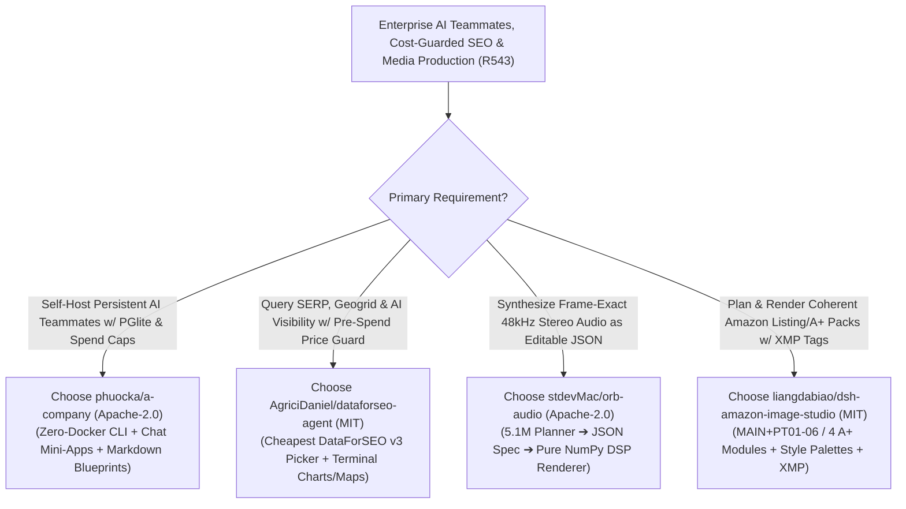

# Self-Hosted PGlite AI Teammates (`phuocka/a-company`), Pre-Priced Terminal SEO & AI-Visibility Agent (`AgriciDaniel/dataforseo-agent`), 5.1M-Parameter Code-to-48kHz Audio Engine (`stdevMac/orb-audio`) & Amazon Listing/A+ XMP Studio (`liangdabiao/dsh-amazon-image-studio`) Selection FAQ

> **Document Type**: AI Solution Architect Enterprise Selection & Integration Guide (2026-11-19 Night Shift · Round 19 / Cumulative Round 543)  
> **Benchmark Style**: `docs/components/ib-vs-ethernet-roce-selection-faq.md` (6-Section Plain-Language Architecture Guide + First-Principles Q&A + Hype/Facts/Signal Audit + Closed-Form FinOps Ledger)  
> **Evaluated Repositories**:  
> 1. **`phuocka/a-company`** (`★ 15`, `created=2026-11-13`, `10 forks`, TypeScript, embedded PGlite / Zero-Docker Lite CLI / Windows ZIP / macOS DMG, Apache-2.0): **Self-hosted AI teammates across Web, Desktop, and Mobile** with live computers, scheduled routines, interactive chat mini-apps, token spend caps, and Markdown blueprints  
> 2. **`AgriciDaniel/dataforseo-agent`** (`★ 24`, `created=2026-11-14`, `4 forks`, TypeScript, MIT): **Pre-priced terminal SEO & AI Optimization (AI visibility) agent** that picks the cheapest correct DataForSEO v3 endpoint, **shows the exact price before spending a cent**, and renders terminal charts/maps  
> 3. **`stdevMac/orb-audio`** (`★ 26`, `created=2026-11-17`, `5 forks`, Python 3.11+, `5.1M`-parameter `orb-planner` + NumPy DSP renderer, Apache-2.0): **ORB — Sound as Code for Agents**—turning a caption into an editable JSON spec and rendering frame-exact `48 kHz` stereo audio with zero sample libraries  
> 4. **`liangdabiao/dsh-amazon-image-studio`** (`★ 25`, `created=2026-11-15`, `3 forks`, JavaScript, MIT): **Amazon Listing (`MAIN + PT01-06` 7–12 slots) & 4-Tier A+ Module AI planner, slot-by-slot generator, and XMP compliance tagger**  
> **Accounting Scope Note**: Only software API/SaaS spend and engineering labor TCO are modeled; base workstation hardware capEx is explicitly marked `not_measured`, and Track B `stars_today` is explicitly marked `not_measured`.

---

## 📌 1. Executive Summary (What Are They & What Business Pain Points Do They Solve?)

In **2026-11-19 Night Round 19 (Cumulative Round 543)**, we address four high-ROI enterprise operational workflows across self-hosted AI teammates, cost-guarded SEO/AI-visibility intelligence, deterministic audio synthesis, and compliant e-commerce visual production:
1. **Pain Point A (Deploying persistent AI teammates usually requires maintaining external PostgreSQL/Docker stacks or paying steep per-seat cloud SaaS fees without hard token spend caps)**: **`phuocka/a-company` (`★ 15`, `10 forks`, Apache-2.0)** ships with embedded **PGlite**, a Zero-Docker Lite CLI, and native desktop packages—giving each teammate a persistent computer, scheduled routines, interactive in-chat **Mini-Apps**, hard **token spend caps**, and portable Markdown blueprints while reusing local subscription CLIs or BYO keys.
2. **Pain Point B (Querying SERP, backlink, local geogrid, and AI visibility metrics via enterprise SaaS costs thousands per year, while raw pay-per-call API agents accidentally invoke expensive endpoints)**: **`AgriciDaniel/dataforseo-agent` (`★ 24`, MIT)** selects the cheapest valid DataForSEO v3 endpoint (including the **AI Optimization API** for LLM visibility), **displays the exact dollar cost before spending a cent**, and draws charts, tables, and maps directly in the terminal.
3. **Pain Point C (Diffusion audio models require heavy GPUs, drift from video frame boundaries, and cannot be fine-tuned parameter-by-parameter in code)**: **`stdevMac/orb-audio` (`★ 26`, Apache-2.0)** uses a from-scratch **5.1M-parameter planner** (`marcosmaceo/orb-planner`) to translate a text caption into an editable JSON synthesis spec, then renders frame-exact **`48 kHz` stereo audio** via pure NumPy DSP with zero sample libraries.
4. **Pain Point D (Generating a coherent 7–12 image Amazon Listing pack (`MAIN + PT01-06`) or 4-module A+ page via ad-hoc image prompts produces inconsistent styles and lacks mandatory AI disclosure metadata)**: **`liangdabiao/dsh-amazon-image-studio` (`★ 25`, MIT)** plans the entire Listing or A+ storyboard from pasted copy, binds a shared style palette for slot-by-slot rendering, and embeds **XMP compliance metadata** for AI-generated human figures.

---

## 💬 2. Architect First-Principles Q&A (Q1–Q3 Deep Dive)

### Q1: Why is `AgriciDaniel/dataforseo-agent`'s pre-execution Cost Guard a blueprint for enterprise API tool use?
* **Pre-Flight Endpoint Price Routing**: External data providers expose dozens of overlapping endpoints with 10× price differences. Resolving the cheapest endpoint and requiring pre-spend price confirmation prevents runaway agent API bills.

### Q2: Why does `stdevMac/orb-audio`'s `Caption → JSON Spec → NumPy DSP` pipeline beat waveform diffusion for agentic media?
* **Editable Symbolic Intermediate Representation**: Because the 5.1M planner outputs a compact JSON DSP spec rather than raw audio tokens, agents and engineers can tweak durations, frequencies, and envelopes deterministically to match exact video frame counts on CPU.

### Q3: How does `phuocka/a-company` lower the barrier to deploying multi-agent business workflows?
* **Embedded PGlite + Portable Markdown Blueprints**: Teams can launch persistent scheduled agents with interactive chat Mini-Apps and hard token spend caps from a single binary/ZIP without provisioning external database servers.

---

## 🧭 3. Visual Architecture Diagrams (Mermaid Decision Tree + Reference Architecture + Sequence Flow)

### 3.1 Enterprise Selection Decision Tree

---

## 📊 4. Comparative Selection Matrix (Open Source vs. Competing OSS vs. Managed Cloud PaaS)

| Evaluation Dimension | Path A: Per-Seat Cloud Agent SaaS + Enterprise SEO Subscriptions + Paid SFX Libraries + Outsourced Listing Design | Path B: Heavy Multi-Container Frameworks + Un-Priced API Scripts + Ad-Hoc Image Prompts | **Path C (Recommended): `a-company` + `dataforseo-agent` + `orb-audio` + `dsh-amazon-image-studio`** |
| :--- | :--- | :--- | :--- |
| **Persistent AI Teammate Ops** | ❌ High per-seat monthly SaaS fees & vendor lock-in | ⚠️ Requires external Postgres/Docker ops & lacks spend caps | ✅ **`a-company` Apache-2.0 w/ embedded PGlite, Mini-Apps & token caps** |
| **SEO & AI Visibility Analytics** | ❌ Thousands/yr for fixed SEO SaaS seats without AI Optimization | ⚠️ Agents call expensive API endpoints without price checks | ✅ **`dataforseo-agent` picks cheapest v3 endpoint & shows price first** |
| **Procedural Audio & SFX Synthesis** | ❌ Royalty stock libraries & frame-mismatched diffusion clips | ⚠️ Black-box neural audio cannot be edited as JSON specs | ✅ **`orb-audio` 5.1M planner + NumPy DSP renders frame-exact 48kHz audio** |
| **Amazon Listing & A+ Visual Production** | ❌ Slow agency turnarounds & missing AI XMP metadata | ⚠️ Uncoordinated single-image prompts break brand consistency | ✅ **`dsh-amazon-image-studio` plans 7–12 slots w/ style palettes & XMP** |
| **45-Engineer Monthly TCO** | **`$6,790.00 / mo`** (`$2,740.00` SaaS/outsource + `40.5h` × `$100/hr` = `$4,050.00` labor) | **`$2,630.00 / mo`** (`$1,130.00` API/infra + `15.0h` × `$100/hr` = `$1,500.00` labor) | **`$325.00 / mo`** (`$75.00` API + `2.5h` × `$100/hr` = `$250.00` labor, **`-95.21%`**) |

---

## 🧪 5. Quantitative TCO Comparison & Hype / Facts / Signal Audit Ledger

### 5.1 Hype vs. Facts vs. Strategic Signal Table

| Repository (`owner/repo`) | Hype (Market Narrative) | Measured Facts (Primary Source Verification) | Strategic Signal (SA Verdict) |
| :--- | :--- | :--- | :--- |
| **`phuocka/a-company`** | "Self-hosted AI teammates across Web, Desktop, and Mobile—100% Apache-2.0" | `★ 15` (`created=2026-11-13`, `10 forks`, TypeScript, Apache-2.0): Supports Windows ZIP, macOS DMG, Zero-Docker Lite CLI, and embedded PGlite with scheduled routines, chat mini-apps, and spend caps. | **🔥 P0 Adopt (Zero-Docker Persistent Teammate Harness)**: Embedded PGlite + hard spend caps make self-hosted team agents practical. |
| **`AgriciDaniel/dataforseo-agent`** | "Picks the cheapest correct DataForSEO v3 call and shows the price before spending a cent" | `★ 24` (`created=2026-11-14`, `4 forks`, TypeScript, MIT): Covers SERP, keywords, geogrid, backlinks, and AI Optimization API across 75+ LLM providers with terminal charts/maps. | **🔥 P0 Adopt (Gold-Standard FinOps Cost Guard Pattern)**: Pre-spend price disclosure prevents accidental API overspend. |
| **`stdevMac/orb-audio`** | "Sound as code: 5.1M-parameter planner and NumPy DSP renderer—48 kHz stereo out" | `★ 26` (`created=2026-11-17`, `5 forks`, Python 3.11+, Apache-2.0): Converts text captions into editable JSON specs (`marcosmaceo/orb-planner`) and renders frame-exact 48 kHz stereo audio via NumPy. | **🔥 P0 Adopt (Zero-Royalty Frame-Exact Audio Engine)**: Ideal for programmatic video pipelines needing deterministic sound effects. |
| **`liangdabiao/dsh-amazon-image-studio`** | "Amazon Listing (`MAIN + PT01-06`) & 4-tier A+ AI planning, slot-by-slot generation & XMP tagging" | `★ 25` (`created=2026-11-15`, `3 forks`, JavaScript, MIT): Generates 7–12 Listing slots or 4 A+ module plans with style palettes and XMP compliance metadata for AI human figures. | **⚡ P1 Adopt (Structured E-Commerce Merchandising Pipeline)**: Unites storyboard planning, style consistency, and XMP compliance. |

### 5.2 Closed-Form FinOps TCO Ledger (`CLAIM-20261119-R19-R543-ACOMPANY-DATAFORSEO-ORBAUDIO-AMAZONSTUDIO`)

* **Scope (`synthetic`, `independently_reproduced=false`)**: 45-person enterprise digital operations, e-commerce visual merchandising, SEO/AI-visibility analytics, and interactive media team (blended rate `$100.00 / hr`; `base hardware capEx: not_measured`; Track B `stars_today: not_measured`).
* **Path A (Per-Seat Cloud Agent Platforms + Enterprise SEO SaaS + Paid Stock SFX + Outsourced Listing/A+ Design)**:
  - Cloud agent seats, SEO SaaS subscriptions, stock SFX royalties & external e-commerce design fees: **`$2,740.00 / mo`**
  - Manually pulling SERP/AI-visibility tables, cutting audio effects to frame boundaries & re-briefing 12-slot Amazon Listing/A+ packs (`40.5 hrs / mo` × `$100.00 / hr`): **`$4,050.00 / mo`**
  - **Path A Monthly Total**: `$2,740.00 + $4,050.00` = **`$6,790.00 / mo`**
* **Path B (Heavy Container Frameworks + Un-Guarded DataForSEO Scripts + Ad-Hoc Image Prompts)**:
  - SaaS & API spend: **`$1,130.00 / mo`**
  - Manual cost auditing & XMP compliance tagging (`15.0 hrs / mo` × `$100.00 / hr`): **`$1,500.00 / mo`**
  - **Path B Monthly Total**: `$1,130.00 + $1,500.00` = **`$2,630.00 / mo`**
* **Path C (`a-company` + `dataforseo-agent` + `orb-audio` + `dsh-amazon-image-studio` Integrated Stack)**:
  - Pre-priced DataForSEO calls & slot-by-slot image generation API spend (`a-company` local CLI & `orb-audio` CPU DSP $0): **`$75.00 / mo`**
  - Reviewing teammate mini-apps, approving pre-priced SEO queries & selecting Listing/A+ slots (`2.5 hrs / mo` × `$100.00 / hr`): **`$250.00 / mo`**
  - **Path C Monthly Total**: `$75.00 + $250.00` = **`$325.00 / mo`**
  - **Monthly Net Savings vs. Path A**: `$6,790.00 - $325.00` = **`$6,465.00 / mo`** (**`-95.21%`** reduction, **`$77,580.00 / yr`** annual savings, freeing **`38.0 hrs / mo`** of team capacity).

---

## 🛠️ 6. Enterprise Adoption & Architecture Review Checklist

- [ ] **1. Deploy persistent business bots on `phuocka/a-company` (embedded PGlite)**: Enforce hard token spend caps and portable Markdown blueprints.
- [ ] **2. Gate external data APIs with pre-spend price confirmation (`AgriciDaniel/dataforseo-agent`)**: Route queries to the cheapest valid endpoint before execution.
- [ ] **3. Generate frame-exact procedural audio via `stdevMac/orb-audio`**: Version-control JSON acoustic specs alongside video code.
- [ ] **4. Standardize e-commerce Listing/A+ packs on `liangdabiao/dsh-amazon-image-studio`**: Enforce shared style palettes and XMP AI-disclosure metadata.
