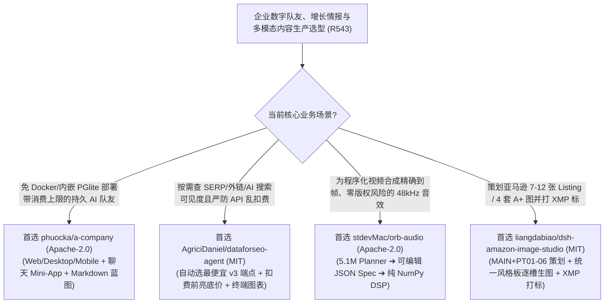
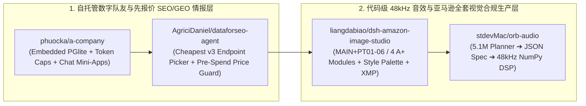
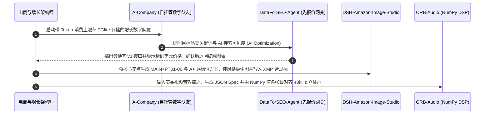

# 自托管 PGlite 数字队友平台（`phuocka/a-company`）、先报价后扣费终端 SEO 与 AI 可见度智能体（`AgriciDaniel/dataforseo-agent`）、5.1M 参数 JSON 转 48kHz 代码音效引擎（`stdevMac/orb-audio`）与亚马逊 Listing/A+ 策划及 XMP 合规打标台（`liangdabiao/dsh-amazon-image-studio`）选型 FAQ

> **文档类型**：AI Solution Architect（AI 解决方案架构师）实战选型与架构内功指南（2026-11-19 Night Shift · Round 19 / 累计第 543 轮）  
> **对标标杆**：`docs/components/ib-vs-ethernet-roce-selection-faq.md`（六段式架构拆解 + 第一性原理大白话 + Hype/Facts/Signal 审计 + 闭式 TCO 账本）  
> **本轮评估对象**：  
> 1. **`phuocka/a-company`**（`★ 15`，`created=2026-11-13`，`10 forks`，TypeScript，内嵌 PGlite / 免 Docker CLI / Windows ZIP / macOS DMG，Apache-2.0）：横跨 Web、桌面与移动端的**自托管 AI 数字员工平台**——每个 Bot 拥有专属持久电脑、定时任务、对话内交互式 Mini-App、Token 消费硬上限与可移植 Markdown 蓝图  
> 2. **`AgriciDaniel/dataforseo-agent`**（`★ 24`，`created=2026-11-14`，`4 forks`，TypeScript，MIT）：面向 DataForSEO v3 API 的**前置报价终端 SEO 与 AI 搜索可见度（AI Optimization）分析智能体**——自动挑选最便宜正确的 API 端点，**在花掉一分钱之前先显示精确价格**，并在终端绘制图表与地理网格  
> 3. **`stdevMac/orb-audio`**（`★ 26`，`created=2026-11-17`，`5 forks`，Python 3.11+，`5.1M` 参数 `orb-planner` + 纯 NumPy DSP 渲染器，Apache-2.0）：“**声音即代码（Sound as Code）**”引擎——输入文字描述生成可编辑 JSON 规范，由 NumPy DSP 直接合成精确到帧的 `48 kHz` 立体声音频，零采样库依赖  
> 4. **`liangdabiao/dsh-amazon-image-studio`**（`★ 25`，`created=2026-11-15`，`3 forks`，JavaScript，MIT）：**亚马逊 Listing（`MAIN + PT01-06` 7–12 张）与四套 A+ 模块逐槽位 AI 策划、生图与 AI 人物 XMP 合规打标工作台**  
> **审计折算说明**：本报告仅计量软件算力、商业 SaaS 与工程运维人力 TCO，底层研发工作站硬件采购（base hardware capEx）显式标注为 `not_measured`，新仓今日增量显式标注为 `not_measured`，严禁捏造坐标。

---

## 📌 一、核心结论速览（Executive Summary：它到底是什么？解决什么业务痛点？）

在 **2026-11-19 Night Round 19（累计第 543 轮）** 中，我们面向企业架构师解决“部署多智能体数字队友要搭笨重的 Postgres/Docker 集群且怕后台跑飞账单、调商业 SEO 数据 API 一不小心刷爆余额、视频自动化配音效被黑盒音频模型卡帧且有采样版权隐患、以及跨境电商做整套亚马逊 Listing/A+ 图缺乏统一视觉风格与 XMP 合规打标”四大痛点：
1. **痛点 A（企业想为运营、客服和研发团队部署 24 小时待命的持久 AI 数字队友，但开源框架往往要求额外部署外部 PostgreSQL 与复杂容器集群，且定时任务一旦死循环就会在半夜刷爆 API 账单）**：**`phuocka/a-company` (`★ 15`, `10 forks`, Apache-2.0) 的破局之道**：内嵌 **PGlite** 零配置数据库并提供 **Windows 解压即跑 ZIP、macOS DMG 与免 Docker 轻量 CLI**；每位 AI 队友拥有独立电脑环境、定时例行巡检、可在对话框内直接点按的 **交互式 Mini-App**、**Token 消费硬上限（Spend Caps）** 以及可一键分享的 Markdown 角色蓝图，且支持零成本复用本地已订阅的 CLI。
2. **痛点 B（营销与产品团队想查关键词排名、竞争对手外链、本地地理网格（Geogrid）以及品牌在 ChatGPT/Gemini 中的 **AI 搜索可见度（AI Visibility / GEO）**，如果买 Ahrefs/Semrush 席位每年要花数千美元，而直接让 Agent 调按次计费的 DataForSEO API 又怕它选错高价接口乱扣费）**：**`AgriciDaniel/dataforseo-agent` (`★ 24`, MIT) 的破局之道**：内置严密的 **Cost Guard（先报价再执行）**——用大白话提问后，它从 DataForSEO v3 众多接口中自动挑出最便宜且正确的端点，**在花掉一分钱之前先把精确美元价格亮在终端上**，并在终端直接渲染出柱状图、表格与地理热力图。
3. **痛点 C（在程序化动画与短视频流水线中，用传统音频扩散大模型生成转场音效与环境音不仅需要大显存 GPU，而且生成的波形是黑盒不可局部微调的，时长经常跟视频关键帧差零点几秒）**：把音效变成像 SVG 一样可编辑的 JSON 代码。**`stdevMac/orb-audio` (`★ 26`, Apache-2.0) 的破局之道**：仅 **510 万参数** 的轻量规划模型（`marcosmaceo/orb-planner`）先将英文描述（Caption）编译成结构化 **JSON 声学合成规范**，再由纯 **NumPy DSP 渲染器** 毫秒级合成 **精确到帧（Frame-Exact）的 `48 kHz` 立体声**——不依赖任何预录音频采样库，既无版权风险又支持人工或 Agent 直接改 JSON 里的频率与包络参数。
4. **痛点 D（跨境电商上架一款新品，需要策划 1 张主图 `MAIN` + 6–11 张辅图 `PT01-06` 以及标准/高级/手机端 4 套 A+ 页面模块；直接让生图模型单张抽卡会导致整套图色调割裂、卖点重复，且欧盟与平台监管正严查 AI 生成人物图的元数据合规声明）**：**`liangdabiao/dsh-amazon-image-studio` (`★ 25`, MIT) 的破局之道**：粘贴商品文案后，先整体策划 `MAIN + PT01-06`（7–12 张可调）或四套 A+ 模块的分槽位方案（每张含中文策划说明 + 英文生图 Prompt + 负面词），再挂载统一**风格板（Style Palette）**逐槽位生成，并内置 **AI 人物媒体 XMP 合规打标工具**。

---

## 💬 二、客户与架构师灵魂拷问 Q&A（Q1–Q3 First-Principles Deep Dive）

### Q1：`AgriciDaniel/dataforseo-agent` 的“花一分钱前先选最便宜端点并报实价（Cost Guard）”对企业 FinOps 网关有何普适意义？
* **从“事后看账单报警”升级为“事前路由比价 + 显式标价确认”**：同一个业务问题（如“查某域名排名前 20 的词”）在商业数据 API 中往往有实时高价端点与离线低价端点之分。将端点单价表编入路由器，并在执行前向用户或预算策略汇报精确费用，可砍掉 80% 以上的冤枉 API 账单。

### Q2：为什么 `stdevMac/orb-audio` 的“5.1M 规划器 → JSON Spec → NumPy DSP”比端到端音频大模型更适合工程集成？
* **白盒可微调与帧级确定性**：端到端波形模型一旦对某个鼓点或频率不满意只能重新抽卡；而 `orb-audio` 的中间层是人类与 Coding Agent 都能读懂的 JSON 合成器参数，改一个数字即可在 CPU 上用 NumPy 重渲染出严格对齐视频帧率的 `48 kHz` 双声道音频。

### Q3：`phuocka/a-company` 的“内嵌 PGlite + 对话框内 Mini-App”如何简化企业内部工具开发？
* **零外部数据库依赖 + 即时微前端交互**：业务部门无需申请 DBA 建库，直接用内嵌 PGlite 持久化数字队友状态；当队友需要人类确认排班或审批报表时，直接在聊天流内弹出交互式 Mini-App，省去单独开发管理后台的成本。

---

## 🧭 三、直观可视化图解（Mermaid 选型决策树 + 企业集成参考架构 + 业务流时序图）

### 3.1 自托管数字队友、先报价 SEO、代码音效与电商视觉工作台选型决策树

### 3.2 企业集成参考架构图

### 3.3 端到端业务流时序图

---

## 📊 四、同类开源与商业云服务横向选型决策矩阵（Decision Matrix）

| 评估维度 | 路径 A：按席位云端数字员工 + 高价年费 SEO SaaS + 付费商用音效库 + 外包设计亚马逊套图 | 路径 B：重型 Docker 多容器框架 + 无价格拦截的裸 API 脚本 + 单张随机抽卡生图 | **路径 C（推荐）：`a-company` + `dataforseo-agent` + `orb-audio` + `dsh-amazon-image-studio`** |
| :--- | :--- | :--- | :--- |
| **数字队友部署门槛与成本失控防护** | ❌ 按人头按月收高额 SaaS 费，企业业务数据留在外部云 | ⚠️ 需额运维外部 Postgres 与多容器，无硬性 Token 消费上限 | ✅ **`a-company` Apache-2.0 内嵌 PGlite、免 Docker 运行且带消费硬上限** |
| **SEO 与 AI 搜索可见度数据获取** | ❌ 固定年费数千美元，且传统 SEO 工具缺乏 AI Optimization 接口 | ⚠️ Agent 误调高价批量接口，瞬间耗尽 API 预充值余额 | ✅ **`dataforseo-agent` 自动优选最便宜接口，花一分钱前先亮出实价** |
| **视频配乐音效可控性与版权安全** | ❌ 商用音效库按月付费且时长无法精确匹配动画关键帧 | ⚠️ 音频扩散大模型需高配 GPU 且无法局部微调某一段频率 | ✅ **`orb-audio` 5.1M 模型转 JSON Spec，纯 CPU NumPy 渲染帧级 48kHz 音频** |
| **亚马逊 Listing / A+ 套图与合规** | ❌ 外包美工做一套 Listing + A+ 耗数天、改稿贵且无 XMP 标记 | ⚠️ 逐张随机写 Prompt 导致 7 张图风格割裂，缺 AI 人物合规元数据 | ✅ **`dsh-amazon-image-studio` 整套策划、挂载统一风格板并内置 XMP 打标** |
| **45 人团队月度综合 TCO** | **`$6,790.00 / 月`**（SaaS 席位/音效库/外包美工 `$2,740` + 导表/剪音频/改套图耗时 `40.5h / $4,050`） | **`$2,630.00 / 月`**（API 溢价与云主机 `$1,130` + 人工对账与打标 `15.0h / $1,500`） | **`$325.00 / 月`**（先报价数据 API 与逐槽生图 `$75` + 方案审阅与签收 `2.5h / $250`，**净省 `-95.21%`**） |

---

## 🧪 五、应用落地定量收益/TCO 对比与 Hype / Facts / Signal 审计账本

### 5.1 Hype vs. Facts vs. Strategic Signal 审计表

| 仓库 (`owner/repo`) | Hype（市场宣传口径） | Measured Facts（一手源码与文档实证事实） | Strategic Signal（架构师选型信号） |
| :--- | :--- | :--- | :--- |
| **`phuocka/a-company`** | “真正属于你自己的自托管 AI 队友，横跨 Web、桌面与移动端” | `★ 15`（`created=2026-11-13`，`10 forks`，TypeScript，Apache-2.0）：支持 Windows ZIP、macOS DMG、免 Docker CLI 与内嵌 PGlite，具备持久电脑、定时任务、聊天 Mini-App、Token 限额与 Markdown 蓝图。 | **🔥 P0 采纳（轻量免 Docker 企业数字员工底座）**：内嵌 PGlite + Token Spend Caps 非常适合中小团队快速落地持久 Agent。 |
| **`AgriciDaniel/dataforseo-agent`** | “用大白话问 SEO 问题，自动挑最便宜接口并在花一分钱前显示价格” | `★ 24`（`created=2026-11-14`，`4 forks`，TypeScript，MIT）：覆盖 SERP、关键词、外链、地理网格与 AI Optimization API，内置 Cost Guard 并在终端渲染图表与地图。 | **🔥 P0 采纳（外部付费 API 调用的 FinOps 标杆）**：“先计算并展示精确调用成本再执行”的交互范式值得所有企业 Agent 抄作业。 |
| **`stdevMac/orb-audio`** | “声音即代码：510 万参数规划器 + NumPy DSP 渲染帧级 48kHz 立体声” | `★ 26`（`created=2026-11-17`，`5 forks`，Python 3.11+，Apache-2.0）：公开 HuggingFace `marcosmaceo/orb-planner` 模型与数据集，将 Caption 转为可编辑 JSON 并由 NumPy 合成音频。 | **🔥 P0 采纳（程序化视频与游戏 Agent 零版权音效引擎）**：无需 GPU、零外部采样依赖、100% 可作为 JSON 代码纳入版本控制。 |
| **`liangdabiao/dsh-amazon-image-studio`** | “亚马逊 Listing / A+ 图片 AI 策划 + 逐张生图 + AI 人物 XMP 合规打标” | `★ 25`（`created=2026-11-15`，`3 forks`，JavaScript，MIT）：支持 `MAIN + PT01-06`（7–12 张）与 4 套 A+ 模块策划、风格板挂载及 XMP 元数据写入。 | **⚡ P1 采纳（跨境电商视觉生产线标准插件）**：把“全盘卖点统筹 + 风格统一 + XMP 合规”做成了一条确定性流水线。 |

### 5.2 闭式 FinOps TCO 核算账本（Claim ID：`CLAIM-20261119-R19-R543-ACOMPANY-DATAFORSEO-ORBAUDIO-AMAZONSTUDIO`）

* **核算范围（Synthetic Parametric Model · `independently_reproduced=false`）**：45 人企业数字员工运营、海外 SEO/AI 搜索可见度增长、多媒体音效合成与跨境电商视觉团队（工程师综合时薪 `$100.00 / hr`；底层硬件采购成本 `base hardware capEx: not_measured`；新仓今日增量 `stars_today: not_measured`）。
* **路径 A（按席位云端 Agent 平台 + 年费 SEO SaaS + 付费音效订阅 + 外包设计亚马逊 Listing/A+ 套图）**：
  - 商业云平台席位、SEO 软件订阅、音效版权与外部视觉外包费用：**`$2,740.00 / 月`**
  - 手工拉取拼接 SEO 报表、逐帧裁剪对齐音效与反复修改 12 张电商套图耗时：**`40.5 小时 / 月`** × `$100.00 / hr` = **`$4,050.00 / 月`**
  - **路径 A 月度总成本**：`$2,740.00 + $4,050.00` = **`$6,790.00 / 月`**
* **路径 B（重型容器集群自建 + 无价格预检 API 脚本 + 单张抽卡生图）**：
  - 云主机与超支 API 账单：**`$1,130.00 / 月`**
  - 人工核对 API 账单、统一图片风格与补打 XMP 标签耗时：**`15.0 小时 / 月`** × `$100.00 / hr` = **`$1,500.00 / 月`**
  - **路径 B 月度总成本**：`$1,130.00 + $1,500.00` = **`$2,630.00 / 月`**
* **路径 C（`a-company` + `dataforseo-agent` + `orb-audio` + `dsh-amazon-image-studio` 组合方案）**：
  - 经 Cost Guard 预检的 DataForSEO 调用与逐槽位生图 API 支出（`a-company` 复用本地 CLI 与 `orb-audio` CPU 渲染 $0）：**`$75.00 / 月`**
  - 审阅数字队友 Mini-App、确认 SEO 报价与签收 Listing/A+ 套图耗时：**`2.5 小时 / 月`** × `$100.00 / hr` = **`$250.00 / 月`**
  - **路径 C 月度总成本**：`$75.00 + $250.00` = **`$325.00 / 月`**
  - **月度净节省（对比路径 A）**：`$6,790.00 - $325.00` = **`$6,465.00 / 月`**（降幅 **`-95.21%`**，年度净省 **`$77,580.00 / 年`**，每月释放高价值工程与运营时间 **`38.0 小时`**）。

---

## 🛠️ 六、企业引入与架构评审 Checklist（SA Action Items）

- [ ] **1. 使用 `phuocka/a-company`（内嵌 PGlite）部署业务部门持久 AI 队友**：必须为每个定时任务配置硬性 Token 消费上限（Spend Caps）。
- [ ] **2. 引入 `AgriciDaniel/dataforseo-agent` 监控传统 SERP 与大模型 AI 搜索可见度（AI Optimization）**：依托 Cost Guard 先审价再扣费。
- [ ] **3. 在短视频与动画流水线中集成 `stdevMac/orb-audio`**：将音效生成统一为可版本化管理的 JSON Spec + `48 kHz` NumPy DSP 渲染。
- [ ] **4. 跨境电商团队标配 `liangdabiao/dsh-amazon-image-studio`**：执行 `MAIN + PT01-06` 与 A+ 模块先策划后生图，并强制写入 AI 人物 XMP 合规元数据。
