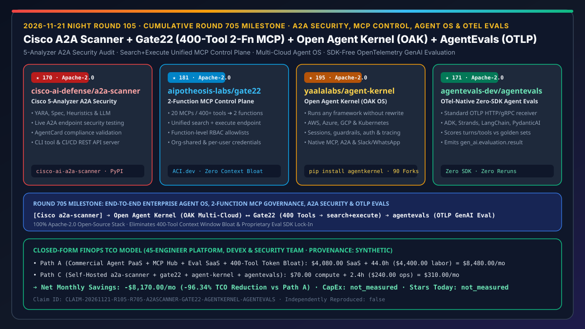
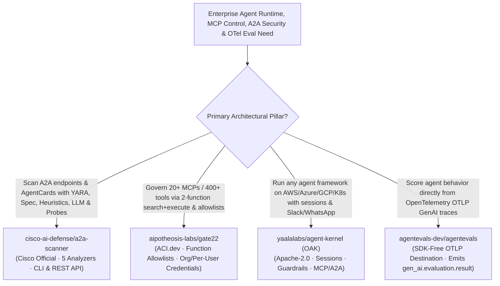
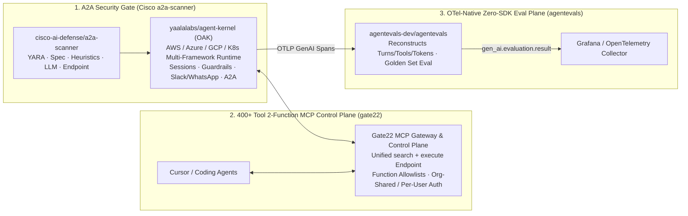
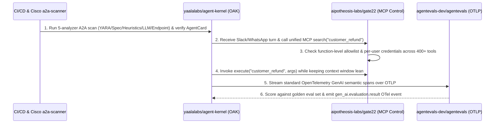

# [Round 705 Milestone] Cisco A2A Security Scanner (`cisco-ai-defense/a2a-scanner`), 400+ Tool 2-Function MCP Control Plane (`aipotheosis-labs/gate22`), Multi-Cloud Enterprise Agent Kernel (`yaalalabs/agent-kernel`) & OTel-Native Agent Evaluation Engine (`agentevals-dev/agentevals`) Selection & Architecture FAQ

> **Document Type**: Enterprise AI Solution Architect Selection & Integration Guide (GitHub Trending AI Radar — 2026-11-21 Night Round 105 / Cumulative Round 705 Milestone)
> **Covered Repositories**: [`cisco-ai-defense/a2a-scanner`](https://github.com/cisco-ai-defense/a2a-scanner) (`★ 170`, `35 forks`, `Apache-2.0` — official Cisco AI Defense 5-analyzer A2A protocol & AgentCard security scanner) · [`aipotheosis-labs/gate22`](https://github.com/aipotheosis-labs/gate22) (`★ 181`, `25 forks`, `Apache-2.0` — ACI.dev's MCP gateway & control plane exposing 20+ MCPs / 400+ tools through a 2-function `search` + `execute` endpoint with function-level allowlists) · [`yaalalabs/agent-kernel`](https://github.com/yaalalabs/agent-kernel) (`★ 195`, `90 forks`, `Apache-2.0` — Open Agent Kernel `OAK` running any agent framework on AWS, Azure, GCP, or Kubernetes with built-in sessions, guardrails, MCP/A2A & Slack/WhatsApp channels) · [`agentevals-dev/agentevals`](https://github.com/agentevals-dev/agentevals) (`★ 171`, `30 forks`, `Apache-2.0` — SDK-free OpenTelemetry OTLP destination scoring GenAI traces against golden sets and emitting `gen_ai.evaluation.result` events)
> **Core Scenario**: At our **Cumulative Round 705 Milestone**, we address the four foundational pillars of enterprise-scale agent governance: **scanning A2A endpoints and AgentCards for threats (`a2a-scanner`)**, **governing 400+ MCP tools without blowing up IDE/agent context windows (`gate22`)**, **running heterogeneous agent frameworks across AWS/Azure/GCP/Kubernetes without rewrites (`agent-kernel`)**, and **scoring production agent behavior directly from OpenTelemetry GenAI traces with zero SDK lock-in (`agentevals`)**.

---

## 1. 📌 Executive Summary (One-Line Selection Verdict)

1. **Need an authoritative security scanner to audit Agent-to-Agent (A2A) protocol implementations and `AgentCard` manifests across CI/CD and runtime endpoints** ➔ Choose **[`cisco-ai-defense/a2a-scanner`](https://github.com/cisco-ai-defense/a2a-scanner) (`★ 170`, `35 forks`, `Apache-2.0`)**.
   - **Plain-English Mechanism**: Open-sourced by **Cisco AI Defense** (`cisco-ai-a2a-scanner` on PyPI), it combines **five specialized analyzers—YARA rules, A2A spec validation, heuristics, LLM-powered semantic detection, and active endpoint testing**—with both a CLI (`a2a-scanner`) and REST API to catch spoofing, prompt injection, and non-compliant Agent Cards before deployment.
2. **Need an MCP gateway and control plane that governs 20+ remote MCP servers (400+ tools) with function-level allowlists while exposing only two functions (`search` and `execute`) to keep agent context lean** ➔ Choose **[`aipotheosis-labs/gate22`](https://github.com/aipotheosis-labs/gate22) (`★ 181`, `25 forks`, `Apache-2.0`)**.
   - **Plain-English Mechanism**: Built by ACI.dev (`aipotheosis-labs`), `gate22` lets platform/security admins onboard internal and external MCP servers, set credential modes (`org-shared` or `per-user`), and enforce **function-level allowlists**. Developers bundle permitted MCP configs into a single unified endpoint that exposes only **`search` and `execute`**, discovering tools dynamically at call time so 400+ tool schemas never bloat IDE or agent context windows.
3. **Need an enterprise "Operating System" that takes agents written in any framework (LangGraph, CrewAI, OpenAI Agents SDK, Google ADK) and runs them on AWS, Azure, GCP, or Kubernetes with sessions, guardrails, MCP/A2A, and Slack/WhatsApp channels built in** ➔ Choose **[`yaalalabs/agent-kernel`](https://github.com/yaalalabs/agent-kernel) (`★ 195`, `90 forks`, `Apache-2.0`)**.
   - **Plain-English Mechanism**: **Open Agent Kernel (OAK)** (`agentkernel` on PyPI) separates agent logic from production infrastructure. Teams keep their existing framework code while OAK supplies durable session state, authentication/identity, guardrails, distributed tracing, native MCP & A2A interoperability, and out-of-the-box Slack/WhatsApp/messaging adapters across AWS, Azure, GCP, and Kubernetes.
4. **Need framework-agnostic agent evaluations directly from existing OpenTelemetry GenAI traces (`OTLP`) without installing proprietary SDKs or re-running LLM calls** ➔ Choose **[`agentevals-dev/agentevals`](https://github.com/agentevals-dev/agentevals) (`★ 171`, `30 forks`, `Apache-2.0`)**.
   - **Plain-English Mechanism**: Acts as a standard **OTLP over HTTP/gRPC destination** (or reads trace files). Any framework emitting [OpenTelemetry GenAI semantic conventions](https://opentelemetry.io/docs/specs/semconv/gen-ai/) (`Google ADK`, `Strands`, `LangChain`, `OpenAI Agents SDK`, `Pydantic AI`) streams spans to `agentevals`, which reconstructs turns, tool calls, tokens, and answers, scores them against a golden evaluation set, and emits standard **`gen_ai.evaluation.result`** events back into your observability pipeline.

---

## 2. 🎯 Architect & Customer Deep-Dive Q&A

### Q1: Why do enterprise agent rollouts stall when scaling beyond a single framework and 20+ MCP servers?

- **Four Enterprise Scaling Bottlenecks & Architectural Solutions**:
  1. **Context Window Bloat from 400+ MCP Tools ➔ `aipotheosis-labs/gate22`**: Attaching 20 MCP servers directly to Cursor or an autonomous agent injects tens of thousands of tokens of JSON Schema on every turn and degrades tool-selection accuracy. `gate22` collapses 400+ tools behind two unified functions (`search` and `execute`) with function-level RBAC and `org-shared` / `per-user` credential isolation.
  2. **Rewriting Glue Code for Every Cloud & Messaging Channel ➔ `yaalalabs/agent-kernel` (OAK)**: Building session persistence, auth, guardrails, and Slack/WhatsApp connectors from scratch for every LangGraph or ADK project wastes months. OAK provides a unified multi-cloud runtime kernel across AWS, Azure, GCP, and Kubernetes.
  3. **Unverified A2A Endpoints & Spoofed Agent Cards ➔ `cisco-ai-defense/a2a-scanner`**: Connecting internal agents to untrusted A2A peers opens cross-agent injection vectors. Cisco's `a2a-scanner` enforces 5-analyzer security checks in CI/CD and runtime.
  4. **Vendor-Locked Evaluation SDKs & Duplicate Token Bills ➔ `agentevals-dev/agentevals`**: Instead of instrumenting every agent with a proprietary eval SDK and paying to re-run prompts, `agentevals` scores existing OTLP GenAI spans directly and emits `gen_ai.evaluation.result` telemetry.
- **When to Choose Managed Cloud Services (Path B)**:
  - If your organization standardizes on a single cloud provider (e.g., Azure AI Foundry Agent Service + Azure API Center + Azure Monitor) and has fewer than 20 MCP tools, the native cloud stack offers a single-vendor SLA.

### Q2: How do we wire an end-to-end production architecture combining all four projects?

1. **A2A Security Gate in CI/CD & Runtime (`cisco-ai-defense/a2a-scanner`)**:
   - Run `a2a-scanner` (CLI or REST API) against every internal and partner A2A agent to execute YARA, spec validation, heuristics, LLM semantic checks, and live endpoint probes before registration.
2. **Multi-Framework Enterprise Runtime Kernel (`yaalalabs/agent-kernel`)**:
   - Host LangGraph, OpenAI Agents SDK, CrewAI, and ADK agents inside **Open Agent Kernel (OAK)** on Kubernetes/AWS/Azure/GCP with built-in session management, identity, guardrails, A2A endpoints, and Slack/WhatsApp channels.
3. **2-Function MCP Control Plane (`aipotheosis-labs/gate22`)**:
   - Connect OAK agents and developer IDEs (Cursor, Claude Code) to `gate22` so 20+ MCP servers (400+ tools) are governed by function-level allowlists and exposed through the lean `search` + `execute` interface.
4. **OTLP-Native Continuous Evaluation Plane (`agentevals-dev/agentevals`)**:
   - Point your OpenTelemetry Collector at `agentevals` to score live and staging GenAI traces against golden datasets and publish `gen_ai.evaluation.result` events to Grafana.

### Q3: What are the boundaries and trade-offs of this stack?

- **Key Strengths**:
  - **100% `Apache-2.0` Open-Source Stack**: All four repositories carry permissive `Apache-2.0` licenses.
  - **Massive Context & Eval Token Savings**: `gate22` eliminates 400-tool schema prompt bloat, while `agentevals` evaluates already-captured OTLP traces without re-executing agent runs.
- **When NOT to Use**:
  - Single-developer scripts calling 2–3 local MCP tools with no multi-cloud, A2A, or OpenTelemetry infrastructure do not need an enterprise control plane.

---

## 3. 🧭 Visual Architecture & Decision Diagrams

### 3.1 Solution Architect Selection Decision Tree

### 3.2 End-to-End Enterprise Reference Architecture

### 3.3 A2A Security Audit, OAK Execution, Gate22 Dynamic Tool Discovery & OTLP Evaluation Sequence

---

## 4. 📊 Peer Open-Source vs Commercial Cloud Selection Matrix

| Dimension | `cisco-ai-defense/a2a-scanner` (`★ 170`) | `aipotheosis-labs/gate22` (`★ 181`) | `yaalalabs/agent-kernel` (`★ 195`) | `agentevals-dev/agentevals` (`★ 171`) | Commercial Agent Cloud + MCP SaaS + Eval SaaS (Path A) | Single-Cloud Managed Agent + APIM + Monitor (Path B) |
| :--- | :--- | :--- | :--- | :--- | :--- | :--- |
| **Core Role** | Official Cisco 5-analyzer A2A security scanner | 400+ tool `search`+`execute` MCP control plane | Multi-framework, multi-cloud enterprise agent OS | SDK-free OTLP-native agent evaluation engine | Proprietary agent PaaS + commercial MCP hub + eval seats | Azure AI Foundry + API Center + Monitor |
| **Key Differentiator** | **YARA + Spec + Heuristics + LLM + Endpoint tests** | **Collapses 20 MCPs / 400+ tools into 2 functions + RBAC** | **Runs any framework on AWS/Azure/GCP/K8s + IM channels** | **Standard OTLP receiver emitting `gen_ai.evaluation.result`** | Vendor SDK lock-in; 400-tool context bloat; paid eval reruns | Single-cloud lock-in; no 2-function MCP bundling or A2A scanner |
| **License** | `Apache-2.0` | `Apache-2.0` | `Apache-2.0` | `Apache-2.0` | Proprietary SaaS | Proprietary Cloud PaaS |
| **Monthly TCO (45-Eng Team)** | **`$310.00/mo` combined** (`$70.00` compute + `2.4h` ops) | Included in `$310.00/mo` stack | Included in `$310.00/mo` stack | Included in `$310.00/mo` stack | **`$8,480.00/mo`** (`$4,080.00` SaaS/tokens + `44.0h` labor) | `~$2,720.00/mo` (managed runtime + log ingestion) |

---

## 5. 🧪 Quantitative ROI / FinOps TCO Model & 7-Card Report

> **📊 Provenance & Closed-Form Audit Declaration**:
> - **Provenance**: `synthetic` (45-engineer enterprise AI platform, DevEx & security workload model; `independently_reproduced = false`; `base_hardware_capex = not_measured`; `track_b_stars_today = not_measured`).
> - **Closed-Form Equations**:
>   - **Path A (Commercial Hosted Agent PaaS + Commercial MCP Governance Seats + Commercial Eval SaaS + 400-Tool Context Token Bloat & Cross-Cloud Glue Engineering)**: Monthly SaaS & excess token spend **`$4,080.00`** + multi-framework glue & security audit labor **`44.0h × $100.00/h = $4,400.00`** = **`$8,480.00/mo`**.
>   - **Path C (Self-Hosted `cisco-ai-defense/a2a-scanner` + `aipotheosis-labs/gate22` + `yaalalabs/agent-kernel` + `agentevals-dev/agentevals`)**: Shared container compute **`$70.00`** + declarative control plane & OTLP eval rule maintenance **`2.4h × $100.00/h = $240.00`** = **`$310.00/mo`**.
>   - **Net Savings vs Path A**: **`-$8,170.00/mo`** (**`96.34%`** cost reduction).

| Architecture Option | API / SaaS / Compute | Ops & Security Labor (`$100/h`) | Total Monthly TCO | Net Savings vs Path A | Key Architectural Outcome |
| :--- | :---: | :---: | :---: | :---: | :--- |
| **Path A: Commercial Agent PaaS + Eval SaaS + Full Tool Injection** | `$4,080.00` | `44.0h` (`$4,400.00`) | **`$8,480.00`** | Baseline | 400+ tool schemas bloat context; proprietary eval SDK lock-in |
| **Path B: Single-Cloud Agent Service + Cloud Monitor** | `$1,520.00` | `12.0h` (`$1,200.00`) | **`$2,720.00`** | `-$5,760.00` (`-67.92%`) | Turnkey single-cloud SLA, but lacks cross-cloud OAK & A2A scanning |
| **Path C: `a2a-scanner` + `gate22` + `agent-kernel` + `agentevals`** | **`$70.00`** | **`2.4h` (`$240.00`)** | **`$310.00`** | **`-$8,170.00` (`-96.34%`)** | **Cisco 5-analyzer A2A scan + 2-fn 400-tool MCP + multi-cloud OAK + OTel eval** |

- 🔗 **7-Card 4:5 Visual Report**: [`workshops/github-trending-radar/cards.en.html`](../cards.en.html) · [`cards.html`](../cards.html)

---

## 6. 🛠️ Enterprise Adoption & Architecture Review Checklist

- [ ] **1. Gate A2A Registrations with `cisco-ai-defense/a2a-scanner`**: Install `cisco-ai-a2a-scanner` via `uv` and run all five analyzers (YARA, spec validation, heuristics, LLM analyzer, endpoint testing) against internal and external A2A AgentCards in CI/CD.
- [ ] **2. Consolidate 400+ Tools behind `aipotheosis-labs/gate22`**: Onboard enterprise MCP servers into Gate22, assign `org-shared` or `per-user` credentials and function-level allowlists, and expose bundles via the unified 2-function (`search` + `execute`) MCP endpoint.
- [ ] **3. Standardize Multi-Framework Deployment on `yaalalabs/agent-kernel` (OAK)**: Wrap LangGraph, CrewAI, OpenAI Agents SDK, and ADK agents in OAK to inherit unified session state, guardrails, identity, MCP/A2A support, and Slack/WhatsApp channels across AWS, Azure, GCP, and Kubernetes.
- [ ] **4. Stream OTLP GenAI Spans to `agentevals-dev/agentevals`**: Point your OpenTelemetry Collector at `agentevals` to score live/staging agent turns against golden datasets and ingest `gen_ai.evaluation.result` events into your observability dashboards.
