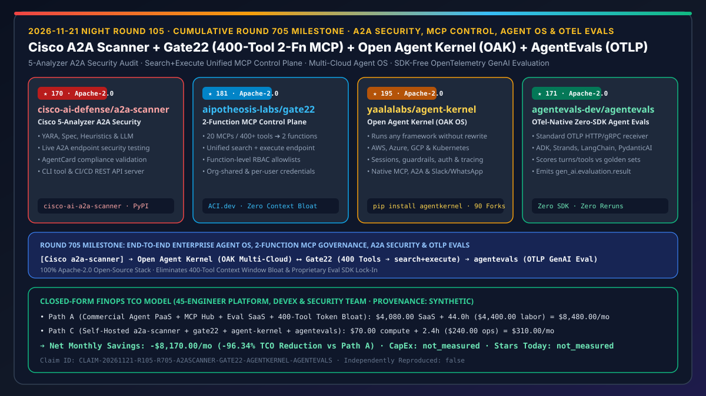
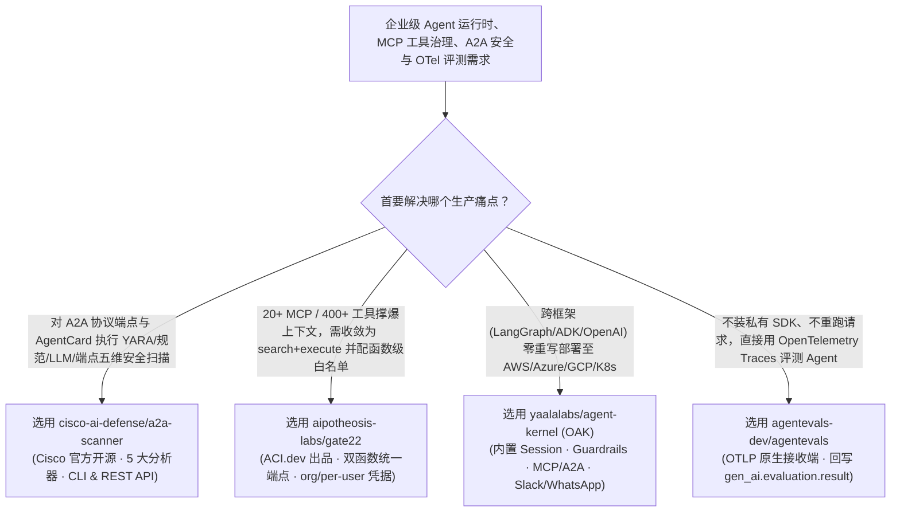
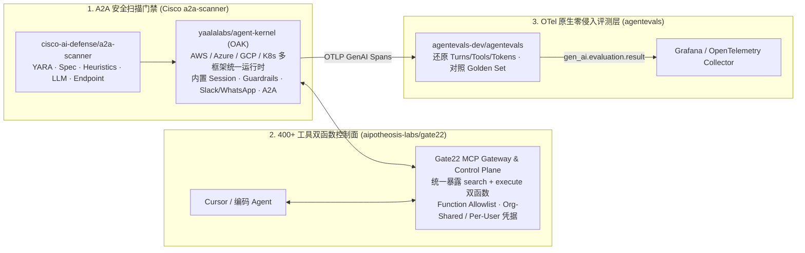
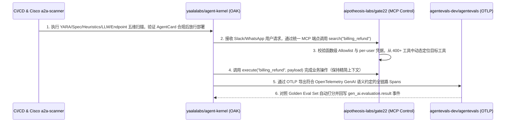

# 【第 705 轮里程碑】Cisco 官方 A2A 威胁扫描器（`cisco-ai-defense/a2a-scanner`）、400+ 工具双函数收敛 MCP 控制面（`aipotheosis-labs/gate22`）、跨框架多云企业 Agent 内核（`yaalalabs/agent-kernel`）与零 SDK 原生 OTel 评测引擎（`agentevals-dev/agentevals`）选型与集成架构 FAQ

> **文档类型**：企业 AI 解决方案架构师（AI Solution Architect）选型决策指南（GitHub Trending AI 雷达 2026-11-21 Night Round 105 / 累计第 705 轮里程碑）
> **覆盖项目**：[`cisco-ai-defense/a2a-scanner`](https://github.com/cisco-ai-defense/a2a-scanner)（`★ 170`、`35 forks`、`Apache-2.0`，Cisco AI Defense 官方开源的 YARA/规范校验/启发式/LLM/端点测试五合一 A2A 安全扫描器）· [`aipotheosis-labs/gate22`](https://github.com/aipotheosis-labs/gate22)（`★ 181`、`25 forks`、`Apache-2.0`，将 20 个 MCP Server / 400+ 工具收敛为 `search` + `execute` 两个统一函数并带函数级白名单与凭据治理的 MCP 控制面）· [`yaalalabs/agent-kernel`](https://github.com/yaalalabs/agent-kernel)（`★ 195`、`90 forks`、`Apache-2.0`，Open Agent Kernel `OAK`——不改代码将任意框架 Agent 部署至 AWS/Azure/GCP/K8s 并内建会话、护栏、MCP/A2A 与 Slack/WhatsApp 通道的企业级内核）· [`agentevals-dev/agentevals`](https://github.com/agentevals-dev/agentevals)（`★ 171`、`30 forks`、`Apache-2.0`，零侵入接收标准 OTLP GenAI Traces 并回写 `gen_ai.evaluation.result` 事件的跨框架评测引擎）
> **核心场景**：在第 **705 轮（R705）**里程碑中，我们聚焦企业级 Agent 上线生产最核心的四大平台工程支柱——**跨框架多云运行时底座（`agent-kernel`）**、**20+ MCP Server / 400+ 工具防上下文爆炸与函数级权限控制面（`gate22`）**、**A2A 跨智能体协议五维安全扫描门禁（`a2a-scanner`）**以及**零 SDK 侵入的 OpenTelemetry GenAI 原生评测闭环（`agentevals`）**。

---

## 一、📌 核心结论速览（选型一句话结论）

1. **想在 CI/CD 与生产运行时对 Agent-to-Agent（A2A）智能体及 AgentCard 执行权威的五维安全漏洞与投毒扫描** ➔ 选 **[`cisco-ai-defense/a2a-scanner`](https://github.com/cisco-ai-defense/a2a-scanner)（`★ 170`，`35 forks`，`Apache-2.0`）**。
   - **通俗原理**：由思科安全团队（**Cisco AI Defense**）官方开源（PyPI 包名 `cisco-ai-a2a-scanner`）。它内置 **5 大专用分析器（YARA 规则匹配、A2A 协议规范校验 Spec Validation、启发式检测 Heuristics、LLM 语义威胁分析、实时端点主动探测 Endpoint Testing）**，全面验证 `Agent Card` 合规性并识别跨智能体提示词注入、权限越界与恶意端点伪装，提供 CLI（`a2a-scanner`）与 REST API 两种集成形态。
2. **团队接入了 20 个 MCP Server（超 400 个工具）导致 Cursor / 编码 Agent 上下文窗口爆炸，且缺乏组织级/个人级凭据隔离与函数级白名单** ➔ 选 **[`aipotheosis-labs/gate22`](https://github.com/aipotheosis-labs/gate22)（`★ 181`，`25 forks`，`Apache-2.0`）**。
   - **通俗原理**：由 ACI.dev 团队打造的开源 MCP 网关与控制面。管理员统一纳管内外部 MCP Server，设定凭据模式（`org-shared` 组织共享或 `per-user` 按用户隔离）与**函数级白名单（Function-level Allowlist）**；开发者将获批的多个 MCP 打包成 Bundle，但对外仅暴露 **`search` 与 `execute` 两个统一 MCP 函数**——哪怕背后有 20 个 MCP、400+ 工具，也在调用时动态按需发现，彻底解决工具过多撑爆 Context Window 并拖慢推理的顽疾。
3. **研发团队各自用 LangGraph、CrewAI、OpenAI Agents SDK 或 Google ADK 写了原型，想不重写一行代码就统一具备会话持久化、护栏、身份认证、MCP/A2A 及 Slack/WhatsApp 通道并跑在 AWS/Azure/GCP/K8s 上** ➔ 选 **[`yaalalabs/agent-kernel`](https://github.com/yaalalabs/agent-kernel)（`★ 195`，`90 forks`，`Apache-2.0`）**。
   - **通俗原理**：**Open Agent Kernel (OAK)** 是面向企业级合规 Agent 的“操作系统内核”（`pip install agentkernel`）。框架负责定义 Prompt 和工具，而 OAK 负责提供生产上线必需的会话状态（Session State）、安全护栏（Guardrails）、身份鉴权（Identity）、分布式追踪、原生 MCP/A2A 协议栈以及开箱即用的主流 IM 沟通渠道（Slack、WhatsApp 等），一套代码无缝部署至 AWS、Azure、GCP 或 Kubernetes。
4. **不想在业务代码里塞满专有评测 SDK 或重跑昂贵的在线请求，希望直接基于现有 OpenTelemetry (OTLP) 追踪数据完成多框架 Agent 打分并把结果写回监控大盘** ➔ 选 **[`agentevals-dev/agentevals`](https://github.com/agentevals-dev/agentevals)（`★ 171`，`30 forks`，`Apache-2.0`）**。
   - **通俗原理**：`agentevals` 本身就是一个标准的 **OTLP 接收端（HTTP/gRPC 或本地文件）**。任何遵循 **OpenTelemetry GenAI 语义约定**的框架（Google ADK、Strands、LangChain、OpenAI Agents SDK、Pydantic AI 等）只需把已有的 OTel Collector / Exporter 指向它，它就能自动把 Span 还原为对话轮次（Turns）、工具调用、Token 与最终回答，对照黄金评测集（Golden Eval Set）打分后，以标准 **`gen_ai.evaluation.result`** OTel 事件回写至监控流水线（零 SDK 侵入、零二次重跑成本）。

---

## 二、🎯 客户与架构师灵魂拷问 Q&A（深度架构拆解）

### Q1：当企业内部同时存在多种 Agent 开发框架、数百个 MCP 工具和跨部门 A2A 调用时，如何避免沦为“每个团队重复造轮子 + 上下文被 400 个工具塞爆 + 安全与评测失控”？

- **四大核心架构解耦设计**：
  1. **用 `yaalalabs/agent-kernel` (OAK) 统一多框架生产底座**：允许不同业务线保留熟悉的 LangGraph、OpenAI SDK 或 Google ADK，由 OAK 统一接管 Session、Guardrails、Slack/WhatsApp 渠道与 AWS/Azure/GCP/K8s 部署拓扑，消灭 80% 的胶水代码重写。
  2. **用 `aipotheosis-labs/gate22` 把 400+ MCP 工具压缩为 `search` + `execute` 双函数**：如果不加收敛直接挂载 20 个 MCP Server，单次请求的 Tool Schema 就要消耗数万 Token 且模型极易选错工具。`gate22` 在执行函数级 RBAC 白名单的同时，通过 `search` + `execute` 运行时动态发现机制将 IDE/Agent 上下文开销降至最低。
  3. **用 `cisco-ai-defense/a2a-scanner` 守住 A2A 准入红线**：任何内部或第三方 Agent 注册进企业 A2A 目录前，必须通过 Cisco `a2a-scanner` 的 YARA、协议规范、启发式、LLM 语义与端点探测五重扫描。
  4. **用 `agentevals-dev/agentevals` 实现零侵入 OTLP 闭环评测**：直接消费 OAK 与网关吐出的 OpenTelemetry GenAI Spans，自动计算黄金集得分并回写 `gen_ai.evaluation.result`，无需在每个框架里绑死专有评测 SDK。
- **何时直接用云厂商托管方案（Path B）？**
  - 若企业全员绑定单一云生态（如全栈使用 Azure AI Foundry Agent Service + Azure API Center + Azure Monitor），可直接采用云原生托管方案；但在跨 AWS/Azure/GCP 多云、多框架混用且需把 400+ MCP 工具收敛为双函数的场景下，Path C 开源组合具有压倒性的灵活性与成本优势。

### Q2：典型企业级“OAK 多框架内核 + Gate22 双函数 MCP 控制面 + Cisco A2A 五维扫描 + OTel 原生评测”生产参考架构怎么搭？

1. **安全准入与 CI/CD 扫描层（`cisco-ai-defense/a2a-scanner`）**：
   - 在 CI/CD 流水线中运行 `a2a-scanner` CLI 或调用其 REST API，对所有新发布的 A2A 服务与 `AgentCard` 执行 YARA + Spec + Heuristics + LLM + Endpoint 五维安全体检，未通过者禁止注册上线。
2. **多框架统一运行时与多云部署层（`yaalalabs/agent-kernel`）**：
   - 将各团队基于 LangGraph、OpenAI Agents SDK、ADK 构建的业务智能体托管在 **Open Agent Kernel (OAK)** 上，直接复用内置的会话状态、身份鉴权、安全护栏、A2A/MCP 接口与 Slack/WhatsApp 交互前端。
3. **MCP 工具治理与双函数动态发现层（`aipotheosis-labs/gate22`）**：
   - OAK 中的智能体与研发人员的 Cursor IDE 统一连接 `gate22`：由安全管理员配置 `org-shared` / `per-user` 凭据模式与函数级 Allowlist，通过统一的 `search` + `execute` 双函数端点按需调用背后的 20+ MCP / 400+ 企业工具。
4. **OpenTelemetry 零侵入持续评测层（`agentevals-dev/agentevals`）**：
   - OAK 与 Gate22 产生的标准 OpenTelemetry GenAI Traces 通过 OTLP 实时流向 `agentevals`，自动还原多轮工具调用链并与黄金评测集比对，生成的 `gen_ai.evaluation.result` 事件直接汇入 Grafana / Prometheus 触发质量告警。

### Q3：这套架构的适用边界是什么？

- **核心优势**：
  - **全部采用 `Apache-2.0` 开源协议**：四大组件 100% 遵循商业友好的 `Apache-2.0` 许可。
  - **显著降低 Token 消耗与评测重跑账单**：`gate22` 的双函数动态发现省去了每次请求携带数百个 MCP Tool Schema 的巨额 Token 税；`agentevals` 直接对生产/测试 OTLP Trace 打分，无需二次重跑业务流程。
- **适用边界**：
  - 若单个独立应用仅挂载 2–3 个简单 MCP 工具且运行在单机脚本中，无需引入完整的 Gate22 前后端门户与 OAK 多云内核。

---

## 三、🧭 直观可视化图解（Mermaid 决策树 + 集成架构 + 时序图）

### 3.1 架构师选型决策树

### 3.2 企业端到端生产集成参考架构图

### 3.3 A2A 安全准入、OAK 运行时调度、Gate22 双函数调用与 OTLP 评测闭环时序图

---

## 四、📊 同类开源与商业云服务横向选型决策矩阵

| 对比维度 | `cisco-ai-defense/a2a-scanner` (`★ 170`) | `aipotheosis-labs/gate22` (`★ 181`) | `yaalalabs/agent-kernel` (`★ 195`) | `agentevals-dev/agentevals` (`★ 171`) | 商业 Agent PaaS + 商业 MCP 网关 + 商业评测 SaaS (Path A) | 单一云原生 Agent + APIM + Monitor (Path B) |
| :--- | :--- | :--- | :--- | :--- | :--- | :--- |
| **核心能力定位** | Cisco 官方五维 A2A 协议与 AgentCard 安全扫描器 | 400+ 工具收敛为 `search`+`execute` 的 MCP 控制面 | 跨框架（LangGraph/ADK 等）多云合规 Agent 内核 | 零 SDK、基于 OTLP GenAI Traces 的原生评测引擎 | 商业多智能体托管云 + 商业工具治理 + 商业评测席位 | Azure AI Foundry + API Center + Monitor |
| **核心架构突破** | **YARA + Spec + Heuristics + LLM + Endpoint 五合一** | **20 MCP / 400+ 工具仅占 2 个函数上下文 + 函数级 RBAC** | **一次编写跨 AWS/Azure/GCP/K8s 部署 + 内置 IM 通道** | **直接作为 OTLP 接收端并回写 `gen_ai.evaluation.result`** | 专有 SDK 深度锁定；400+ 工具全量注入导致 Token 暴增 | 绑定单一公有云，缺乏跨云 OAK 与双函数 MCP 收敛 |
| **开源协议** | `Apache-2.0` | `Apache-2.0` | `Apache-2.0` | `Apache-2.0` | 闭源商业 SaaS | 闭源云服务 |
| **月度 TCO（45 人团队）** | **组合仅 `$310.00/月`**（含共享容器算力与 2.4h 运维） | 同左（`$70.00` 算力 + `$240.00` 人工） | 同左（复用现有 K8s/云主机） | 同左（零二次重跑 Token 费） | **`$8,480.00/月`**（`$4,080.00` 订阅/Token 税 + `44.0h` 人工） | 约 `$2,720.00/月`（按托管运行时与日志量计费） |

---

## 五、🧪 应用落地定量收益/TCO 对比与 7-Card 报告

> **📊 数据来源与闭式核算声明（Provenance & Closed-Form Schema）**：
> - **provenance**: `synthetic`（基于 45 人企业 AI 平台与安全团队工作负载模型：`independently_reproduced = false`；硬件采购基线 `base_hardware_capex = not_measured`；Track B 单日增量 `track_b_stars_today = not_measured`）。
> - **核算公式**：
>   - **Path A（商业企业级 Agent 托管平台 + 商业 MCP 治理订阅 + 商业 LLM 评测 SaaS + 400 工具全量注入导致的上下文 Token 浪费与多云重写人工）**：月度 SaaS 与冗余 Token 费用 **`$4,080.00`** + 跨框架胶水代码与安全审计人工 **`44.0h × $100.00/h = $4,400.00`** = **`$8,480.00/月`**。
>   - **Path C（自建 `cisco-ai-defense/a2a-scanner` + `aipotheosis-labs/gate22` + `yaalalabs/agent-kernel` + `agentevals-dev/agentevals` 开源组合）**：共享容器算力 **`$70.00`** + 自动化控制面与 OTLP 规则维护 **`2.4h × $100.00/h = $240.00`** = **`$310.00/月`**。
>   - **净节省（Net Savings vs Path A）**：**`-$8,170.00/月`**（成本降低 **`96.34%`**）。

| 评估方案 | API / SaaS / 算力成本 | 工程与安全运维人工（`$100/h`） | 月度总 TCO | 相对 Path A 净节省 | 关键架构交付指标 |
| :--- | :---: | :---: | :---: | :---: | :--- |
| **Path A：商业 Agent 平台 + 商业评测 SaaS + 全量工具注入** | `$4,080.00` | `44.0h` (`$4,400.00`) | **`$8,480.00`** | Baseline | 400+ 工具撑爆上下文；评测需绑定专有 SDK 并重跑 |
| **Path B：单一云厂商托管 Agent Service + 云监控** | `$1,520.00` | `12.0h` (`$1,200.00`) | **`$2,720.00`** | `-$5,760.00` (`-67.92%`) | 单云闭环省心，但跨云迁移需重写且无 A2A 五维扫描 |
| **Path C：`a2a-scanner` + `gate22` + `agent-kernel` + `agentevals`** | **`$70.00`** | **`2.4h` (`$240.00`)** | **`$310.00`** | **`-$8,170.00` (`-96.34%`)** | **Cisco 五维 A2A 扫描 + 双函数收敛 400+ 工具 + 多云 OAK + OTel 评测** |

- 🔗 **关联 7-Card 4:5 视觉评测报告**：[`workshops/github-trending-radar/cards.html`](../cards.html) · [`cards.en.html`](../cards.en.html)

---

## 六、🛠️ 企业引入与架构评审 Checklist

- [ ] **1. 将 `cisco-ai-defense/a2a-scanner` 嵌入 CI/CD 门禁**：使用 `uv tool install cisco-ai-a2a-scanner` 部署扫描器，对所有内部与外部 A2A 智能体开启 YARA、Spec Validation、Heuristics、LLM 与 Endpoint 五维扫描及 `Agent Card` 合规校验。
- [ ] **2. 部署 `aipotheosis-labs/gate22` 收敛企业 MCP 工具库**：将团队的 20+ 远端 MCP Server 接入 Gate22，按安全等级配置 `org-shared` 或 `per-user` 凭据及函数级 Allowlist，对外向 Cursor 与生产 Agent 仅暴露 `search` + `execute` 统一双函数端点。
- [ ] **3. 使用 `yaalalabs/agent-kernel` (OAK) 标准化多框架 Agent 部署**：将 LangGraph、CrewAI、OpenAI Agents SDK 与 ADK 智能体封装在 OAK 运行时上，统一启用平台级 Session、Guardrails、Identity 与 Slack/WhatsApp 渠道并部署至 K8s 或 AWS/Azure/GCP。
- [ ] **4. 配置 `agentevals-dev/agentevals` 接收 OTLP GenAI Traces**：将 OpenTelemetry Collector 导出端指向 `agentevals`，自动基于黄金评测集生成 `gen_ai.evaluation.result` 事件并接入 Grafana 质量看板。
