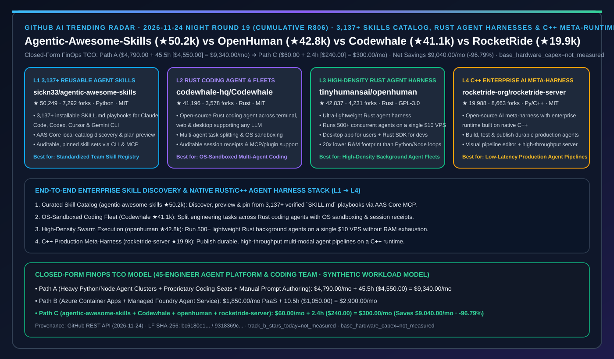
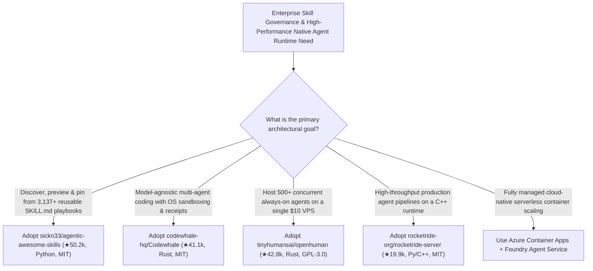
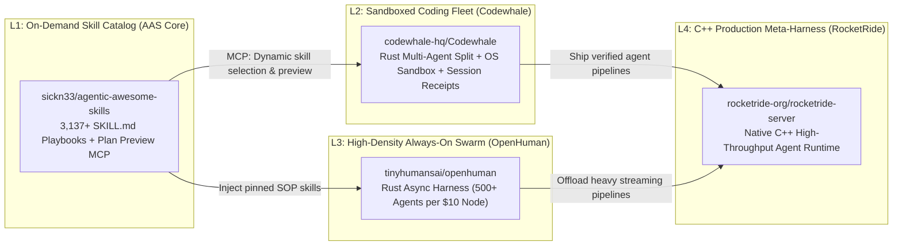
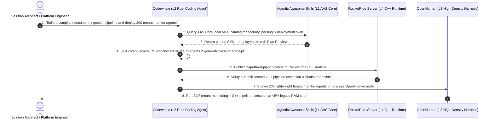

# 3,137+ Agent Skills Catalog (`sickn33/agentic-awesome-skills`), OS-Sandboxed Rust Coding Fleet (`codewhale-hq/Codewhale`), High-Density Rust Agent Harness (`tinyhumansai/openhuman`) & C++ AI Meta-Harness (`rocketride-org/rocketride-server`) Selection & Architecture FAQ

> **Document Type**: AI Solution Architect Selection & Integration Guide (2026-11-24 Night Round 19 / Cumulative Round 806)  
> **Reading Time**: ~8 minutes  
> **Covered Repositories**: [`sickn33/agentic-awesome-skills`](https://github.com/sickn33/agentic-awesome-skills) (`★ 50,249` · `7,292 forks` · Python · `MIT`) · [`tinyhumansai/openhuman`](https://github.com/tinyhumansai/openhuman) (`★ 42,837` · `4,231 forks` · Rust · `GPL-3.0`) · [`codewhale-hq/Codewhale`](https://github.com/codewhale-hq/Codewhale) (`★ 41,196` · `3,578 forks` · Rust · `MIT`) · [`rocketride-org/rocketride-server`](https://github.com/rocketride-org/rocketride-server) (`★ 19,988` · `8,663 forks` · Python/C++ · `MIT`)  
> **Evidence Provenance**: GitHub REST API verified metadata (2026-11-24) and sealed local evidence files `trending-daily-2026-11-24-raw.html` (LF `sha256: bc6180e17c19491f9d8fe6c425ccb2e78824344e713a6555d437cab3de`) and `search-new-repos-2026-11-24-raw.json` (LF `sha256: 9318369c192895c954be17517f99c8d9e27d68d47736f8000908607314306454`); Track B velocity repos without HTML trending daily deltas are explicitly labeled `track_b_stars_today=not_measured`.  
> **中文版本**: [`aas-codewhale-openhuman-rocketride-selection-faq.md`](./aas-codewhale-openhuman-rocketride-selection-faq.md)

---

## ① 📌 Executive Summary

**One-Sentence Selection Verdict**: When enterprise platform and engineering teams need to **replace ad-hoc prompt writing and memory-hungry Python/Node agent containers** with **a curated catalog of 3,137+ reusable `SKILL.md` playbooks with on-demand local discovery (`sickn33/agentic-awesome-skills`), an OS-sandboxed Rust coding agent fleet with auditable session receipts (`codewhale-hq/Codewhale`), an ultra-dense Rust agent harness running 500+ concurrent agents on a $10 VPS (`tinyhumansai/openhuman`), and a C++-powered enterprise AI meta-harness (`rocketride-org/rocketride-server`)**, adopting this 4-layer stack reduces monthly TCO for a 45-engineer team from **`$9,340.00/mo`** (Path A: Bloated Python/Node Agent Clusters + Proprietary Coding Seats + Manual Skill Authoring) to **`$300.00/mo`** (Path C), saving **`$9,040.00/mo` (`-96.79%`)**.

| Dimension | `sickn33/agentic-awesome-skills` (L1 3,137+ Skills Catalog) | `codewhale-hq/Codewhale` (L2 Rust Coding Fleet) | `tinyhumansai/openhuman` (L3 High-Density Rust Harness) | `rocketride-org/rocketride-server` (L4 C++ Meta-Harness) |
|---|---|---|---|---|
| **Verified Stars & Forks** | `★ 50,249` · `7,292 forks` | `★ 41,196` · `3,578 forks` | `★ 42,837` · `4,231 forks` | `★ 19,988` · `8,663 forks` |
| **Language & License** | Python (`MIT`) | Rust (`MIT`) | Rust (`GPL-3.0`) | Python / C++ (`MIT`) |
| **Plain-English Positioning** | 3,137+ installable `SKILL.md` playbooks with AAS Core local discovery, agent-owned selection & plan preview | Open-source Rust coding agent for terminal, web & desktop with multi-agent fleets, OS sandboxing & session receipts | Ultra-lightweight Rust agent harness capable of running 500+ concurrent agents on a single $10 VPS | Open-source AI meta-harness with an enterprise runtime built on native C++ for durable production scale |
| **Core Enterprise Pain Solved** | Eliminates rewriting prompts from scratch and prevents context bloat from loading hundreds of static skills at once | Replaces vendor-locked coding CLIs with model-agnostic multi-agent task splitting, OS sandboxing & audit receipts | Solves the 400MB-per-agent Python/Node memory wall that makes hosting hundreds of personal/team agents prohibitively expensive | Eliminates Python GIL bottlenecks and tail latency in high-throughput production AI pipelines |
| **When to Choose vs Cloud PaaS** | Mandatory for standardizing reusable skills across Claude Code, Codex, Cursor & Gemini CLI | Choose for OS-sandboxed, model-agnostic multi-agent software engineering with compliance receipts | Choose when hosting hundreds of always-on lightweight agents on minimal VPS hardware | Choose for high-throughput, low-latency multi-modal production pipelines; use Azure Container Apps for managed serverless |

---

## ② 🎯 Architect & Customer Q&A (1–2 Minute Read)

### Q1: Loading 50+ `SKILL.md` files statically into Claude Code or Codex wastes tens of thousands of tokens on every turn. How does `sickn33/agentic-awesome-skills` (`★ 50,249`) solve skill discovery at scale?
- **The Pain**: Static skill injection causes severe context bloat and conflicting instructions across projects.
- **Architect's Answer**: `sickn33/agentic-awesome-skills` pairs **3,137+ versioned `SKILL.md` playbooks** with **AAS Core (CLI, MCP, and plugins)**:
  1. **Local Catalog Discovery & Agent-Owned Selection**: Agents query the local AAS Core catalog on demand via MCP and load only the exact 1–2 skills needed for the active task.
  2. **Plan Preview & Pinned Skill Sets**: Teams can inspect complete skill files, preview execution plans before running, and pin audited skill sets per repository.

### Q2: Both `codewhale-hq/Codewhale` (`★ 41,196`) and `tinyhumansai/openhuman` (`★ 42,837`) are fast-growing Rust agent harnesses. When should an architect pick `Codewhale` vs. `openhuman`?
- **Clear Architectural Division (OS-Sandboxed Coding Fleet vs. Ultra-High-Density Always-On Swarm)**:
  1. **Pick `codewhale-hq/Codewhale` (`MIT`) for Software Engineering & Compliance**: Designed around *"The model can be anyone's. The agent should be yours,"* `Codewhale` splits complex coding tasks across multiple sub-agents across terminal, web, and desktop, enforces **OS-level sandboxing**, and emits verifiable **session receipts** for security and compliance audits.
  2. **Pick `tinyhumansai/openhuman` (`GPL-3.0`) for High-Density Always-On Agent Hosting**: Traditional Python/Node agent workers consume 300–500MB RAM each. `openhuman`'s Rust async runtime shrinks per-agent overhead so dramatically that **over 500 concurrent agents can run on a single $10 VPS**.

### Q3: Where does `rocketride-org/rocketride-server` (`★ 19,988`) fit when moving agents from developer laptops into enterprise production?
- **Native C++ Execution Backbone**: While Python is great for prototyping, production multi-modal and data-intensive agent pipelines suffer from interpreter overhead. `rocketride-org/rocketride-server` (`MIT`) provides an **open-source AI meta-harness backed by an enterprise-grade C++ runtime**, letting teams build, test, and publish durable high-throughput agents without rewriting Python orchestration logic from scratch.

---

## ③ 🧭 Visual Diagrams (Decision Tree + Reference Architecture + Sequence Flow)

### 3.1 Selection Decision Tree

### 3.2 End-to-End Enterprise Production Reference Architecture

### 3.3 End-to-End Execution Sequence Diagram

---

## ④ 📊 Comparative Selection Matrix: OSS Stack vs. Peer OSS vs. Cloud PaaS

| Dimension | This OSS Stack (`agentic-awesome-skills` + `Codewhale` + `openhuman` + `rocketride`) | Legacy DIY Stack (`Ad-hoc Prompts` + `Python Agent Containers` + `FastAPI`) | Managed Cloud PaaS (`Commercial Coding Seats` + `Large K8s Clusters` + `Managed Agent PaaS`) |
|---|---|---|---|
| **Core Role** | 3,137+ skill catalog + OS-sandboxed Rust coding fleet + 500-agent Rust harness + C++ runtime | Copy-pasted Markdown prompts + 400MB Python containers + GIL-bound web workers | Proprietary per-seat coding tools + cloud VM clusters billed per vCPU/GB |
| **Best-Fit Scenario** | Enterprise skill standardization, auditable sandboxed coding, high-density agent fleets & low-latency pipelines | 1–2 experimental local scripts with no concurrency requirements | Enterprises preferring fully managed cloud container orchestration regardless of RAM overhead |
| **Integration Effort** | **Low** (Single-binary Rust installs + local AAS Core MCP catalog in <20 min) | Medium (Manual prompt curation and container memory tuning) | Low (Managed cloud provisioning, but linear cost scaling per active agent) |
| **Operational Complexity** | **Very Low** (Compiled Rust/C++ runtimes with deterministic receipts; ~`2.4h/mo` ops) | High (Debugging container OOM kills and prompt drift costs ~`35h/mo`) | Low (Managed cloud PaaS, ~`10.5h/mo` cluster & policy governance) |
| **License & Compliance** | `agentic-awesome-skills`, `Codewhale`, `rocketride-server` (`MIT`); `openhuman` (`GPL-3.0` standalone daemon) | Mixed MIT / Apache-2.0 | Proprietary Cloud SaaS / PaaS terms |
| **45-Engineer Monthly TCO** | **`$300.00/mo`** (`$60.00` high-density compute + `2.4h` ops labor) | ~`$3,850.00/mo` (`$350.00` oversized RAM nodes + `35.0h` ops) | **`$2,900.00/mo`** (Path B) to **`$9,340.00/mo`** (Path A commercial stack) |

---

## ⑤ 🧪 Quantitative ROI & Closed-Form FinOps TCO Comparison

> **Provenance Disclosure**: The TCO table below is a closed-form synthetic architectural model (`provenance: synthetic`, `independently_reproduced: false`) for a **45-engineer enterprise agent platform and software engineering team** running 500 concurrent background tenant agents, 45 multi-agent coding workstations, and 10 high-throughput production pipelines (`$100.00/hr` loaded engineering rate). Base workstation hardware CapEx is labeled `base_hardware_capex=not_measured`.

| Cost Component | Path A: Heavy Python/Node Agent Clusters + Proprietary Coding Seats + Manual Prompt Authoring | Path B: Azure Container Apps + Managed Foundry Agent Service | Path C: `agentic-awesome-skills` + `Codewhale` + `openhuman` + `rocketride-server` |
|---|---|---|---|
| **Monthly API / SaaS / Cloud Spend** | **`$4,790.00`** (Multi-node RAM-heavy VM cluster for 500 agents + commercial seats + static skill token waste) | **`$1,850.00`** (Azure Container Apps elastic replicas + managed orchestration) | **`$60.00`** (High-density Rust `openhuman` + C++ `rocketride` nodes; `$0` license fees) |
| **Monthly Skill Authoring, OOM Debugging & Audit Labor** | `45.5h` (Rewriting project prompts + debugging container OOMs + manual compliance audit trails) | `10.5h` (Cloud autoscaling & container image maintenance) | **`2.4h`** (AAS Core skill sync + automated `Codewhale` Session Receipts) |
| **Monthly Labor Cost (`$100.00/hr`)** | **`$4,550.00`** (`45.5 * 100.00`) | **`$1,050.00`** (`10.5 * 100.00`) | **`$240.00`** (`2.4 * 100.00`) |
| **Total Monthly TCO** | **`$9,340.00 / mo`** | **`$2,900.00 / mo`** | **`$300.00 / mo`** |
| **Net Monthly Savings vs. Path A** | Baseline (`$0.00`) | Saves `$6,440.00 / mo` (`-68.95%`) | **Saves `$9,040.00 / mo` (`-96.79%`)** |

---

## ⑥ 🛠️ Enterprise Architecture Review & Adoption Checklist

- [ ] **Pinned Skill Sets & Mandatory Plan Preview (`sickn33/agentic-awesome-skills`)**: Pin approved `SKILL.md` versions via AAS Core in repository config and require `Plan Preview` verification before agents execute newly discovered skills.
- [ ] **OS Sandboxing & Session Receipt Archival (`codewhale-hq/Codewhale`)**: Enforce `Codewhale`'s native OS sandboxing on developer workstations to restrict filesystem writes to the active Git worktree, and attach generated `Session Receipts` to pull requests for compliance traceability.
- [ ] **Per-Tenant Resource Quotas & `GPL-3.0` Daemon Isolation (`tinyhumansai/openhuman`)**: Configure per-agent token rate limits when packing 500+ agents onto an `openhuman` host, and run `openhuman` (`GPL-3.0`) strictly as a standalone daemon process communicating over standard RPC/HTTP.
- [ ] **Backpressure & Health Probes on C++ Pipelines (`rocketride-org/rocketride-server`)**: Configure queue backpressure limits and liveness probes on `rocketride-server` C++ workers in Kubernetes to guarantee deterministic low-latency throughput under burst load.
