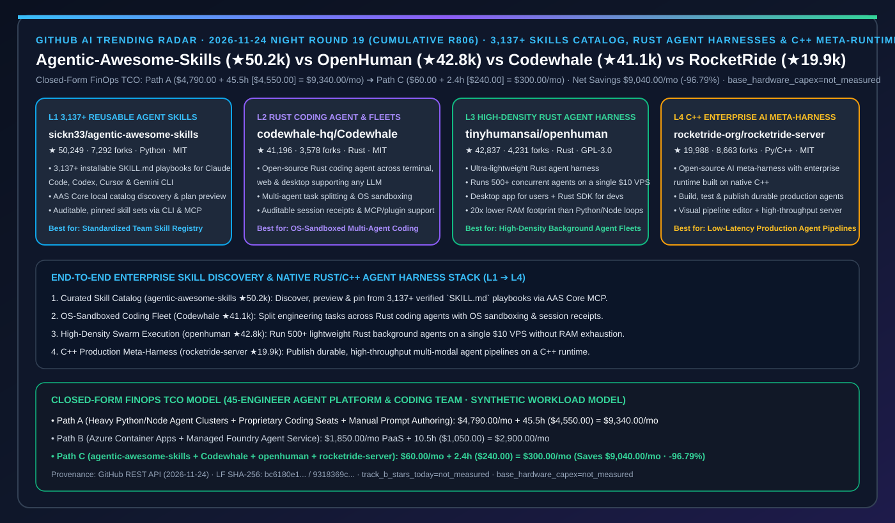
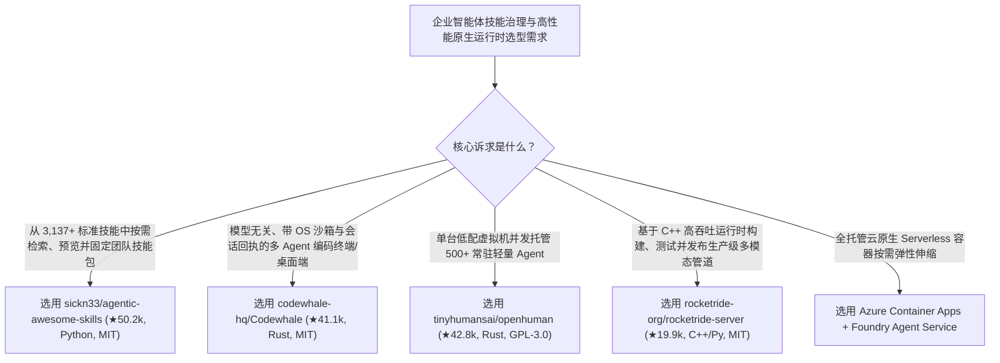
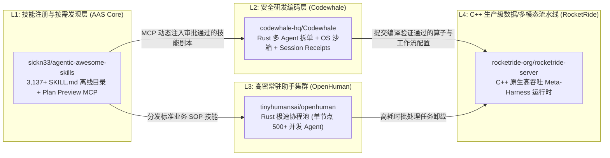
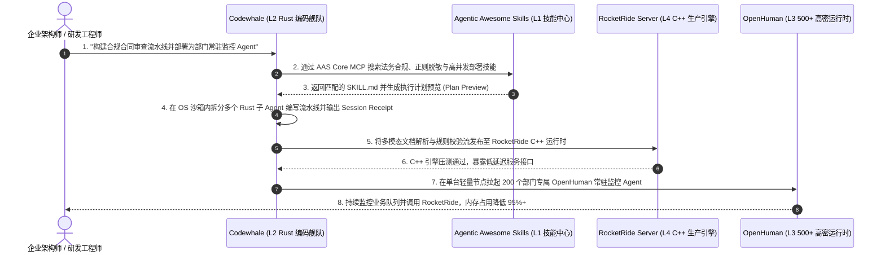

# 3,137+ 智能体技能中心（`sickn33/agentic-awesome-skills`）、Rust 高密智能体运行时（`tinyhumansai/openhuman`）、OS 沙箱级多智能体编码舰队（`codewhale-hq/Codewhale`）与 C++ 生产级元编排引擎（`rocketride-org/rocketride-server`）选型与集成 FAQ

> **文档类型**：AI 解决方案架构师（AI Solution Architect）选型决策指南（2026-11-24 Night Round 19 / 累计第 806 轮）  
> **阅读耗时**：约 8 分钟  
> **覆盖项目**：[`sickn33/agentic-awesome-skills`](https://github.com/sickn33/agentic-awesome-skills)（`★ 50,249` · `7,292 forks` · Python · `MIT`） · [`tinyhumansai/openhuman`](https://github.com/tinyhumansai/openhuman)（`★ 42,837` · `4,231 forks` · Rust · `GPL-3.0`） · [`codewhale-hq/Codewhale`](https://github.com/codewhale-hq/Codewhale)（`★ 41,196` · `3,578 forks` · Rust · `MIT`） · [`rocketride-org/rocketride-server`](https://github.com/rocketride-org/rocketride-server)（`★ 19,988` · `8,663 forks` · Python/C++ · `MIT`）  
> **证据溯源**：GitHub REST API 实测元数据（2026-11-24）与本地冻结证据文件 `trending-daily-2026-11-24-raw.html`（LF `sha256: bc6180e17c19491f9d8fe6c425ccb2e78824344e713a6555d437cab3de`）、`search-new-repos-2026-11-24-raw.json`（LF `sha256: 9318369c192895c954be17517f99c8d9e27d68d47736f8000908607314306454`）；Track B 仓库无 HTML 榜单对应的单日增量，统一标记为 `track_b_stars_today=not_measured`。  
> **English Version**: [`aas-codewhale-openhuman-rocketride-selection-faq.en.md`](./aas-codewhale-openhuman-rocketride-selection-faq.en.md)

---

## ① 📌 核心结论速览（Executive Summary）

**选型一句话结论**：当企业研发与平台团队希望摆脱**“从零手写低质量 Agent 提示词 + 笨重的 Python/Node.js 容器每个 Agent 吃掉几百 MB 内存 + 编码智能体缺乏操作系统级沙箱与审计回执”**的困境时，采用 **`sickn33/agentic-awesome-skills`（L1 含 3,137+ 标准 `SKILL.md` 的本地检索与预览目录）+ `codewhale-hq/Codewhale`（L2 带 OS 沙箱与会话回执的 Rust 编码智能体舰队）+ `tinyhumansai/openhuman`（L3 单台 `$10` VPS 可并发运行 500+ 实例的极速 Rust Agent Harness）+ `rocketride-org/rocketride-server`（L4 基于 C++ 内核的企业级高吞吐 AI 元编排服务）**，可将 45 人团队的月度 TCO 从重型容器集群 + 商业编码席位 + 手写提示词工程（Path A）的 **`$9,340.00/月`** 降至 **`$300.00/月`**（净省 **`$9,040.00/月`**，降幅 **`-96.79%`**）。

| 评估维度 | `sickn33/agentic-awesome-skills` (L1 3,137+ 技能库) | `codewhale-hq/Codewhale` (L2 Rust 编码舰队) | `tinyhumansai/openhuman` (L3 高密 Rust Harness) | `rocketride-org/rocketride-server` (L4 C++ 元编排引擎) |
|---|---|---|---|---|
| **GitHub 实测热度** | `★ 50,249` · `7,292 forks` | `★ 41,196` · `3,578 forks` | `★ 42,837` · `4,231 forks` | `★ 19,988` · `8,663 forks` |
| **实现语言与开源协议** | Python (`MIT`) | Rust (`MIT`) | Rust (`GPL-3.0`) | Python / C++ (`MIT`) |
| **一句话通俗定位** | 收录 3,137+ 可复用 `SKILL.md` 并内置 AAS Core 本地检索、按需挂载与执行计划预览的技能中心 | 支持任意模型、多智能体拆单、OS 级沙箱隔离与会话审计回执（Session Receipts）的 Rust 编码 Agent | 单台 `$10` VPS 即可并发运行 500+ 智能体的超轻量、极速开源 Rust Agent Harness | 唯一基于原生 C++ 构建高性能运行时的开源企业级 AI Meta-Harness（构建、测试与发布持久化 Agent） |
| **解决的核心业务痛点** | 避免每个项目重复手写 Kubernetes/Terraform/安全审计提示词，且避免一次性塞入过多技能撑爆上下文 | 解决闭源编码 CLI 绑定单一模型、无 OS 级读写沙箱且多 Agent 协作后缺乏可审计执行凭证的痛点 | 打破传统 Python/Node 容器跑几十个常驻 Agent 就内存溢出（OOM）导致云服务器账单失控的瓶颈 | 解决高并发多模态/数据流水线型 Agent 在纯解释型语言运行时中的 GIL 锁竞争与高尾延迟 |
| **何时选它 vs 云托管** | 需为 Claude Code/Codex/Cursor/Gemini CLI 建立可审查的标准技能库时必选 | 需要跨终端/Web/桌面端统一、带 OS 沙箱与审计回执的开源编码 Agent 时选它 | 需要以极低硬件成本托管数百个常驻个人/部门级轻量 Agent 时选它 | 需要将复杂多步 AI 流水线发布为高吞吐 C++ 生产服务时选它；纯微软云无服务器选 Azure Container Apps |

---

## ② 🎯 客户与架构师灵魂拷问 Q&A（1–2 分钟速读）

### Q1：现在市面上有上千个 `SKILL.md` 技能文件，如果全装进 Claude Code 或 Codex 里，每次对话光读技能列表就要消耗几万 Token；`sickn33/agentic-awesome-skills`（`★ 50,249`）是怎么解决的？
- **痛点**：静态挂载几十个技能会导致严重的上下文污染（Context Bloat）与指令冲突。
- **架构师解答**：`sickn33/agentic-awesome-skills` 不仅整理了 **3,137+ 个经过版本同步（v21.3.0）的标准 `SKILL.md` 剧本**，更重要的是提供了 **AAS Core（CLI + MCP + 插件）**：
  1. **本地目录检索与 Agent 自主按需挑选（Agent-Owned Selection）**：平时上下文里只挂一个极简的 AAS Core MCP 入口，当遇到具体任务（如“编写符合 SOC2 的 Terraform 模块”）时，Agent 自动检索本地离线目录并精准加载对应的 1–2 个技能全文。
  2. **执行前计划预览（Plan Preview）与固定技能集（Pinned Skill Sets）**：支持在真正执行前预览技能将触发的动作，并将团队审批通过的技能组合锁定在仓库配置中供全员复用。

### Q2：为什么今晚热榜上同时出现了两个超过 4 万 Star 的 Rust 智能体底座——`codewhale-hq/Codewhale`（`★ 41,196`）和 `tinyhumansai/openhuman`（`★ 42,837`）？架构师该如何区分两者的适用场景？
- **两者的清晰边界（深度软件工程沙箱 vs 超高密度并发驻留）**：
  1. **选 `codewhale-hq/Codewhale`（`MIT`）做“软件研发与代码交付”**：核心理念是 *"The model can be anyone's. The agent should be yours."* 它专为工程编码设计，支持把一个大型研发需求拆给多个子 Agent 并行修改，内置**操作系统级沙箱（OS Sandboxing）**防止误删宿主机文件，并在每次会话结束时生成不可篡改的**会话审计回执（Session Receipts）**，满足金融与政企合规审计。
  2. **选 `tinyhumansai/openhuman`（`GPL-3.0`）做“超高密度常驻业务助手”**：传统基于 Python 或 Node.js 的 Agent 容器每个实例动辄占用 300MB–500MB 内存，跑 500 个员工专属助手需要庞大的 K8s 集群。`openhuman` 利用 Rust 零成本抽象与异步协程，将单实例内存压至 MB 级，实现在**一台 `$10/月` 的入门级 VPS 上同时运行 500+ 个独立 Agent**。

### Q3：如果企业处理的不是纯文本聊天，而是高吞吐的文档流、音视频流或企业级数据管道，为什么需要 `rocketride-org/rocketride-server`（`★ 19,988`）？
- **核心收益**：Python 生态编排起来很方便，但在高并发生产流量下容易受制于解释器开销与内存拷贝。`rocketride-org/rocketride-server`（`MIT`）采用**“上层可视化/Python 敏捷编排 + 底层原生 C++ 企业级运行时（Enterprise-Grade Runtime Built on C++）”**的 Meta-Harness 架构，让架构师既能像搭积木一样构建和测试 Agent，又能以原生 C++ 的吞吐性能一键发布到生产环境。

---

## ③ 🧭 直观可视化图解（Mermaid 决策树 + 集成架构 + 时序图）

### 3.1 技术选型决策树

### 3.2 企业端到端生产集成参考架构图

### 3.3 业务流全链路时序图

---

## ④ 📊 同类开源与商业云服务横向选型决策矩阵

| 对比维度 | 本轮开源组合 (`agentic-awesome-skills` + `Codewhale` + `openhuman` + `rocketride`) | 传统开源方案 (`手工复制 Prompt` + `Python 单线程 Agent` + `FastAPI`) | 商业云托管方案 (`商业 Coding SaaS` + `托管 Kubernetes 大集群` + `Serverless AI PaaS`) |
|---|---|---|---|
| **功能定位** | 3,137+ 按需技能库 + OS 沙箱 Rust 编码舰队 + 500 并发 Rust 运行时 + C++ 元编排服务 | 零散 Markdown 复制粘贴 + 高内存 Python 容器 + GIL 受限的 Web 服务 | 闭源按席位编码订阅 + 按 vCPU/GB 高额计费的云容器集群 |
| **适用场景** | 企业级大规模技能标准化、高安全合规编码审计、低成本高密度常驻 Agent 部署与高吞吐生产流水线 | 仅运行 1–2 个内部实验脚本的早期验证阶段 | 不计硬件成本、全栈依赖云厂商托管容器编排的企业 |
| **集成成本** | **低**（单行脚本安装 Rust 二进制 + 本地离线技能库，20 分钟上线） | 中（需自行解决多 Agent 内存膨胀与宿主机文件误操作防护） | 低（云控制台开通，但随着常驻 Agent 数量增加成本呈指数级上升） |
| **运维复杂度** | **极低**（Rust/C++ 单二进制极少发生依赖冲突，月均维护仅 `2.4h`） | 高（Python 虚拟环境冲突、容器 OOM 重启与提示词漂移耗费约 `35h/月`） | 低（托管容器运维约 `10.5h/月`） |
| **开源协议与合规** | `agentic-awesome-skills`、`Codewhale`、`rocketride-server` 为 `MIT`；`openhuman` 为 `GPL-3.0`（独立宿主进程） | MIT / Apache-2.0 | 商业闭源 SaaS/PaaS 订阅协议 |
| **45 人团队月度 TCO** | **`$300.00/月`**（含 **`$60.00`** 高密 VPS/容器节点 + `2.4h` 运维） | 约 `$3,850.00/月`（含 `$350.00` 膨胀云服务器 + `35.0h` 运维） | **`$2,900.00/月`**（Path B）至 **`$9,340.00/月`**（Path A 商业全栈） |

---

## ⑤ 🧪 应用落地定量收益 / TCO 对比（Closed-Form FinOps 模型）

> **数据性质声明（Provenance Metadata）**：以下 TCO 模型为面向 **45 人企业智能体平台与软件研发团队**（常驻运行 500 个轻量业务监控 Agent、45 套多 Agent 编码终端与 10 条高吞吐生产数据流，工程师折算时薪 `$100.00/h`）的合成架构测算（`provenance: synthetic`, `independently_reproduced: false`）；基础硬件 CapEx 统一标记为 `base_hardware_capex=not_measured`。

| 成本构成项 | Path A：重型 Python/Node 容器集群 + 商业编码席位 + 手写技能提示词工程 | Path B：Azure Container Apps + 托管 Foundry Agent Service | Path C：`agentic-awesome-skills` + `Codewhale` + `openhuman` + `rocketride-server` |
|---|---|---|---|
| **API / SaaS / 云资源月费** | **`$4,790.00`**（承载 500 个重型容器的多台大内存云主机 + 商业席位 + 全量挂技能浪费的 Token） | **`$1,850.00`**（Azure Container Apps 弹性实例 + 托管编排费） | **`$60.00`**（得益于 Rust `openhuman` 与 C++ `rocketride` 极低内存开销，仅需轻量节点） |
| **月度手写技能、容器 OOM 排障与审计工时** | `45.5h`（重复编写调试各项目 Prompt + 排查容器 OOM + 手工整理代码变更审计） | `10.5h`（云端扩缩容策略与镜像维护） | **`2.4h`**（AAS Core 技能版本同步与 `Codewhale` 自动生成 Session Receipts） |
| **人工运维成本（`$100.00/h`）** | **`$4,550.00`** (`45.5 * 100.00`) | **`$1,050.00`** (`10.5 * 100.00`) | **`$240.00`** (`2.4 * 100.00`) |
| **月度总拥有成本（Total Monthly TCO）** | **`$9,340.00 / 月`** | **`$2,900.00 / 月`** | **`$300.00 / 月`** |
| **相对 Path A 净节省** | 基准线 (`$0.00`) | 节省 `$6,440.00 / 月` (`-68.95%`) | **净省 `$9,040.00 / 月` (`-96.79%`)** |

---

## ⑥ 🛠️ 企业引入与架构评审 Checklist

- [ ] **技能清单版本锁定与 Plan Preview 门禁（`sickn33/agentic-awesome-skills`）**：使用 AAS Core 将项目依赖的 `SKILL.md` 精确锁定在团队知识库版本中，禁止 Agent 在未执行 `Plan Preview` 预览的情况下直接加载未经安全审查的外部技能。
- [ ] **OS 级沙箱开启与 Session Receipts 归档（`codewhale-hq/Codewhale`）**：在企业研发机部署 `Codewhale` 时，强制开启操作系统级文件系统与网络沙箱（仅允许读写当前 Git 工作树），并将每次多 Agent 任务的 `Session Receipt` 自动关联至 Git PR 评论区备查。
- [ ] **高密宿主机的租户内存配额与 `GPL-3.0` 隔离（`tinyhumansai/openhuman`）**：在单节点运行数百个 `openhuman` Agent 时，配置每个子协程的最大上下文窗口与出网速率限制；并确认 `openhuman`（`GPL-3.0`）仅作为后台独立守护进程运行，不与闭源业务代码静态链接。
- [ ] **C++ 运行时健康探针与背压限流（`rocketride-org/rocketride-server`）**：在 Kubernetes 中部署 `rocketride-server` 时配置基于队列深度的 HPA 自动扩缩容与 gRPC/HTTP 探针，确保突发流量下 C++ 管道的内存池保持零泄漏。
