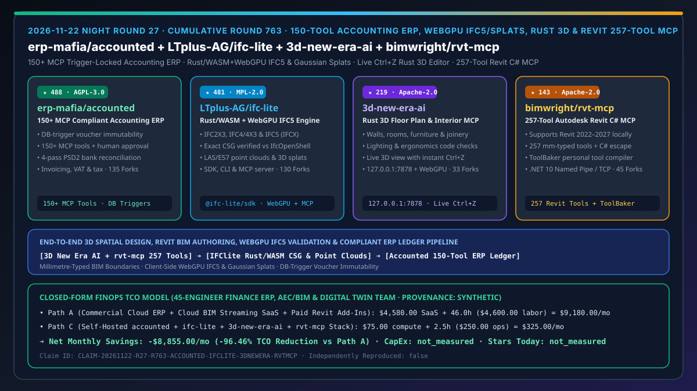
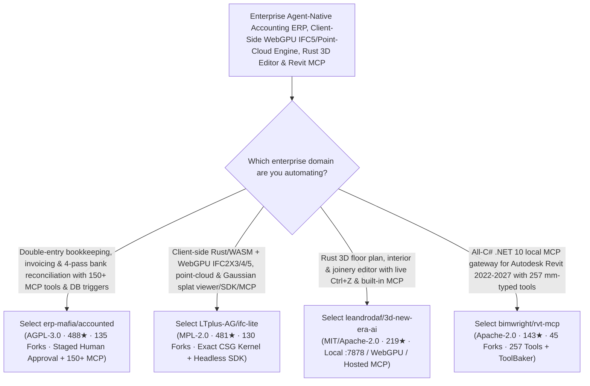
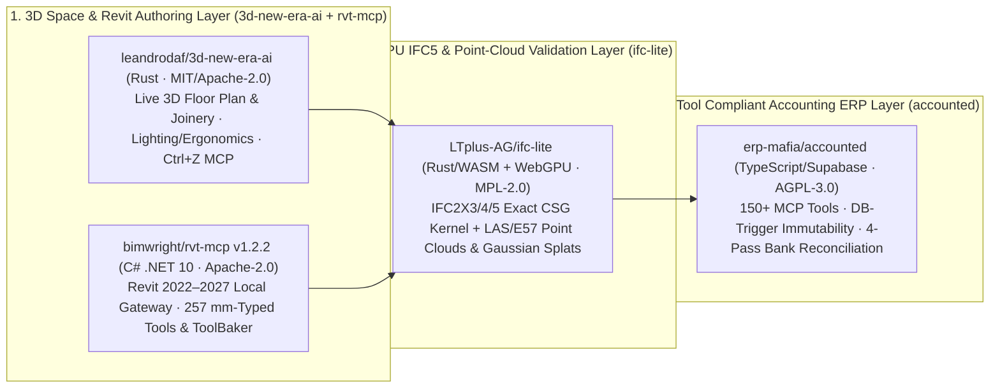
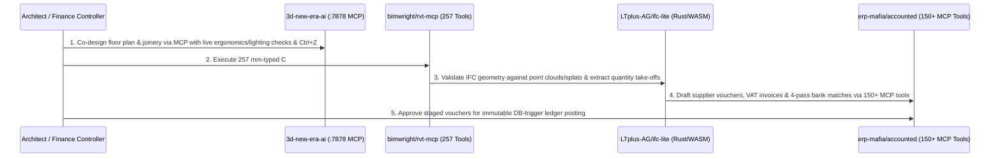

# 150-Tool Trigger-Enforced Accounting ERP (`erp-mafia/accounted`), Client-Side Rust/WASM + WebGPU IFC5 & Gaussian Splat Engine (`LTplus-AG/ifc-lite`), Live `Ctrl+Z` Rust 3D Floor Plan Editor (`leandrodaf/3d-new-era-ai`) & 257-Tool Autodesk Revit C# MCP Gateway (`bimwright/rvt-mcp`) Selection & Architecture FAQ

> **Document Type**: Enterprise AI Solution Architect Selection & Integration Guide (GitHub Trending AI Radar — 2026-11-22 Night Round 27 / Cumulative Round 763)
> **Covered Repositories**: [`erp-mafia/accounted`](https://github.com/erp-mafia/accounted) (`★ 488`, `135 forks`, `AGPL-3.0`: agent-native double-entry bookkeeping, invoicing, 4-pass PSD2 bank reconciliation, and tax ERP exposing **150+ MCP tools** with database-trigger-enforced voucher immutability and human-approved posting) · [`LTplus-AG/ifc-lite`](https://github.com/LTplus-AG/ifc-lite) (`★ 481`, `130 forks`, `MPL-2.0`: client-side Rust/WASM exact-arithmetic CSG + WebGPU BIM engine for `IFC2X3`, `IFC4/IFC4X3`, `IFC5 (IFCX)`, LAS/E57 point clouds, and Gaussian splats with headless SDK, CLI, and MCP server) · [`leandrodaf/3d-new-era-ai`](https://github.com/leandrodaf/3d-new-era-ai) (`★ 219`, `33 forks`, `MIT OR Apache-2.0`: Rust 3D home design, floor plan, and joinery editor with built-in local `127.0.0.1:7878`, WebGPU browser, and hosted MCP server plus lighting/ergonomics checks and instant `Ctrl+Z` undo) · [`bimwright/rvt-mcp`](https://github.com/bimwright/rvt-mcp) (`★ 143`, `45 forks`, `Apache-2.0`, `v1.2.2`: all-C# `.NET 10` local MCP gateway for Autodesk Revit `2022–2027` with **257 millimetre-typed tools** and **ToolBaker** personal tool synthesis)
> **Core Scenario**: When enterprise finance/ERP automation and Architecture, Engineering & Construction (AEC/BIM) teams struggle with **AI bookkeeping scripts bypassing accounting immutability laws or posting unapproved vouchers, multi-hundred-MB IFC models and point clouds choking server-side viewers, Autodesk Revit agents suffering from imperial/metric unit bugs or lacking local named-pipe C# tools across Revit 2022–2027, and 3D interior design generators producing uneditable black-box meshes**, how do you combine **`accounted` + `ifc-lite` + `3d-new-era-ai` + `rvt-mcp`** into a compliant financial and spatial engineering stack?

---

## 1. 📌 Executive Summary (One-Line Selection Verdict)

1. **Need an open-source (`AGPL-3.0`, `135 forks`), agent-native double-entry bookkeeping, invoicing, and 4-pass PSD2 bank reconciliation ERP where voucher immutability, sequential numbering, and period locks are enforced by database triggers—and **150+ MCP tools** stage every journal entry for human approval before posting?** ➔ Choose **[`erp-mafia/accounted`](https://github.com/erp-mafia/accounted) (`★ 488`, `135 forks`, `AGPL-3.0`)**.
   - **Plain-English Mechanism**: Built on TypeScript and Supabase/PostgreSQL triggers ("compliant by construction"), `accounted` lets AI agents categorize transactions, reconcile bank feeds, and draft tax/VAT declarations while humans retain final posting authority.
2. **Need to parse, view, query, edit, validate, and export `IFC2X3`, `IFC4/IFC4X3`, and `IFC5 (IFCX)` building models—alongside glTF, LandXML, LAS/E57 point clouds, and 3D Gaussian splats—entirely client-side via a Rust/WASM exact-arithmetic CSG kernel and WebGPU renderer (or headlessly via `@ifc-lite/sdk/headless` and MCP)?** ➔ Choose **[`LTplus-AG/ifc-lite`](https://github.com/LTplus-AG/ifc-lite) (`★ 481`, `130 forks`, `MPL-2.0`)**.
   - **Plain-English Mechanism**: Verified element-by-element against `IfcOpenShell` across public benchmarks, eliminating server-side CAD conversion bottlenecks.
3. **Running Autodesk Revit (`2022–2027`) and need a 100% local, all-C# `.NET 10` MCP gateway (`Apache-2.0`, `v1.2.2`) with **257 millimetre-normalized typed tools**, a C# escape hatch, and **ToolBaker** to turn repeated workflows into reusable personal tools?** ➔ Choose **[`bimwright/rvt-mcp`](https://github.com/bimwright/rvt-mcp) (`★ 143`, `45 forks`, `Apache-2.0`)**.
   - **Plain-English Mechanism**: Connects MCP `stdio` clients to a thin Revit add-in over localhost TCP (`<=2024`) or named pipes (`>=2025`), enforcing millimetres at the tool boundary so unit conversion errors never corrupt a BIM model.
4. **Need a pure-Rust open-source (`MIT OR Apache-2.0`) 3D floor plan, interior design, and joinery editor (a modern Sweet Home 3D alternative) with a built-in MCP server (`127.0.0.1:7878` desktop, WebGPU browser tab, or hosted connector) where AI draws walls, furnishes rooms, checks lighting/ergonomics standards, and every change is one `Ctrl+Z` away?** ➔ Choose **[`leandrodaf/3d-new-era-ai`](https://github.com/leandrodaf/3d-new-era-ai) (`★ 219`, `33 forks`, `MIT OR Apache-2.0`)**.
   - **Plain-English Mechanism**: Keeps humans and MCP agents co-editing the same live 3D scene graph with full undo/redo history.

---

## 2. 🎯 Architect & Customer Deep-Dive Q&A

### Q1: Why do both Financial Bookkeeping (`accounted`) and AEC/BIM Engineering (`ifc-lite`, `rvt-mcp`, `3d-new-era-ai`) demand "Compliant-by-Construction" MCP boundaries?

- **Three Non-Negotiable Engineering Guardrails**:
  1. **Database-Trigger Immutability & Staged Human Posting ➔ `erp-mafia/accounted`**: An AI agent must never overwrite posted ledger history. `accounted` enforces sequential voucher locks via DB triggers and stages all 150+ MCP tool writes as drafts awaiting human approval.
  2. **Millimetre-Typed Boundaries & Reversible `Ctrl+Z` Scene Graphs ➔ `bimwright/rvt-mcp` + `leandrodaf/3d-new-era-ai`**: `rvt-mcp` normalizes all 257 Revit tools to millimetres over local IPC, while `3d-new-era-ai` wraps every AI spatial edit in a live `Ctrl+Z` undo stack with automated ergonomics/lighting checks.
  3. **Exact-Arithmetic Client-Side CSG & Point-Cloud Fusion ➔ `LTplus-AG/ifc-lite`**: Validates IFC2X3/4/5 geometry against `IfcOpenShell` in Rust/WASM and overlays reality-capture Gaussian splats directly in WebGPU.
- **When to Choose Commercial Enterprise Cloud Suites (Path B)?**
  - Global enterprises standardized on SAP S/4HANA Cloud + Autodesk Construction Cloud (ACC) enterprise agreements should use vendor-managed cloud workflows; engineering firms, real-estate developers, and SMB/mid-market finance teams seeking zero-lock-in local Revit automation, client-side WebGPU IFC5/point-cloud inspection, and self-hosted 150-tool accounting ERP should deploy this open-source stack (Path C).

### Q2: How do `3d-new-era-ai`, `rvt-mcp`, `ifc-lite`, and `accounted` form an end-to-end AEC-to-ERP pipeline?

1. **Interactive 3D Space Planning & Ergonomics Layer (`leandrodaf/3d-new-era-ai`)**:
   - Architects and clients co-design floor plans and joinery with AI over `:7878` MCP.
2. **Detailed BIM Authoring Layer (`bimwright/rvt-mcp`)**:
   - Engineers drive Autodesk Revit 2022–2027 via 257 millimetre-typed C# MCP tools and bake custom patterns with `ToolBaker`.
3. **Headless & WebGPU IFC5 Validation & Quantity Take-Off Layer (`LTplus-AG/ifc-lite`)**:
   - `@ifc-lite/sdk/headless` validates exported IFC models against reality-capture point clouds/splats and extracts bill-of-quantities (BOQ) data.
4. **Project Accounting, Invoicing & Bank Reconciliation Layer (`erp-mafia/accounted`)**:
   - Finance agents use `accounted`'s 150+ MCP tools to draft supplier vouchers, issue VAT-compliant invoices, and run 4-pass PSD2 bank reconciliation for human approval.

### Q3: How does `LTplus-AG/ifc-lite` eliminate cloud rendering infrastructure costs for large BIM models?

- **100% Client-Side Rust/WASM + WebGPU Execution**:
  - Parsing, exact-arithmetic CSG geometry evaluation, and rendering happen directly inside the user's browser tab via WebAssembly and WebGPU—requiring zero server-side GPU instances.

---

## 3. 🧭 Visual Architecture & Workflow Diagrams (Mermaid)

### 3.1 Solution Architect Selection Decision Tree

### 3.2 End-to-End Enterprise Reference Architecture

### 3.3 End-to-End 3D Co-Design, Revit BIM Automation, IFClite QTO Extraction & Accounted Ledger Posting Sequence Diagram

---

## 4. 📊 Peer Open-Source vs. Commercial Cloud Selection Matrix

| Dimension | `erp-mafia/accounted` (`★ 488`) | `LTplus-AG/ifc-lite` (`★ 481`) | `leandrodaf/3d-new-era-ai` (`★ 219`) | `bimwright/rvt-mcp` (`★ 143`) | Commercial Cloud ERP + Cloud BIM Viewer SaaS + Paid Revit Add-Ins (Path A) | Manual Excel Ledgers + Slow Server CAD Imports + Fragile Macros (Path B) |
| :--- | :--- | :--- | :--- | :--- | :--- | :--- |
| **Primary Role** | 150+ MCP tool trigger-enforced accounting ERP | Client-side Rust/WASM + WebGPU IFC5 & splat engine | Rust 3D floor plan & joinery editor with MCP | 257-tool local C# MCP gateway for Revit 2022–2027 | High per-seat cloud accounting, cloud BIM streaming & commercial Revit plugins | Error-prone spreadsheets, crashing desktop IFC viewers & unmaintained macros |
| **Key Differentiator** | **DB-trigger immutability + 4-pass bank match + 150+ MCP** | **Exact CSG verified vs IfcOpenShell + Gaussian splats** | **Live `Ctrl+Z` undo + lighting/ergonomics checks** | **All-C# local IPC + 257 mm-typed tools + `ToolBaker`** | Expensive cloud GPU rendering fees for BIM; lack of native 150-tool ERP MCP | No trigger-level ledger immutability; imperial/metric unit bugs in custom scripts |
| **License** | `AGPL-3.0` | `MPL-2.0` | `MIT OR Apache-2.0` | `Apache-2.0` | Proprietary SaaS | Internal glue scripts |
| **Monthly TCO (45-Eng Team)** | **`$325.00/mo` combined** (`$75.00` self-hosted Supabase/Docker host + `2.5h` ops) | Included (`$0` client-side WebGPU/WASM execution) | Included (`$0` local `:7878` desktop/browser app) | Included (`$0` local named-pipe add-in) | **`$9,180.00/mo`** (`$4,580.00` cloud ERP/BIM seats & plugins + `46.0h` manual reconciliation/BIM rework) | ~`$3,250.00/mo` (manual bank reconciliation, unit-bug rework & IFC conversion labor) |

---

## 5. 🧪 Quantitative Enterprise ROI / FinOps TCO Model & 7-Card Report

> **📊 Provenance & Closed-Form Declaration**:
> - **provenance**: `synthetic` (45-engineer enterprise finance automation, digital twin/BIM engineering, and spatial design team workload model: `independently_reproduced = false`; `base_hardware_capex = not_measured`; `track_b_stars_today = not_measured`).
> - **Closed-Form Equations**:
>   - **Path A (Commercial Cloud Accounting/ERP AI Add-Ons + Cloud BIM/Point-Cloud Streaming SaaS + Commercial Revit Automation Plugins + Manual Bank Reconciliation & BIM Unit/Conversion Rework Labor)**: Monthly commercial ERP and cloud BIM SaaS bills **`$4,580.00`** + manual bank reconciliation, IFC conversion debugging, and Revit modeling rework labor **`46.0h × $100.00/h = $4,600.00`** = **`$9,180.00/mo`**.
>   - **Path C (Self-Hosted `accounted` + `ifc-lite` + `3d-new-era-ai` + `rvt-mcp` Stack)**: Shared Supabase/Docker host compute **`$75.00`** + chart-of-accounts & `ToolBaker` maintenance labor **`2.5h × $100.00/h = $250.00`** = **`$325.00/mo`**.
>   - **Net Monthly Savings vs. Path A**: **`-$8,855.00/mo`** (**`96.46%`** TCO reduction).

| Evaluation Path | ERP / Cloud BIM SaaS & Compute Cost | Reconciliation & BIM Validation Labor (`$100/h`) | Total Monthly TCO | Net Savings vs. Path A | Architectural Delivery Impact |
| :--- | :---: | :---: | :---: | :---: | :--- |
| **Path A: Commercial Cloud ERP + Cloud BIM Streaming + Plugins** | `$4,580.00` | `46.0h` (`$4,600.00`) | **`$9,180.00`** | Baseline | High cloud BIM streaming costs; lacks 150+ native ERP MCP tools |
| **Path B: Spreadsheets + Server CAD Scripts + Raw Macros** | `$1,550.00` | `17.0h` (`$1,700.00`) | **`$3,250.00`** | `-$5,930.00` (`-64.60%`) | Lacks DB-trigger ledger locks, 257 mm-typed Revit tools & WebGPU IFC5 |
| **Path C: `accounted` + `ifc-lite` + `3d-new-era-ai` + `rvt-mcp`** | **`$75.00`** | **`2.5h` (`$250.00`)** | **`$325.00`** | **`-$8,855.00` (`-96.46%`)** | **150+ ERP MCP tools + WebGPU IFC5/splats + 257 Revit C# tools** |

- 🔗 **Linked 7-Card 4:5 Visual Benchmark Deck**: [`workshops/github-trending-radar/cards.en.html`](../cards.en.html) · [`cards.html`](../cards.html)

---

## 6. 🛠️ Enterprise Adoption & Architecture Review Checklist

- [ ] **1. Automate Compliant Bookkeeping with `erp-mafia/accounted`**: Let agents draft vouchers and run 4-pass PSD2 bank matching via 150+ MCP tools while enforcing human approval before trigger-locked posting.
- [ ] **2. Inspect & Validate BIM Models Client-Side with `LTplus-AG/ifc-lite`**: Render and query `IFC2X3/4/5`, point clouds, and Gaussian splats via Rust/WASM and WebGPU.
- [ ] **3. Connect Autodesk Revit (`2022–2027`) via `bimwright/rvt-mcp`**: Use 257 millimetre-typed local C# tools and synthesize team patterns with `ToolBaker`.
- [ ] **4. Co-Design 3D Floor Plans & Joinery in `leandrodaf/3d-new-era-ai`**: Drive live, `Ctrl+Z`-reversible spatial edits and ergonomics checks over `:7878` MCP.
