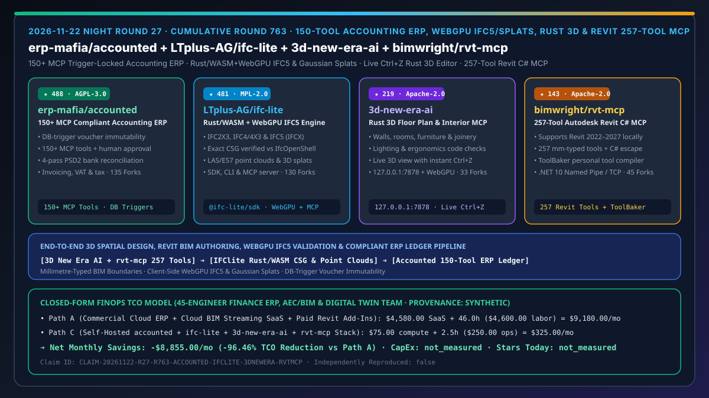
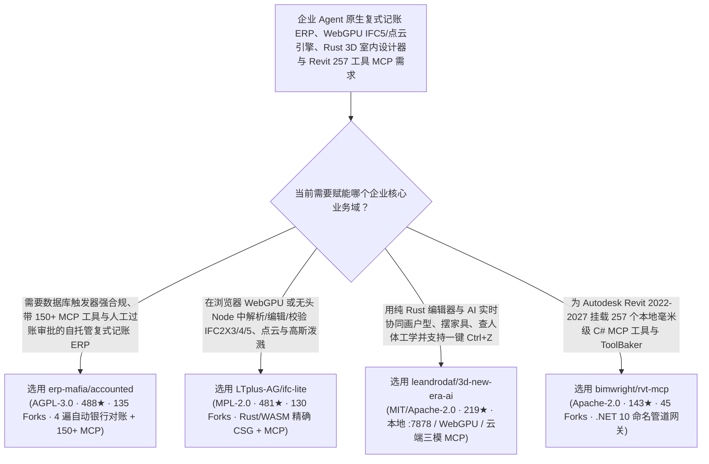
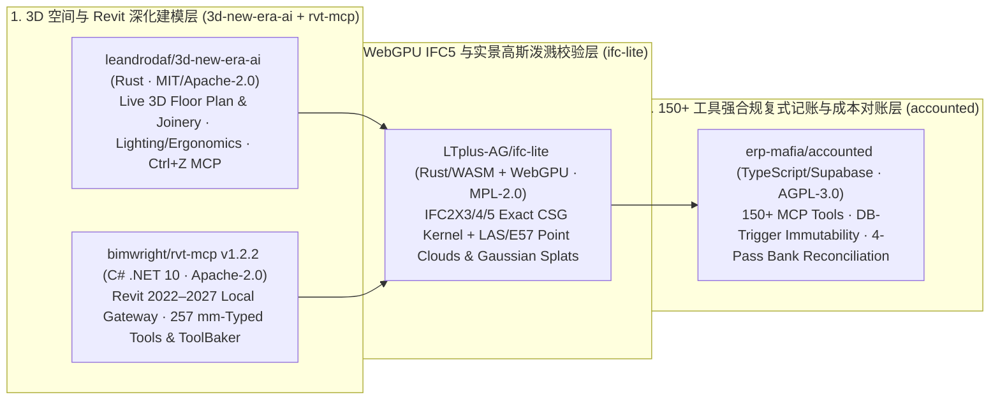
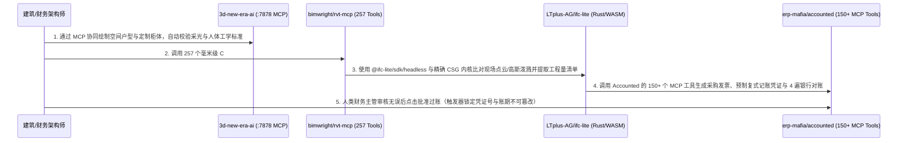

# 150+ MCP 工具与数据库触发器强合规复式记账 ERP（`erp-mafia/accounted`）、Rust/WASM+WebGPU 建筑 IFC5 与高斯泼溅引擎（`LTplus-AG/ifc-lite`）、内置实时 `Ctrl+Z` MCP 的 Rust 3D 室内设计器（`leandrodaf/3d-new-era-ai`）与 257 工具 Autodesk Revit 本地 C# MCP 网关（`bimwright/rvt-mcp`）选型与集成架构 FAQ

> **文档类型**：企业 AI 解决方案架构师（AI Solution Architect）选型决策指南（GitHub Trending AI 雷达 2026-11-22 Night Round 27 / 累计第 763 轮）
> **覆盖项目**：[`erp-mafia/accounted`](https://github.com/erp-mafia/accounted)（`★ 488`、`135 forks`、`AGPL-3.0`，专为 AI Agent 打造的开源复式记账、发票、PSD2 银行四遍自动对账与报税 ERP，由数据库触发器强制锁定凭证不可篡改与期初锁账，并暴露 **150+ 个受人类过账审批保护的 MCP 工具**）· [`LTplus-AG/ifc-lite`](https://github.com/LTplus-AG/ifc-lite)（`★ 481`、`130 forks`、`MPL-2.0`，基于 Rust/WASM 精确算术 CSG 内核与 WebGPU 的客户端/Headless BIM 引擎，全兼容 IFC2X3/IFC4/IFC5、点云与 3D Gaussian Splatting 并内置 CLI 与 MCP Server）· [`leandrodaf/3d-new-era-ai`](https://github.com/leandrodaf/3d-new-era-ai)（`★ 219`、`33 forks`、`MIT OR Apache-2.0`，Rust 编写的开源户型图、3D 室内与定制柜体设计编辑器，自带本地 `127.0.0.1:7878`、浏览器 WebGPU 与云端三模 MCP，AI 每次画墙摆家具均可实时预览并一键 `Ctrl+Z` 撤销）· [`bimwright/rvt-mcp`](https://github.com/bimwright/rvt-mcp)（`★ 143`、`45 forks`、`Apache-2.0`，`v1.2.2`，面向 Autodesk Revit 2022–2027 的纯 C# `.NET 10` 本地命名管道/TCP MCP 网关，内置 **257 个毫米级强类型工具**与 `ToolBaker` 个人工具自合成器）
> **核心场景**：当企业财务数字化（FinOps/ERP）与工程建设/地产建筑设计（AEC/BIM）团队面临**“传统财务软件让 AI 记账时缺乏数据库触发器级别的凭证防篡改与过账前人工审批门禁、几百 MB 的建筑 IFC 模型与激光点云/高斯泼溅在网页端加载卡死且缺少无头校验 SDK、建筑师用 Autodesk Revit 建模时缺乏覆盖 2022–2027 全版本的本地毫秒级 C# MCP 工具、以及室内空间规划缺少支持一键 `Ctrl+Z` 悔棋的 Rust 3D 协同画布”**四大痛点时，如何组合**`accounted` + `ifc-lite` + `3d-new-era-ai` + `rvt-mcp`** 打造强合规财务记账与全生命周期 BIM/3D 空间工程智能体底座？

---

## 一、📌 核心结论速览（选型一句话结论）

1. **想让 AI 智能体安全接管企业日常复式记账、发票开具、PSD2 银行流水四遍自动对账（4-Pass Matching）与税务申报草案，同时由底层数据库触发器（Database Triggers）死死锁住“凭证不可篡改、顺序编号与锁账期”，并要求所有分录必须由人类会计点击审批后才能正式过账（Agent Proposes, You Decide）** ➔ 选 **[`erp-mafia/accounted`](https://github.com/erp-mafia/accounted)（`★ 488`，`135 forks`，`AGPL-3.0`）**。
   - **通俗原理**：把整套复式记账引擎暴露为 **150+ 个带 OAuth / 细粒度 API Key 的 MCP 工具**，基于 Docker + Supabase 即可私有化部署，是“构造即合规（Compliant by Construction）”的 Agent 原生财务 ERP 标杆。
2. **想在纯浏览器端（WebGPU + Rust/WASM）或服务端无头环境（`@ifc-lite/sdk/headless`）极速解析、查看、查询、编辑并校验建筑 BIM 模型（全面支持 `IFC2X3`、`IFC4/IFC4X3` 与最新 `IFC5/IFCX`），同时在同一个视口叠加激光雷达点云（LAS/LAZ/E57）与 3D 高斯泼溅（Gaussian Splatting `.splat`）实景** ➔ 选 **[`LTplus-AG/ifc-lite`](https://github.com/LTplus-AG/ifc-lite)（`★ 481`，`130 forks`，`MPL-2.0`）**。
   - **通俗原理**：其 Rust 精确算术 CSG 几何内核已逐构件与 `IfcOpenShell` 基准语料库完成严格对齐验证，并提供 CLI 与 MCP Server 供工程智能体直接提取构件工程量（QTO）与合规性指标。
3. **建筑设计院与机电（MEP）团队主力使用 Autodesk Revit（2022–2027），想在本地电脑上零云端外发地接入 **257 个毫米级（mm）强类型 C# MCP 工具**，并能用内置的 `ToolBaker` 把高频重复的 C# 脚本固化为个人专属 MCP 工具** ➔ 选 **[`bimwright/rvt-mcp`](https://github.com/bimwright/rvt-mcp)（`★ 143`，`45 forks`，`Apache-2.0`，`v1.2.2`）**。
   - **通俗原理**：采用全链路纯 C#（`.NET 10` stdio 服务端 + 极薄 Revit 年份插件，通过本地命名管道 Named Pipe 或 TCP 通信），在工具边界统一強制使用毫米（mm）单位消除英制/公制换算事故。
4. **想找一款用纯 Rust 编写、可免费替代 Sweet Home 3D 的开源 3D 户型、室内软装与定制木作（Joinery）编辑器，让 Claude/ChatGPT/Cursor 通过内置 MCP（本地 `127.0.0.1:7878` 或 WebGPU 浏览器标签页）帮你画墙、摆家具、校验采光与人体工学标准，且每一步修改都能在屏幕上实时看到并随时按 `Ctrl+Z` 撤销** ➔ 选 **[`leandrodaf/3d-new-era-ai`](https://github.com/leandrodaf/3d-new-era-ai)（`★ 219`，`33 forks`，`MIT OR Apache-2.0`）**。
   - **通俗原理**：彻底解决 AI 生成 3D 户型“黑盒不可改”的痛点，人类设计师与 AI 共享同一个支持单步 Undo/Redo 的实时 3D 场景树。

---

## 二、🎯 客户与架构师灵魂拷问 Q&A（深度架构拆解）

### Q1：为什么财务记账（`accounted`）与建筑工程 BIM（`ifc-lite` / `rvt-mcp` / `3d-new-era-ai`）是“最需要确定性护栏与强类型 MCP”的两大高价值企业场景？

- **三大工程与合规硬约束**：
  1. **财务账本决不允许大模型“幻觉删改历史凭证” ➔ `erp-mafia/accounted`**：通过 PostgreSQL 数据库触发器强制执行凭证不可变性与连续编号，150+ 个 MCP 工具只能生成草稿（Draft Voucher），正式入账必须经过人工审批。
  2. **建筑与机电设计决不允许“单位换算错位与不可逆破坏” ➔ `bimwright/rvt-mcp` + `leandrodaf/3d-new-era-ai`**：`rvt-mcp` 在 257 个工具边界强制统一为毫米（mm）并在本地进程间通信；`3d-new-era-ai` 将每一次 MCP 调用纳入编辑器的 `Ctrl+Z` 事务栈并自动校验采光与人体工学规范。
  3. **跨软件交付与实景数字孪生校验 ➔ `LTplus-AG/ifc-lite`**：用与 `IfcOpenShell` 逐构件对齐的 Rust/WASM 内核统一解析 `IFC2X3/4/5` 与现场 3D 高斯泼溅/点云，自动完成工程量清单（BOQ）提取并与 `accounted` 工程成本账本对接。
- **何时直接用商业云 SaaS 方案（Path B）？**
  - 若跨国集团已全面上线 SAP S/4HANA Cloud + Autodesk Construction Cloud (ACC) 企业总包协议，优先使用原厂云平台；若中大型工程设计团队、地产开发商或独立企业需要零年费锁定的本地 Revit 257 工具网关、WebGPU 客户端 IFC5/点云引擎及 150+ 工具自托管财务 ERP，则采用本轮开源栈（Path C）。

### Q2：典型企业级“空间方案与人体工学设计 (`3d-new-era-ai`) ➔ Revit 深化建模 (`rvt-mcp`) ➔ IFC5/点云无头工程量校验 (`ifc-lite`) ➔ 工程预算与复式记账对账 (`accounted`)”架构怎么搭？

1. **概念方案与室内空间人机共创层（`leandrodaf/3d-new-era-ai`）**：
   - 设计师通过本地 `:7878` MCP 让 AI 快速生成户型、家具布局与定制柜体，实时校验采光与人体工学。
2. **BIM 施工图深化与族构件自动化层（`bimwright/rvt-mcp`）**：
   - 在 Autodesk Revit 2022–2027 中通过 257 个毫米级 C# MCP 工具与 `ToolBaker` 批量完成管线综合与构件标注。
3. **客户端/无头 IFC5 几何校验与点云实景比对层（`LTplus-AG/ifc-lite`）**：
   - 导出 IFC 模型后，通过 `@ifc-lite/sdk/headless` 与 WebGPU 浏览器叠加现场激光点云/高斯泼溅，自动核算出精准工程量清单。
4. **项目成本核算、开票与银行四遍自动对账层（`erp-mafia/accounted`）**：
   - 财务 Agent 调用 `accounted` 的 150+ 个 MCP 工具根据工程量清单生成采购凭证草稿、开具分税率发票并执行 PSD2 银行流水对账，交由财务主管一键审批过账。

### Q3：`bimwright/rvt-mcp` 的 `ToolBaker` 是怎么帮建筑院沉淀团队资产的？

- **从一次性 C# 逃生舱脚本进化为团队标准强类型工具**：
  - 当遇到 257 个内置工具未覆盖的特殊造型或院标出图逻辑时，Agent 可先通过 C# 逃生舱接口执行，验证无误后由 `ToolBaker` 将该模式“烘焙”为持久化的本地强类型 MCP 工具，全团队直接复用。

---

## 三、🧭 直观可视化图解（Mermaid 决策树 + 集成架构 + 时序图）

### 3.1 架构师选型决策树

### 3.2 企业端到端生产集成参考架构图

### 3.3 3D 空间设计、Revit 257 工具建模、IFClite 工程量提取与 Accounted 财务入账时序图

---

## 四、📊 同类开源与商业云服务横向选型决策矩阵

| 对比维度 | `erp-mafia/accounted` (`★ 488`) | `LTplus-AG/ifc-lite` (`★ 481`) | `leandrodaf/3d-new-era-ai` (`★ 219`) | `bimwright/rvt-mcp` (`★ 143`) | 商业云财务 ERP + 商业云 BIM 查看器 + 昂贵 Revit 插件席位 (Path A) | 手工录入 Excel 凭证 + 笨重桌面 IFC 导入 + 手写脆弱 Dynamo 脚本 (Path B) |
| :--- | :--- | :--- | :--- | :--- | :--- | :--- |
| **核心能力定位** | 150+ MCP 工具强合规复式记账与对账 ERP | Rust/WASM+WebGPU IFC2X3/4/5 与点云引擎 | 内置三模 MCP 的 Rust 3D 户型与柜体编辑器 | 257 工具 Autodesk Revit 本地 C# MCP 网关 | 按用户数和云端存储容量高额收费的商业财务与工程云套件 | 易出错的 Excel 记账、卡顿崩溃的大模型导入与难维护的宏脚本 |
| **核心技术突破** | **数据库触发器锁死合规 + 4 遍自动对账 + 人工审批过账** | **对标 IfcOpenShell 的精确 CSG + 同屏渲染高斯泼溅/点云** | **实时 `Ctrl+Z` 撤销 + 自动校验采光与人体工学规范** | **全 C# 本地命名管道 + 257 个毫米级工具 + `ToolBaker`** | 商业云 BIM 转换按模型收费且上传慢；商业财务 API 缺乏原生 MCP | Excel 记账无触发器防篡改；手写 Revit 脚本英尺/毫米换算频频出错 |
| **开源协议** | `AGPL-3.0` | `MPL-2.0` | `MIT OR Apache-2.0` | `Apache-2.0` | 闭源商业 SaaS | 内部零散脚本 |
| **月度 TCO（45 人团队）** | **组合仅 `$325.00/月`**（`$75.00` 自托管 Supabase 容器 + `2.5h` 维护） | 同左（纯客户端 WebGPU/WASM 零服务端渲染费） | 同左（本地 `:7878` 零成本） | 同左（本地进程内通信零开销） | **`$9,180.00/月`**（`$4,580.00` 商业财务/云 BIM 席位 + `46.0h` 人工对账与翻模返工） | 约 `$3,250.00/月`（大量人工核对银行流水、修复英制单位错位与导模工时） |

---

## 五、🧪 应用落地定量收益/TCO 对比与 7-Card 报告

> **📊 数据来源与闭式核算声明（Provenance & Closed-Form Schema）**：
> - **provenance**: `synthetic`（基于 45 人企业财务数字化、工程数字孪生与 BIM 研发团队月度工作负载模型：`independently_reproduced = false`；硬件采购基线 `base_hardware_capex = not_measured`；Track B 单日增量 `track_b_stars_today = not_measured`）。
> - **核算公式**：
>   - **Path A（采购商业云端财务记账与对账自动化席位 + 商业云端 BIM/点云流式渲染服务 + 商业 Revit 自动化插件订阅 + 财务与工程师手工核对银行流水、重做单位换算错误的 BIM 构件及手工统计工程量人工）**：月度商业 ERP/BIM 云席位账单 **`$4,580.00`** + 手工银行对账、IFC 模型转换排障与 Revit 翻模返工人工 **`46.0h × $100.00/h = $4,600.00`** = **`$9,180.00/月`**。
>   - **Path C（自建 `accounted` + `ifc-lite` + `3d-new-era-ai` + `rvt-mcp` 开源财务与空间工程栈）**：自托管 Supabase 与构建容器开销 **`$75.00`** + 会计科目映射与 `ToolBaker` 工具库维护人工 **`2.5h × $100.00/h = $250.00`** = **`$325.00/月`**。
>   - **净节省（Net Savings vs Path A）**：**`-$8,855.00/月`**（成本降低 **`96.46%`**）。

| 评估方案 | 商业 ERP/云 BIM 订阅与算力成本 | 银行对账与 BIM 翻模校验人工（`$100/h`） | 月度总 TCO | 相对 Path A 净节省 | 关键架构交付指标 |
| :--- | :---: | :---: | :---: | :---: | :--- |
| **Path A：商业云财务席位 + 商业云端 BIM 渲染 + 人工对账** | `$4,580.00` | `46.0h` (`$4,600.00`) | **`$9,180.00`** | Baseline | 云端 BIM 大文件上传慢且按容量计费；缺少 150+ 原生财务 MCP |
| **Path B：Excel 台账 + 慢速服务端 IFC 转换 + 手写 Dynamo** | `$1,550.00` | `17.0h` (`$1,700.00`) | **`$3,250.00`** | `-$5,930.00` (`-64.60%`) | 缺少数据库触发器锁账护栏、257 个毫米级 Revit 工具与客户端 WebGPU |
| **Path C：`accounted` + `ifc-lite` + `3d-new-era-ai` + `rvt-mcp`** | **`$75.00`** | **`2.5h` (`$250.00`)** | **`$325.00`** | **`-$8,855.00` (`-96.46%`)** | **150+ 财务 MCP + 客户端 WebGPU IFC5/点云 + 257 Revit 工具** |

- 🔗 **关联 7-Card 4:5 视觉评测报告**：[`workshops/github-trending-radar/cards.html`](../cards.html) · [`cards.en.html`](../cards.en.html)

---

## 六、🛠️ 企业引入与架构评审 Checklist

- [ ] **1. 部署 `erp-mafia/accounted` 实现受控的 AI 自动化记账与对账**：启用 150+ 个 MCP 工具自动执行 4 遍银行流水匹配与凭证草稿编制，保持最终过账（Posting）人工审批门禁开启。
- [ ] **2. 前端与工程平台集成 `LTplus-AG/ifc-lite`**：利用 Rust/WASM + WebGPU 在客户端直接加载 `IFC2X3/4/5`、激光点云与 3D 高斯泼溅模型。
- [ ] **3. 为 Revit 2022–2027 设计师工作站安装 `bimwright/rvt-mcp`**：利用 257 个毫米级本地 C# 工具与 `ToolBaker` 沉淀团队专属 BIM 自动化资产。
- [ ] **4. 使用 `leandrodaf/3d-new-era-ai` 加速空间与定制家居方案共创**：连接本地 `127.0.0.1:7878` MCP，在实时 `Ctrl+Z` 与人体工学标准校验下快速出图。
