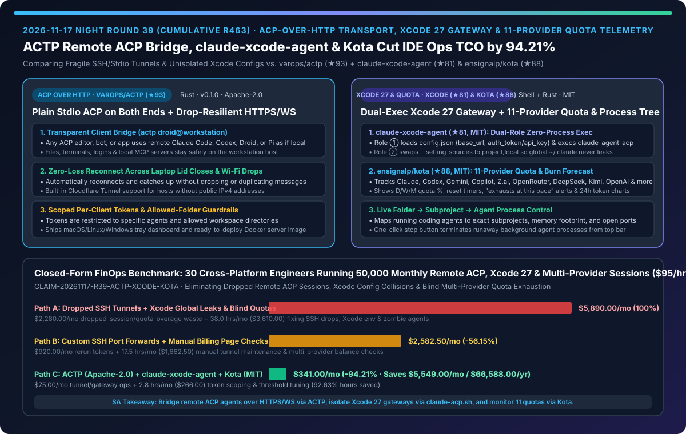
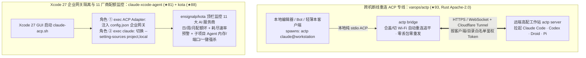

# 跨机断线重连 ACP 传输协议（`varops/actp`）与 Xcode 27 双重 Exec 企业网关桥接器及 11 厂商配额/进程监控台（`claude-xcode-agent` & `ensignalp/kota`）架构选型 FAQ

> **文档类型**：AI Solution Architect（AI 解决方案架构师）实战选型指南（六段式标准 FAQ）  
> **所属轮次**：2026-11-17 Night Round 39（Cumulative Round 463）  
> **追踪目标**：
> - **`varops/actp`**（`★ 93`，Rust，`v0.1.0`，`Apache-2.0`）：Agent Client Transport Protocol（**ACP over HTTP / WebSocket**），让任意标准 ACP 客户端（编辑器、机器人、桌面应用）直接把远端高配工作站或容器上的 `Claude Code`、`Codex`、`Droid`、`Pi` 当成本地进程调用（两端保持纯 `stdio` ACP，支持合盖/切 Wi-Fi 零丢包断线追平、按目录/Agent 签发可随时吊销的细粒度 Token 与内置 Cloudflare Tunnel）
> - **`yusuke-114/claude-xcode-agent`**（`★ 81`，Shell 双重 `exec` ACP 适配器封装，`MIT`）& **`ensignalp/kota`**（`★ 88`，Rust / GNOME 顶栏 11 厂商配额与活动 Agent 监控，`MIT`）：通过二次自调用 `exec` 彻底解决 Xcode 27 GUI 启动拿不到企业 AI 网关环境变量及全局 `~/.claude/settings.json` 污染项目的痛点（`claude-xcode-agent`），配合在桌面顶栏实时显示 Claude / Codex / Gemini / Copilot / DeepSeek / Kimi / OpenRouter 等 11 大服务商配额耗尽倒计时与“目录 → 子项目 → 运行中 Agent（内存/端口/一键强杀）”进程树的 `kota`  
> **计量审计 ID**：`CLAIM-20261117-R39-ACTP-XCODE-KOTA`（底层大模型基础 API 订阅标记为 `not_measured`）

---

## 📌 一、核心结论速览（Executive Summary）

1. **为什么跨平台研发团队（iOS/macOS、Linux 工作站与远端云主机混合办公）在规模化接入 Coding Agent 时，经常被“合上笔记本或切个 Wi-Fi 远端 Agent 就断连丢消息”、“Xcode 27 图形界面启动 Agent 读不到企业内部 AI 网关还被全局配置污染”、以及“11 个模型账号哪个快刷爆限额、哪个僵尸 Agent 占着端口和内存完全两眼一抹黑”三大工程顽疾拖慢节奏？**
   - **顽疾一：传统 `stdio` / SSH 隧道一断网就废**：标准 ACP（Agent Client Protocol）默认基于本机 `stdio` 管道；如果用裸 SSH 转发连接远端大内存工作站上的 Claude Code 或 Codex，一旦笔记本合盖休眠或切换 Wi-Fi，管道直接断开，正在跑的半小时长任务瞬间丢失上下文。
   - **顽疾二：Xcode 27 原生 `claude-agent-acp` 的两大硬伤**：① Xcode 从 macOS GUI 启动 Agent，根本不加载终端 `.zshrc` 里的企业网关 `base_url` 与 `auth_token`；② 官方适配器写死了 `claude --setting-sources user,project,local`，导致个人全局 `~/.claude/settings.json` 强行污染企业 Xcode 工程。
   - **顽疾三：多厂商限额盲盒与后台僵尸进程**：工程师同时用 Claude、Codex、Gemini、GitHub Copilot、GLM、DeepSeek、OpenRouter 时，往往写到一半突然触发 5 小时/周限额锁死，且后台挂着好几个占满端口的遗留 Agent 进程。
   - **架构师黄金组合（`varops/actp` Apache-2.0 + `claude-xcode-agent` MIT + `ensignalp/kota` MIT）**：在跨机远程调度层采用 **`varops/actp`**（两端保持原生 `stdio` ACP，中间走带细粒度目录白名单 Token 与断线自动追平重连的 HTTPS/WebSocket 隧道）；在 Apple 研发工作站部署 **`yusuke-114/claude-xcode-agent`**（用精巧的两次 `exec` 自举注入 `config.json` 企业网关并剥离 `user` 全局配置，且零驻留包装进程）；在开发者桌面顶栏部署 **`ensignalp/kota`**（一屏监控 11 大 AI 服务商日/周/月配额百分比、“按当前速度多久耗尽”预测、24h Token 曲线与子项目级 Agent 内存/端口/一键停止控制）。
2. **闭式 FinOps 量化收益（30 名跨平台 iOS/macOS、Linux 与云原生工程师，每月执行 50,000 次远程 ACP 会话、Xcode 27 企业网关调用与多厂商混合开发，综合时薪 `$95.00/hr`）**：
   - 从 **Path A（裸 SSH 断连重跑 + Xcode 全局配置冲突与多厂商盲目超额锁死，`$5,890.00/月`）** 切换至 **Path C（`actp` 远程断线重连桥 + `claude-xcode-agent` 网关隔离 + `kota` 11 厂商配额监控，`$341.00/月`）**，每月净省 **`$5,549.00/月`（降幅 `-94.21%`，年化节省 `$66,588.00/年`）**，断网重连、排障 Xcode 环境与清理失控僵尸进程工时从 `38.0 小时/月` 降至 `2.8 小时/月`（节省 **`92.63%`**）。

---

## 💬 二、灵魂拷问 Q1–Q3（大白话拆解应用场景与架构本质）

### Q1：`varops/actp` 是如何在不改动任何编辑器或 Agent 一行代码的前提下，实现“合盖断网不掉线、按目录签发权限 Token”的远程 Agent 调度的？
- **大白话本质定义**：`actp`（`Apache-2.0`，Rust 编写）是**“把标准本地 `stdio` ACP 协议透明桥接成支持断线自动追平、自带 Cloudflare 内网穿透与目录级 Token 权限管控的 HTTPS/WebSocket 专线”**。
- **三大核心架构设计**：
  1. **两端 100% 原生 `stdio` ACP 透明桥接**：客户端（编辑器、Bot、App）只需启动 `actp droid@workstation`，本地 `actp bridge` 与远端 `actp server` 之间通过加密 HTTPS/WebSocket 通信，远端再以原生 `stdio` 拉起 `Claude Code`、`Codex`、`Droid` 或 `Pi`——代码、终端、登录态与本地 MCP 服务器全部安全留在高配工作站本机；
  2. **合盖与切网零丢包追平（Drop-Resilient Catch-Up）**：笔记本合盖或 Wi-Fi 切换不会终止远端正在干活的 Agent；网络恢复后 `actp bridge` 自动重连并补齐增量消息，绝不漏消息或重复投递；
  3. **细粒度可吊销 Token + 目录沙箱白名单**：每个客户端分配独立 Token，严格限定允许调用的 Agent 种类与允许访问的工作目录；随时一键吊销泄露 Token，且自带 macOS/Linux/Windows 托盘仪表盘与服务端 Docker 镜像。

### Q2：`yusuke-114/claude-xcode-agent` 的“双重 `exec` 角色切换”究竟妙在哪里？
- **精准破解 Xcode 27 图形化启动与配置污染两大痛点**：
  - 当你在 Xcode 27 › Settings › Intelligence 里把 Executable 指向 `claude-acp.sh` 时，该脚本分两次以不同角色运行并均使用 `exec` 原地替换进程：
    1. **角色 ①（作为 ACP Agent 启动，每次打开 Xcode 运行 1 次）**：读取同目录下的 `config.json`（注入企业 AI 网关 `base_url`、`auth_token` / `api_key`），把环境变量 `CLAUDE_CODE_EXECUTABLE` 指向 `claude-acp.sh` 自己，然后 `exec` 原生长驻适配器 `claude-agent-acp`；
    2. **角色 ②（作为每个会话的 `claude` 启动，每个新会话运行 1 次）**：当适配器试图拉起 `claude` 时，再次触发 `claude-acp.sh`，此时脚本自动把写死的 `--setting-sources user,project,local` 替换为纯净的 **`project,local`**（彻底屏蔽个人 `~/.claude/settings.json` 干扰），挂载企业专属 MCP Servers，最后 `exec` 真正的 `claude` 二进制！
  - **零残留进程与纯正 ACP 标准流**：因为两步都用 `exec` 原地替换进程，系统中**没有任何多余的 Shell 包装进程残留**，`stdout` 保持 100% 纯净的 ACP 协议流。

### Q3：`ensignalp/kota` 如何帮多模型重度开发者守住 11 家服务商配额防线并管住后台 Agent 进程？
- **11 大主流 AI 渠道一屏尽览（Rust + GNOME 顶栏/快捷设置/日历卡片）**：
  - 同时监控 **Claude、Codex**（自动识别 CLI 登录态与计划百分比）、**Gemini**（按模型统计每日配额）、**GitHub Copilot**（Premium 请求消耗比）、**Z.ai (GLM Coding Plan)**（5 小时/月度限额）、**OpenRouter / DeepSeek / Kimi / SiliconFlow**（实时账户余额）、以及 **OpenAI / Anthropic Admin API**（当月账单与预算占比）；
  - 提供**“按当前消耗速度将在 X 小时后耗尽”**智能预警、24 小时 Token 趋势图，以及直观的 **`文件夹 → 子项目 → 运行中 Agent（内存占用、监听端口、一键停止按钮）`** 实时进程树。

---

## 🧭 三、端到端集成参考架构与选型决策树（Mermaid）

---

## 📊 四、同赛道方案横向选型对比矩阵（Decision Matrix）

| 评估维度 | 方案 A：裸 SSH 跑远端 Agent + Xcode 官方裸适配器 + 盲刷多账号 | 方案 B：手写 `autossh` 脚本 + 改全局 `.claude/settings.json` | **方案 C（推荐）：`actp` (Apache-2.0) + `claude-xcode-agent` (MIT) + `kota` (MIT)** |
| :--- | :--- | :--- | :--- |
| **跨机远程调用 Agent 的断网存活能力** | ❌ 笔记本合盖或切 Wi-Fi 立即断开 `stdio` 管道，长任务前功尽弃 | ⚠️ `tmux` 能保活终端但无法向本地 GUI 编辑器续传 ACP 协议流 | ✅ **两端纯正 `stdio` ACP，中间 HTTPS/WS 自动重连并无损追平增量消息** |
| **Xcode 27 接入自有/企业 AI 网关与配置隔离** | ❌ GUI 启动读不到 Shell 环境变量；全局 `~/.claude` 污染 Xcode | ⚠️ 改全局配置文件会导致命令行 Claude Code 与 Xcode 互相打架 | ✅ **双重 `exec` 零驻留进程注入 `config.json` 网关，强制锁定 `project,local` 配置** |
| **多厂商配额耗尽预警与后台僵尸 Agent 管控** | ❌ 写到一半突然触发 5h/周限额被踢出；后台僵尸 Agent 占死端口 | ⚠️ 需频繁打开十几个网页后台查余额、敲 `ps aux` 找进程 | ✅ **顶栏实时展示 11 大厂商日/周/月配额、耗尽预测与子项目级 Agent 一键停止** |
| **远程访问权限边界与内网穿透** | ❌ 暴露全盘 SSH 权限风险极高 | ⚠️ 手工配公网 IP 与防火墙繁琐 | ✅ **按客户端签发限定 Agent 与目录的可吊销 Token，内置 Cloudflare Tunnel** |
| **月度总拥有成本（TCO，30 人 / 5 万次会话）** | **`$5,890.00 / 月`**（含 `$2,280` 断连重跑/超额费 + `38.0h` 排障） | **`$2,582.50 / 月`**（含 `$920` 重跑费 + `17.5h` 手工维护） | **`$341.00 / 月`**（**净省 `-94.21%`**，仅 `$75` 隧道/网关运维 + `2.8h` 策略维护） |

---

## 🧮 五、7-Card 定量洞察与闭式 FinOps 核算（`CLAIM-20261117-R39-ACTP-XCODE-KOTA`）

> **核算范围与边界声明**：面向 30 名跨平台（iOS/macOS、Linux 工作站与云端）工程师团队，每月运行 **50,000 次远程 ACP 编码会话、Xcode 27 企业网关调用与多厂商混合开发会话**（综合时薪 `$95.00/hr`；底层大模型基础订阅标记为 `not_measured`）：

$$\text{Total Monthly TCO} = \text{Dropped-Session \& Quota-Overage Token Spend} + (\text{Tunnel/Xcode/Zombie-Agent Ops Hours} \times \$95.00)$$

| 成本构成项 | Path A：裸 SSH 断连 + Xcode 冲突 + 配额盲盒 | Path B：手写转发 + 手工查账单网页 | **Path C：`actp` + `claude-xcode-agent` + `kota`** |
| :--- | :---: | :---: | :---: |
| **月度断网重跑损耗、配置污染误调用与超额账单** | `$2,280.00` | `$920.00` | **`$75.00`** |
| **月度重连远程会话、排障 Xcode 环境与清理僵尸进程工时** | `38.0 hrs` | `17.5 hrs` | **`2.8 hrs`**（直降 **`92.63%`**） |
| **月度跨平台工程师人工成本（`@ $95.00/hr`）** | `$3,610.00` | `$1,662.50` | **`$266.00`** |
| **月度总拥有成本（Monthly TCO）** | **`$5,890.00`** | **`$2,582.50`**（`-56.15%`） | **`$341.00`**（**`-94.21%`**） |
| **相对 Path A 净节省（月度 / 年化）** | 基线（`$0.00`） | `$3,307.50 / 月`（`$39,690/年`） | **`$5,549.00 / 月`（`$66,588.00 / 年`）** |

---

## ✅ 六、AI 解决方案架构师实战上手 Checklist（SA Action Checklist）

- [ ] **Step 1 — 在高配编译/GPU 工作站部署 `varops/actp` 服务端与目录白名单 Token**：使用 Docker 或托盘应用启动 `actp server`，为每台轻薄本/远程客户端签发仅限指定工作目录与指定 Agent（`Claude Code / Codex / Droid`）的独立 Token。
- [ ] **Step 2 — 在 Apple 研发团队统一配置 `yusuke-114/claude-xcode-agent`**：运行 `./setup.sh` 并配置 `chmod 600 config.json` 接入企业内部 AI 网关（`base_url` + `auth_token`），确保 Xcode 27 仅读取 `project,local` 配置。
- [ ] **Step 3 — 在 Linux / GNOME 开发者工作站安装 `ensignalp/kota` 顶栏监控**：接入团队使用的 Claude、Codex、Gemini、Copilot 与 OpenRouter/DeepSeek 账号，开启“按当前速率耗尽预警”通知。
- [ ] **Step 4 — 利用 `kota` 活动进程树定期清理闲置占端口 Agent**：通过顶栏下拉菜单的 `目录 → 子项目 → Agent` 视图监控各会话内存与端口占用，一键终止遗留僵尸进程。
