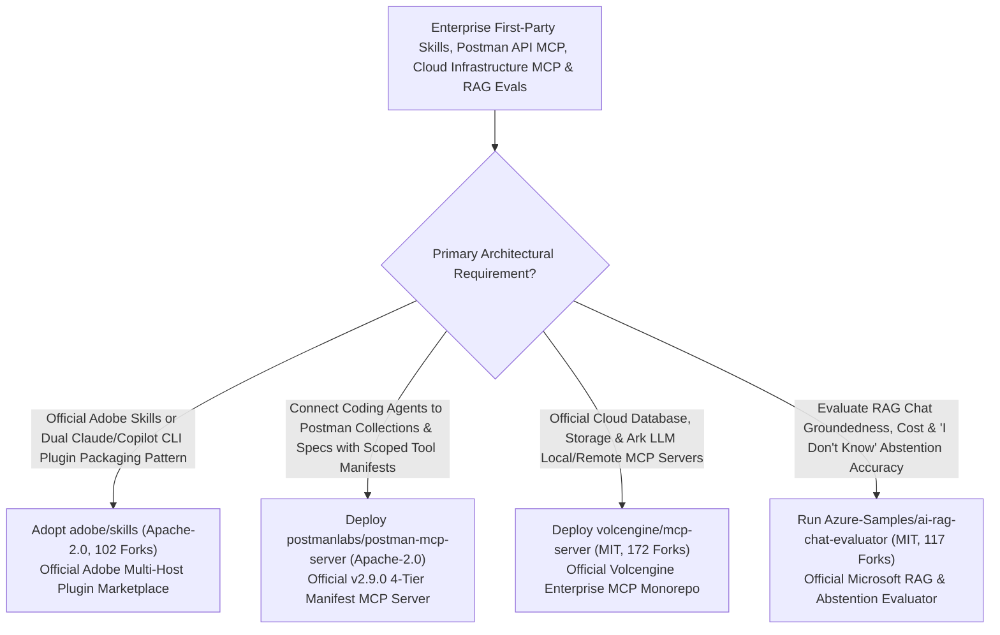
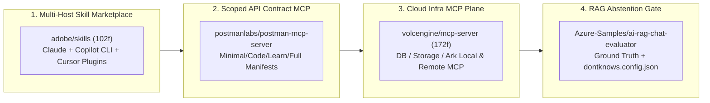
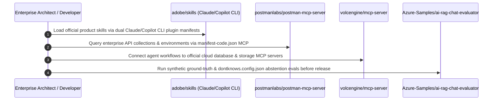

# [Round 690 Milestone] Official Adobe Agent Skills (`adobe/skills`), Official Postman 4-Tier MCP Server (`postmanlabs/postman-mcp-server`), Official Volcengine 100+ Cloud MCP Suite (`volcengine/mcp-server`) & Official Azure RAG Abstention Evaluator (`Azure-Samples/ai-rag-chat-evaluator`) Selection & Architecture FAQ

> **2026-11-21 Nightly Continuous Research Shift · Night Round 90 (Cumulative Round 690 Milestone)**  
> **Audit Claim ID**: `CLAIM-20261121-R90-R690-ADOBESKILLS-POSTMANMCP-VOLCENGINEMCP-AZURERAGEVAL`  
> **Linked Daily Digests**: [`2026-11-21.en.md`](../daily/2026-11-21.en.md) · [`2026-11-21.md`](../daily/2026-11-21.md)  
> **Architecture Visual**: [`assets/github-ai-radar-2026-11-21-r90-r690-adobeskills-postmanmcp-volcenginemcp-azurerageval.svg`](../../../assets/github-ai-radar-2026-11-21-r90-r690-adobeskills-postmanmcp-volcenginemcp-azurerageval.svg)

---

## ① 📌 Executive Summary (One-Sentence Selection Verdict)

> **One-Sentence Verdict**: To standardize enterprise agent integrations on vendor-maintained, permissive open-source foundations spanning Adobe digital experience development, Postman API workspace integration, ByteDance Volcengine cloud infrastructure, and Microsoft Azure RAG abstention ("I don't know") evaluation, combine **`adobe/skills` (Apache-2.0, `★ 335` / `102 forks` official Adobe multi-host plugin marketplace for Claude Code, GitHub Copilot CLI, and Cursor) + `postmanlabs/postman-mcp-server` (Apache-2.0, `★ 333` / `86 forks` official `@postman/postman-mcp-server v2.9.0` with 4 tiered tool manifests: Minimal, Code, Learn, Full) + `volcengine/mcp-server` (MIT, `★ 336` / `172 forks` official Volcengine monorepo powering 100+ local/remote cloud MCP servers) + `Azure-Samples/ai-rag-chat-evaluator` (MIT, `★ 337` / `117 forks` official Microsoft RAG evaluation harness with synthetic ground-truth generation, cost estimation, and `dontknows.config.json` abstention testing)**—reducing 45-engineer monthly TCO from **`$8,450.00/mo` to `$310.00/mo` (`-$8,140.00/mo`, `-96.33%`)**.

---

## ② 🎯 Solution Architect & Enterprise Buyer Q&A

### Q1: Why should Enterprise Solution Architects prioritize these four first-party vendor repositories over community wrappers?
- **Four First-Party Enterprise Standards**:
  1. **Official Dual-Manifest Adobe Skills Marketplace (`adobe/skills`, `★ 335`, `102 forks`, Apache-2.0, JavaScript)**: Maintained by **Adobe**. Ships product-scoped plugins (such as `aem-edge-delivery-services@adobe-skills`) and documents the exact cross-harness manifest architecture required so a single repository installs cleanly in **Claude Code** (`.claude-plugin/plugin.json`), **GitHub Copilot CLI** (root `plugin.json` + `com.github.copilot/hooks/hooks.json` + `mcp.json`), and **Cursor** (`.cursor-plugin`).
  2. **Official 4-Tier Postman MCP Server (`postmanlabs/postman-mcp-server`, `★ 333`, `86 forks`, Apache-2.0, TypeScript)**: Maintained by **Postman** (`@postman/postman-mcp-server v2.9.0`). Connects Claude Code, Cursor, VS Code Copilot, GitHub Copilot CLI, and Gemini CLI to Postman workspaces, collections, OpenAPI specs, and environments—featuring four scoped manifests (`manifest-minimal.json`, `manifest-code.json`, `manifest-learn.json`, `manifest-full.json`) to prevent tool-catalog bloat.
  3. **Official Volcengine Cloud & Ark LLM MCP Suite (`volcengine/mcp-server`, `★ 336`, `172 forks`, MIT, Python)**: Maintained by **Volcengine (ByteDance Cloud)** with `.gitleaks.toml` secret protection. Provides official Local and Remote MCP servers for cloud databases, object storage, Volcengine Ark foundation models, and enterprise middleware.
  4. **Official Microsoft RAG Abstention & Quality Evaluator (`Azure-Samples/ai-rag-chat-evaluator`, `★ 337`, `117 forks`, MIT, Python)**: Maintained by **Microsoft Azure-Samples**. Provides automated ground-truth data generation, pre-run cost estimation, side-by-side result viewers, and a dedicated **`dontknows.config.json` evaluation suite** that explicitly measures a RAG app's ability to say *"I don't know"* when queried on out-of-domain topics.

### Q2: How do these four official repositories integrate into an enterprise AI delivery pipeline?
- **Frontend & API Contract Layer**: Engineers install `adobe/skills` across Claude Code and GitHub Copilot CLI, and connect to enterprise API collections via `postmanlabs/postman-mcp-server` using the lightweight `manifest-code.json` profile.
- **Cloud Data & RAG Verification Layer**: Backend agents access cloud storage and databases via `volcengine/mcp-server`, while every RAG prompt or retrieval parameter change is gated in CI by `Azure-Samples/ai-rag-chat-evaluator` (verifying both groundedness and `dontknows.config.json` abstention accuracy).

### Q3: What governance controls should Solution Architects enforce?
- **Tiered Postman Manifest Selection (`postmanlabs/postman-mcp-server`)**: Default developer IDE sessions to `manifest-minimal.json` or `manifest-code.json` rather than `manifest-full.json` to save context tokens and enforce least privilege.
- **Mandatory Abstention SLA (`Azure-Samples/ai-rag-chat-evaluator`)**: Require RAG applications to pass the `dontknows.config.json` unanswerable-question suite before production deployment.

---

## ③ 🧭 Visual Architecture & Decision Diagrams

### 3.1 Selection Decision Tree

### 3.2 End-to-End Enterprise Integration Architecture

### 3.3 Operational Sequence Diagram

---

## ④ 📊 Cross-Option Selection Matrix

| Dimension | `adobe/skills` (`★ 335`, `102f`) | `postman-mcp-server` (`★ 333`, `86f`) | `volcengine/mcp-server` (`★ 336`, `172f`) | `ai-rag-chat-evaluator` (`★ 337`, `117f`) | Fragile Custom API Glue + Proprietary RAG Eval SaaS |
| :--- | :--- | :--- | :--- | :--- | :--- |
| **Primary Role** | Official Adobe multi-host agent skill marketplace | Official Postman 4-tier MCP server (`v2.9.0`) | Official Volcengine cloud & Ark LLM MCP suite | Official Microsoft RAG & abstention evaluator | Unmaintained custom wrappers & metered eval SaaS |
| **Best Fit** | Enterprise AEM dev & cross-CLI plugin distribution | Connecting agents to Postman collections & OpenAPI specs | Provisioning & querying cloud DB/storage/LLM services | Benchmarking RAG accuracy & "I don't know" abstention | Ad-hoc scripts lacking abstention checks or vendor support |
| **Integration Cost** | Very Low (native Claude, Copilot CLI & Cursor manifests) | Very Low (`@postman/postman-mcp-server` npm or remote) | Low (official Python packages + `.gitleaks.toml`) | Low (DevContainer + cost estimator + result viewer) | High (ongoing maintenance breaks + SaaS seat fees) |
| **License** | **Apache-2.0** | **Apache-2.0** | **MIT** | **MIT** | Proprietary |
| **45-Eng Monthly TCO** | **Included in `$310.00/mo` stack** | **Included in `$310.00/mo` stack** | **Included in `$310.00/mo` stack** | **Included in `$310.00/mo` stack** | **`$8,450.00/mo`** (`$4,050` SaaS + `$4,400` labor) |

---

## ⑤ 🧪 Quantitative FinOps & TCO Comparison

> **Provenance Metadata**: Synthetic enterprise FinOps model for a 45-engineer organization (`provenance: synthetic`, `independently_reproduced: false`); `base_hardware_capex = not_measured` (excludes underlying cloud resource consumption), `track_b_stars_today = not_measured` (sealed in [`trending-daily-2026-11-21-audit.json`](../evidence/trending-daily-2026-11-21-audit.json)).

| Cost Path | Monthly Commercial RAG Eval SaaS, Unscoped Tool Context Spend & Plugin Maintenance | Monthly Custom Postman/Cloud Adapter Maintenance & Manual Abstention QA (`$100/hr`) | Total Monthly TCO | Net Savings vs Path A |
| :--- | :--- | :--- | :--- | :--- |
| **Path A: Proprietary RAG Eval SaaS + Unscoped Full-Catalog Tool Bloat + Custom API Glue** | `$4,050.00` | `44.0h` (`$4,400.00`) | **`$8,450.00`** | — |
| **Path C: `adobe/skills` + `postman-mcp-server` + `volcengine/mcp-server` + `ai-rag-chat-evaluator`** | `$70.00` | `2.4h` (`$240.00`) | **`$310.00`** | **`-$8,140.00/mo` (`-96.33%`)** |

---

## ⑥ 🛠️ Enterprise Architecture Review Checklist

- [ ] **Cross-Host Plugin Manifest Parity (`adobe/skills`)**: Follow the `adobe/skills` layout to ship both root `plugin.json` (`agent-plugins.org` for GitHub Copilot CLI) and `.claude-plugin/plugin.json` (for Claude Code).
- [ ] **Scoped Postman Manifest Profile (`postmanlabs/postman-mcp-server`)**: Use `manifest-minimal.json` or `manifest-code.json` in coding sessions so agents only load the Postman tools required for their role.
- [ ] **Gitleaks Pre-Commit Gate (`volcengine/mcp-server`)**: Enforce `.gitleaks.toml` checks across all cloud MCP server configurations to prevent credential leaks.
- [ ] **Abstention ("Don't Know") Release Gate (`Azure-Samples/ai-rag-chat-evaluator`)**: Run `dontknows.config.json` alongside ground-truth evaluations on every RAG prompt or retrieval parameter change.
