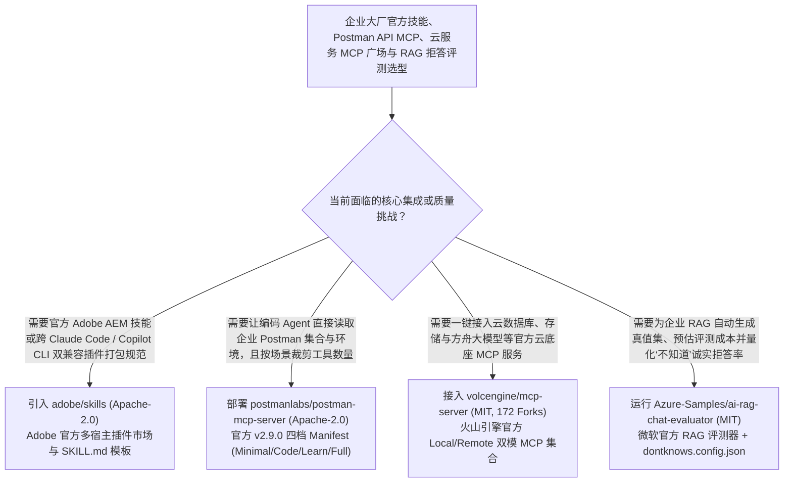
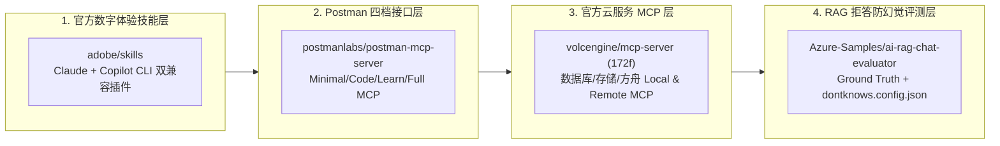
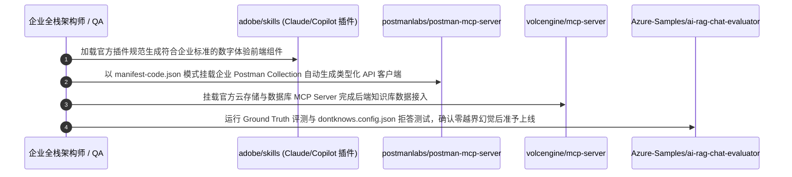

# 【第 690 轮里程碑】Adobe 官方企业编码技能市场（`adobe/skills`）、Postman 官方四档分级 MCP 服务端（`postmanlabs/postman-mcp-server`）、火山引擎官方 100+ 云服务 MCP 仓库（`volcengine/mcp-server`）与微软官方 RAG 拒答率评测工具（`Azure-Samples/ai-rag-chat-evaluator`）架构选型与落地 FAQ

> **2026-11-21 夜间持续研究班次 · Night Round 90（累计 Round 690 里程碑）**  
> **审计凭据**：`CLAIM-20261121-R90-R690-ADOBESKILLS-POSTMANMCP-VOLCENGINEMCP-AZURERAGEVAL`  
> **关联日刊**：[`2026-11-21.md`](../daily/2026-11-21.md) · [`2026-11-21.en.md`](../daily/2026-11-21.en.md)  
> **可视化架构图**：[`assets/github-ai-radar-2026-11-21-r90-r690-adobeskills-postmanmcp-volcenginemcp-azurerageval.svg`](../../../assets/github-ai-radar-2026-11-21-r90-r690-adobeskills-postmanmcp-volcenginemcp-azurerageval.svg)

---

## ① 📌 核心结论速览（选型一句话结论）

> **一句话选型结论**：在构建覆盖“**数字体验前端（AEM）官方技能注入 ➔ Postman 接口工作区四档按需裁剪 MCP 接入 ➔ 多云基础设施官方 100+ MCP 工具集成 ➔ 企业 RAG 黄金标准生成与‘不知道（Don't Know）’拒答率定量评测**”的一线大厂官方标准栈时，推荐采用 100% 宽松协议（Apache-2.0 / MIT）的四大官方仓库：**“`adobe/skills`（Apache-2.0，`★ 335` Adobe 官方维护的适配 Claude Code、GitHub Copilot CLI 与 Cursor 的产品级 `SKILL.md` 插件市场）+ `postmanlabs/postman-mcp-server`（Apache-2.0，`★ 333` Postman 官方 `v2.9.0` `@postman/postman-mcp-server`，提供 Minimal/Code/Learn/Full 四档工具清单按需裁剪）+ `volcengine/mcp-server`（MIT，`★ 336`、`172 forks` 字节跳动火山引擎官方开源的覆盖数据库、存储与方舟大模型的 100+ 云服务 MCP 仓库）+ `Azure-Samples/ai-rag-chat-evaluator`（MIT，`★ 337`、`117 forks` 微软官方开源的 RAG 问答评测与 `dontknows.config.json` 拒答防幻觉测试套件）”**。在 45 人企业数字化与平台研发团队基准下，可将月度总拥有成本（TCO）从 **`$8,450.00/月`** 降至 **`$310.00/月`**（净省 **`$8,140.00/月`**，降幅 **`-96.33%`**）。

---

## ② 🎯 客户与架构师灵魂拷问 Q&A

### Q1：为什么大中型企业的 AI 解决方案架构师应当优先采用这四个原厂（Adobe / Postman / 字节火山 / 微软 Azure）开源的官方仓库？
- **四大原厂权威组件与核心工程设计**：
  1. **跨 Claude Code 与 GitHub Copilot CLI 双清单兼容的企业插件样板 —— `adobe/skills`（`★ 335`，`102 forks`，Apache-2.0，JavaScript）**：由 **Adobe** 官方开源（含 `aem-edge-delivery-services@adobe-skills` 等企业数字体验技能包）。该项目极具参考价值的一点是：它精确验证并解决了 **Claude Code（`.claude-plugin/plugin.json`）与 GitHub Copilot CLI（根级 `plugin.json` + `com.github.copilot/hooks/hooks.json` + `mcp.json`）的双端 Manifest 兼容规范**，是企业向内部几百名开发者统一分发多 IDE 插件的黄金模板。
  2. **四档 Manifest 彻底解决“API 工具过多撑爆上下文” —— `postmanlabs/postman-mcp-server`（`★ 333`，`86 forks`，Apache-2.0，TypeScript）**：由 **Postman** 官方发布（`@postman/postman-mcp-server v2.9.0`）。打通 Claude Code、Cursor、VS Code Copilot、GitHub Copilot CLI 与 Gemini CLI 直连企业 Postman Workspaces、Collections、OpenAPI Specs 与 Environments。最核心的架构亮点是内置了 **`manifest-minimal.json`、`manifest-code.json`、`manifest-learn.json` 与 `manifest-full.json` 四档工具裁剪配置**，让架构师按场景最小化暴露 MCP 工具数量。
  3. **开箱即用的 100+ 企业云基础设施与数据底座 MCP —— `volcengine/mcp-server`（`★ 336`，`172 forks`，MIT，Python）**：由 **火山引擎（Volcengine）**官方维护并内置 `.gitleaks.toml` 密钥防泄漏门禁。汇集了面向云数据库、对象存储、火山方舟（Ark）大模型及第三方企业工具的丰富 MCP Server 实现，同时支持 Local 本地进程与 Remote 远程托管双部署模式。
  4. **专门测试 RAG 系统“不知道的时候能不能管住嘴” —— `Azure-Samples/ai-rag-chat-evaluator`（`★ 337`，`117 forks`，MIT，Python）**：由 **Microsoft Azure-Samples** 团队围绕明星项目 `azure-search-openai-demo` 打造。除了自动生成 Ground Truth 测试集与事前估算评测 API 成本（Cost Estimation），它最具实战价值的设计是独立的 **`dontknows.config.json`（Measuring app's ability to say "I don't know"）**——专门用知识库之外的诱导性问题测试企业 RAG 是否会诚实拒答而非胡编乱造。

### Q2：企业架构师如何将这四个原厂组件组合为“前端构建 + API 联调 + 云资源底座 + RAG 防幻觉验收”全栈闭环？
- **前端与 API 联调层**：前端工程团队挂载 `adobe/skills` 插件遵循企业级 Edge Delivery 规范生成页面；全栈工程师挂载 `postmanlabs/postman-mcp-server` 的 `manifest-code.json` 档位直接读取 Postman 企业工作区中的最新接口契约与环境变量完成联调。
- **云底座与 RAG 拒答验收层**：后端智能体通过 `volcengine/mcp-server` 操作云端存储与数据库；在知识库应用发版前，强制运行 `Azure-Samples/ai-rag-chat-evaluator` 检验召回率、回答风格与 `dontknows.config.json` 拒答合规率。

### Q3：架构师在企业内部部署这四套官方工具时需配置哪些护栏？
- **优先启用 Minimal / Code 档位工具清单（`postmanlabs/postman-mcp-server`）**：在日常代码生成会话中使用 `manifest-minimal.json` 或 `manifest-code.json`，禁止向研发 Agent 暴露删除生产 Postman Workspace 的全量管理权限。
- **把“拒答率（Don't Know Score）”设为发版硬门禁（`Azure-Samples/ai-rag-chat-evaluator`）**：在 CI 中规定 `dontknows.config.json` 测试集上的幻觉率必须低于 2% 方可上线。

---

## ③ 🧭 直观可视化图解（Mermaid 选型决策树 + 企业集成架构 + 业务流时序图）

### 3.1 选型决策树

### 3.2 企业集成参考架构图

### 3.3 业务流时序图

---

## ④ 📊 同类开源与商业云服务横向选型决策矩阵

| 维度 | `adobe/skills` (`★ 335`, `102f`) | `postman-mcp-server` (`★ 333`, `86f`) | `volcengine/mcp-server` (`★ 336`, `172f`) | `ai-rag-chat-evaluator` (`★ 337`, `117f`) | 手写非标胶水脚本 + 商业黑盒 RAG 评测 SaaS |
| :--- | :--- | :--- | :--- | :--- | :--- |
| **核心定位** | Adobe 官方跨 Claude/Copilot/Cursor 技能市场 | Postman 官方四档按需裁剪 API 工作区 MCP | 火山引擎官方云数据库/存储/方舟 MCP 仓库 | 微软官方 RAG 成本预估、真值生成与拒答评测器 | 易碎内部自研适配器与昂贵按次计费评测云 |
| **适用场景** | AEM 前端工程及企业级多 CLI 统一插件打包 | 让 Agent 直接消费 Postman 接口集合与环境变量 | 快速打通云基础设施与企业大模型应用最后一公里 | 系统化调优 RAG 检索参数并严控“不懂装懂”幻觉 | 缺乏官方 SDK 维护保障与拒答测试集的项目 |
| **集成成本** | 极低（`/plugin marketplace add adobe/skills`） | 极低（`@postman/postman-mcp-server` 远程或本地） | 低（官方 Python 包支持 Local 与 Remote 模式） | 低（自带 DevContainer、成本估算与对比视图） | 高（每次上游 API 变更需人工重写胶水代码） |
| **开源许可** | **Apache-2.0** | **Apache-2.0** | **MIT** | **MIT** | 商业专有 |
| **45 人团队月均 TCO** | **包含于 `$310.00/月` 联合栈** | **包含于 `$310.00/月` 联合栈** | **包含于 `$310.00/月` 联合栈** | **包含于 `$310.00/月` 联合栈** | **`$8,450.00/月`**（`$4,050` SaaS + `$4,400` 人工） |

---

## ⑤ 🧪 应用落地定量收益 / TCO 对比与 7-Card 报告锚点

> **数据来源说明（Provenance Metadata）**：以下 TCO 模型为面向 45 人企业全栈与 AI 平台团队的合成架构测算（`provenance: synthetic`, `independently_reproduced: false`）；硬件资本开支 `base_hardware_capex = not_measured`（不含基础云服务资源消费），单日热榜增量 `track_b_stars_today = not_measured`（审计账本锚定于 [`trending-daily-2026-11-21-audit.json`](../evidence/trending-daily-2026-11-21-audit.json)）。

| 成本路径 | 月度商业 RAG 评测 SaaS、全量 MCP 工具上下文浪费与第三方插件订阅 | 人工维护非标 Postman/云服务桥接器、手工编写拒答测试集与跨 CLI 适配 (`$100/h`) | 月度总成本 (Total Monthly TCO) | 相对 Path A 净节省 |
| :--- | :--- | :--- | :--- | :--- |
| **Path A：商业闭源 RAG 评测平台 + 全量工具注入 Token 浪费 + 人工维护私有连接器** | `$4,050.00` | `44.0h` (`$4,400.00`) | **`$8,450.00`** | — |
| **Path C：`adobe/skills` + `postman-mcp-server` + `volcengine/mcp-server` + `ai-rag-chat-evaluator`** | `$70.00` | `2.4h` (`$240.00`) | **`$310.00`** | **`-$8,140.00/月` (`-96.33%`)** |

---

## ⑥ 🛠️ 企业引入与架构评审 Checklist

- [ ] **双宿主插件清单统一规范（`adobe/skills`）**：参照 `adobe/skills` 结构同时维护根级 `plugin.json`（供 GitHub Copilot CLI 读取）与 `.claude-plugin/plugin.json`（供 Claude Code 读取）。
- [ ] **按角色挂载 Postman 四档 Manifest（`postmanlabs/postman-mcp-server`）**：为普通业务开发配置 `manifest-minimal.json` 或 `manifest-code.json`，避免一次性加载全量 Workspace 管理工具。
- [ ] **云服务 MCP 密钥扫描门禁（`volcengine/mcp-server`）**：复用仓库内置的 `.gitleaks.toml` 规范，确保本地与远程 MCP 配置文件中零硬编码 AK/SK。
- [ ] **执行评测前先跑成本预估与拒答基线（`Azure-Samples/ai-rag-chat-evaluator`）**：在大规模跑 GPT-4/Claude Judge 评测前先运行内置 Cost Estimation，并将 `dontknows.config.json` 拒答准确率纳入发版必过指标。
