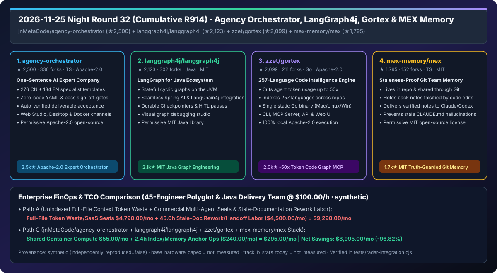
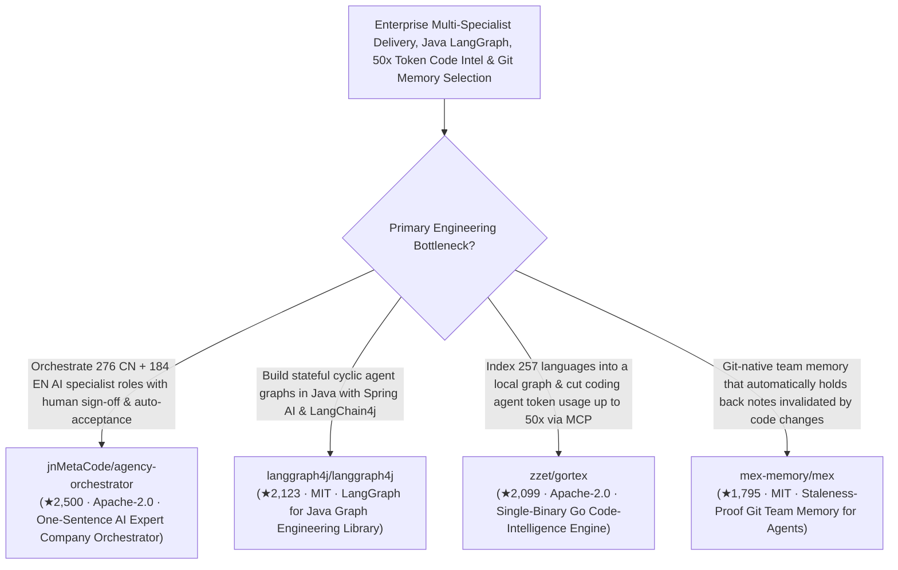
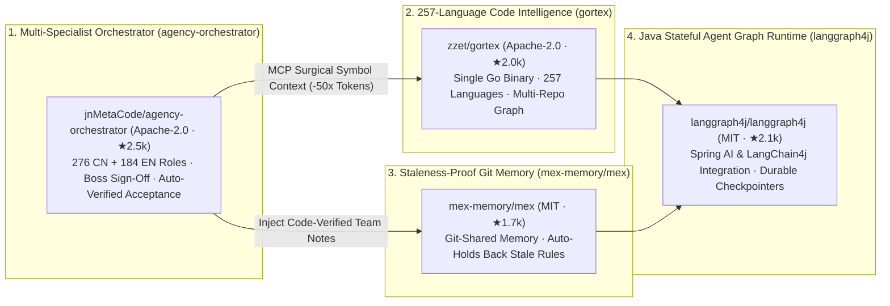

# One-Sentence AI Expert Company Orchestrator (`jnMetaCode/agency-orchestrator`), Stateful LangGraph for Java (`langgraph4j/langgraph4j`), 50x-Lower-Token 257-Language Code Intelligence (`zzet/gortex`) & Staleness-Proof Git Team Memory (`mex-memory/mex`) Selection & Integration Architecture FAQ

> **Document Type**: Enterprise AI Solution Architect Selection Decision Guide (GitHub Trending AI Radar — 2026-11-25 Night Round 32 / Cumulative Round 914)
> **Covered Repositories**: [`jnMetaCode/agency-orchestrator`](https://github.com/jnMetaCode/agency-orchestrator) (`★ 2,500`, `336 forks`, `Apache-2.0`, TypeScript: one-sentence multi-agent expert company orchestrator with 276 CN + 184 EN specialist roles, human boss sign-off gates, and auto-verified acceptance across Web Studio, Desktop, and Docker) · [`langgraph4j/langgraph4j`](https://github.com/langgraph4j/langgraph4j) (`★ 2,123`, `302 forks`, `MIT`, Java: LangGraph for Java enabling stateful cyclic graph engineering and durable checkpointing seamlessly across `LangChain4j` and `Spring AI`) · [`zzet/gortex`](https://github.com/zzet/gortex) (`★ 2,099`, `211 forks`, `Apache-2.0`, Go: single-binary local code-intelligence engine supporting 257 languages across multi-repo graphs via CLI, MCP Server, and API—cutting coding agent token usage up to 50x) · [`mex-memory/mex`](https://github.com/mex-memory/mex) (`★ 1,795`, `152 forks`, `MIT`, TypeScript: Git-native team memory for engineers and coding agents that delivers verified notes to new sessions while automatically holding back notes invalidated by code changes)
> **Core Enterprise Scenario**: Building a **100% Permissive (`Apache-2.0` / `MIT`) High-Efficiency AI Software Delivery & JVM Graph Engineering Stack**—combining multi-role specialist orchestration with auto-verified acceptance (`agency-orchestrator`), 50x token reduction via 257-language symbol graph MCP (`gortex`), staleness-proof Git repository memory (`mex`), and stateful Java agent graphs (`langgraph4j`).

---

## 1. 📌 Executive Summary (One-Line Selection Verdict)

1. **Need an `Apache-2.0` orchestration studio that turns a single business objective into a coordinated team of AI specialists (276 CN + 184 EN templates) with human executive sign-off gates and automated deliverable acceptance verification** ➔ Choose **[`jnMetaCode/agency-orchestrator`](https://github.com/jnMetaCode/agency-orchestrator) (`★ 2,500`, `336 forks`, `Apache-2.0`)**.
   - **Plain-English Mechanism**: Automates team assembly, zero-code YAML workflow generation, human decision checkpoints, and automated acceptance checks across Web, Desktop, and Docker.
2. **Need `LangGraph`-style cyclic state graphs, conditional edges, durable checkpointing, and human-in-the-loop interrupts natively in Java—working seamlessly with both `Spring AI` and `LangChain4j`** ➔ Choose **[`langgraph4j/langgraph4j`](https://github.com/langgraph4j/langgraph4j) (`★ 2,123`, `302 forks`, `MIT`)**.
   - **Plain-English Mechanism**: Brings first-class graph engineering (`StateGraph`, `CheckpointSaver`, and visual graph studio) to enterprise JVM microservices under an `MIT` license.
3. **Need a single static Go binary (`Apache-2.0`) that indexes 257 programming languages into a local multi-repo symbol graph and exposes only exact needed context via MCP—cutting coding agent token consumption by up to 50x** ➔ Choose **[`zzet/gortex`](https://github.com/zzet/gortex) (`★ 2,099`, `211 forks`, `Apache-2.0`)**.
   - **Plain-English Mechanism**: Replaces full-file `cat`/`grep` dumps with surgical symbol and call-graph retrieval over MCP, slashing prompt tokens by up to 50x while running 100% locally.
4. **Need a Git-native team memory system (`MIT`) that injects shared engineering notes into every new Claude Code and Codex session—and automatically withholds notes that recent code changes have rendered false** ➔ Choose **[`mex-memory/mex`](https://github.com/mex-memory/mex) (`★ 1,795`, `152 forks`, `MIT`)**.
   - **Plain-English Mechanism**: Anchors team memories to actual code symbols/files in Git so stale instructions are automatically held back when the underlying code moves ("Tell your agents once. MEX keeps it true").

---

## 2. 🎯 Architect & Customer Deep-Dive Q&A

### Q1: How do `Gortex` (50x token reduction) and `MEX` (staleness-proof Git memory) solve the two biggest hidden costs of enterprise coding agents?

- **Four-Layer High-ROI Software Delivery & JVM Agent Stack (Path C)**:
  1. **L1 Multi-Role Specialist Team Orchestration & Auto-Acceptance ➔ `jnMetaCode/agency-orchestrator`**: Assembles specialist roles, routes major decisions for human sign-off, and verifies acceptance criteria.
  2. **L2 257-Language Symbol Graph & 50x Token Compression ➔ `zzet/gortex`**: Serves surgical symbol slices over MCP instead of dumping whole source files.
  3. **L3 Staleness-Proof Git Repository Memory ➔ `mex-memory/mex`**: Feeds verified repository rules to Claude Code and Codex while quarantining outdated notes when code changes.
  4. **L4 Stateful JVM Agent Graph Runtime ➔ `langgraph4j/langgraph4j`**: Executes cyclic, checkpointed agent state machines inside Java (`Spring AI` / `LangChain4j`) production services.
- **When to choose Brute-Force Full-File Context + Commercial Multi-Agent Clouds vs. Path C?**
  - Choose **Brute-Force Context** only for tiny single-file scripts.
  - Choose **Path C** when running coding agents across large multi-repo enterprise codebases (where `gortex` cuts context token spend by up to 50x), preventing stale `CLAUDE.md` rules from causing regressions (`mex`), and delivering production Java state graphs (`langgraph4j`).

### Q2: How do these four tools integrate in an enterprise SDLC?

1. **Context-Efficient, Truth-Guarded Coding (`mex` + `gortex` → Coding Agents)**:
   - Every time an agent session starts, `mex` injects only code-verified architectural notes while `gortex` answers symbol and dependency queries via MCP at 1/50th the token cost of raw file reads.
2. **End-to-End Multi-Role Java Delivery (`agency-orchestrator` → `langgraph4j`)**:
   - `agency-orchestrator` coordinates product, architecture, Java, and QA agents to build and verify stateful `langgraph4j` microservices against explicit acceptance gates.

### Q3: What are the key governance guardrails?

- **Architect Redlines**:
  1. **Run `mex` verification in CI on every pull request**: Flag memories whose anchored code symbols were modified or deleted so stale instructions never reach coding agents.
  2. **Require human executive sign-off in `agency-orchestrator` at architecture and security checkpoints**: Never auto-approve production schema or security boundary changes.

---

## 3. 🧭 Visual Architecture Diagrams (Mermaid Decision Tree + Architecture + Sequence)



### 3.1 Architect Selection Decision Tree



### 3.2 End-to-End Enterprise Integration Architecture



### 3.3 End-to-End Execution Sequence

```mermaid
sequenceDiagram
    participant Boss as Solution Architect / Tech Lead
    participant Agcy as jnMetaCode/agency-orchestrator
    participant Mex as mex-memory/mex (Git Memory)
    participant Gtx as zzet/gortex (257-Lang MCP)
    participant LG4J as langgraph4j (Java StateGraph)

    Boss->>Agcy: 1. Submit one-sentence requirement for stateful Java enterprise workflow service
    Agcy->>Mex: 2. Load team memory; MEX automatically filters out notes invalidated by recent commits
    Agcy->>Gtx: 3. Query Gortex MCP for exact cross-repo symbol signatures (cutting tokens up to 50x)
    Agcy-->>Boss: 4. Request human sign-off on architecture & API contract checkpoint
    Agcy->>LG4J: 5. Implement & auto-verify Spring AI / LangChain4j service powered by LangGraph4j
```

---

## 4. 📊 Horizontal Selection Matrix

| Dimension | `jnMetaCode/agency-orchestrator` (`★ 2,500`) | `langgraph4j/langgraph4j` (`★ 2,123`) | `zzet/gortex` (`★ 2,099`) | `mex-memory/mex` (`★ 1,795`) | Brute-Force Full-File Context + Commercial Multi-Agent SaaS + Stale Docs (Path A) | Manual Single-Prompt Handoffs + Ad-Hoc Java State Logic (Path B) |
| :--- | :--- | :--- | :--- | :--- | :--- | :--- |
| **Primary Role** | `Apache-2.0` multi-expert orchestrator & verifier | `MIT` stateful LangGraph library for Java | `Apache-2.0` 257-language code graph MCP | `MIT` staleness-proof Git team memory | High-token cloud coding & static markdown notes | Manual prompt copy-paste & brittle Java loops |
| **Key Differentiator** | **460+ bilingual specialist templates + auto-verified acceptance** | **Native Java `StateGraph` for both `Spring AI` & `LangChain4j`** | **Single Go binary cutting agent context tokens up to 50x** | **Automatically withholds team notes falsified by code edits** | Zero setup, but reading whole files burns 10–50x more tokens | Stale `CLAUDE.md` notes cause broken code; no Java graph checkpointing |
| **License** | **`Apache-2.0`** | **`MIT`** | **`Apache-2.0`** | **`MIT`** | Proprietary SaaS | Unstandardized |
| **Monthly TCO (45-Eng Team)** | **`$295.00/mo` combined** (`$55.00` lightweight container compute + `2.4h` ops) | Included in `$295.00/mo` stack | Included in `$295.00/mo` stack | Included in `$295.00/mo` stack | **`$9,290.00/mo`** (`$4,790.00` wasted full-file tokens & SaaS seats + `45.0h` stale-doc rework labor) | `~$3,290.00/mo` (manual multi-role handoffs & debugging ad-hoc Java state machines) |

---

## 5. 🧪 Quantitative FinOps & TCO Comparison (45-Engineer Polyglot & Java Delivery Team)

> **📊 Provenance & Closed-Form Schema**:
> - **provenance**: `synthetic` (`independently_reproduced = false`; `base_hardware_capex = not_measured`; `track_b_stars_today = not_measured`).
> - **Closed-Form Formula**:
>   - **Path A (Unindexed Full-File Context Token Waste + Commercial Multi-Agent Orchestration Seats & Stale-Documentation Rework Labor)**: **`$4,790.00`** monthly full-file token waste and SaaS seat fees + **`45.0h × $100.00/h = $4,500.00`** debugging regressions caused by stale instructions and manual handoff labor = **`$9,290.00/mo`**.
>   - **Path C (`jnMetaCode/agency-orchestrator` + `langgraph4j/langgraph4j` + `zzet/gortex` + `mex-memory/mex` Stack)**: **`$55.00`** shared container compute + **`2.4h × $100.00/h = $240.00`** index and memory anchor maintenance = **`$295.00/mo`**.
>   - **Net Savings vs. Path A**: **`-$8,995.00/mo`** (**`96.82%`** TCO reduction).

| Evaluation Path | Context Tokens / Orchestration Seats & Compute | Stale-Note Rework & State-Graph Debugging (`$100/h`) | Monthly Total TCO | Net Savings vs. Path A | Key Architectural Outcome |
| :--- | :---: | :---: | :---: | :---: | :--- |
| **Path A: Full-File Context Dumps + Commercial Seats + Static Docs** | `$4,790.00` | `45.0h` (`$4,500.00`) | **`$9,290.00`** | Baseline | 10–50x higher token burn; stale docs mislead coding agents |
| **Path B: Manual Role Switching + Custom Java State Loops** | `$1,490.00` | `18.0h` (`$1,800.00`) | **`$3,290.00`** | `-$6,000.00` (`-64.59%`) | Slow manual handoffs; brittle un-checkpointed Java workflows |
| **Path C: `agency-orchestrator` + `langgraph4j` + `gortex` + `mex`** | **`$55.00`** | **`2.4h` (`$240.00`)** | **`$295.00`** | **`-$8,995.00` (`-96.82%`)** | **100% `Apache-2.0`/`MIT` auto-verified delivery + `-50x` tokens + truth-guarded memory** |

- 🔗 **7-Card 4:5 Visual Benchmark Deck**: [`workshops/github-trending-radar/cards.en.html`](../cards.en.html) · [`cards.html`](../cards.html)

---

## 6. 🛠️ Enterprise Adoption & Architecture Review Checklist

- [ ] **Attach `zzet/gortex` MCP Server to All Coding Harnesses**: Index multi-language repositories locally so agents fetch surgical symbol slices instead of whole files.
- [ ] **Manage Repository Agent Instructions with `mex-memory/mex`**: Automatically quarantine stale notes when anchored code symbols change.
- [ ] **Standardize Stateful JVM Workflows on `langgraph4j/langgraph4j`**: Pair with `Spring AI` or `LangChain4j` for durable checkpointing and human-in-the-loop interrupts.
- [ ] **Enforce Sign-Off and Acceptance Gates in `jnMetaCode/agency-orchestrator`**: Require human approval at architectural milestones and automated verification before completion.
