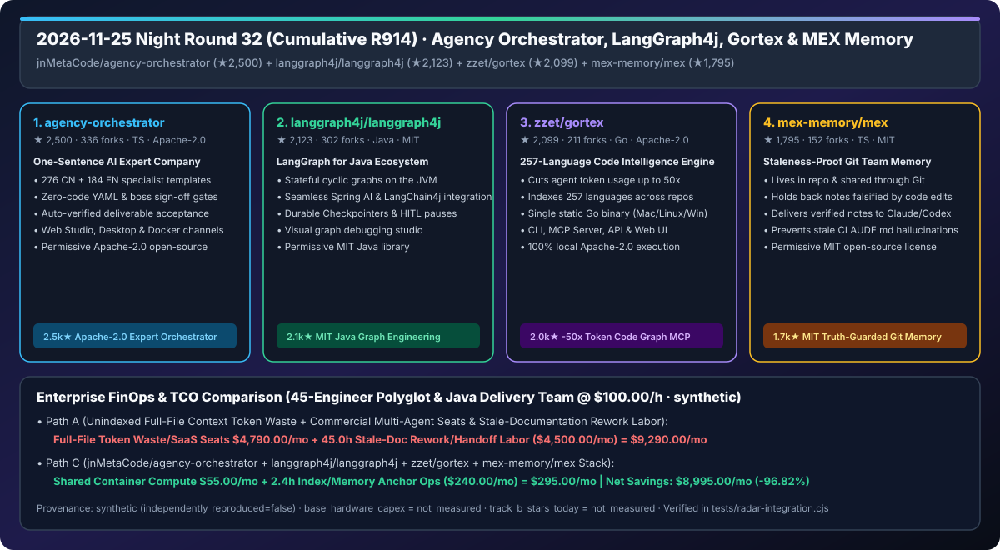
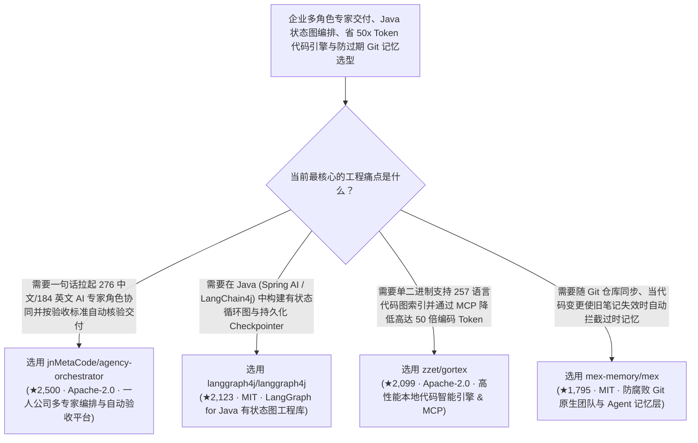
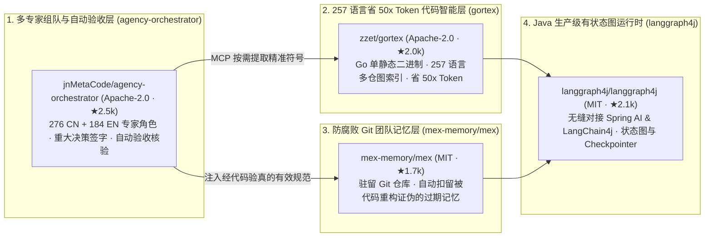
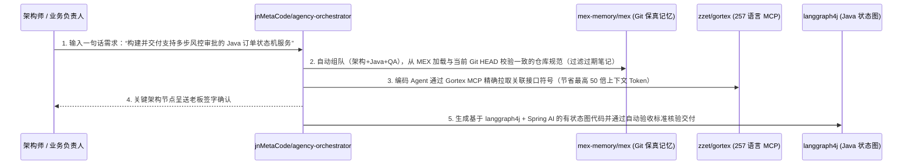

# “一人公司”AI 专家团队自动编排与验收平台（`jnMetaCode/agency-orchestrator`）、Java 生态有状态智能体图工程库（`langgraph4j/langgraph4j`）、省 50 倍 Token 的 257 语言代码智能引擎（`zzet/gortex`）与随代码变更自动防腐败的 Git 团队记忆层（`mex-memory/mex`）选型与集成架构 FAQ

> **文档类型**：企业 AI 解决方案架构师（AI Solution Architect）选型决策指南（GitHub Trending AI 雷达 2026-11-25 Night Round 32 / 累计第 914 轮）
> **覆盖项目**：[`jnMetaCode/agency-orchestrator`](https://github.com/jnMetaCode/agency-orchestrator)（`★ 2,500`、`336 forks`、`Apache-2.0`：一句话组建“一人公司”AI 专家团队的开源编排平台，内置 276 中文 + 184 英文角色模板、重大决策老板签字与自动验收核验）· [`langgraph4j/langgraph4j`](https://github.com/langgraph4j/langgraph4j)（`★ 2,123`、`302 forks`、`MIT`：专为 Java 生态打造的有状态图工程库 [LangGraph for Java]，无缝集成 `LangChain4j` 与 `Spring AI`）· [`zzet/gortex`](https://github.com/zzet/gortex)（`★ 2,099`、`211 forks`、`Apache-2.0`：Go 单静态二进制高性能代码智能引擎，支持 257 种语言与多仓库图索引，通过 MCP 按需暴露符号上下文，最高降低 50 倍 Token 消耗）· [`mex-memory/mex`](https://github.com/mex-memory/mex)（`★ 1,795`、`152 forks`、`MIT`：驻留在 Git 仓库中的团队与 Agent 共享记忆层，当底层代码变更导致旧规则失效时自动冻结过时记忆）
> **核心场景**：当企业架构师与独立交付团队构建“高效能 AI 软件工程与方案交付体系”时，常面临四个直击痛点的问题：**“咨询顾问或架构师想一个人带一支包含产品、架构、前后端、测试与安全专家的 AI 虚拟团队并按验收标准自动核验交付物，选哪套 `Apache-2.0` 平台（`agency-orchestrator`）？Java 团队用 Spring AI 或 LangChain4j 时，缺一套像 Python LangGraph 那样的循环状态图与持久化断点引擎怎么办（`langgraph4j`）？编码 Agent 每次用 `grep` 和 `cat` 读完整文件动辄烧掉几十万 Token，怎么用单二进制 Go 引擎按符号图谱精准喂上下文省下 50 倍 Token（`gortex`）？写在 `CLAUDE.md` 里的项目笔记一旦代码重构就变成误导 Agent 的‘过期毒药’，怎么自动检测并剔除过期记忆（`mex`）？”** 本文给出 100% `MIT`/`Apache-2.0` 完整方案。

---

## 一、📌 核心结论速览（选型一句话结论）

1. **想让单名架构师、产品经理或业务专家“像当老板一样输入一句话目标，系统自动从 276 个中文 + 184 个英文专业角色中组队、在关键架构分叉点请人类签字拍板、并按量化验收标准自动核验最终交付包”** ➔ 选 **[`jnMetaCode/agency-orchestrator`](https://github.com/jnMetaCode/agency-orchestrator)（`★ 2,500`，`336 forks`，`Apache-2.0`）**。
   - **通俗原理**：在上一代静态 Prompt 角色库（如 `agency-agents`）之上补齐了完整的 TypeScript 执行引擎、零代码 YAML 编排、自动质量验收回路以及 Web Studio / Desktop / Docker 三端运行界面。
2. **企业后端主力采用 Java（`Spring AI` 或 `LangChain4j`），需要构建带循环反思、条件路由、持久化状态保存（Checkpointer）与人机审批中断的复杂多智能体图状态机** ➔ 选 **[`langgraph4j/langgraph4j`](https://github.com/langgraph4j/langgraph4j)（`★ 2,123`，`302 forks`，`MIT`）**。
   - **通俗原理**：把 Python 界最火的 `LangGraph` 状态图工程（Graph Engineering）原汁原味带入 JVM 生态，既能配合 `LangChain4j` 也能配合官方 `Spring AI`，还内置可视化状态图调试器。
3. **想把编码智能体（Claude Code / Codex / Cursor）在大型多仓库项目中的代码检索 Token 消耗砍掉高达 **50 倍（up to 50x）**，且要求单静态二进制零依赖支持 257 种编程语言** ➔ 选 **[`zzet/gortex`](https://github.com/zzet/gortex)（`★ 2,099`，`211 forks`，`Apache-2.0`）**。
   - **通俗原理**：Go 语言编译的单个可执行文件，100% 本地把多仓库源码构建为符号调用图谱并通过 **MCP Server** 暴露；Agent 不再需要把整份 3,000 行源码读进上下文，而是只拉取目标函数签名与直接关联节点，立省 95%–98%（最高 50 倍）冗余阅读 Token。
4. **受够了“项目里的 `CLAUDE.md` 或团队记忆库随着代码不断重构而迅速过期，反而误导新的 Claude Code / Codex 会话写出调用已废弃接口的 Bug”** ➔ 选 **[`mex-memory/mex`](https://github.com/mex-memory/mex)（`★ 1,795`，`152 forks`，`MIT`）**。
   - **通俗原理**：直接住在 Git 仓库里随代码一起提交的团队记忆工具（`Tell your agents once. MEX keeps it true`）；每条记忆都绑定具体的文件/符号锚点，一旦某次 Git 提交改掉了对应代码，`MEX` 会自动扣留（Hold back）已被代码变更证伪的旧记忆，只向新会话投喂依然为真的有效规范。

---

## 二、🎯 客户与架构师灵魂拷问 Q&A（深度架构拆解）

### Q1：为什么“Gortex（省 50x Token 代码智能）+ MEX（防过期 Git 记忆）”能彻底改变企业编码智能体的 ROI？它们如何与 `agency-orchestrator` 和 `langgraph4j` 配合？

- **四层高 ROI 智能体研发与交付架构（Path C）**：
  1. **L1 多角色专家组队与自动验收门户 ➔ `jnMetaCode/agency-orchestrator`**：负责将高层业务诉求拆解为产品、架构、Java 后端、前端与测试角色的协同流水线，并在关键节点触发老板签字与自动验收。
  2. **L2 257 语言精准代码图谱与省 Token 引擎 ➔ `zzet/gortex`**：通过 MCP 为所有编码角色提供精准符号切片，将盲读代码仓的上下文 Token 削减高达 50 倍。
  3. **L3 随 Git 演进的防腐败团队记忆层 ➔ `mex-memory/mex`**：确保注入给 Claude Code / Codex 的工程规范与当前分支代码 100% 同步保真。
  4. **L4 企业核心 Java 有状态智能体图引擎 ➔ `langgraph4j/langgraph4j`**：在交付的 Java 微服务内部驱动高可靠、带持久化检查点的生产级状态图。
- **何时选商业云方案（高价云端多 Agent 平台 + 全量暴力塞 1M Context 窗口） vs 自建本轮开源四件套（Path C）？**
  - 若是一次性写个百行小脚本，直接暴力塞上下文即可。
  - **何时采用本轮开源四件套（Path C）？** 当企业在大型多仓库工程上日均运行数千次 Agent 编码与审查（不用 `gortex` 暴力读全文件每天白烧数千美元 Token）、需要防止过期文档误导 Agent（`mex` `MIT`）、需要在 Java 生产栈落地 `LangGraph` 状态机（`langgraph4j` `MIT`）、并希望用 `Apache-2.0` 的 `agency-orchestrator` 自动完成多角色方案交付时，Path C 可节省 **96%+** 的 Token 与人力成本。

### Q2：这四个项目如何在日常工程流中串联？

1. **一句话启动多角色交付（`agency-orchestrator`）**：
   - 架构师在 `agency-orchestrator` 输入业务需求，系统自动拉起架构师 Agent、Java 开发 Agent 与 QA Agent。
2. **精准上下文 + 保真记忆赋能编码（`gortex` + `mex` → `langgraph4j`）**：
   - 开发 Agent 启动时，`mex` 自动注入经当前 Git 分支校验有效的架构规范；查询存量代码时，通过 `gortex` MCP 仅拉取相关调用链符号（省 50x Token），编写出基于 `langgraph4j` + `Spring AI` 的有状态业务状态机代码，最后由 `agency-orchestrator` 的验收引擎自动跑通测试核验。

### Q3：生产落地的安全与治理红线是什么？

- **架构师避坑红线**：
  1. **将 `mex` 记忆校验纳入 Git Pre-commit / CI 流水线**：当某次代码重构触发 `mex` 标记某条架构记忆失效时，提醒提交者在同一个 PR 内同步更新或归档该条记忆。
  2. **在 `agency-orchestrator` 中对关键架构决策开启强制人工签字（Boss Sign-off）**：切勿跳过数据库表结构设计与外部接口契约的人工确认环节。

---

## 三、🧭 直观可视化图解（Mermaid 决策树 + 集成架构 + 时序图）

### 3.1 架构师选型决策树

### 3.2 企业端到端生产集成参考架构图

### 3.3 一句话派发专家团队、MEX 保真记忆注入、Gortex 省 50x Token 检索与 LangGraph4j 交付时序图

---

## 四、📊 同类开源与商业云服务横向选型决策矩阵

| 对比维度 | `jnMetaCode/agency-orchestrator` (`★ 2,500`) | `langgraph4j/langgraph4j` (`★ 2,123`) | `zzet/gortex` (`★ 2,099`) | `mex-memory/mex` (`★ 1,795`) | 暴力全文件塞上下文 + 商业多智能体 SaaS + 静态过期 Wiki (Path A) | 手工切换几十个单角色 Prompt + Java 手写 `if-else` 状态流转 (Path B) |
| :--- | :--- | :--- | :--- | :--- | :--- | :--- |
| **核心能力定位** | `Apache-2.0` 多专家自动组队与验收平台 | `MIT` Java 生态有状态智能体图编排库 | `Apache-2.0` 257 语言代码智能引擎 | `MIT` 随代码自动验真的 Git 团队记忆 | 高 Token 消耗云端编码与静态文档组合 | 人工复制粘贴交接 + 脆弱状态流转代码 |
| **核心技术突破** | **460+ 多语种角色 + 重大决策人工签字 + 自动验收核验** | **为 `Spring AI` 与 `LangChain4j` 补齐原生 `LangGraph` 状态图** | **单 Go 二进制构建多仓图谱，最高砍掉 50 倍上下文 Token** | **代码变动时自动冻结失效笔记，杜绝过期文档误导 Agent** | 免配置，但每次查询全量读大文件导致 Token 账单暴涨 10–50 倍 | 过期 `CLAUDE.md` 频繁诱导 Agent 写出调用废弃 API 的错误代码 |
| **开源协议** | **`Apache-2.0`** | **`MIT`** | **`Apache-2.0`** | **`MIT`** | 闭源商业 SaaS | 无工程化保障 |
| **月度 TCO（45 人团队）** | **四件套合建仅 `$295.00/月`**（`$55.00` 极轻本地/内网容器算力 + `2.4h` 维护） | 同左（`MIT` 纯 Java 依赖库零开销） | 同左（`Apache-2.0` 单二进制把百万行仓检索 Token 压降一个数量级） | 同左（`MIT` 随 Git 仓同步零外部数据库成本） | **`$9,290.00/月`**（`$4,790.00` 全文件暴力读取浪费的巨额 Token 与商业平台席位 + `45.0h` 过期文档误导返工） | 约 `$3,290.00/月`（大量人工扮演多角色交接与排查 Java 状态机死锁工时） |

---

## 五、🧪 应用落地定量收益/TCO 对比与 7-Card 报告

> **📊 数据来源与闭式核算声明（Provenance & Closed-Form Schema）**：
> - **provenance**: `synthetic`（基于 45 人企业多语言/Java 研发与方案交付团队月度工作负载模型：`independently_reproduced = false`；硬件采购基线 `base_hardware_capex = not_measured`；Track B 单日增量 `track_b_stars_today = not_measured`）。
> - **核算公式**：
>   - **Path A（未采用代码图按需切片而全文件暴力灌入上下文造成的巨额冗余 Token 账单 + 商业多智能体编排席位 + 因静态 `CLAUDE.md` 过期误导 Agent 产生错误代码的返工人工）**：月度冗余代码阅读 Token 与商业平台席位费 **`$4,790.00`** + 修复被过期文档误导的错误代码、手动协调多角色交付与维护脆弱 Java 状态逻辑人工 **`45.0h × $100.00/h = $4,500.00`** = **`$9,290.00/月`**。
>   - **Path C（采用 `jnMetaCode/agency-orchestrator` + `langgraph4j/langgraph4j` + `zzet/gortex` + `mex-memory/mex` 全 `Apache-2.0`/`MIT` 高效交付体系）**：内网轻量编排容器算力分摊 **`$55.00`** + 验收标准与 Git 记忆锚点日常维护人工 **`2.4h × $100.00/h = $240.00`** = **`$295.00/月`**。
>   - **净节省（Net Savings vs Path A）**：**`-$8,995.00/月`**（成本降低 **`96.82%`**）。

| 评估方案 | 代码阅读 Token / 商业编排席位与算力成本 | 过期记忆返工、多角色交接与状态机排障（`$100/h`） | 月度总 TCO | 相对 Path A 净节省 | 核心业务交付收益 |
| :--- | :---: | :---: | :---: | :---: | :--- |
| **Path A：全文件暴力读上下文 + 商业多 Agent 席位 + 静态笔记** | `$4,790.00` | `45.0h` (`$4,500.00`) | **`$9,290.00`** | Baseline | 盲读整文件浪费数十倍 Token；过期笔记误导 Agent 写错代码 |
| **Path B：人工串行切换单角色 Prompt + 手写 Java 状态流转** | `$1,490.00` | `18.0h` (`$1,800.00`) | **`$3,290.00`** | `-$6,000.00` (`-64.59%`) | 缺乏自动验收标准核验；Java 复杂循环图缺乏标准 Checkpointer |
| **Path C：`agency-orchestrator` + `langgraph4j` + `gortex` + `mex`** | **`$55.00`** | **`2.4h` (`$240.00`)** | **`$295.00`** | **`-$8,995.00` (`-96.82%`)** | **100% `Apache-2.0`/`MIT` 自动组队验收 + 省 50x Token + 防腐败记忆** |

- 🔗 **关联 7-Card 4:5 视觉评测报告**：[`workshops/github-trending-radar/cards.html`](../cards.html) · [`cards.en.html`](../cards.en.html)

---

## 六、🛠️ 企业引入与架构评审 Checklist

- [ ] **为所有编码智能体配置 `zzet/gortex` MCP Server**：强制优先使用符号图查询拉取最小必要上下文，禁止无脑 `cat` 整份数千行源码文件。
- [ ] **用 `mex-memory/mex` 替代无校验的静态项目说明文件**：为每条工程记忆绑定源码文件/符号锚点，让代码变更自动冻结过期规则。
- [ ] **在 Java（`Spring AI` / `LangChain4j`）多步智能体项目中统一引入 `langgraph4j`**：使用标准 `StateGraph` 与持久化 `CheckpointSaver` 管理复杂循环与人工审批。
- [ ] **使用 `jnMetaCode/agency-orchestrator` 编排端到端方案交付**：开启关键里程碑人工签字与自动化验收核验。
