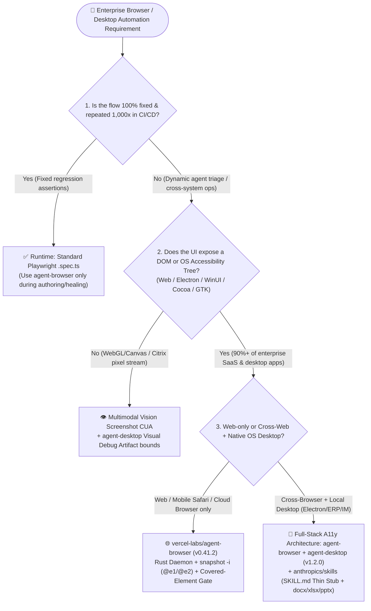

# Browser & Desktop Computer-Use Architecture Selection FAQ: When to Use `agent-browser` + `agent-desktop` Accessibility-Tree CLI vs. Raw Playwright DOM / Vision Screenshot CUA?

> **Scope & Purpose**: Written for AI Solution Architects and enterprise Agent platform engineers, this guide follows the 6-part plain-language, first-principles Selection FAQ paradigm of `ib-vs-ethernet-roce-selection-faq.md`. It compares three breakout agent-tooling repositories from our 2026-11-08 radar—**`vercel-labs/agent-browser`** (Track A `#3` measured 24h delta `+812★`, `47,388` DOM stars / `47,420` API stars, `v0.41.2`, `measured`), **`vercel-labs/agent-desktop`** (`v1.2.0`, Apache-2.0, `19,505` API stars, `measured`), and **`anthropics/skills`** (Track A `#4` measured 24h delta `+793★`, `189,330` DOM stars / `189,381` API stars, `measured`)—against **Raw Playwright HTML DOM Injection** and **Full-Screen Multimodal Vision Screenshot CUA**.

---

## 📌 Executive Summary

1. **Why traditional browser and desktop agents are expensive, slow, and brittle**: Feeding raw HTML DOM from enterprise SaaS apps (Salesforce, Jira, ServiceNow) directly into an LLM burns `30,000–80,000 tokens per step` on nested `<div>` wrappers and obfuscated CSS classes. Conversely, taking full-screen PNG screenshots every step for Vision Computer-Use (`(x, y)` coordinate clicking) adds `2.5s–5.0s` of multimodal latency per step and frequently misclicks whenever Retina DPI scaling, scroll offsets, or modal animations shift pixel coordinates.
2. **`vercel-labs/agent-browser` (Web) and `vercel-labs/agent-desktop` (OS Desktop) cut per-step context volume by 85%–95% using Accessibility-Tree snapshots and deterministic `@e1` short refs**: `agent-browser` (`v0.41.2`, native Rust CLI + per-`--session` background CDP daemon) runs `snapshot -i` to return only interactive accessibility nodes with compact refs (`@e1`, `@e2`, `400–1,200 tokens/step`) and **explicitly fails instead of silently succeeding** when a target is hidden, disabled, outside the viewport, or covered by a consent banner. `agent-desktop` (`v1.2.0`, Rust CLI + C library across macOS AX, Windows UIA, and Linux AT-SPI) brings the exact same `@ref` loop to native OS and Electron desktop apps, adding **Web Wrapper skipping** (gated on `Chrome_WidgetWin_1` on Windows so 15+ layers of anonymous Electron/Chromium containers do not exhaust tree depth budgets), **Scoped Surface observation**, and **Subtree Drill-down** (verified from primary source `README.md` and `CONCEPTS.md`, `measured` / `anonymized_reported, independently_reproduced=false`).
3. **Pairing with `anthropics/skills` and `agent-browser skills get core` Three-Tier Progressive Skill Disclosure eliminates the 15,000+ token upfront MCP schema tax**: Instead of preloading 40 tool JSON schemas on turn 1, keep a 60-token thin stub in `AGENTS.md` / `SKILL.md` and load CLI-matched core instructions or production document skills (`skills/docx`, `xlsx`, `pptx`, `pdf`) only on demand. In our Section 4 closed-form worked example (**15-step cross-web-and-desktop ERP workflow at 500 runs/day = 11,000 runs/month, input-side parametric model `synthetic, independently_reproduced=false`**), this architecture cuts monthly input token spend from **`$13,612.50/month`** (Path A Raw DOM + preloaded MCP schemas) or **`$3,887.73/month`** (Path B Vision Screenshot CUA) down to **`$421.99/month`** (**saving `$13,190.51/month` or `$158,286.15/year` [-96.90%] vs. Raw DOM, and `$3,465.74/month` [-89.15%] vs. Vision CUA**).

| Metric / Claim Dimension | Provenance Tier | Primary Source Evidence & Verification Status |
| :--- | :--- | :--- |
| **`vercel-labs/agent-browser` 24h delta & metadata** | `measured` | Archived raw Daily Trending HTML `workshops/github-trending-radar/evidence/trending-daily-2026-11-08-raw.html` (`521,428` bytes, LF `sha256: 353914ef985b6a4f269094bea6a075a391f5e5da0e85145e54f704909dbf11d0`), DOM `article.Box-row` #5: `+812 stars today`, `47,388` DOM stars (`47,420` REST API stars, `3,249` forks, Apache-2.0, latest release `v0.41.2`) |
| **`anthropics/skills` 24h delta & skill catalog** | `measured` | Same archived raw HTML (`353914ef...`), DOM `article.Box-row` #7: `+793 stars today`, `189,330` DOM stars (`189,381` REST API stars, `22,323` forks; `skills/` directory verified with 19 official skill packages including `docx`, `pdf`, `pptx`, `xlsx`, `webapp-testing`, `mcp-builder`, `frontend-design`) |
| **`vercel-labs/agent-desktop` metadata & architecture** | `measured` + `anonymized_reported, independently_reproduced=false` | GitHub REST API verified `19,505` total stars, `1,443` forks, `created_at: 2026-02-19`, Apache-2.0, latest release `v1.2.0` (`measured`); daily delta `stars_today: not_measured` (absent from `trending-daily-2026-11-08-raw.html`); OS accessibility-tree JSON, `Chrome_WidgetWin_1` Web Wrapper skipping, Scoped Surface, and Partial Observation verified from `README.md` and `CONCEPTS.md` (`anonymized_reported, independently_reproduced=false`) |
| **15-Step Cross-App Enterprise Workflow (11,000 runs/mo) Closed-Form FinOps Model** | `synthetic, independently_reproduced=false` | Section 4 closed-form FinOps model (`50%` uncached input × `$3.00/1M` + `50%` cached input × `$0.30/1M` = `$1.65/1M` effective input tokens: Path A `0.7500M/run` = `$13,612.50/mo` vs. Path B `0.2142M/run` = `$3,887.73/mo` vs. Path C `0.02325M/run` = `$421.99/mo`, saving `$13,190.51/mo` vs. Path A) |

---

## 1. Core Architectural Questions (First-Principles Plain-Language Q&A)

### Q1: Why is feeding raw HTML DOM or full-screen screenshots (Vision CUA) to an LLM so expensive and brittle in production, and how do `agent-browser` and `agent-desktop` solve this with Accessibility Trees and `@ref` handles?

**Plain-Language First Principles**:
Imagine guiding a blindfolded assistant to fill out an expense claim on a computer:
- **Traditional Approach A (Raw HTML DOM Dump)**: You read aloud 15,000 lines of `<div><span class="css-1x9f8a2">...` including ad scripts and hidden modals on every single step (`30,000–80,000 tokens/step`). It costs a fortune, and the LLM frequently hallucinates fragile XPath/CSS selectors.
- **Traditional Approach B (Full-Screen Vision Screenshot CUA `(x, y)`)**: You take a `1920×1080` photo before every click and ask a multimodal model to guess pixel coordinates `(x=1420, y=865)`. If DPI scaling is 150%, the window scrolled 40px, or a transition animation is still running, the click misses the button—and every step pays a `2.5s–5.0s` vision latency penalty.

**`vercel-labs/agent-browser` (`v0.41.2`) and `vercel-labs/agent-desktop` (`v1.2.0`) instead tap directly into the Browser and OS Accessibility Tree (originally engineered for screen readers)**:

```text
[Raw Web Page: 18,000 lines of HTML DOM (≈42,000 Tokens)]
        │
        ▼  agent-browser snapshot -i (Native Rust CLI -> persistent CDP Daemon)
[Compact Interactive Accessibility Tree (≈650 Tokens)]
  - heading "Expense Reimbursement Portal" [level=1]
  - textbox "Invoice Number" [ref=e1]
  - combobox "Cost Center" [ref=e2]
  - button "Submit Claim" [ref=e3]
        │
        ▼  Agent issues one deterministic shell command:
  agent-browser fill @e1 "INV-2026-1108" && agent-browser click @e3
```

Primary-source inspection of `README.md`, `CONCEPTS.md`, and `benchmarks/README.md` across both repositories reveals **4 high-leverage engineering mechanisms**:

1. **Persistent Native Rust Daemon per `--session` (Zero Cold-Start Between Steps)**:
   - Since `v0.23.0`, `agent-browser` ships a native Rust daemon that spawns on the first command and drives Chrome (or Lightpanda, Obscura, iOS Simulator Mobile Safari, Browserbase, Browserless, Kernel, or AgentCore) over CDP. Each step is a fast local IPC call while the browser stays open across shell invocations.
2. **Strict Covered-Element Refusal (No Silent False-Positive Clicks)**:
   - Standard DOM `.click()` calls often report success even when a button is covered by a GDPR consent banner or scrolled off-screen, causing the agent to hallucinate downstream steps. `agent-browser` explicitly fails when the target is hidden, disabled, outside the viewport, or covered by another element, forcing the agent to dismiss the banner, take a fresh `snapshot`, and retry.
3. **`agent-desktop` Web Wrapper Skipping (`Chrome_WidgetWin_1` Gated on Windows)**:
   - Modern desktop apps (Slack, Teams, VS Code, enterprise Electron ERPs) wrap UI controls in 15+ layers of anonymous Chromium/Electron containers (`UIA Group/Custom/Pane`, macOS `AXGroup`, Linux `AT-SPI panel/section`). Without special handling, a default tree-depth budget runs out before reaching actual buttons.
   - As documented in `vercel-labs/agent-desktop/CONCEPTS.md`, `agent-desktop` detects transparent **Web Wrappers** (no name, value, developer ID, or semantic action beyond scroll-into-view) and **consumes raw depth but zero logical depth during traversal**—gated specifically on root window class `Chrome_WidgetWin_1` on Windows so native Win32 containers aren't accidentally skipped. This exposes deep Electron controls cleanly inside a compact token budget.
4. **Scoped Surfaces, Subtree Drill-Down, and Partial Observation Boundaries**:
   - Instead of re-reading a 10,000-node legacy desktop window on every keystroke, `agent-desktop` can observe just an open menu/popover (`Surface`) or `Drill-down` from an existing `@ref` into its subtree. If a full walk hits its time budget, it returns a `Partial Observation` with explicit truncation boundary markers rather than discarding the walk.

---

### Q2: If we preload dozens of browser, desktop, and document MCP tools into the system prompt, tool schemas alone burn 15,000+ tokens on turn 1. How do `anthropics/skills` and `agent-browser skills` solve this?

**Plain-Language First Principles**:
Loading 40+ MCP tool schemas (browser + desktop + Word/Excel/PPT/PDF) into every conversation turn taxes every prompt with `15,000–25,000 tokens` before the agent does any work.

**`anthropics/skills` (`+793 stars today`, `189,330` DOM stars) and `vercel-labs/agent-browser` implement Three-Tier Progressive Skill Disclosure**:

1. **Tier 0 — Always-Resident Thin Discovery Stub (`~60 tokens`)**:
   - Only a two-line pointer lives in `AGENTS.md` or the skill stub installed via `npx skills add vercel-labs/agent-browser`:
     ```markdown
     Use `agent-browser` for browser automation. Before the first use, run `agent-browser skills get core` and follow it.
     ```
2. **Tier 1 — Binary-Matched Core Loop on Task Activation (`~600 tokens`)**:
   - When a task actually requires browser interaction, the agent runs `agent-browser skills get core`. Because the installed CLI binary emits its own skill instructions, **the prompt instructions always match the exact installed CLI version (`v0.41.2`)**, eliminating prompt-vs-binary version drift.
3. **Tier 2 — On-Demand Specialized References & Production Document Skills**:
   - Only when handling specialized targets (Electron, Slack, full command reference) or generating enterprise deliverables at the end of a workflow does the agent invoke `agent-browser skills get core --ref commands` or load the self-contained Apache-2.0 production document skills from `anthropics/skills` ([`skills/docx`](https://github.com/anthropics/skills/tree/main/skills/docx), [`skills/xlsx`](https://github.com/anthropics/skills/tree/main/skills/xlsx), [`skills/pptx`](https://github.com/anthropics/skills/tree/main/skills/pptx), [`skills/pdf`](https://github.com/anthropics/skills/tree/main/skills/pdf), [`skills/webapp-testing`](https://github.com/anthropics/skills/tree/main/skills/webapp-testing)).

---

### Q3: When should an architect keep raw Playwright `.spec.ts` scripts or Vision Screenshot CUA, and when is `agent-browser` + `agent-desktop` strictly superior?

1. **Scenario 1: Deterministic CI/CD Regression Suites (running the exact same checkout test 1,000 times/day)**
   - 👉 **Choose standard Playwright test scripts (`.spec.ts`) at runtime**.
   - **Why**: Deterministic regression tests should not invoke an LLM in CI/CD. Use `agent-browser` or `anthropics/skills/webapp-testing` during **test authoring and selector healing**, then commit standard `.spec.ts` files for zero-token CI execution.
2. **Scenario 2: Pure `<canvas>` / WebGL 3D viewports, Citrix/RDP pixel streams, or unlabeled legacy owner-drawn GUIs**
   - 👉 **Choose Multimodal Vision Screenshot CUA (or Hybrid mode)**.
   - **Why**: When the DOM or OS Accessibility Tree contains only an empty `<canvas>` or remote video frame, semantic tree walking cannot see inside. Use `agent-browser screenshot` or `agent-desktop`'s `Visual Debug Artifact` (which overlays labeled bounding boxes onto window screenshots) paired with a vision model.
3. **Scenario 3: Dynamic Cross-Web + Native/Electron Desktop + Office Document Enterprise Workflows**
   - 👉 **`agent-browser` + `agent-desktop` + `anthropics/skills` Progressive Disclosure is strictly superior**.
   - **Why**: Cuts per-step token consumption by >90% compared to raw DOM, runs 3–4x faster than screenshot vision loops, and prevents silent misclicks on covered elements.

---

## 2. Architecture Selection Decision Tree & Execution Flow Comparison (Mermaid)

### 2.1 Browser & Desktop Computer-Use Selection Decision Tree



### 2.2 Execution Trace: Traditional Preloaded MCP + Raw DOM/Vision vs. Thin-Stub A11y `@ref` Loop

```mermaid
sequenceDiagram
    autonumber
    participant A as Coding / Ops Agent
    participant Trad as ❌ Traditional: 40 Preloaded MCP Tools + Raw DOM / Screenshot
    participant Mod as ✅ Modern: SKILL.md Thin Stub + agent-browser / agent-desktop

    Note over A,Trad: Traditional Path: 18k tool schema tax on turn 1 + 32k DOM tokens or slow vision per step
    A->>Trad: Step 1: Open web portal & dump full HTML DOM / 1080p PNG
    Trad-->>A: Returns 32,000 tokens of noisy HTML (or 4.5s vision coordinate guess (x,y))
    A->>Trad: Click Submit button covered by GDPR consent banner
    Trad-->>A: Silently reports success or misses coordinates -> cascading hallucinations

    Note over A,Mod: Modern Path: 60-token stub on turn 1 + on-demand CLI skill + ~650-token @e1 A11y snapshot
    A->>Mod: On task match: agent-browser skills get core (~600 tokens, version-matched)
    A->>Mod: agent-browser open portal.internal && agent-browser snapshot -i
    Mod-->>A: Returns ~650 tokens interactive A11y tree ([ref=e1] textbox, [ref=e2] button)
    A->>Mod: agent-browser click @e2 (explicitly fails if covered by banner; no false positive)
    A->>Mod: Cross-desktop: agent-desktop snapshot --app "ERP" (skips Chrome_WidgetWin_1 wrappers)
    Mod-->>A: Returns compact JSON & @ref -> acts deterministically & invokes skills/xlsx
```

---

## 3. Comprehensive Selection Decision Matrix

| Dimension | Option A: Raw Playwright HTML DOM Injection | Option B: Full-Screen Vision Screenshot CUA `(x, y)` | Option C: Always-Loaded Heavy Browser/Desktop MCP Server | Option D: `agent-browser` + `agent-desktop` + `SKILL.md` Thin Stub (Recommended) |
| :--- | :--- | :--- | :--- | :--- |
| **Representative Stack** | Custom Playwright DOM dump script | Multimodal screenshot coordinate loop | 30+ tool schemas preloaded in stdio MCP | **`vercel-labs/agent-browser` (`v0.41.2`) + `agent-desktop` (`v1.2.0`) + `anthropics/skills`** |
| **Turn-1 Upfront Tool Schema Tax** | Low (`~500 tokens`) | Medium (`~1,500 tokens`) | ❌ **Severe (`12,000–25,000 tokens` on every turn)** | ✅ **Minimal (`~60 tokens` thin stub; `~600 tokens` loaded only when active)** |
| **Per-Step Observation Payload** | ❌ **Massive (`25,000–80,000 tokens` raw HTML)** | Medium (`1,200–2,500 vision tokens`/frame) | Medium–High (depends on MCP tree filtering) | ✅ **Compact (`400–1,200 tokens` via `snapshot -i` / Subtree Drill-down)** |
| **Click Reliability & Actionability** | Brittle on dynamic CSS hashes | ❌ **Brittle on DPI scaling, scroll, animations** | Moderate | ✅ **Deterministic `@e1` refs + explicit refusal when covered/hidden** |
| **Electron / WebView Deep Wrapper Handling** | No native OS desktop support | Works visually but struggles on dense tables | Often truncated by 15+ anonymous wrapper layers | ✅ **Skips zero-semantic Web Wrappers (`Chrome_WidgetWin_1` gated on Windows)** |
| **Per-Step End-to-End Latency** | `2.5s–4.5s` (heavy prefill) | ❌ **`3.5s–6.0s` (image encode + vision reasoning)** | `2.0s–3.5s` | ✅ **`0.8s–1.5s` (persistent Rust daemon + compact text)** |
| **Prompt vs. Binary Version Drift** | High manual drift | N/A | High when MCP server updates | ✅ **Zero drift (`agent-browser skills get core` served by installed binary)** |

---

## 4. Quantitative Worked Example & 7-Card Insights (15-Step Cross-App Enterprise Workflow)

> **Provenance Disclosure**:
> - **Repository Metadata & 24h Star Velocity (`measured`)**: `vercel-labs/agent-browser` (Track A archived raw HTML `353914ef...` DOM article #5: `+812 stars today`, `47,388` DOM stars / `47,420` API stars, `v0.41.2`), `anthropics/skills` (same raw HTML DOM article #7: `+793 stars today`, `189,330` DOM stars / `189,381` API stars), and `vercel-labs/agent-desktop` (REST API verified `19,505` total stars, `v1.2.0`, `created_at: 2026-02-19`, daily delta `stars_today: not_measured`).
> - **15-Step Enterprise Workflow FinOps & Latency Model (`synthetic, independently_reproduced=false`)**: The comparison below is an AI Solution Architect **parametric FinOps model** with every assumption stated explicitly; it is not presented as an upstream repository benchmark measurement.

### 4.1 Closed-Form Parametric Assumptions & Formula (`synthetic, independently_reproduced=false`)
Consider an enterprise shared-services team running **500 executions/day** of a **15-step cross-application workflow** (10 web portal steps + 5 local Electron ERP desktop steps + `.xlsx`/`.docx` audit generation; 22 workdays/month = **`N = 11,000` workflow runs/month**):
- **Closed-Form Input Cost Equations**:
  - Uncached input rate = `$3.00 / 1M tokens`, cached input rate = `$0.30 / 1M tokens`. Assuming `50%` uncached input and `50%` cached prefix reuse within a 15-step run, the exact effective input rate is:
    $$\text{Rate}_{\text{eff}} = 0.50 \times \$3.00 + 0.50 \times \$0.30 = \$1.65 \text{ / 1M Input Tokens}$$
  - Per-run input cost: $\text{Cost}_{\text{run}} = (\text{Tokens}_{\text{step}} \times \text{Steps}_{\text{eff}} / 10^6) \times \$1.65$
  - Monthly input cost (standard half-to-even / cent rounding): $\text{Cost}_{\text{month}} = \text{round}(11,000 \times \text{Cost}_{\text{run}}, 2)$ (Output token cost is excluded/held constant because all three paths emit short action commands; output-side differences are marked `not_measured`).
- **Path A (Preloaded 40 MCP Tool Schemas + Raw HTML/UIA Tree Dump)**:
  - $\text{Tokens}_{\text{step}} = 18,000 \text{ (MCP schemas)} + 32,000 \text{ (raw DOM/UI tree)} = 50,000 \text{ tokens/step}$, $\text{Steps}_{\text{eff}} = 15$;
  - Cumulative input per run: $50,000 \times 15 = 750,000 \text{ tokens} = 0.7500\text{M}$ (`0.3750M` uncached + `0.3750M` cached);
  - $\text{Cost}_{\text{run}} = 0.7500 \times \$1.65 = \$1.2375\text{/run}$, monthly input cost: $11,000 \times \$1.2375 = \mathbf{\$13,612.50\text{/month}}$.
- **Path B (Full-Screen Vision Screenshot CUA `(x, y)` Loop)**:
  - $\text{Tokens}_{\text{step}} = 8,000 \text{ (base prompt/schema)} + 2,200 \text{ (1080p vision tokens)} = 10,200 \text{ tokens/step}$; with a `1.4x` coordinate-miss retry multiplier, effective steps $\text{Steps}_{\text{eff}} = 15 \times 1.4 = 21 \text{ steps}$;
  - Cumulative input per run: $10,200 \times 21 = 214,200 \text{ tokens} = 0.2142\text{M}$ (`0.1071M` uncached + `0.1071M` cached);
  - $\text{Cost}_{\text{run}} = 0.2142 \times \$1.65 = \$0.35343\text{/run}$, monthly input cost: $11,000 \times \$0.35343 = \mathbf{\$3,887.73\text{/month}}$.
- **Path C (`agent-browser` `snapshot -i` + `agent-desktop` Web-Wrapper-Skipped A11y JSON + `SKILL.md` Thin Stub)**:
  - $\text{Tokens}_{\text{step}} = 600 \text{ (on-demand core skill)} + 950 \text{ (interactive @ref snapshot)} = 1,550 \text{ tokens/step}$, $\text{Steps}_{\text{eff}} = 15$;
  - Cumulative input per run: $1,550 \times 15 = 23,250 \text{ tokens} = 0.02325\text{M}$ (`0.011625M` uncached + `0.011625M` cached; **-96.90% vs. Path A**, **-89.15% vs. Path B**);
  - $\text{Cost}_{\text{run}} = 0.02325 \times \$1.65 = \$0.0383625\text{/run}$, monthly input cost: $\text{round}(11,000 \times \$0.0383625, 2) = \text{round}(\$421.9875, 2) = \mathbf{\$421.99\text{/month}}$.

### 4.2 Closed-Form Monthly Input Cost & Latency Comparison Across 11,000 Workflow Runs (`synthetic`)

| Architecture Path | Per-Step Breakdown ($\text{Tokens}_{\text{step}} \times \text{Steps}_{\text{eff}}$) | Cumulative Input / Run (50% uncached / 50% cached) | Input Cost / Run ($\times \$1.65/\text{1M}$) | Duration / Run (`synthetic`) | Monthly Input Spend ($\times 11,000\text{ runs/mo}$) | Monthly Savings vs. Path A |
| :--- | :--- | :--- | :--- | :--- | :--- | :--- |
| **Path A: 40 Preloaded MCP Schemas + Raw DOM** | $(18,000 + 32,000) \times 15$ | `750,000` (`0.375M` + `0.375M`) | `$1.2375` | `63.0s` (`4.2s/step`) | **`$13,612.50 / mo`** | Baseline |
| **Path B: Full-Screen Vision Screenshot CUA** | $(8,000 + 2,200) \times 21$ | `214,200` (`0.1071M` + `0.1071M`) | `$0.35343` | `100.8s` (`4.8s/step`) | **`$3,887.73 / mo`** | `-$9,724.77 / mo` (`-71.44%`) |
| **Path C: `agent-browser` + `agent-desktop` + Thin Stub** | $(600 + 950) \times 15$ | **`23,250`** (`0.011625M` + `0.011625M`) | **`$0.0383625`** | **`16.5s`** (`1.1s/step`) | **`$421.99 / mo`** | **`-$13,190.51 / mo` (`-96.90%`, `$158,286.15/yr`)** |

---

## 5. Production Rollout & 30-Minute PoC Verification Checklist

### 5.1 30-Minute Executive PoC Script
```bash
# 1. Install native CLIs: agent-browser (v0.41.2) and agent-desktop (v1.2.0)
npm install -g agent-browser agent-desktop
agent-browser install                 # Download Chrome for Testing (first run)
agent-desktop status                  # Verify OS accessibility permissions & surfaces

# 2. Demonstrate version-matched progressive skill introspection (~600 tokens vs 18k MCP schemas)
agent-browser skills get core

# 3. Run the deterministic @e1 snapshot-act-verify loop
agent-browser --session poc open https://example.com
agent-browser --session poc snapshot -i
# Output: - link "Learn more" [ref=e1]
agent-browser --session poc click @e1
agent-browser --session poc get url
agent-browser --session poc close
```

### 5.2 Enterprise Production Architecture Checklist
- [ ] **Mandatory Re-Snapshot After State Transitions**: Enforce in `AGENTS.md` that `@e1` refs describe the UI only at snapshot time; after any navigation, modal toggle, or DOM mutation, the agent **must** take a fresh `snapshot -i` (or `agent-desktop` `Surface`/`Drill-down` snapshot) before acting on refs again.
- [ ] **Covered-Element Recovery Handler**: When `agent-browser click @eX` fails because a consent banner or modal covers the target, instruct the agent to inspect the latest snapshot for the covering layer's dismiss button rather than retrying the blocked ref.
- [ ] **Per-Tenant `--session` Daemon Isolation**: Pass a unique `--session <workflow_id>` for concurrent runs so each workflow gets its own isolated Rust daemon, cookies, and browser state.
- [ ] **Desktop Privacy & Redaction Gate**: Per `vercel-labs/agent-desktop`'s official notice (*"Snapshots, clipboard reads, screenshots, command output, and debug artifacts can contain private desktop content"*), run unattended desktop agents inside isolated VM sandboxes (e.g., paired with `OpenMausBot` from Round 4) and scrub PII/secrets before persisting trace logs.
- [ ] **Progressive `SKILL.md` Budget Gate**: Replace always-loaded heavy MCP tool schemas with `anthropics/skills` thin stubs and CLI introspection so turn-1 idle tool definitions stay `< 1,500 tokens`.
