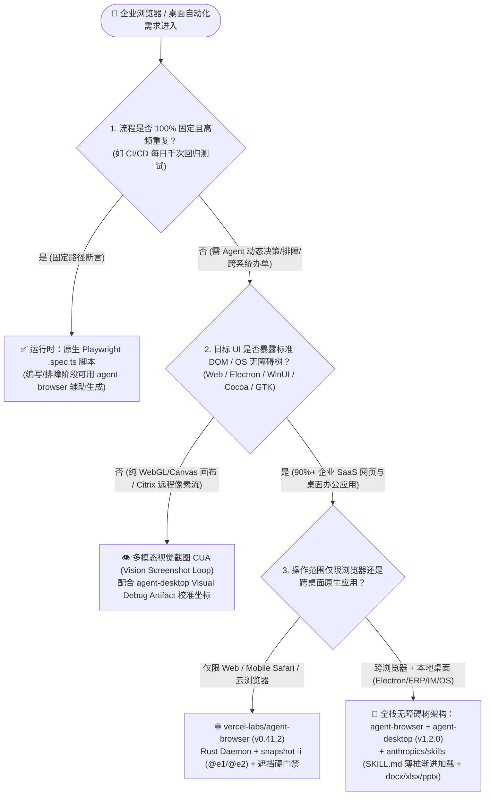
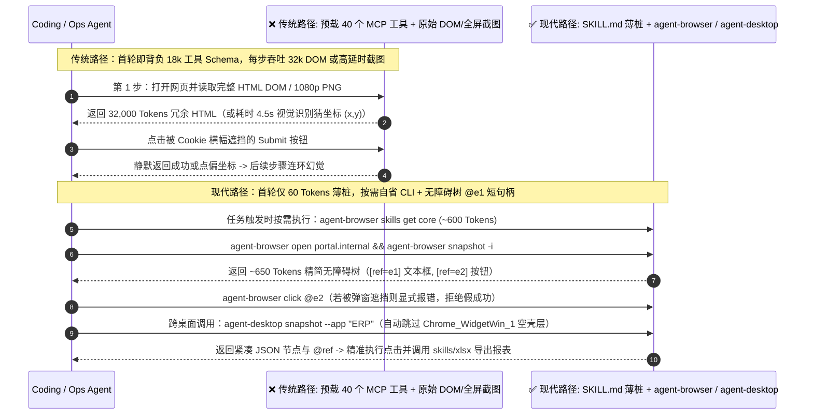

# 浏览器与桌面 Computer-Use 架构选型 FAQ：什么时候用 `agent-browser` + `agent-desktop` 无障碍树 CLI，什么时候用原生 Playwright DOM / 视觉截图 CUA？

> **文档定位**：本文面向 AI Solution Architect（AI 解决方案架构师）与企业级 Agent 平台工程师，严格对标 `ib-vs-ethernet-roce-selection-faq.md` 的「第一性原理大白话 + 决策树 + 定量算例 + 生产核验清单」范式，对 2026-11-08 GitHub AI 飙升榜中的三大工具层热点项目——**`vercel-labs/agent-browser`**（Track A 实测单日第 3 名 `+812★`，DOM 总 `47,388★` / API `47,420★`，`v0.41.2`，`measured`）、**`vercel-labs/agent-desktop`**（`v1.2.0`，Apache-2.0，API 总 `19,505★`，`measured`）与 **`anthropics/skills`**（Track A 实测单日第 4 名 `+793★`，DOM 总 `189,330★` / API `189,381★`，`measured`）——与传统 **Playwright 原始 DOM 注入**及**全屏视觉截图 CUA（Vision Computer-Use）**进行深度拆解与架构选型对比。

---

## 📌 核心结论速览（Executive Summary）

1. **为什么传统浏览器/桌面 Agent 又贵又慢又爱点歪？根源在于“喂给大模型的数据抽象层错了”**：把现代 SaaS 网页（Salesforce、Jira、ServiceNow）动辄上万行的原始 HTML DOM 直接塞进上下文，单步就要烧掉 `30,000–80,000 Tokens`；而每步截全屏图走多模态视觉坐标点击（Vision CUA `(x, y)`），不仅每步多出 `2.5s–5.0s` 视觉推理延迟，还会因为高分屏 DPI 缩放、滚动条偏移或弹窗遮挡频繁“点偏”或静默误触。
2. **`vercel-labs/agent-browser`（网页端）与 `vercel-labs/agent-desktop`（操作系统桌面端）用“无障碍树快照 + `@e1` 短引用句柄”把单步上下文体积砍掉 85%–95%**：`agent-browser`（Rust 原生 CLI + 按 `--session` 隔离的后台 CDP 守护进程，`v0.41.2`）通过 `snapshot -i` 只提取可交互元素的无障碍树（Accessibility Tree）并分配确定性短句柄（如 `@e1`、`@e2`），单步仅需 `400–1,200 Tokens`，且当目标元素被 Cookie 弹窗遮挡或不在视口内时会**显式报错拒绝点击**而非静默假装成功；`agent-desktop`（`v1.2.0`，Rust CLI + C 库，打通 macOS AX / Windows UIA / Linux AT-SPI）则把同一套 `@ref` 范式延伸到原生桌面与 Electron 应用，并通过 **Web Wrapper 匿名容器层跳过（Windows 下按 `Chrome_WidgetWin_1` 门控）**、**Surface 局部图层聚焦**与**子树 Drill-down** 解决了复杂桌面软件无障碍树过深截断的难题（上述架构特性源自两仓一手 `README.md` 与 `CONCEPTS.md` 核验，`measured` / `anonymized_reported, independently_reproduced=false`）。
3. **配合 `anthropics/skills` 与 `agent-browser skills get core` 的“两级渐进式技能披露（Progressive Disclosure）”，可彻底消灭首轮上万 Token 的工具 Schema 税**：不要在首轮 System Prompt 中预加载几十个笨重的 MCP 浏览器/文档工具 JSON Schema；在 `AGENTS.md` 或 `SKILL.md` 中只放 60 Token 的薄桩（Thin Stub），等 Agent 真正需要操作网页、桌面或生成 `.docx`/`.xlsx`/`.pptx`（`anthropics/skills` 开源生产技能包）时再按需加载核心指令。在本文件第 4 节完全可复算的 **15 步跨网页与桌面 ERP 自动办单算例（日跑 500 次、月 11,000 次，输入侧闭式参数模型 `synthetic, independently_reproduced=false`）**中，该组合可将月度输入 Token 成本从 Path A 原始 DOM 方案的 **`$13,612.50/月`**（或 Path B 纯视觉截图方案的 **`$3,887.73/月`**）降至 **`$421.99/月`**（**较原始 DOM 月省 `$13,190.51/月`、降幅 `-96.90%`；较纯视觉 CUA 月省 `$3,465.74/月`、降幅 `-89.15%`**）。

| 指标 / 断言维度 | 数据口径分级（Provenance Tier） | 原始证据出处与核验状态 |
| :--- | :--- | :--- |
| **`vercel-labs/agent-browser` 榜单增量与元数据** | `measured` | 归档原始日榜 HTML `workshops/github-trending-radar/evidence/trending-daily-2026-11-08-raw.html`（`521,428` bytes，LF `sha256: 353914ef985b6a4f269094bea6a075a391f5e5da0e85145e54f704909dbf11d0`）第 5 个 `article.Box-row`：`+812 stars today`，DOM 总星 `47,388`（REST API `47,420★`，`3,249` forks，Apache-2.0，最新 Release `v0.41.2`） |
| **`anthropics/skills` 榜单增量与技能包结构** | `measured` | 同一归档原始日榜 HTML（`353914ef...`）第 7 个 `article.Box-row`：`+793 stars today`，DOM 总星 `189,330`（REST API `189,381★`，`22,323` forks；仓库 `skills/` 含 `docx`、`pdf`、`pptx`、`xlsx`、`webapp-testing`、`mcp-builder`、`frontend-design` 等 19 个官方技能目录） |
| **`vercel-labs/agent-desktop` 仓库元数据与架构特性** | `measured` + `anonymized_reported, independently_reproduced=false` | GitHub REST API 实测总星 `19,505★`、`1,443` forks、创建日期 `2026-02-19`、Apache-2.0、最新 Release `v1.2.0`（`measured`）；当日增量 `stars_today: not_measured`（未出现在 `trending-daily-2026-11-08-raw.html` 日榜 DOM 中）；其 OS 无障碍树 JSON、`Chrome_WidgetWin_1` Web Wrapper 跳过、Scoped Surface 与 Partial Observation 机制源自仓库 `README.md` 与 `CONCEPTS.md`（`anonymized_reported, independently_reproduced=false`） |
| **15 步跨应用企业工单流（月跑 11,000 次）输入 Token 闭式算例** | `synthetic, independently_reproduced=false` | 见本文第 4 节架构师闭式可复算 FinOps 模型（`50%` 未缓存输入 × `$3.00/1M` + `50%` 缓存命中输入 × `$0.30/1M` = 有效输入单价 `$1.65/1M` Input Tokens：Path A `0.7500M/次` = `$13,612.50/月` vs Path B `0.2142M/次` = `$3,887.73/月` vs Path C `0.02325M/次` = `$421.99/月`，较 Path A 月省 `$13,190.51/月`） |

---

## 1. 核心问题解答（Q&A 灵魂三问：用大白话讲透第一性原理）

### Q1：为什么让大模型直接读网页 HTML DOM 或每步截全屏图（Vision CUA）在生产里又贵又脆？`agent-browser` 和 `agent-desktop` 的“无障碍树 + `@ref` 短句柄”到底是怎么工作的？

**大白话第一性原理**：
想象你要指挥一位蒙着眼睛的助手在电脑上填一张报销单。
- **传统做法 A（直接喂原始 HTML DOM）**：相当于把网页源码里一万行 `<div><span class="css-1x9f8a2">...` 连同广告脚本、隐藏弹窗原封不动念给助手听。每走一步就要念 4 万个词（Tokens），不仅账单爆炸，大模型还经常写错复杂的 XPath/CSS 选择器。
- **传统做法 B（每步截全屏图走视觉模型 Vision CUA）**：相当于每点一下鼠标就拍一张 `1920×1080` 的高清照片发给多模态大模型，让它猜“提交按钮大概在屏幕坐标 `(x=1420, y=865)`”。只要遇到 Retina 200% 缩放、窗口轻微滚动、或者动画还没播完，这一指头戳下去就会点歪，而且每步视觉推理要等 3–5 秒。

**`vercel-labs/agent-browser`（`v0.41.2`）与 `vercel-labs/agent-desktop`（`v1.2.0`）的解法是：直接借用操作系统和浏览器专门为视障读屏器设计的“无障碍树（Accessibility Tree）”！**

```text
[原始网页 18,000 行 HTML DOM (≈42,000 Tokens)]
        │
        ▼  agent-browser snapshot -i (Rust CLI -> 后台常驻 CDP Daemon)
[精简可交互无障碍树文本 (≈650 Tokens)]
  - heading "Expense Reimbursement Portal" [level=1]
  - textbox "Invoice Number" [ref=e1]
  - combobox "Cost Center" [ref=e2]
  - button "Submit Claim" [ref=e3]
        │
        ▼  Agent 只需发出一行极简 Shell 命令：
  agent-browser fill @e1 "INV-2026-1108" && agent-browser click @e3
```

通过对两仓一手源码与文档（`README.md`、`CONCEPTS.md`、`benchmarks/README.md`）的核验，这套架构在底层做了 **4 件极其扎实的工程设计**：

1. **跨命令常驻的 Rust 原生守护进程（Zero Cold-Start per Step）**：
   - `agent-browser` 自 `v0.23.0` 起已全面替换为**纯 Rust 原生守护进程（Native Rust Daemon）**。第一次执行 `agent-browser open` 时自动拉起后台 Daemon 并通过 Chrome DevTools Protocol（CDP）接管浏览器；后续每一步 `snapshot -i`、`click @e1` 都是一次毫秒级的本地进程通信，每个 `--session` 拥有独立 Daemon 与会话持久化（闲置 1 小时自动优雅保存并关闭）。
2. **拒绝“假装点成功”的遮挡与可见性硬门禁（Strict Actionability Gate）**：
   - 传统脚本调 `element.click()` 经常在按钮被 Cookie 隐私横幅挡住、处于 `disabled` 或滚出视口外时依然返回“成功”，导致 Agent 误以为已提交而在后续步骤连环幻觉。`agent-browser` 在 `README.md` 中明确承诺：**当目标隐藏、禁用、在视口外或被其他元素（如弹窗横幅）遮挡时，`click` 会立即报错失败**，迫使 Agent 先关闭遮挡物、重新 `snapshot` 再重试。
3. **`agent-desktop` 的杀手锏：跨 Electron / WebView 匿名包装层智能折叠（Web Wrapper Skipping）**：
   - 很多企业桌面软件（Slack、Teams、VS Code、内部 ERP 客户端）是用 Electron / Chromium / WebView2 写的，在操作系统无障碍树（Windows UIA / macOS AX / Linux AT-SPI）里会套上十几层毫无语义的匿名容器（`Group` / `Custom` / `Pane`）。如果不处理，默认树深预算走完都还停留在空壳容器里，90% 的真实按钮根本看不见！
   - 根据 `vercel-labs/agent-desktop/CONCEPTS.md` 一手披露：`agent-desktop` 识别出无名称、无值、无开发标识符且仅有默认滚动动作的 **Web Wrapper（透明包装层）** 时，**在遍历时仅消耗原始深度（Raw Depth）而不消耗逻辑深度（Logical Depth）**；且在 Windows 上专门通过检测根窗口类名 `Chrome_WidgetWin_1` 进行精确门控，避免误伤原生 Win32 控件。这一招让密集的 Electron 桌面应用无需加大 Token 预算就能把深层按钮完整暴露给 `@ref`！
4. **局部图层（Surface）、子树下钻（Drill-down）与超时部分观测边界（Partial Observation）**：
   - 面对拥有上万个控件的大型工业桌面软件，`agent-desktop` 支持只观测当前弹出的菜单/对话框（`Surface`），或基于已有 `@ref` 做局部子树下钻（`Drill-down`）；当全量遍历超出时间预算时，不会丢弃结果，而是返回带明确截断边界标记的 `Partial Observation`，让 Agent 知道哪棵子树被截断并按需下钻。

---

### Q2：如果把浏览器、桌面和办公文档几十个工具一次性塞进 MCP / System Prompt，光工具说明就要烧掉上万 Token！`anthropics/skills` 与 `agent-browser skills` 是怎么解决这个问题的？

**大白话第一性原理**：
很多架构师在搭多功能 Agent 时，喜欢一次性挂载 Browser MCP（25 个工具）、Desktop MCP（20 个工具）、Word/Excel/PPT MCP（30 个工具）。结果**用户刚说一句“早上好”，每一轮请求头里就已经背上了 `15,000–25,000 Tokens` 的 JSON Schema 工具说明书**，而且工具越多，大模型选错工具或填错参数的概率呈指数上升。

**`anthropics/skills`（Track A `#4`，实测单日 `+793★`，总 `189,330★`）与 `vercel-labs/agent-browser` 给出的工业标准答案是：三层渐进式技能披露（Three-Tier Progressive Skill Disclosure）**：

1. **第 0 层：常驻 Prompt 的超薄发现桩（Thin Discovery Stub，每个技能仅 `~50–80 Tokens`）**：
   - 在 `AGENTS.md` 或技能注册表里，只告诉 Agent 一句话：
     ```markdown
     Use `agent-browser` for browser automation. Before the first use, run `agent-browser skills get core` and follow it.
     ```
   - 或者通过 `npx skills add vercel-labs/agent-browser` 安装薄桩 `SKILL.md`。平时不触碰浏览器任务时，上下文损耗几乎为零。
2. **第 1 层：命中任务时按需自省核心循环（Binary-Matched Core Skill，`~500–800 Tokens`）**：
   - 一旦任务需要操作网页，Agent 在 Shell 里执行 `agent-browser skills get core`，由当前安装的 CLI 二进制文件直接吐出**与当前 CLI 版本（`v0.41.2`）100% 匹配**的核心 `@e1` 循环规范。这同时彻底根治了“Prompt 里的文档过时、和实际安装的 CLI 参数对不上”的版本漂移顽疾！
3. **第 2 层：遇到专有场景再按需拉取子手册或生产脚本（Specialized Reference & Production Scripts）**：
   - 只有当需要操作 Electron、Slack 或查阅全量命令时，才执行 `agent-browser skills get core --ref commands` 或 `agent-browser skills list`。
   - 同理，当任务最后一步需要把采集到的 ERP 数据生成带公司排版的 Word 报告、Excel 财务表或高管 PPT 时，Agent 再动态加载 `anthropics/skills` 仓库下的开源生产级技能文件夹（[`skills/docx`](https://github.com/anthropics/skills/tree/main/skills/docx)、[`skills/xlsx`](https://github.com/anthropics/skills/tree/main/skills/xlsx)、[`skills/pptx`](https://github.com/anthropics/skills/tree/main/skills/pptx)、[`skills/pdf`](https://github.com/anthropics/skills/tree/main/skills/pdf)、[`skills/webapp-testing`](https://github.com/anthropics/skills/tree/main/skills/webapp-testing)）。

---

### Q3：什么时候必须保留原生 Playwright 测试脚本或视觉截图 CUA（Vision Computer-Use），什么时候 `agent-browser` + `agent-desktop` 严格更优？

架构师在评审方案时，请直接按以下 **3 条黄金分界线** 拍板：

1. **场景一：固定流程的 CI/CD 自动化回归测试（每天跑 1,000 次相同的登录、加购、结账断言）**
   - 👉 **选原生 Playwright 确定性测试脚本（`.spec.ts`）**。
   - **理由**：固定回归测试在运行时根本不应该调用大模型烧 Token！正确姿势是：在**编写和调试测试脚本阶段**，让 Coding Agent 用 `agent-browser` 或 `anthropics/skills/webapp-testing` 探测页面无障碍树并生成 `.spec.ts` 代码；到了 CI/CD 流水线里，直接 `npx playwright test` 零 Token 极速跑完。
2. **场景二：纯 `<canvas>` / WebGL 3D 画布、远程 Citrix/RDP 像素流、或完全没有无障碍标签的远古自绘 GUI**
   - 👉 **选多模态视觉截图 CUA（Vision Screenshot CUA）或混合模式**。
   - **理由**：如果目标界面是一张 `<canvas>` 图形报表、Blender 3D 视口或 Citrix 远端视频流，操作系统和浏览器的无障碍树是空的（只有外框没有内部节点）。此时必须启用 `agent-browser screenshot` 或 `agent-desktop` 的 `Visual Debug Artifact`（带元素边框标注的窗口截图）配合多模态视觉推理。
3. **场景三：动态多变、跨企业 Web 系统 + 桌面原生/Electron 客户端 + 办公文档生成的 Agent 自动化工作流**
   - 👉 **`agent-browser` + `agent-desktop` + `anthropics/skills` 渐进式技能架构严格更优**。
   - **理由**：无论是网页端连接已有登录态 Chrome（`--cdp` / `--auto-connect`）还是云浏览器（Browserbase / Browserless / Kernel / AgentCore），还是桌面端跨 Windows/macOS/Linux 操作本地 ERP 与即时通讯软件，无障碍树 `@ref` 都比原始 DOM 省 **90%+ Token**、比纯视觉截图快 **3–4 倍**且具备遮挡报错保护。

---

## 2. 架构选型决策树与执行链路对比（Mermaid 流程图）

### 2.1 浏览器与桌面自动化架构选型决策树



### 2.2 传统「全量 MCP Schema + 原始 DOM / 截图」vs「薄桩技能 + 无障碍树 `@ref` 循环」执行链路对比



---

## 3. 同类方案全面对比决策矩阵（Selection Decision Matrix）

| 评估维度 | 方案 A：原生 Playwright 原始 HTML DOM 注入 | 方案 B：全屏多模态视觉截图 CUA（Vision `(x, y)`） | 方案 C：重型全量预加载 Browser/Desktop MCP Server | 方案 D：`agent-browser` + `agent-desktop` + `SKILL.md` 薄桩（推荐） |
| :--- | :--- | :--- | :--- | :--- |
| **代表项目与版本** | 自研 Playwright DOM dump 脚本 | OpenAI/Anthropic Computer-Use 纯截图循环 | 传统 30+ 工具常驻 stdio MCP Server | **`vercel-labs/agent-browser` (`v0.41.2`) + `agent-desktop` (`v1.2.0`) + `anthropics/skills`** |
| **首轮空载工具 Schema 税** | 低（`~500 Tokens`） | 中（`~1,500 Tokens`） | ❌ **极高（`12,000–25,000 Tokens` 每轮常驻）** | ✅ **极低（`AGENTS.md` 薄桩仅 `~60 Tokens`，触发时按需加载 `~600 Tokens`）** |
| **单步页面/桌面观测体积** | ❌ **极重（`25,000–80,000 Tokens` 原始 HTML）** | 中（`1,200–2,500 Vision Tokens`/张图） | 中至重（取决于 MCP 返回全量树还是过滤树） | ✅ **极轻（`snapshot -i` / 子树 Drill-down 仅 `400–1,200 Tokens`）** |
| **元素定位与点击可靠性** | 脆（动态混淆 CSS 类名易失效） | ❌ **脆（DPI 缩放/滚动/动画易点偏 `(x, y)`）** | 中（依赖具体实现） | ✅ **极稳（确定性 `@e1` 句柄 + 遮挡/不可见时显式报错拒绝假成功）** |
| **Electron / WebView 桌面深层嵌套支持** | 不支持操作系统原生桌面 | 支持但看不清密集小字与折叠菜单 | 通常被 15 层匿名容器截断树深 | ✅ **原生支持（自动跳过 `Chrome_WidgetWin_1` 等无语义 Web Wrapper 层）** |
| **单步端到端交互延迟** | `2.5s–4.5s`（大上下文 Prefill 慢） | ❌ **`3.5s–6.0s`（截图编码 + 视觉坐标推理慢）** | `2.0s–3.5s` | ✅ **`0.8s–1.5s`（Rust 常驻 Daemon + 极短文本 Token）** |
| **CLI 与 Prompt 版本一致性** | 易漂移（手写 Prompt 与脚本脱节） | 无版本绑定 | MCP 升级后 System Prompt 易过时 | ✅ **零漂移（`agent-browser skills get core` 由当前二进制实时吐出）** |

---

## 4. 定量算例与 7-Card 评测洞察（Worked Example: 15 步跨网页与桌面 ERP 自动办单流）

> **数据口径声明（Provenance Metadata）**：
> - **仓库基础元数据与星标增量（`measured`）**：`vercel-labs/agent-browser`（Track A 归档原始 HTML `353914ef...` 第 5 个 `article.Box-row`：`+812 stars today`，DOM 总 `47,388★` / API `47,420★`，`v0.41.2`）、`anthropics/skills`（同一原始 HTML 第 7 个 `article.Box-row`：`+793 stars today`，DOM 总 `189,330★` / API `189,381★`）、`vercel-labs/agent-desktop`（REST API 实测总星 `19,505★`，`v1.2.0`，`created_at: 2026-02-19`，当日增量 `stars_today: not_measured`）。
> - **15 步跨应用企业工作流月度 Token 与延迟算例（`synthetic, independently_reproduced=false`）**：以下对比模型为 AI Solution Architect 面向企业运营自动化团队构建的**参数化 FinOps 成本算例（Parametric FinOps Model）**，所有假设参数均在下方显式列出，不代表上游仓库固定实测跑分。

### 4.1 闭式可复算算例参数与公式设定（`synthetic, independently_reproduced=false`）
假设某跨国企业共享服务中心每天运行 **500 次**「Web 工单系统提取 → 本地 Electron ERP 客户端核销 → 生成 `.xlsx`/`.docx` 审计回执」的 **15 步跨应用 Agent 工作流**（其中 10 步网页操作、5 步桌面客户端操作；每月 22 个工作日 = **`N = 11,000` 次工作流/月**）：
- **统一计费与闭式公式（Input-Side Closed-Form Formula）**：
  - 未缓存输入单价 `$3.00 / 1M Tokens`，缓存命中输入单价 `$0.30 / 1M Tokens`；假设单次 15 步执行内平均 `50%` 输入 Token 命中前缀缓存、`50%` 为未缓存输入，则综合有效输入单价为：
    $$\text{Rate}_{\text{eff}} = 0.50 \times \$3.00 + 0.50 \times \$0.30 = \$1.65 \text{ / 1M Input Tokens}$$
  - 单次运行输入成本：$\text{Cost}_{\text{run}} = (\text{Tokens}_{\text{step}} \times \text{Steps}_{\text{eff}} / 10^6) \times \$1.65$
  - 月度输入总成本（保留两位小数，四舍五入至美分）：$\text{Cost}_{\text{month}} = \text{round}(11,000 \times \text{Cost}_{\text{run}}, 2)$（输出 Token 因三路径均输出简短动作指令，此模型仅隔离对比**输入侧上下文开销**，输出侧差异标为 `not_measured`）。
- **Path A（传统全量预载 40 个 MCP 工具 Schema + 原始 HTML/UIA 全量树注入）**：
  - $\text{Tokens}_{\text{step}} = 18,000 \text{ (MCP Schemas)} + 32,000 \text{ (Raw DOM/UI Tree)} = 50,000 \text{ Tokens/step}$，$\text{Steps}_{\text{eff}} = 15$；
  - 单次累计输入：$50,000 \times 15 = 750,000 \text{ Tokens} = 0.7500\text{M}$（其中未缓存 `0.3750M`、缓存命中 `0.3750M`）；
  - $\text{Cost}_{\text{run}} = 0.7500 \times \$1.65 = \$1.2375\text{/run}$，月度输入成本：$11,000 \times \$1.2375 = \mathbf{\$13,612.50\text{/月}}$。
- **Path B（全屏多模态视觉截图 CUA `(x, y)` 循环）**：
  - $\text{Tokens}_{\text{step}} = 8,000 \text{ (基础上下文/Schema)} + 2,200 \text{ (1080p 截图 Vision Tokens)} = 10,200 \text{ Tokens/step}$；因高分屏/滚动条坐标点偏产生 `1.4x` 重试系数，实际有效步数 $\text{Steps}_{\text{eff}} = 15 \times 1.4 = 21 \text{ 步}$；
  - 单次累计输入：$10,200 \times 21 = 214,200 \text{ Tokens} = 0.2142\text{M}$（其中未缓存 `0.1071M`、缓存命中 `0.1071M`）；
  - $\text{Cost}_{\text{run}} = 0.2142 \times \$1.65 = \$0.35343\text{/run}$，月度输入成本：$11,000 \times \$0.35343 = \mathbf{\$3,887.73\text{/月}}$。
- **Path C（`agent-browser` `snapshot -i` + `agent-desktop` Web-Wrapper 折叠 + `SKILL.md` 薄桩按需加载）**：
  - $\text{Tokens}_{\text{step}} = 600 \text{ (按需加载核心技能说明)} + 950 \text{ (精简无障碍树 @ref 快照)} = 1,550 \text{ Tokens/step}$，$\text{Steps}_{\text{eff}} = 15$；
  - 单次累计输入：$1,550 \times 15 = 23,250 \text{ Tokens} = 0.02325\text{M}$（其中未缓存 `0.011625M`、缓存命中 `0.011625M`，**较 Path A 削减 `-96.90%`，较 Path B 削减 `-89.15%`**）；
  - $\text{Cost}_{\text{run}} = 0.02325 \times \$1.65 = \$0.0383625\text{/run}$，月度输入成本：$\text{round}(11,000 \times \$0.0383625, 2) = \text{round}(\$421.9875, 2) = \mathbf{\$421.99\text{/月}}$。

### 4.2 三种架构路径月度（11,000 次运行）闭式可复算输入成本与延迟对比表

| 架构路径 | 单步输入构成 ($\text{Tokens}_{\text{step}} \times \text{Steps}_{\text{eff}}$) | 单次累计输入 (未缓存 50% / 缓存 50%) | 单次输入成本 ($\times \$1.65/\text{1M}$) | 单次耗时 (`synthetic`) | 月度输入总成本 ($\times 11,000\text{ 次/月}$) | 较 Path A 月度节省额（降幅） |
| :--- | :--- | :--- | :--- | :--- | :--- | :--- |
| **Path A：全量 MCP Schema + 原始 DOM** | $(18,000 + 32,000) \times 15$ | `750,000` (`0.375M` + `0.375M`) | `$1.2375` | `63.0s` (`4.2s/步`) | **`$13,612.50 / 月`** | 基准（Baseline） |
| **Path B：全屏视觉截图 CUA `(x, y)`** | $(8,000 + 2,200) \times 21$ | `214,200` (`0.1071M` + `0.1071M`) | `$0.35343` | `100.8s` (`4.8s/步`) | **`$3,887.73 / 月`** | `-$9,724.77 / 月`（`-71.44%`） |
| **Path C：`agent-browser` + `agent-desktop` + 薄桩** | $(600 + 950) \times 15$ | **`23,250`** (`0.011625M` + `0.011625M`) | **`$0.0383625`** | **`16.5s`** (`1.1s/步`) | **`$421.99 / 月`** | **`-$13,190.51 / 月`（`-96.90%`，年省 `$158,286.15`）** |

---

## 5. 生产落地与 30 分钟客户 PoC 核验清单（SA Production & PoC Checklist）

### 5.1 30 分钟高管 / 客户现场对比 Demo 脚本
```bash
# 1. 安装 agent-browser (v0.41.2) 与 agent-desktop (v1.2.0) 原生 CLI
npm install -g agent-browser agent-desktop
agent-browser install                 # 首次下载 Chrome for Testing
agent-desktop status                  # 检查当前 OS (Windows UIA / macOS AX / Linux AT-SPI) 权限与可用图层

# 2. 演示“版本自洽的渐进式技能自省”（对比塞入 20,000 Tokens MCP Schema）
agent-browser skills get core         # 仅输出 ~600 Tokens 的核心 @ref 循环规范

# 3. 演示网页端无障碍树快照与 @e1 确定性交互
agent-browser --session poc open https://example.com
agent-browser --session poc snapshot -i
# 输出: - link "Learn more" [ref=e1]
agent-browser --session poc click @e1
agent-browser --session poc get url
agent-browser --session poc close
```

### 5.2 生产环境架构师核验清单（Checklist）
- [ ] **状态变更后强制重新 `snapshot` 纪律**：在 `AGENTS.md` 中明确约束 Agent——`@e1` 引用句柄仅对当前快照时刻有效；一旦发生页面跳转、弹窗打开或 DOM 变更，**必须先重新执行 `snapshot -i`（或 `agent-desktop` 的局部 `Surface` / `Drill-down` 快照）再使用新分配的 `@ref`**。
- [ ] **遮挡报错自愈循环（Covered-Element Recovery）**：当 `agent-browser click @eX` 返回目标被遮挡（如 Cookie 隐私横幅或模态框）时，禁止盲目重试同一 `@ref`，应引导 Agent 在最新 `snapshot -i` 中定位关闭/同意按钮消除遮挡后再重试。
- [ ] **多租户/多任务 `--session` 隔离**：并发运行多个浏览器任务时，必须为每个任务指定独立的 `--session <task_id>`，确保各自拥有独立的后台 Rust Daemon、Cookie 存储与生命周期，防止跨任务串号。
- [ ] **桌面隐私与剪贴板脱敏红线（Security & Privacy Gate）**：严格遵循 `vercel-labs/agent-desktop` 官方安全警告——桌面无障碍树快照、剪贴板读取、视觉调试截图（`Visual Debug Artifact`）可能包含宿主机上的私人聊天、密钥或敏感文档；生产流水线必须在受控沙盒 VM（如配合 Round 4 的 `OpenMausBot` 容器/VM）中运行，并在上传日志前执行 PII/Secret 过滤。
- [ ] **渐进式 `SKILL.md` 上下文预算门禁**：审查团队现有的 Agent System Prompt，将不常用的重型 MCP 工具替换为 `anthropics/skills` 风格的文件夹 `SKILL.md` 薄桩或 CLI 自省指令，确保首轮空载工具定义开销控制在 `< 1,500 Tokens` 以内。
