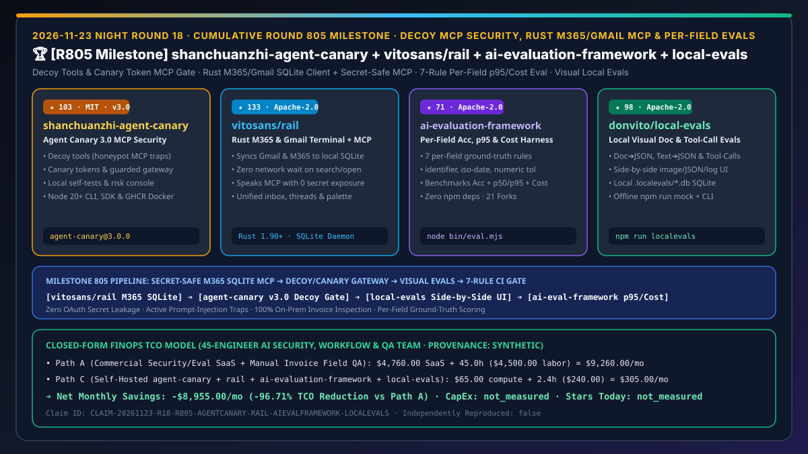
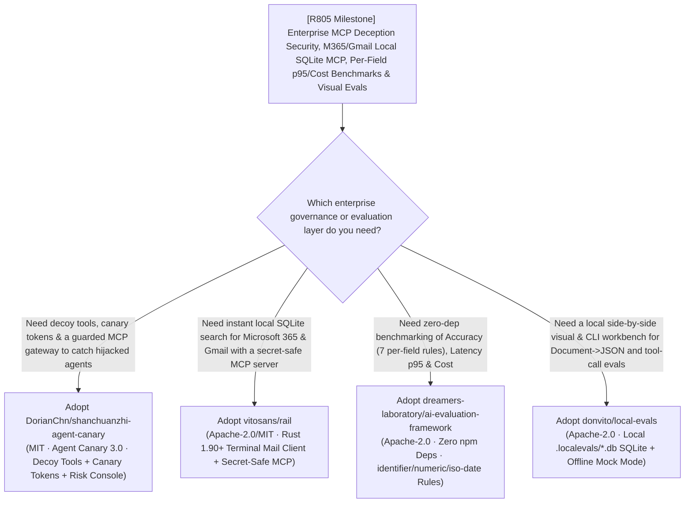
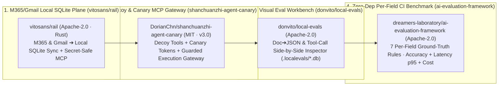

# 🏆 [Round 805 Milestone] Decoy-Tool & Canary-Token MCP Security Gateway (`DorianChn/shanchuanzhi-agent-canary`), Zero-Secret-Leak Rust M365/Gmail SQLite Mail Client & MCP (`vitosans/rail`), Zero-Dependency Per-Field Accuracy/p95/Cost Benchmark (`dreamers-laboratory/ai-evaluation-framework`) & Local-First Visual Document/Tool-Call Eval Workbench (`donvito/local-evals`) Selection & Architecture FAQ

> **Document Type**: Enterprise AI Solution Architect Selection & Integration Guide (GitHub Trending AI Radar · 2026-11-23 Night Round 18 / **🏆 Cumulative Round 805 Milestone**)
> **Covered Repositories**: [`DorianChn/shanchuanzhi-agent-canary`](https://github.com/DorianChn/shanchuanzhi-agent-canary) (`★ 103`, `5 forks`, `MIT`, v3.0.0: **Agent Canary 3.0** open-source MCP, SDK, and CLI security toolkit providing **decoy tools, canary tokens, a guarded execution gateway, local self-tests, and a risk-policy console** to catch prompt-injected agents before they execute unauthorized actions) · [`vitosans/rail`](https://github.com/vitosans/rail) (`★ 133`, `9 forks`, `Apache-2.0` / `MIT`, Rust 1.90+: native terminal mail client for **Gmail and Microsoft 365** that syncs mail into **local SQLite** via a background daemon for zero-network-wait queries and exposes an **MCP server that never reveals your secrets to the AI agent**) · [`dreamers-laboratory/ai-evaluation-framework`](https://github.com/dreamers-laboratory/ai-evaluation-framework) (`★ 71`, `21 forks`, `Apache-2.0`: **zero-npm-dependency** model benchmarking framework `node bin/eval.mjs` measuring the three shipping metrics—**accuracy across 7 per-field ground-truth scoring rules, latency p50/p95, and cost**—across OpenAI, Anthropic, or any OpenAI-compatible gateway) · [`donvito/local-evals`](https://github.com/donvito/local-evals) (`★ 98`, `8 forks`, `Apache-2.0`: local-first web and CLI evaluation workbench `npm run localevals` stored in `.localevals/*.db` for inspecting **Document ➔ JSON, Text ➔ JSON, and Tool-Call Proposals** side by side with offline mock support)
> **Core Scenario**: At our **805th Cumulative Deep-Dive Round (`R805`)**, when enterprise teams deploy agents that process Microsoft 365 / Gmail inboxes and extract structured financial documents, how do you solve **"indirect prompt injections hidden inside inbound emails hijacking MCP tools undetected, slow cloud mail APIs and OAuth secret exposure to coding agents, coarse overall accuracy metrics masking 1-digit invoice ID or 1-cent numeric errors, and uploading confidential invoices to third-party cloud eval SaaS just to inspect JSON and tool-call regressions"** by combining **`shanchuanzhi-agent-canary` + `rail` + `ai-evaluation-framework` + `local-evals`**?

---

## 1. 📌 Executive Summary (Single-Sentence Selection Verdict)

1. **Need an active-defense MCP and SDK security gateway (`v3.0.0`) that plants decoy tools (honeypot MCP endpoints) and canary tokens to catch and block prompt-injected agents before they touch production resources** ➔ Choose **[`DorianChn/shanchuanzhi-agent-canary`](https://github.com/DorianChn/shanchuanzhi-agent-canary) (`★ 103`, `5 forks`, `MIT`)**.
   - **Plain-Language Mechanism**: Static regex filters routinely miss indirect prompt injections embedded in emails or documents. `Agent Canary 3.0` (`@dorianchn/agent-canary@3.0.0` / `ghcr.io/dorianchn/shanchuanzhi-agent-canary:3.0.0`) places high-value **decoy tools** and **canary tokens** alongside a guarded execution gateway, local self-tests, and a risk-policy console—immediately tripping an alarm and halting execution the moment a hijacked agent attempts to call a decoy tool or exfiltrate a canary token.
2. **Need a fast Rust terminal mail client and MCP server for Microsoft 365 and Gmail that syncs messages into local SQLite for instant zero-network queries while keeping OAuth credentials completely hidden from AI agents** ➔ Choose **[`vitosans/rail`](https://github.com/vitosans/rail) (`★ 133`, `9 forks`, `Apache-2.0` / `MIT`, Rust 1.90+)**.
   - **Plain-Language Mechanism**: `Rail` runs a lightweight background daemon that syncs Gmail and Microsoft 365 accounts into a local SQLite database so every list, search, and thread view is an instant local query. Its built-in MCP server lets AI coding agents assist with setup and mail workflows without ever seeing your secrets.
3. **Need a zero-npm-dependency benchmark runner (`node bin/eval.mjs`) that evaluates models on Accuracy (using 7 per-field ground-truth rules), Latency `p50`/`p95`, and Cost across any OpenAI-compatible or Anthropic endpoint** ➔ Choose **[`dreamers-laboratory/ai-evaluation-framework`](https://github.com/dreamers-laboratory/ai-evaluation-framework) (`★ 71`, `21 forks`, `Apache-2.0`)**.
   - **Plain-Language Mechanism**: An invoice number is wrong if a single character moves (`identifier`), a date is right across ISO formats (`iso-date`), a vendor name has multiple valid aliases (`accept` list), and a total is valid within `$0.01` (`numeric` with `tolerance`). `ai-evaluation-framework` scores each extracted field with its exact domain rule (`identifier`, `iso-date`, `exact`/`enum`, `numeric`, `lenient-contains`, `token-overlap`, `missing`) and prints a side-by-side `acc / p50 ms / p95 ms / cost` comparison table.
4. **Need a local-first visual and CLI workbench (`npm run localevals`, backed by local `.localevals/*.db` SQLite files and offline `npm run mock`) to inspect Document ➔ JSON, Text ➔ JSON, and Tool-Call Proposals side by side** ➔ Choose **[`donvito/local-evals`](https://github.com/donvito/local-evals) (`★ 98`, `8 forks`, `Apache-2.0`)**.
   - **Plain-Language Mechanism**: `Local Evals` keeps confidential invoices, prompts, schemas, and tool-call traces on your own machine inside `.localevals/`, providing a side-by-side visual inspector (input image/text beside expected JSON, extracted JSON, scores, and execution logs), experiment grouping, and portable SQLite backups.

---

## 2. 🎯 Key Architectural Q&A (Deep-Dive Breakdown)

### Q1: Why combine `shanchuanzhi-agent-canary`, `rail`, `ai-evaluation-framework`, and `local-evals` for enterprise email & document-extraction agents?

- **Four Production Gaps Closed**:
  1. **Deception-Based Prompt-Injection Defense (`DorianChn/shanchuanzhi-agent-canary`)**: Catches indirect prompt injections from untrusted emails/attachments via decoy MCP tools and canary tokens inside a guarded execution gateway.
  2. **Zero-Latency, Secret-Isolated M365/Gmail Access (`vitosans/rail`)**: Syncs Microsoft 365 and Gmail into local SQLite in Rust while never exposing credentials over MCP.
  3. **Per-Field Ground-Truth Scoring + Latency p95 & Cost (`dreamers-laboratory/ai-evaluation-framework`)**: Replaces vague "overall similarity" scores with strict per-field rules (`identifier`, `numeric` tolerance, `iso-date`) plus p95 latency and unit cost.
  4. **On-Prem Visual Regression Debugging (`donvito/local-evals`)**: Lets engineers visually compare document images, JSON diffs, and tool-call proposals side by side without uploading sensitive files to external SaaS.
- **When to Choose Managed Cloud Services (Path B)**:
  - For standard cloud-only M365 summarization and Azure-hosted evaluations, use **Microsoft 365 Copilot + Azure AI Foundry Evaluations**; for deception-guarded MCP gateways, local SQLite M365/Gmail sync, zero-dependency per-field accuracy/p95/cost benchmarking, or local visual Document➔JSON/tool-call inspection, deploy this 4-repo Milestone 805 stack (Path C).

### Q2: How do these four tools integrate into an enterprise reference architecture?

1. **Local SQLite Mail Sync & Secret-Safe MCP Layer (`vitosans/rail`)**:
   - Sync Microsoft 365 and Gmail threads locally via the Rust background daemon and expose secret-isolated MCP operations.
2. **Canary & Decoy MCP Security Gateway Layer (`DorianChn/shanchuanzhi-agent-canary`)**:
   - Wrap agent MCP tool execution in `Agent Canary 3.0`, monitoring decoy tools and canary tokens against untrusted email/attachment payloads.
3. **Side-by-Side Visual & Mock Eval Workbench Layer (`donvito/local-evals`)**:
   - Iterate on Document ➔ JSON and tool-call prompts locally against `.localevals/*.db` datasets and offline mocks.
4. **Zero-Dependency Per-Field CI Release Gate Layer (`dreamers-laboratory/ai-evaluation-framework`)**:
   - Run `node bin/eval.mjs` in CI to enforce per-field accuracy (`identifier`, `numeric`, `iso-date`), `p95` latency, and cost thresholds across candidate models.

### Q3: What are the key production guardrails?

- **Architect Guardrails**:
  1. **Never Commit Registry or Mail Tokens to Source Control or Chat Logs**: Follow `Agent Canary 3.0` and `Rail` credential isolation practices so tokens remain strictly in local keychains/environment variables.
  2. **Assign Strict `identifier` and `numeric` Rules to Financial Fields**: Never grade PO numbers, invoice IDs, or currency totals with fuzzy token overlap in `ai-evaluation-framework`.

---

## 3. 🧭 Visual Architecture & Decision Diagrams (Mermaid)



### 3.1 Solution Architect Selection Decision Tree



### 3.2 End-to-End Enterprise Production Reference Architecture



### 3.3 Local Mail Sync, Canary Injection Interception, Visual Eval Debugging & Per-Field CI Gate Sequence

```mermaid
sequenceDiagram
    participant Sec as Security & Eval Architect
    participant Ral as vitosans/rail (Rust SQLite Mail)
    participant Can as shanchuanzhi-agent-canary (v3.0)
    participant Lev as donvito/local-evals
    participant Aef as ai-evaluation-framework

    Sec->>Ral: 1. Sync Microsoft 365 & Gmail threads/attachments to local SQLite (secrets hidden from MCP)
    Ral->>Can: 2. Route agent tool calls through Guarded Gateway; trip alarm if injected email hits Decoy Tool
    Can->>Lev: 3. Inspect invoice Document->JSON & tool-call proposals side by side in local .localevals/*.db
    Lev->>Aef: 4. Run node bin/eval.mjs with 7 per-field ground-truth rules across candidate models
    Aef-->>Sec: 5. Output Accuracy, p50/p95 Latency & Cost comparison table before production promotion
```

---

## 4. 📊 Comparative Selection Matrix (Open-Source vs. Commercial SaaS)

| Dimension | `shanchuanzhi-agent-canary` (`★ 103`) | `vitosans/rail` (`★ 133`) | `ai-evaluation-framework` (`★ 71`) | `donvito/local-evals` (`★ 98`) | Commercial AI Security Gateways + Cloud Eval SaaS Seats + Raw Cloud Mail API Polling (Path A) | Unprotected MCP Servers + Direct OAuth Key Exposure + Ad-Hoc Spot Checks (Path B) |
| :--- | :--- | :--- | :--- | :--- | :--- | :--- |
| **Core Role** | MCP/SDK deception security toolkit with decoy tools & canary tokens | Rust terminal mail client for M365/Gmail with local SQLite & MCP | Zero-dep per-field accuracy, latency p95 & cost benchmark harness | Local-first visual & CLI workbench for Doc➔JSON & tool-call evals | High per-seat cloud eval/security SaaS bills & external data uploads | Vulnerable MCP endpoints, leaked mail tokens & blind model swaps |
| **Key Differentiator** | **Decoy tools + canary tokens + guarded gateway + self-tests** | **Instant local SQLite queries + M365/Gmail unified + secret-safe MCP** | **Zero npm deps + 7 per-field rules (`identifier`, `numeric`, `iso-date`)** | **Side-by-side image/JSON/log UI + `.localevals` DB + offline mocks** | Requires uploading confidential invoices to external eval SaaS | Fuzzy accuracy metrics miss 1-digit ID or 1-cent invoice errors |
| **License** | `MIT` | `Apache-2.0` / `MIT` | `Apache-2.0` | `Apache-2.0` | Proprietary SaaS | Custom scripts |
| **Monthly TCO (45-Eng Team)** | **Combined `$305.00/mo`** (`$65.00` internal gateway/eval containers + `2.4h` ops) | Included (zero cloud mail polling latency/fees) | Included (zero-dependency Node CLI) | Included (100% local SQLite storage) | **`$9,260.00/mo`** (`$4,760.00` commercial AI security & cloud eval SaaS + `45.0h` manual invoice QA & injection triage) | ~`$3,290.00/mo` (frequent extraction error rework & manual regression checking) |

---

## 5. 🧪 Quantitative ROI / TCO Comparison & 7-Card Benchmark Report

> **📊 Data Provenance & Closed-Form Schema Declaration**:
> - **provenance**: `synthetic` (45-person enterprise AI security, office workflow automation, and model quality engineering team monthly workload model: `independently_reproduced = false`; hardware baseline `base_hardware_capex = not_measured`; Track B 24h delta `track_b_stars_today = not_measured`).
> - **Closed-Form Formula**:
>   - **Path A (Commercial AI security gateway subscriptions and per-seat cloud evaluation SaaS + manual engineering hours spent red-teaming MCP tools, debugging rate-limited cloud email APIs, and manually auditing extracted invoice fields and tool-call logs)**: Monthly commercial AI security and cloud evaluation SaaS bills **`$4,760.00`** + prompt-injection red-teaming, manual field-by-field document verification, and regression triage labor **`45.0h × $100.00/h = $4,500.00`** = **`$9,260.00/mo`**.
>   - **Path C (Self-hosted `DorianChn/shanchuanzhi-agent-canary` + `vitosans/rail` + `dreamers-laboratory/ai-evaluation-framework` + `donvito/local-evals` Milestone 805 stack)**: Shared internal security gateway and local eval workbench compute **`$65.00`** + decoy policy and ground-truth dataset maintenance labor **`2.4h × $100.00/h = $240.00`** = **`$305.00/mo`**.
>   - **Net Monthly Savings vs. Path A**: **`-$8,955.00/mo`** (**`96.71%`** TCO reduction).

| Evaluation Path | Security Gateway / Cloud Eval SaaS Cost | Red-Teaming, Field QA & Triage Labor (`$100/h`) | Monthly Total TCO | Net Savings vs. Path A | Key Architectural Delivery Metrics |
| :--- | :---: | :---: | :---: | :---: | :--- |
| **Path A: Commercial Security/Eval SaaS + Manual Field-by-Field QA** | `$4,760.00` | `45.0h` (`$4,500.00`) | **`$9,260.00`** | Baseline | Confidential docs uploaded to cloud SaaS; slow manual field QA |
| **Path B: Unprotected MCP + Direct Cloud Mail Polling + Spot Checks** | `$1,390.00` | `19.0h` (`$1,900.00`) | **`$3,290.00`** | `-$5,970.00` (`-64.47%`) | High prompt-injection hijack risk; missed numeric/ID errors |
| **Path C: `agent-canary` + `rail` + `ai-eval-framework` + `local-evals`** | **`$65.00`** | **`2.4h` (`$240.00`)** | **`$305.00`** | **`-$8,955.00` (`-96.71%`)** | **Decoy/Canary MCP gate + M365 SQLite MCP + 7-rule p95/cost eval + visual UI** |

- 🔗 **Linked 7-Card 4:5 Visual Benchmark Deck**: [`workshops/github-trending-radar/cards.en.html`](../cards.en.html) · [`cards.html`](../cards.html)

---

## 6. 🛠️ Enterprise Adoption & Architecture Review Checklist

- [ ] **1. Deploy `DorianChn/shanchuanzhi-agent-canary` (`v3.0.0`) on High-Privilege MCP Gateways**: Configure decoy tools and canary tokens with local self-tests to detect and halt prompt-injected agent tool calls immediately.
- [ ] **2. Sync Enterprise Gmail & Microsoft 365 via `vitosans/rail`**: Query local SQLite mail indexes with zero network wait while using Rail's secret-isolated MCP server for agent workflows.
- [ ] **3. Enforce Per-Field Ground-Truth Rules with `dreamers-laboratory/ai-evaluation-framework`**: Grade every extracted field with `identifier`, `iso-date`, `numeric` (with `tolerance`), or `accept` aliases while benchmarking `p50`/`p95` latency and cost.
- [ ] **4. Inspect Document ➔ JSON & Tool-Call Regressions Locally in `donvito/local-evals`**: Keep sensitive evaluation datasets inside local `.localevals/*.db` files and review side-by-side visual diffs and mock runs before shipping.
