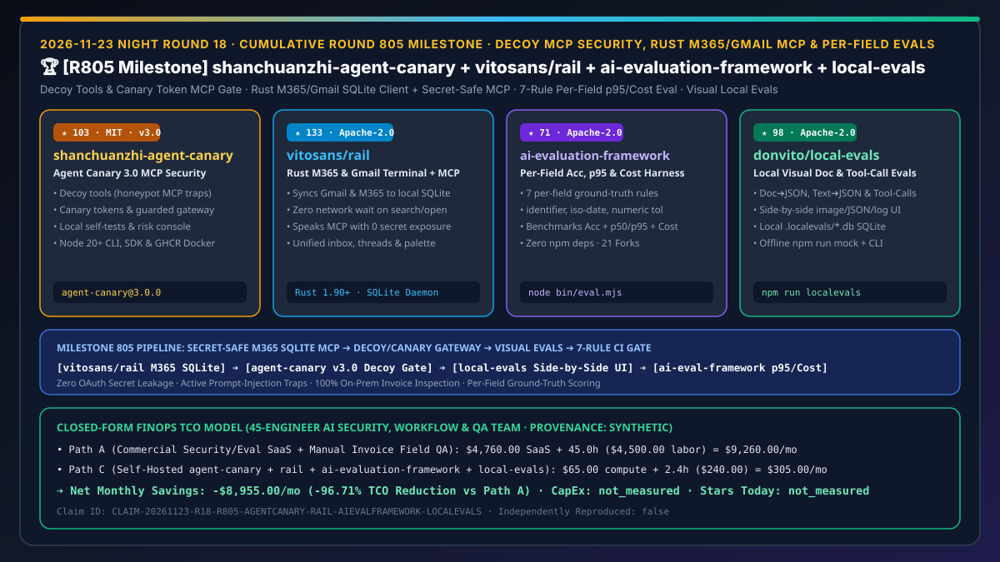
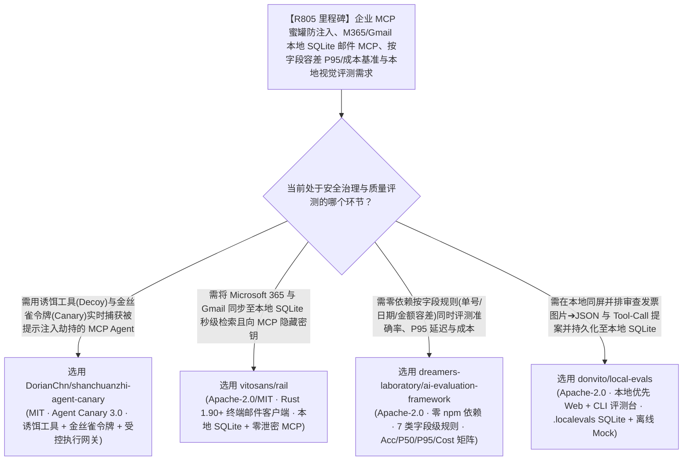
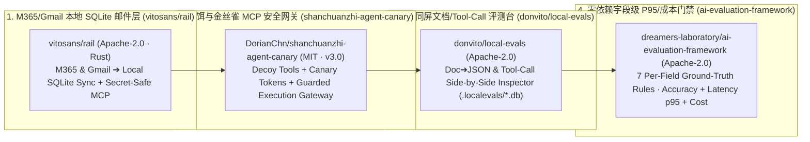
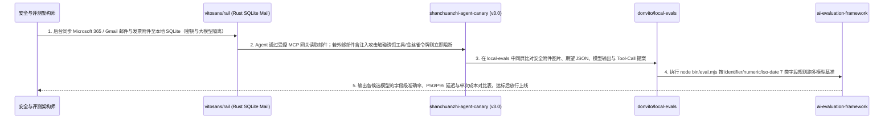

# 🏆【第 805 轮里程碑】内置诱饵工具与金丝雀令牌的 MCP 安全执行网关（`DorianChn/shanchuanzhi-agent-canary`）、零密钥暴露同步 Microsoft 365/Gmail 至本地 SQLite 的 Rust 邮件 MCP（`vitosans/rail`）、零依赖按字段容差核算准确率/P95 延迟/成本的评测框架（`dreamers-laboratory/ai-evaluation-framework`）与本地优先文档转 JSON 及工具调用视觉评测台（`donvito/local-evals`）选型与集成架构 FAQ

> **文档类型**：企业 AI 解决方案架构师（AI Solution Architect）选型决策指南（GitHub Trending AI 雷达 2026-11-23 Night Round 18 / **🏆 累计第 805 轮里程碑**）
> **覆盖项目**：[`DorianChn/shanchuanzhi-agent-canary`](https://github.com/DorianChn/shanchuanzhi-agent-canary)（`★ 103`、`5 forks`、`MIT`：开源 **Agent Canary 3.0** MCP/SDK/CLI 安全套件，提供**诱饵工具（Decoy Tools）、金丝雀令牌（Canary Tokens）、受控执行网关、本地自检与风险策略控制台**，在被间接提示注入劫持的 Agent 触碰真实生产接口前当场捕获）· [`vitosans/rail`](https://github.com/vitosans/rail)（`★ 133`、`9 forks`、`Apache-2.0`：基于 Rust 1.90+ 构建的 **Microsoft 365 与 Gmail 终端邮件客户端及安全 MCP Server**，通过后台小守护进程将邮件同步至本地 SQLite 实现零网络等待查询，且让 AI 编程智能体在**绝不接触 OAuth 密钥原文**的前提下完成配置与交互）· [`dreamers-laboratory/ai-evaluation-framework`](https://github.com/dreamers-laboratory/ai-evaluation-framework)（`★ 71`、`21 forks`、`Apache-2.0`：**零 npm 依赖**的模型选型基准框架 `node bin/eval.mjs`，围绕决定能否上线的三大硬指标——**准确率（支持 7 种按字段评分规则）、延迟 P50/P95 与单次成本**进行横向对比）· [`donvito/local-evals`](https://github.com/donvito/local-evals)（`★ 98`、`8 forks`、`Apache-2.0`：本地优先的 **Document ➔ JSON、Text ➔ JSON 与 Tool-Call 提案视觉评测工作台及 CLI** `npm run localevals`，所有数据落盘本地 `.localevals/*.db`，支持左右同屏比对发票/文档原图、期望 JSON、模型输出与执行日志）
> **核心场景**：当企业安全与质量工程团队将接入企业邮箱（Microsoft 365 / Gmail）和财务单据提取的 Agent 推向生产时，面对**“邮件正文夹带的恶意 Prompt 一旦诱导 Agent 调高危 MCP 工具极难提前发现、直接把 M365/Gmail 密钥交给 Agent 既慢又有凭据泄露风险、发票与合同抽取用笼统的整体准确率评测掩盖了金额差一分钱或单号错一位的致命错误、以及缺乏本地同屏可视化排查 Document-to-JSON 与 Tool-Call 回归退化的工具”**四大痛点，如何通过 **Agent-Canary 3.0 + Rail + AI-Evaluation-Framework + Local-Evals** 构建防劫持、零泄密、细粒度评测的闭环？

---

## 一、📌 核心结论速览（选型一句话结论）

1. **想在企业 MCP 工具链中布设“蜜罐诱饵工具（Decoy Tools）与金丝雀令牌（Canary Tokens）”，一旦 Agent 因读取恶意邮件或外部网页遭到提示词注入（Prompt Injection）试图窃密或越权执行，立即在受控执行网关层触发告警并阻断** ➔ 选 **[`DorianChn/shanchuanzhi-agent-canary`](https://github.com/DorianChn/shanchuanzhi-agent-canary)（`★ 103`，`5 forks`，`MIT`）**。
   - **通俗原理**：传统正则防火墙很难区分正常工具调用与被注入劫持后的调用。`Agent Canary 3.0`（支持 npm 与 `ghcr.io/dorianchn/shanchuanzhi-agent-canary:3.0.0` 容器部署）采用主动欺骗防御：在 MCP 工具列表中混入正常业务绝不会主动调用的高诱惑度**诱饵工具（Decoy Tools）**，并在上下文中埋入**金丝雀假凭据（Canary Tokens）**；一旦被攻击者诱导的 Agent 触碰诱饵或外传金丝雀令牌，受控网关当场锁定攻击链路并拦截执行。
2. **想让开发者与智能体极速检索、阅读并处理 Microsoft 365 与 Gmail 多账号邮件，既要靠本地 SQLite 同步实现毫秒级零网络等待检索，又要通过内置 MCP 严格保证大模型永远看不到任何邮箱密钥（Secrets）** ➔ 选 **[`vitosans/rail`](https://github.com/vitosans/rail)（`★ 133`，`9 forks`，`Apache-2.0` / `MIT`，Rust 1.90+）**。
   - **通俗原理**：每次通过云端 Graph/Gmail REST API 实时拉取邮件不仅慢，还容易触发限流。`Rail` 用轻量级 Rust 守护进程将 Microsoft 365 与 Gmail 邮件增量同步到本地 SQLite 库，列表、全文搜索与会话展开全走本地毫秒级查询，并通过对密钥完全隔离的 MCP 接口供 AI 智能体安全辅助配置与处理邮件。
3. **想用一套零第三方 npm 依赖的极简命令行框架（`node bin/eval.mjs`），一次性算清多个候选模型在企业结构化抽取任务上的三大上线生命线指标——“按字段规则定义的真实准确率、P50/P95 延迟与精确成本”** ➔ 选 **[`dreamers-laboratory/ai-evaluation-framework`](https://github.com/dreamers-laboratory/ai-evaluation-framework)（`★ 71`，`21 forks`，`Apache-2.0`）**。
   - **通俗原理**：“整体准确率 90%”在企业财务单据场景下毫无意义——因为发票号错一个字符就是 100% 错误，而供应商名称有三种合法缩写却都算对。该框架允许为每个 JSON 字段单独绑定 **7 种精确判定规则**（`identifier` 精确匹配、`iso-date` 归一化日期、`exact`/`enum`、`numeric` 数值容差如精确到 0.01 元、`lenient-contains`、`token-overlap` Jaccard 阈值、`missing` 缺失判定）及 `accept` 合法别名列表，直接打印多模型 `acc / p50 ms / p95 ms / cost` 决策表。
4. **想在本地浏览器与 CLI 中对“发票/文档图片 ➔ JSON、文本 ➔ JSON、以及智能体 Tool-Call 提案”做左右分栏可视化对比评测，且所有评测集与 SQLite 结果库（`.localevals/*.db`）100% 留在内网本机** ➔ 选 **[`donvito/local-evals`](https://github.com/donvito/local-evals)（`★ 98`，`8 forks`，`Apache-2.0`）**。
   - **通俗原理**：既提供 Web 界面（同屏并排展示原始发票图片、期望 JSON、模型提取 JSON、各项得分与执行日志），又提供 `npm run localevals -- run ... --db .localevals/example.db` CLI 与完全离线的 `npm run mock` 合成评测模式，支持按 Experiment 分组对比不同模型或不同 Prompt 版本的退化明细。

---

## 二、🎯 客户与架构师灵魂拷问 Q&A（深度架构拆解）

### Q1：处理企业邮箱（M365/Gmail）与财务发票提取的办公 Agent，为什么是间接提示词注入（Indirect Prompt Injection）的最高危重灾区？

- **办公邮件/单据 Agent 的双重风险与四维防线**：
  1. **外部发件人可控输入 + 高权限工具集 = 极易被劫持**：任何人都能给企业公开邮箱发一封暗藏白色字体指令的邮件或 PDF 发票；一旦 Agent 读取该邮件，若没有 **`shanchuanzhi-agent-canary`** 的诱饵工具（Decoy Tools）与金丝雀令牌（Canary Tokens）前置探测，以及 **`vitosans/rail`** 的本地 SQLite 密钥物理隔离，攻击者就能诱导 Agent 外发敏感数据。
  2. **字段级容差评测 + 视觉同屏复核杜绝“带病上线”**：切换更便宜的模型前，先用 **`ai-evaluation-framework`** 跑完按字段规则（`identifier` / `numeric` / `iso-date`）的准确率、P95 延迟与成本表，再用 **`local-evals`** 同屏检查失败样本与 Tool-Call 提案。
- **何时直接选用商业云服务（Path B）？**
  - 若企业仅在纯 Microsoft 365 云端内用官方固定技能且无需自定义字段容差评测，可直接使用 **Microsoft 365 Copilot + Azure AI Studio Evaluations**；若需在自建 MCP 网关部署诱饵蜜罐与金丝雀令牌、通过 Rust 本地 SQLite 零延迟检索 M365/Gmail、或运行零依赖字段级容差评测与本地视觉对比台，则采用本轮四合一开源栈（Path C）。

### Q2：典型企业级“Rust 邮件本地同步 (`rail`) ➔ 金丝雀蜜罐安全门禁 (`agent-canary`) ➔ 本地同屏视觉评测 (`local-evals`) ➔ 字段级 P95/成本上线放行 (`ai-evaluation-framework`)”参考架构怎么搭？

1. **Microsoft 365 / Gmail 本地 SQLite 极速同步与零泄密 MCP 层（`vitosans/rail`）**：
   - 后台守护进程同步企业邮箱至本地 SQLite，向智能体暴露隔离 OAuth 密钥的安全 MCP 接口。
2. **诱饵工具与金丝雀令牌 MCP 安全执行网关层（`DorianChn/shanchuanzhi-agent-canary`）**：
   - 在 Agent 与真实业务 MCP 之间串接 `Agent Canary 3.0` 受控网关，挂载诱饵工具与金丝雀令牌实时拦截邮件/附件触发的间接提示注入。
3. **本地优先文档转 JSON 与 Tool-Call 视觉诊断层（`donvito/local-evals`）**：
   - 将邮件附件单据与工具调用期望导入 `.localevals/` SQLite 库，通过 Web 同屏视图与离线 Mock 快速迭代 Prompt 与 Schema。
4. **零依赖按字段规则准确率、P95 延迟与成本门禁层（`dreamers-laboratory/ai-evaluation-framework`）**：
   - 在发版 CI 中运行 `node bin/eval.mjs`，按 7 类字段级规则严格核验每个字段准确率、P95 响应时间与单据处理成本。

### Q3：这套架构的落地红线与注意事项是什么？

- **架构师落地红线**：
  1. **严禁把 GitHub Packages / 邮箱 OAuth Token 写入代码库或聊天窗口**：部署 `shanchuanzhi-agent-canary` 或 `rail` 时，所有凭据必须走系统密钥环或受控环境变量。
  2. **财务与订单编号字段必须绑定 `identifier` 与 `numeric` 精确规则**：在 `ai-evaluation-framework` 中严禁对单号或金额字段使用宽松的 `token-overlap` 规则。

---

## 三、🧭 直观可视化图解（Mermaid 决策树 + 集成架构 + 时序图）

### 3.1 架构师选型决策树

### 3.2 企业端到端生产集成参考架构图

### 3.3 M365/Gmail 本地同步、金丝雀防注入拦截、同屏视觉诊断与字段级 P95/成本发版门禁时序图

---

## 四、📊 同类开源与商业云服务横向选型决策矩阵

| 对比维度 | `shanchuanzhi-agent-canary` (`★ 103`) | `vitosans/rail` (`★ 133`) | `ai-evaluation-framework` (`★ 71`) | `donvito/local-evals` (`★ 98`) | 商业 AI 安全网关 SaaS + 商业云评测平台按席位收费 + 直接暴露邮箱 API Key (Path A) | 仅靠 Prompt 叮嘱“别被注入” + 实时调慢速云端邮件 API + 肉眼抽查 5 张发票 (Path B) |
| :--- | :--- | :--- | :--- | :--- | :--- | :--- |
| **核心能力定位** | 含诱饵工具与金丝雀令牌的 MCP 安全执行网关（v3.0） | 同步 M365/Gmail 至本地 SQLite 的 Rust 终端客户端与安全 MCP | 零依赖按字段规则评测准确率、P95 延迟与成本的基准框架 | 本地优先 Document➔JSON 与 Tool-Call 同屏视觉评测工作台 | 昂贵的商业 AI 防火墙与按量计费的云端评测 SaaS（敏感单据需出境上云） | 毫无防注入能力的裸奔 MCP、频繁超时的远程邮件查询与失真的粗放评测 |
| **核心技术突破** | **主动布设诱饵工具（Decoy）与金丝雀令牌抓获被劫持 Agent** | **Rust 守护进程同步本地 SQLite 秒级查询 + MCP 零密钥暴露** | **零 npm 依赖 + 7 种字段级真值规则（含数值容差与合法别名）** | **图像/文本/Tool-Call 同屏并排对比 + `.localevals` 本地 SQLite 库** | 云端评测 SaaS 要求上传企业真实财务发票；商业安全网关按请求量计费高昂 | 邮件里的隐藏指令轻易接管 Agent；用整体文本相似度评测会漏掉金额/单号错位 |
| **开源协议** | `MIT` | `Apache-2.0` / `MIT` | `Apache-2.0` | `Apache-2.0` | 闭源商业 SaaS | 内部零散脚本 |
| **月度 TCO（45 人团队）** | **组合仅 `$305.00/月`**（`$65.00` 本地安全网关与评测容器 + `2.4h` 维护） | 同左（本地 SQLite 零 API 轮询费） | 同左（零 npm 依赖极速运行） | 同左（内置离线 Mock 免 Token 联调） | **`$9,260.00/月`**（`$4,760.00` 商业 AI 防火墙与云评测 SaaS 席位 + `45.0h` 人工核对单据抽取与注入排障） | 约 `$3,290.00/月`（大量因发票字段抽错导致的财务返工与邮件接口限流排障工时） |

---

## 五、🧪 应用落地定量收益/TCO 对比与 7-Card 报告

> **📊 数据来源与闭式核算声明（Provenance & Closed-Form Schema）**：
> - **provenance**: `synthetic`（基于 45 人企业 AI 安全治理、办公自动化研发与模型质量评测团队月度工作负载模型：`independently_reproduced = false`；硬件采购基线 `base_hardware_capex = not_measured`；Track B 单日增量 `track_b_stars_today = not_measured`）。
> - **核算公式**：
>   - **Path A（采购商业 AI 安全网关与按席位计费的商业云端评测 SaaS + 工程师手工搭建诱饵测试、排查邮件 API 限流与逐条人工比对数百份财务发票 JSON 字段及工具调用日志）**：月度商业 AI 防火墙与云评测 SaaS 订阅账单 **`$4,760.00`** + 提示注入红蓝对抗测试、单据字段级人工核对与回归复盘工时 **`45.0h × $100.00/h = $4,500.00`** = **`$9,260.00/月`**。
>   - **Path C（自建 `DorianChn/shanchuanzhi-agent-canary` + `vitosans/rail` + `dreamers-laboratory/ai-evaluation-framework` + `donvito/local-evals` 第 805 轮里程碑开源栈）**：内网安全网关与本地评测工作台容器分摊开销 **`$65.00`** + 诱饵规则与字段级真值集例行维护人工 **`2.4h × $100.00/h = $240.00`** = **`$305.00/月`**。
>   - **净节省（Net Savings vs Path A）**：**`-$8,955.00/月`**（成本降低 **`96.71%`**）。

| 评估方案 | 商业 AI 安全网关 / 云评测 SaaS 成本 | 注入测试、单据字段核对与排障人工（`$100/h`） | 月度总 TCO | 相对 Path A 净节省 | 关键架构交付指标 |
| :--- | :---: | :---: | :---: | :---: | :--- |
| **Path A：商业安全网关 + 商业云评测 SaaS + 人工逐字段核对** | `$4,760.00` | `45.0h` (`$4,500.00`) | **`$9,260.00`** | Baseline | 真实财务单据需上传外部云平台；人工逐字段对账耗时极长 |
| **Path B：裸奔 MCP + 慢速远程查邮件 + 粗放整体准确率抽检** | `$1,390.00` | `19.0h` (`$1,900.00`) | **`$3,290.00`** | `-$5,970.00` (`-64.47%`) | 极易被恶意邮件注入劫持；漏检单号错位与金额分位误差 |
| **Path C：`agent-canary` + `rail` + `ai-eval-framework` + `local-evals`** | **`$65.00`** | **`2.4h` (`$240.00`)** | **`$305.00`** | **`-$8,955.00` (`-96.71%`)** | **诱饵/金丝雀网关 + M365 本地 SQLite MCP + 7 类字段级评测 + 同屏视觉工作台** |

- 🔗 **关联 7-Card 4:5 视觉评测报告**：[`workshops/github-trending-radar/cards.html`](../cards.html) · [`cards.en.html`](../cards.en.html)

---

## 六、🛠️ 企业引入与架构评审 Checklist

- [ ] **1. 在高权限 MCP 工具链前端部署 `DorianChn/shanchuanzhi-agent-canary` (v3.0)**：配置高仿真诱饵工具（Decoy Tools）与金丝雀令牌（Canary Tokens），并运行本地自检验证受控执行网关阻断策略。
- [ ] **2. 使用 `vitosans/rail` 接入企业 Microsoft 365 与 Gmail 邮箱**：利用本地 SQLite 同步实现零网络等待检索，并通过零密钥暴露的 MCP 接口辅助配置。
- [ ] **3. 用 `dreamers-laboratory/ai-evaluation-framework` 定义字段级上线标准**：为单据抽取与结构化输出任务的每个字段显式指定 `identifier`、`iso-date`、`numeric`（含 `tolerance`）或 `accept` 别名列表，同时卡控准确率、P95 延迟与单次成本。
- [ ] **4. 部署 `donvito/local-evals` 进行本地可视化回归诊断**：将敏感业务样本保存在本地 `.localevals/*.db` 中，同屏排查 Document ➔ JSON 与 Tool-Call 提案的回归差异。
