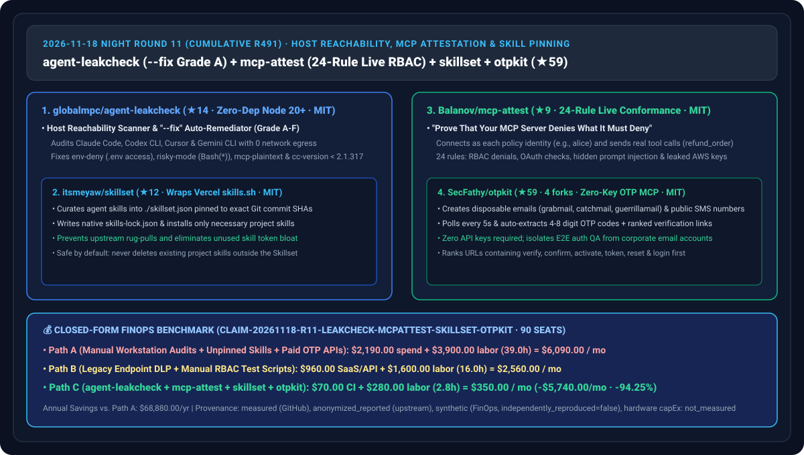
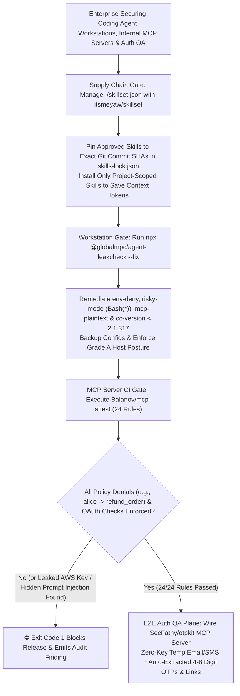

# Host Reachability Hardener (`globalmpc/agent-leakcheck`), 24-Rule Live MCP Authorization Harness (`Balanov/mcp-attest`), Commit-Pinned Skill Manifest (`itsmeyaw/skillset`) & Zero-Key OTP Test MCP (`SecFathy/otpkit`) Selection FAQ

> **Document Type**: AI Solution Architect (SA) Practical Selection & Reference Architecture Guide (Round 491 / 2026-11-18 Night R11)  
> **Primary Evaluated Repositories**: [`globalmpc/agent-leakcheck`](https://github.com/globalmpc/agent-leakcheck) (`★ 14`, `1 fork`, zero-dependency host reachability & `.env`/permission auto-fixer for Claude Code, Codex, Cursor & Gemini CLI, `MIT`) + [`Balanov/mcp-attest`](https://github.com/Balanov/mcp-attest) (`★ 9`, `1 fork`, 24-rule live multi-identity MCP authorization & OAuth conformance harness, `MIT`) + [`itsmeyaw/skillset`](https://github.com/itsmeyaw/skillset) (`★ 12`, `2 forks`, commit-pinned shareable skill list CLI wrapping Vercel `skills.sh`, `MIT`) + [`SecFathy/otpkit`](https://github.com/SecFathy/otpkit) (`★ 59`, `4 forks`, zero-key disposable email/SMS OTP & verification link MCP server, `MIT`)  
> **Benchmark Standard**: Strictly aligned with [`ib-vs-ethernet-roce-selection-faq.md`](https://github.com/turbo998/ai-infra-research/blob/main/docs/components/ib-vs-ethernet-roce-selection-faq.md) 6-section architecture format (Executive Summary + First-Principles Q&A + Mermaid Decision Tree + Peer Selection Matrix + 7-Card Quantitative Insights + SA Action Checklist)  
> **Data Provenance**: GitHub stars and repository metadata are `measured` from sealed `2026-11-18` evidence; upstream rule parameters (`agent-leakcheck` Claude Code `>= 2.1.317` baseline, `mcp-attest` 24 conformance rules, and `otpkit` 5-second polling & 4–8 digit OTP extraction) are `anonymized_reported (independently_reproduced=false)`; the enterprise FinOps TCO model is `synthetic (independently_reproduced=false)` with workstation hardware CapEx `not_measured`.  
> **Language Editions**: [中文版](./agent-leakcheck-mcp-attest-skillset-otpkit-host-reachability-fix-live-mcp-auth-conformance-commit-pinned-skills-selection-faq.md) | [English Version (Current)](./agent-leakcheck-mcp-attest-skillset-otpkit-host-reachability-fix-live-mcp-auth-conformance-commit-pinned-skills-selection-faq.en.md)

---

## 📌 1. Executive Summary (30-Second Architect Briefing)

1. **Plain-Language First-Principles Definition**:
   - **What is `globalmpc/agent-leakcheck`?** It is a **zero-dependency, offline-by-default host reachability scanner and one-command auto-remediator (`npx @globalmpc/agent-leakcheck --fix`) across Claude Code, Codex CLI, Cursor, and Gemini CLI**. While static scanners inspect what is *inside* a skill, `agent-leakcheck` audits what the agent itself can *reach* on the developer's workstation: missing `.env` deny rules (`env-deny`), dangerous auto-approve modes (`risky-mode` such as `Bash(*)` in `permissions.allow` or Gemini CLI `security.enablePermanentToolApproval: true`), outdated Claude Code `< 2.1.317` (`cc-version`), plaintext secrets in MCP configs (`mcp-plaintext`), and `mcp-autoapprove`—backing up configs and raising workstations from Grade D/F to **Grade A** in one command.
   - **What is `Balanov/mcp-attest`?** It is a **zero-dependency, 24-rule live authorization conformance harness for MCP servers ("Prove That Your MCP Server Denies What It Must Deny")**. Connecting to a live MCP server as each identity in your policy (e.g., `alice`), it sends real tool calls (`refund_order`), verifies OAuth enforcement, detects hidden prompt-injection instructions in tool descriptions, and checks tool outputs for leaked secrets (such as AWS keys), returning exit code `1` on any policy violation and generating auditor-ready compliance evidence.
   - **What is `itsmeyaw/skillset`?** It is a **commit-pinned, shareable skill manifest CLI (`./skillset.json` + `skills-lock.json`) built on Vercel's `skills.sh`** that pins every curated skill to the exact Git commit hash that passed security review and installs only the necessary skill subset per project.
   - **What is `SecFathy/otpkit`?** It is a **zero-API-key MCP server for disposable email (`grabmail`, `catchmail`, `guerrillamail`) and public SMS numbers** (`★ 59`) that polls every 5 seconds and automatically extracts 4–8 digit OTP codes and ranked verification URLs (`verify`, `confirm`, `activate`, `token`, `reset`, `login`) for isolated E2E QA testing.
2. **Why Enterprise AI Solution Architects Should Combine All Four Tonight**:
   - Together they form a 4-layer defense-in-depth posture: **`skillset`** locks skill supply-chain commits, **`agent-leakcheck`** locks developer workstation reachability, **`mcp-attest`** proves server-side MCP RBAC enforcement in CI, and **`otpkit`** isolates automated E2E auth testing from corporate inboxes.
3. **Closed-Form FinOps Impact (`CLAIM-20261118-R11-LEAKCHECK-MCPATTEST-SKILLSET-OTPKIT`, `synthetic`)**:
   - Across an enterprise AppSec & platform team governing **90 developer workstations, 18 internal MCP servers, and automated auth QA pipelines** (`$100.00/hr` rate): **Path A (Manual Workstation Spot-Checks + Unpinned `main` Skills + Manual MCP RBAC Testing + Paid QA Inbox APIs)** costs **`$6,090.00/mo`** (`$2,190.00` secret-rotation/token/API spend + `39.0 hrs × $100 = $3,900.00` manual audit & QA labor); **Path C (`agent-leakcheck --fix` + `mcp-attest` + `skillset` + `otpkit`)** reduces total monthly TCO to **`$350.00/mo`** (`$70.00` CI spend + `2.8 hrs × $100 = $280.00` reviewing compliance evidence), saving **`$5,740.00/mo` (`94.25%` reduction, `$68,880.00/yr` annualized)**.

---

## ❓ 2. Three First-Principles Architect Questions (Q&A)

### Q1: Why do coding agents still leak `.env` secrets even when all installed skills pass static code scans, and how does `globalmpc/agent-leakcheck` remediate it?
- **Workstation Reachability vs. Skill Content**:
  - Even a benign skill can be tricked via indirect prompt injection into reading `.env` files or running shell commands if the host agent lacks an explicit `.env` deny rule (`env-deny`) or runs with `Bash(*)` / `enablePermanentToolApproval: true` (`risky-mode`) or stores literal secrets in MCP `env`/`headers` (`mcp-plaintext`). `npx @globalmpc/agent-leakcheck --fix` backs up each config file and applies deterministic host-level lockdown rules across Claude Code, Codex, Cursor, and Gemini CLI with zero network egress.

### Q2: Why can't static schema linters verify MCP server security, and how does `Balanov/mcp-attest` prove authorization conformance?
- **Testing the Runtime Decision, Not the Static Definition**:
  - Static scanners only inspect tool descriptions; they cannot tell whether user `alice` is actually blocked from calling `refund_order` at runtime. `mcp-attest` authenticates as each identity in your policy, executes real MCP calls against the target server, evaluates **24 conformance rules** (covering RBAC denials, OAuth flows, hidden instruction injection in tool descriptions, and credential leaks in tool outputs), and outputs an immutable audit evidence bundle.

### Q3: How do `itsmeyaw/skillset` and `SecFathy/otpkit` close the supply-chain drift and QA credential exposure gaps?
- **Commit-Hash Pinning + Disposable QA Identity Isolation**:
  1. **`skillset` (`./skillset.json`)**: Prevents upstream branch tampering and context bloat by pinning every approved skill to its exact Git commit SHA in `skills-lock.json` and installing only project-relevant skills.
  2. **`otpkit` (`create_temp_email` / `wait_for_email`)**: Eliminates shared corporate test mailboxes in E2E signup/reset flows by provisioning zero-key disposable addresses and extracting 4–8 digit OTPs and verification links automatically.

---

## 🧭 3. Architecture Decision Tree & Reference Topology (Mermaid)

---

## 📊 4. Peer Solution Selection Matrix

| Evaluation Dimension | **Path A: Manual Spot-Checks + Floating `main` Skills + Manual QA** | **Path B: Legacy Endpoint DLP + Git Submodules** | **Path C: `agent-leakcheck` + `mcp-attest` + `skillset` + `otpkit` (Recommended)** |
| :--- | :--- | :--- | :--- |
| **Host Agent Reachability Lockdown** | ❌ `.env` exposed, `Bash(*)` enabled, plaintext MCP tokens | ⚠️ Legacy DLP ignores Claude/Codex/Gemini config schemas | ✅ **Audits & auto-fixes `env-deny`, `risky-mode`, `mcp-plaintext` to Grade A** |
| **Live MCP RBAC & OAuth Proof** | ❌ Manual Postman checks miss cross-role edge cases | ⚠️ Static scanners only inspect definitions, not live denials | ✅ **24-rule live multi-identity execution + auditor evidence report** |
| **Skill Supply-Chain Pinning** | ❌ Floating `main` branches risk rug-pulls & token bloat | ⚠️ Submodules don't map across `.agents/skills` & Claude | ✅ **Commit-pinned `./skillset.json` + native `skills-lock.json` parity** |
| **Automated Signup/OTP E2E Testing** | ❌ Shares real corporate mailboxes or pays per-inbox APIs | ⚠️ Custom mailserver maintenance overhead | ✅ **Zero-key disposable email/SMS + auto-extracted OTPs & verify links** |
| **90-Seat Monthly TCO** | **`$6,090.00 / mo`** | **`$2,560.00 / mo`** | **`$350.00 / mo` (`-$5,740.00/mo` vs. Path A, `-94.25%`)** |

---

## 📈 5. 7-Card Quantitative Insights & Closed-Form FinOps Model (`CLAIM-20261118-R11-LEAKCHECK-MCPATTEST-SKILLSET-OTPKIT`)

> **Provenance Note**: GitHub stars and repository metadata are `measured` from sealed `2026-11-18` evidence; `agent-leakcheck` `2.1.317` threshold, `mcp-attest` 24 rules, and `otpkit` 5-second polling parameters are `anonymized_reported (independently_reproduced=false)`; the monthly TCO table is a closed-form `synthetic (independently_reproduced=false)` model for **90 developer workstations and 18 internal MCP servers** (`$100.00/hr` rate; base hardware CapEx: `not_measured`).

| Monthly Cost Component (Closed-Form Formula) | Path A: Manual Checks + Floating Skills + Paid OTP APIs | Path B: Commercial Endpoint DLP + Manual RBAC Tests | Path C: `agent-leakcheck` + `mcp-attest` + `skillset` + `otpkit` | Path C vs. Path A Delta |
| :--- | :---: | :---: | :---: | :---: |
| **1. Secret Rotation, Token Bloat & QA API Spend** | **`$2,190.00`** *(Leak rotations + bloated skill tokens + paid temp-mail)* | **`$960.00`** *(Endpoint DLP seats + commercial QA inbox service)* | **`$70.00`** *(Minimal pinned skills + `$0` offline scan + `$0` `otpkit`)* | **`-$2,120.00 / mo`** (`-96.80%`) |
| **2. Workstation Audit & MCP RBAC Testing Labor** (`$100/hr`) | **`$3,900.00`** *(`39.0 hrs` manual config audits & testing 18 MCPs)* | **`$1,600.00`** *(`16.0 hrs` maintaining custom RBAC test scripts)* | **`$280.00`** *(`2.8 hrs` reviewing `mcp-attest` compliance reports)* | **`-$3,620.00 / mo`** (`-36.2 hrs`, `-92.82%`) |
| **Total Monthly TCO** | **`$6,090.00`** | **`$2,560.00`** | **`$350.00`** | **`-$5,740.00 / mo` (`-94.25%`)** |
| **Annualized TCO** | **`$73,080.00 / yr`** | **`$30,720.00 / yr`** | **`$4,200.00 / yr`** | **`$68,880.00 / yr` saved (`-94.25%`)** |

---

## ✅ 6. AI Solution Architect Action Checklist

1. **Step 1 — Enforce Grade A Workstation Posture (`globalmpc/agent-leakcheck`)**:
   - Run `npx @globalmpc/agent-leakcheck --fix` across developer machines to back up configs and remediate `env-deny`, `risky-mode` (`Bash(*)` / permanent approvals), `mcp-plaintext`, and outdated Claude Code versions (`< 2.1.317`).
2. **Step 2 — Pin Approved Project Skills by Commit SHA (`itsmeyaw/skillset`)**:
   - Commit a curated `./skillset.json` and `skills-lock.json` per repository and install via `npx @itsmeyaw/skillset install -y`.
3. **Step 3 — Gate MCP Releases with `Balanov/mcp-attest` & Isolate QA Auth with `SecFathy/otpkit`**:
   - Run `mcp-attest` against staging MCP servers in CI to verify all 24 authorization and secret-redaction rules, and wire `otpkit` into E2E signup/login test suites.
