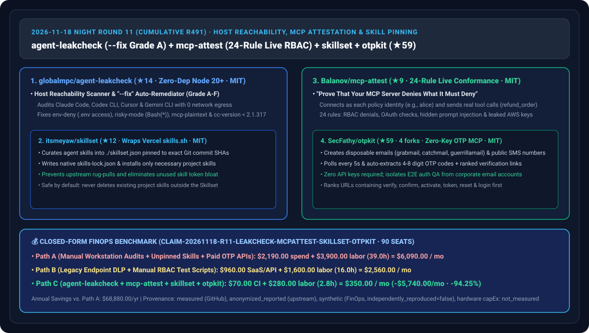
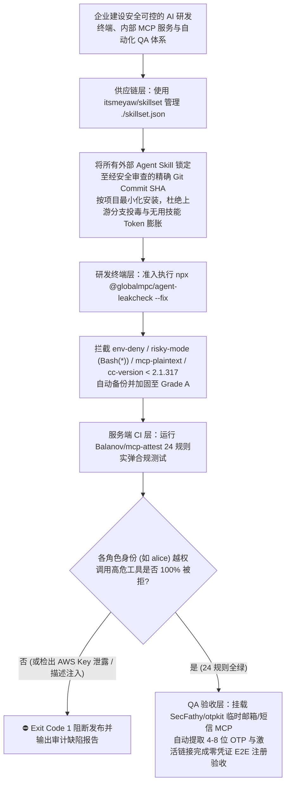

# 终端 Agent 本机越权自检与一键加固（`globalmpc/agent-leakcheck`）、MCP 实时鉴权合规靶场（`Balanov/mcp-attest`）、Commit 锁定技能清单（`itsmeyaw/skillset`）与零密钥验证码测试 MCP（`SecFathy/otpkit`）选型 FAQ

> **文档类型**：AI Solution Architect (SA) 实战选型与参考架构指南（Round 491 / 2026-11-18 Night R11）  
> **核心评估对象**：[`globalmpc/agent-leakcheck`](https://github.com/globalmpc/agent-leakcheck)（`★ 14`，`1 fork`，零依赖检测并一键修复 Claude Code/Codex/Cursor/Gemini CLI 本机 `.env` 与高危权限的扫描器，`MIT`） + [`Balanov/mcp-attest`](https://github.com/Balanov/mcp-attest)（`★ 9`，`1 fork`，24 规则实时多身份 MCP 越权与 OAuth 合规取证套件，`MIT`） + [`itsmeyaw/skillset`](https://github.com/itsmeyaw/skillset)（`★ 12`，`2 forks`，兼容 Vercel `skills.sh` 的 Git Commit 哈希锁定技能分发 CLI，`MIT`） + [`SecFathy/otpkit`](https://github.com/SecFathy/otpkit)（`★ 59`，`4 forks`，零 API Key 临时邮箱/短信 OTP 与验证链接自动提取 MCP，`MIT`）  
> **对标范式**：严格遵循 [`ib-vs-ethernet-roce-selection-faq.md`](https://github.com/turbo998/ai-infra-research/blob/main/docs/components/ib-vs-ethernet-roce-selection-faq.md) 六段式结构（核心结论速览 + 三大灵魂拷问 + Mermaid 决策树 + 选型对比矩阵 + 7-Card 定量洞察 + SA 落地 Checklist）  
> **数据溯源分级（Provenance）**：GitHub 星标与目录元数据为 `measured`；上游规则参数（如 `agent-leakcheck` 要求 Claude Code `>= 2.1.317`、`mcp-attest` 24 条授权与 OAuth 规则、`otpkit` 5 秒轮询与 4–8 位验证码提取）标注为 `anonymized_reported (independently_reproduced=false)`；企业 FinOps 成本算例为 `synthetic (independently_reproduced=false)`，硬件折旧 `not_measured`。  
> **语言版本**：[中文版 (当前)](./agent-leakcheck-mcp-attest-skillset-otpkit-host-reachability-fix-live-mcp-auth-conformance-commit-pinned-skills-selection-faq.md) | [English Version](./agent-leakcheck-mcp-attest-skillset-otpkit-host-reachability-fix-live-mcp-auth-conformance-commit-pinned-skills-selection-faq.en.md)

---

## 📌 一、核心结论速览（Executive Summary — 30 秒看懂）

1. **大白话本质定义**：
   - **`globalmpc/agent-leakcheck` 是什么？** 它是 **专门检查开发者电脑上的四大 Coding Agent（Claude Code、Codex CLI、Cursor、Gemini CLI）“能摸到本机哪些敏感资产”并一键打补丁的零依赖安全体检仪**。如果说 `snyk/agent-scan` 查的是“技能/插件包里面有没有毒”，`agent-leakcheck` 查的就是“宿主机护栏有没有漏”：是否漏配 `.env` 拒绝规则（`env-deny`）、是否默认开启了 `Bash(*)` 或 `enablePermanentToolApproval: true` 免批裸奔模式（`risky-mode`）、Claude Code 版本是否低于安全基线 `2.1.317`（`cc-version`）、以及 MCP 配置文件里是否硬编码了明文密钥（`mcp-plaintext`）。一行 `npx @globalmpc/agent-leakcheck --fix` 自动备份配置并升至 **A 级**。
   - **`Balanov/mcp-attest` 是什么？** 它是 **向企业内审与合规官证明“你的 MCP 服务器确实拒绝了不该放行的越权请求”的 24 规则实弹鉴权靶场**。它不是网关，而是按策略文件逐一扮演不同身份（如普通员工 `alice` vs 财务主管），向真实运行中的 MCP Server 发起 `refund_order` 等真实调用，核验 24 条访问控制、OAuth 令牌边界、工具描述隐藏提示词注入与返回结果密钥泄露规则，输出可交审计的证据报告（发现阻断级漏洞即返回 `exit code 1`）。
   - **`itsmeyaw/skillset` 是什么？** 它是基于 Vercel `skills.sh` 构建的 **企业级“按需精简 + 锁定精确 Git Commit 哈希”技能清单管理器（`./skillset.json` + `skills-lock.json`）**，彻底杜绝上游技能仓库被悄悄篡改（Rug Pull）或全量装入无用技能浪费 Token。
   - **`SecFathy/otpkit` 是什么？** 它是 **零 API Key、专为自动化注册/登录端到端 QA 测试打造的临时邮箱与短信 OTP 提取 MCP 服务器**，自动轮询提取 4–8 位数字验证码与排好优先级的 `verify/confirm/reset` 激活链接，让测试 Agent 永远无需触碰企业真实办公邮箱。
2. **为什么企业 AI 解决方案架构师（SA）今晚要把这四款工具组成“企业 Agent 安全与测试纵深防线”？**
   - **`skillset` 锁供应链源头（Commit 级防篡改） ➔ `agent-leakcheck` 锁开发者终端（防 `.env` 泄露与 `Bash(*)` 裸奔） ➔ `mcp-attest` 锁服务端权限（24 规则实弹防越权） ➔ `otpkit` 锁测试环境隔离（零真实邮箱凭证跑通注册验收）**！
3. **闭式 FinOps 量化收益（`CLAIM-20261118-R11-LEAKCHECK-MCPATTEST-SKILLSET-OTPKIT`，`synthetic`）**：
   - 以管理 **90 台研发终端、18 个内部业务 MCP 服务及自动化注册鉴权 QA 流水线** 的企业安全与平台工程团队（时薪 `$100.00/hr`）计：**Path A（人工抽查终端配置 + 裸装 `main` 分支技能 + 手工测 MCP 权限 + 购买商业接码 API）** 月均总成本 **`$6,090.00`**（密钥泄露轮换、冗余技能 Token 与接码 API `$2,190.00` + 人工排查配置与越权测试 `39.0h × $100 = $3,900.00`）；**Path C（`agent-leakcheck --fix` + `mcp-attest` + `skillset` + `otpkit`）** 月均总成本降至 **`$350.00`**（CI 运行开销 `$70.00` + 审阅合规证据报告 `2.8h × $100 = $280.00`），**净省 `$5,740.00/月`（降幅 `94.25%`，年化节省 `$68,880.00`）**。

---

## ❓ 二、三大灵魂拷问（First-Principles Q&A）

### Q1：我们已经在代码库跑了静态扫描，为什么研发人员的 Claude Code / Cursor / Gemini CLI 还是经常把本地 `.env` 密钥读进上下文？`agent-leakcheck` 是怎么修的？
- **宿主可达性盲区（Host Reachability Gap）**：
  1. **Coding Agent 默认继承当前登录用户的完整文件读取权限**：只要开发者没有在用户级或项目级显式配置 `.env` 忽略/拒绝规则（`env-deny`），或者为了省事在 Claude Code `permissions.allow` 里写了 `Bash(*)`、在 Gemini CLI 开启了 `security.enablePermanentToolApproval: true`（`risky-mode`），甚至在 MCP 配置的 `env`/`headers` 里直接写了明文 API Key（`mcp-plaintext`），任何一次提示词注入就能把本机密钥洗劫一空。
  2. **零依赖离线自检 + 先备份再自动修复（`--fix`）**：运行 `npx @globalmpc/agent-leakcheck` 默认不发任何网络请求，几秒内给出 `A–F` 评级；加 `--fix` 后自动备份原配置文件，一键补齐 `.env` 拒绝策略、收紧高危免批开关并告警低于 `2.1.317` 的旧版 Claude Code。

### Q2：为什么只靠“代码审查”或“静态 Schema 扫描”防不住 MCP 服务端越权？`Balanov/mcp-attest` 的“测决策而非测定义”是什么意思？
- **第一性原理：静态扫描只能看工具描述长什么样，只有以真实身份发起调用才能证明服务端到底拦没拦住**：
  1. **多身份实弹矩阵测试**：你在策略文件里规定“普通客服 `alice` 严禁调用 `refund_order`（退款）”。`mcp-attest` 会真正用 `alice` 的身份连上目标 MCP Server 发起 `refund_order` 请求——如果服务端返回成功而非拒绝，当场判定高危违规（Exit Code `1` 阻断 CI）。
  2. **24 条规则覆盖 OAuth、隐蔽注入与敏感输出脱敏**：除了 RBAC 矩阵，它还自动校验 OAuth 鉴权头规范、扫描工具描述中是否暗藏针对大模型的隐蔽指令，并检查工具返回值（如导出账本）是否意外夹带了 AWS Key 等机密凭据，生成可直接呈交审计师的结构化合规证据。

### Q3：`itsmeyaw/skillset` 和 `SecFathy/otpkit` 是如何帮企业同时管住“技能供应链”和“QA 自动化验证码”的？
- **一锁一隔**：
  1. **`skillset`（Commit 级供应链锁定 + 最小化安装省 Token）**：直接跑 `npx skills add owner/repo` 默认拉取远端最新分支，一旦上游作者账号被盗推入恶意指令就会全员中招；`skillset` 将团队审核通过的技能集合固化在项目 `./skillset.json` 与 `skills-lock.json` 中，**精确绑定到经过安全审计的 Git Commit SHA**，且支持只按需安装当前项目必需的技能子集。
  2. **`otpkit`（QA 测试与企业真实邮箱物理隔离）**：测试 Agent 在验证注册、找回密码、绑定手机流程时，通过 `create_temp_email()` / `wait_for_email()` 自动从 `grabmail`、`catchmail`、`guerrillamail` 获取免 Key 临时收件箱，5 秒轮询自动提取 4–8 位 OTP 验证码并将含 `verify/confirm/activate/token/reset` 的链接置顶返回，既省去付费接码平台费用，又彻底避免把企业内部邮箱授权给测试 Agent。

---

## 🧭 三、架构师选型决策树与端到端参考架构（Mermaid）

---

## 📊 四、同类方案横向选型对比矩阵（Peer Selection Matrix）

| 评估维度 | **Path A：人工抽查终端 + 裸拉分支技能 + 手工测权限** | **Path B：传统重型终端 DLP + 手工 Git Submodule** | **Path C：`agent-leakcheck` + `mcp-attest` + `skillset` + `otpkit`（推荐）** |
| :--- | :--- | :--- | :--- |
| **四大 Coding Agent 本机防泄密** | ❌ `.env` 裸奔、`Bash(*)` 免批开启、MCP 配置存明文 Key | ⚠️ 传统 DLP 不懂 Claude/Codex/Gemini 专属配置语法 | ✅ **精准识别 `env-deny`/`risky-mode`/`mcp-plaintext` 并 `--fix` 至 A 级** |
| **MCP 服务端 RBAC 与 OAuth 证明** | ❌ 靠人工 Postman 抽测，易漏测多角色交叉权限 | ⚠️ 静态扫描器只看定义，测不出运行时鉴权失效 | ✅ **24 规则多身份实弹调用验证，直出合规审计证据报告** |
| **Agent 技能版本防篡改与按需复用** | ❌ 默认跟远端分支浮动，且全量安装浪费 Token | ⚠️ Git Submodule 操作繁琐，不支持跨 Agent 目录映射 | ✅ **`./skillset.json` 锁定精确 Commit SHA + 兼容 `skills-lock.json`** |
| **端到端注册/登录 OTP 自动化测试** | ❌ 把测试邮箱密码配给 Agent 或购买高价接码平台 | ⚠️ 自建邮件服务器维护成本高 | ✅ **零 API Key 免注册临时邮箱/短信 + 自动提取 4–8 位 OTP 与验证链接** |
| **90 席研发团队月均总成本 (TCO)** | **`$6,090.00 / 月`** | **`$2,560.00 / 月`** | **`$350.00 / 月`（较 Path A 净省 `$5,740.00/月`，`-94.25%`）** |

---

## 📈 五、7-Card 定量洞察与闭式 FinOps 算例（`CLAIM-20261118-R11-LEAKCHECK-MCPATTEST-SKILLSET-OTPKIT`）

> **Provenance 声明**：GitHub 星标与目录元数据源自 `2026-11-18` 封存证据（`measured`）；`agent-leakcheck` `2.1.317` 版本门禁、`mcp-attest` 24 规则与 `otpkit` 5 秒轮询参数源自上游文档（`anonymized_reported`, `independently_reproduced=false`）；月度 TCO 为面向 **90 台研发终端与 18 个内部 MCP 服务** 的闭式合成模型（`synthetic`, `independently_reproduced=false`；底层硬件折旧 CapEx：`not_measured`）。

| 成本构成项（月度闭式公式） | Path A：人工抽查 + 浮动分支 + 付费接码 | Path B：商业终端 DLP + 手工权限回归 | Path C：`agent-leakcheck` + `mcp-attest` + `skillset` + `otpkit` | Path C 对比 Path A 净变化 |
| :--- | :---: | :---: | :---: | :---: |
| **1. 安全轮换、冗余 Token 与测试 API 支出** | **`$2,190.00`** *(密钥泄露应急轮换 + 全量冗余技能 Token + 接码 API)* | **`$960.00`** *(商业端点安全订阅 + 测试收件箱服务)* | **`$70.00`** *(按需精简技能 + `$0` 本地自检 + `$0` 临时 OTP)* | **`-$2,120.00 / 月`** (`-96.80%`) |
| **2. 终端安全加固与 MCP 鉴权测试人工** (`$100/hr`) | **`$3,900.00`** *(`39.0 hrs`：逐台排查配置与手工回归 18 个 MCP 权限)* | **`$1,600.00`** *(`16.0 hrs`：编写维护自定义鉴权测试脚本)* | **`$280.00`** *(`2.8 hrs`：审阅 `mcp-attest` 自动生成的审计报告)* | **`-$3,620.00 / 月`** (`-36.2 hrs`, `-92.82%`) |
| **月度总拥有成本 (Monthly Total TCO)** | **`$6,090.00`** | **`$2,560.00`** | **`$350.00`** | **`-$5,740.00 / 月` (`-94.25%`)** |
| **年化总拥有成本 (Annualized TCO)** | **`$73,080.00 / 年`** | **`$30,720.00 / 年`** | **`$4,200.00 / 年`** | **年省 `$68,880.00` (`-94.25%`)** |

---

## ✅ 六、AI 解决方案架构师（SA）实战落地 Checklist

1. **Step 1 — 在全员开发机运行 `npx @globalmpc/agent-leakcheck --fix`**：
   - 将 `agent-leakcheck` 纳入研发入职脚本与 Git `pre-push` 检查，强制所有终端达到 Grade A（补齐 `.env` 拒绝规则、禁用 `Bash(*)` 与 `enablePermanentToolApproval`、清除 MCP 明文密钥并确保 Claude Code `>= 2.1.317`）。
2. **Step 2 — 用 `itsmeyaw/skillset` 固化项目级 `./skillset.json`**：
   - 执行 `npm install -g @itsmeyaw/skillset`，将各项目允许使用的技能精确锁定到 Commit SHA 并提交 `skills-lock.json`。
3. **Step 3 — 在 CI 中用 `Balanov/mcp-attest` 门禁内部 MCP 并挂载 `SecFathy/otpkit` 跑鉴权 E2E**：
   - 对所有自研 MCP Server 编写角色策略文件并在 CI 中运行 `mcp-attest`（24 规则全绿才准上线）；在前端注册/登录自动化测试流水线中接入 `otpkit` 自动完成验证码提取闭环。
