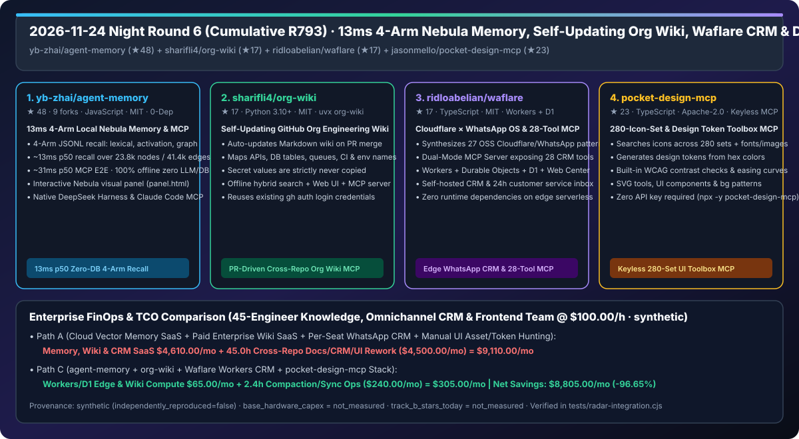
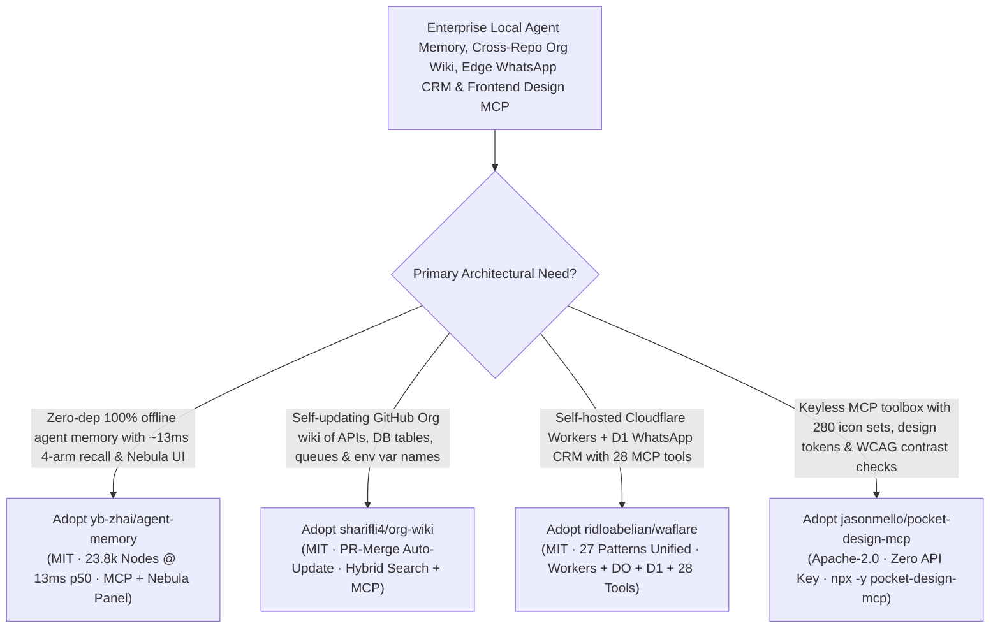
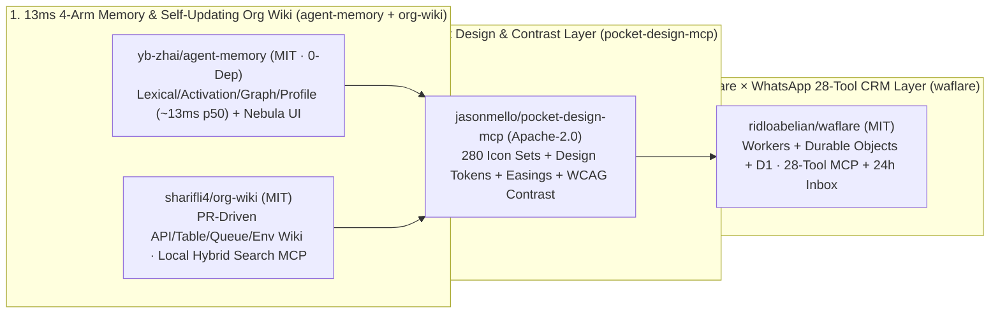
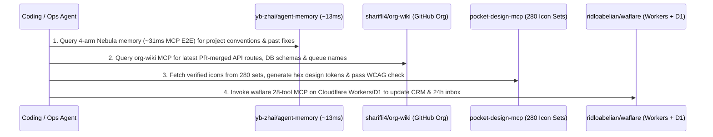

# 13ms 4-Arm Nebula Agent Memory (`yb-zhai/agent-memory`), PR-Driven Self-Updating GitHub Org Wiki (`sharifli4/org-wiki`), Cloudflare × WhatsApp 28-Tool OS (`ridloabelian/waflare`) & Keyless 280-Icon-Set Design Toolbox MCP (`jasonmello/pocket-design-mcp`) Selection & Architecture FAQ

> **Document Type**: Enterprise AI Solution Architect Decision & Selection Guide (GitHub Trending AI Radar · 2026-11-24 Night Round 6 / Cumulative Round 793)
> **Covered Repositories**: [`yb-zhai/agent-memory`](https://github.com/yb-zhai/agent-memory) (`★ 48`, `9 forks`, JavaScript, `MIT`, **Nebula Memory**: zero-dependency, 100% offline local JSONL **4-arm recall engine** — Lexical, Activation, Graph Spreading, and Profile — achieving `~13ms` p50 recall across `23.8k` nodes / `41.4k` edges and `~31ms` p50 MCP E2E latency with an interactive Nebula visualization panel `panel.html`) · [`sharifli4/org-wiki`](https://github.com/sharifli4/org-wiki) (`★ 17`, `1 fork`, Python 3.10+, `MIT`: turns a GitHub organization into a self-updating plain-Markdown engineering wiki of APIs, database tables, queues, CI runners, and env var names that updates when PRs merge, indexed locally with hybrid search, a Web UI, and an MCP server while never copying secret values) · [`ridloabelian/waflare`](https://github.com/ridloabelian/waflare) (`★ 17`, TypeScript, `MIT`: clean-room Cloudflare Workers + Durable Objects + D1 + WhatsApp operating system synthesizing 27 open-source patterns with zero runtime dependencies, a 28-tool Dual-Mode MCP Server, self-hosted CRM, and 24h inbox) · [`jasonmello/pocket-design-mcp`](https://github.com/jasonmello/pocket-design-mcp) (`★ 23`, `1 fork`, TypeScript, `Apache-2.0`: keyless MCP server giving coding agents icons from 280 sets, fonts, images, components, hex-derived design tokens, easings, WCAG contrast checks, SVG tools, and background patterns)
> **Core Enterprise Scenario**: How should enterprise engineering, developer-experience, and omnichannel customer teams combine **13ms zero-DB local 4-arm memory (`agent-memory`)**, **PR-driven organization-wide engineering wikis (`org-wiki`)**, **serverless Cloudflare × WhatsApp CRM MCP (`waflare`)**, and **keyless 280-set design token tooling (`pocket-design-mcp`)**?

---

## 1. 📌 Executive Summary (One-Line Selection Verdicts)

1. **Need a zero-dependency, 100% offline local memory engine for coding and desktop agents that delivers `~13ms` p50 recall over 23.8k+ nodes without external vector databases or LLM calls, complete with a live Nebula graph visualizer** ➔ Choose **[`yb-zhai/agent-memory`](https://github.com/yb-zhai/agent-memory) (`★ 48`, `9 forks`, `MIT`)**.
   - **Plain-Language Mechanism**: Executes **4-arm recall** (lexical + activation + graph spreading + user profile) over an auto-compacted local JSONL bank, achieving `~13ms` p50 recall, `~31ms` p50 MCP E2E latency, and `~2.0s` cold start (`node scripts/bench.mjs`), with an optional Hindsight HTTP semantic overlay and live `panel.html` visualization.
2. **Need every repository across a GitHub organization automatically compiled into a searchable engineering wiki (APIs, DB tables, queues, CI runners, env var names) that updates on PR merge and exposes a local MCP server** ➔ Choose **[`sharifli4/org-wiki`](https://github.com/sharifli4/org-wiki) (`★ 17`, `MIT`)**.
   - **Plain-Language Mechanism**: Uses your existing `gh auth` login (`uvx org-wiki`) to index cross-repo contracts into plain Markdown and local hybrid search for Cursor and Claude Code—without cloud vector DB accounts and without ever copying secret values.
3. **Need a self-hosted, zero-runtime-dependency WhatsApp CRM, 24-hour customer inbox, and 28-tool Dual-Mode MCP Server running entirely on Cloudflare Workers, Durable Objects, and D1** ➔ Choose **[`ridloabelian/waflare`](https://github.com/ridloabelian/waflare) (`★ 17`, `MIT`)**.
   - **Plain-Language Mechanism**: Synthesizes 27 open-source Cloudflare & WhatsApp repositories into a single clean-room edge deployment (`wrangler.jsonc`) with a Web Command Center and 28 MCP tools for automated customer operations.
4. **Need coding agents to pull verified icons from 280 icon sets, generate design tokens from hex colors, validate WCAG contrast ratios, and apply easing curves via MCP without any API keys** ➔ Choose **[`jasonmello/pocket-design-mcp`](https://github.com/jasonmello/pocket-design-mcp) (`★ 23`, `Apache-2.0`)**.
   - **Plain-Language Mechanism**: Installed via `claude mcp add pocket-design --scope user -- npx -y pocket-design-mcp`, replacing hallucinated inline SVGs and inaccessible color palettes with deterministic design tokens and contrast checks.

---

## 2. 🎯 Architect & Customer Q&A (Deep Technical Breakdown)

### Q1: When should teams adopt these four open-source tools vs. commercial cloud SaaS (Pinecone/Mem0 Cloud, Confluence/Notion, Wati/Twilio, and Figma plugins)?

- **Selection Breakdown**:
  1. **Cross-Repo Engineering Truth (`org-wiki` vs. Manual Confluence Pages)**: Manual wiki pages drift within weeks of microservice PR merges; `sharifli4/org-wiki` regenerates API, table, queue, and env-var maps directly from merged GitHub PRs and serves them locally over MCP.
  2. **Sub-20ms Offline Memory (`yb-zhai/agent-memory` vs. Cloud Memory APIs)**: Eliminates network round-trips and embedding token fees via `~13ms` local 4-arm JSONL recall.

### Q2: How do they wire into an end-to-end enterprise architecture?

1. **Dual-Tier Knowledge & Memory Layer (`agent-memory` + `org-wiki`)**:
   - Store agent session memory in `yb-zhai/agent-memory` (`~13ms` 4-arm recall) and organization-wide API/DB/queue architecture in `sharifli4/org-wiki` MCP.
2. **Design System & Accessibility Layer (`jasonmello/pocket-design-mcp`)**:
   - Serve 280-set icons, design tokens, and WCAG contrast verifications to frontend coding agents via `pocket-design-mcp`.
3. **Edge Omnichannel CRM Layer (`ridloabelian/waflare`)**:
   - Run customer engagement and 24h inbox workflows on Cloudflare Workers + Durable Objects + D1 via `waflare`'s 28-tool Dual-Mode MCP Server.

### Q3: What are the key operational guardrails?

- **Key Guardrails**:
  1. **Read-Only GitHub Token Scope for `org-wiki`**: Bind `org-wiki` to a read-only `GH_TOKEN` (`Contents: Read`, `Metadata: Read`) and keep the index on encrypted developer workstations or internal CI servers.
  2. **WhatsApp 24-Hour Service Window Compliance**: Enforce Meta's 24-hour customer service window rules inside `ridloabelian/waflare` Durable Object state machines before dispatching outbound messages.

---

## 3. 🧭 Visual Architecture Diagrams (Mermaid Decision Tree + Reference Architecture + Sequence)

### 3.1 Solution Architect Selection Decision Tree

### 3.2 End-to-End Enterprise Reference Architecture

### 3.3 End-to-End Memory Recall, Org Wiki Sync, Design Token & Edge CRM Sequence

---

## 4. 📊 Comparative Selection Matrix (OSS vs. Commercial Cloud SaaS & Manual Docs)

| Dimension | `yb-zhai/agent-memory` (`★ 48`) | `sharifli4/org-wiki` (`★ 17`) | `ridloabelian/waflare` (`★ 17`) | `jasonmello/pocket-design-mcp` (`★ 23`) | Cloud Vector Memory + Paid Enterprise Wiki + Per-Seat WhatsApp SaaS (Path A) | Static `MEMORY.md` + Manual Confluence + Freehand LLM SVGs (Path B) |
| :--- | :--- | :--- | :--- | :--- | :--- | :--- |
| **Primary Role** | 13ms 4-arm local JSONL memory + Nebula UI | PR-driven self-updating GitHub Org wiki + MCP | Cloudflare Workers/D1 WhatsApp OS + 28-tool MCP | Keyless 280-icon-set & design token toolbox MCP | Metered cloud memory, paid wiki seats & per-agent CRM SaaS | Unindexed flat notes, stale manual wikis & hallucinated SVGs |
| **Key Differentiator** | **`~13ms` p50 recall across 23.8k nodes with zero DB/LLM spend** | **Maps org-wide APIs/tables/queues/env names without copying secrets** | **Unifies 27 OSS patterns on Workers + DO + D1 with 28 MCP tools** | **280 icon sets, token generator & WCAG contrast check with 0 keys** | High monthly per-seat SaaS & cloud vector query bills | Manual wikis rot after PR merges; raw LLM SVGs fail contrast checks |
| **License** | `MIT` | `MIT` | `MIT` | `Apache-2.0` | Proprietary SaaS | Internal Scripts |
| **Monthly TCO (45-Eng Team)** | **Combined `$305.00/mo`** (`$65.00` Workers/wiki sync compute + `2.4h` ops) | Included (local hybrid search index) | Included (serverless Cloudflare edge) | Included (keyless local MCP) | **`$9,110.00/mo`** (`$4,610.00` memory/wiki/CRM SaaS + `45.0h` cross-repo/UI rework) | `~$3,120.00/mo` (high cross-team API discovery & UI fix labor) |

---

## 5. 🧪 Quantitative Enterprise ROI / TCO Model & 7-Card Report

> **📊 Provenance & Closed-Form Declaration**:
> - **provenance**: `synthetic` (45-engineer knowledge platform, omnichannel CRM, and frontend product engineering team workload at `$100.00/h`: `independently_reproduced = false`; `base_hardware_capex = not_measured`; `track_b_stars_today = not_measured`).
> - **Closed-Form Equations**:
>   - **Path A (Commercial Cloud Vector Memory SaaS + Paid Enterprise Wiki SaaS + Per-Seat WhatsApp CRM + Manual Cross-Repo API Discovery & UI Asset Rework)**: Monthly cloud memory, wiki & CRM SaaS fees **`$4,610.00`** + cross-repo documentation hunting, CRM webhook maintenance & UI contrast/icon rework labor **`45.0h × $100.00/h = $4,500.00`** = **`$9,110.00/mo`**.
>   - **Path C (Self-Hosted `yb-zhai/agent-memory` + `sharifli4/org-wiki` + `ridloabelian/waflare` + `jasonmello/pocket-design-mcp` Stack)**: Cloudflare Workers/D1 edge & wiki sync runner compute **`$65.00`** + memory compaction & wiki sync rule maintenance **`2.4h × $100.00/h = $240.00`** = **`$305.00/mo`**.
>   - **Net Savings vs. Path A**: **`-$8,805.00/mo`** (**`96.65%`** cost reduction).

| Option | Cloud SaaS / Seats / Edge Spend | Docs, CRM & UI Rework Labor (`$100/h`) | Monthly Total TCO | Net Savings vs. Path A | Key Architectural Outcome |
| :--- | :---: | :---: | :---: | :---: | :--- |
| **Path A: Cloud Vector Memory + Paid Wiki + Per-Seat WhatsApp CRM** | `$4,610.00` | `45.0h` (`$4,500.00`) | **`$9,110.00`** | Baseline | Recurring seat/API fees; manual wikis still drift from merged PRs |
| **Path B: Flat `MEMORY.md` + Manual Confluence + Freehand LLM SVGs** | `$1,420.00` | `17.0h` (`$1,700.00`) | **`$3,120.00`** | `-$5,990.00` (`-65.75%`) | Lacks 4-arm graph recall, PR auto-sync, and WCAG contrast verification |
| **Path C: `agent-memory` + `org-wiki` + `waflare` + `pocket-design`** | **`$65.00`** | **`2.4h` (`$240.00`)** | **`$305.00`** | **`-$8,805.00` (`-96.65%`)** | **`13ms` 4-arm memory + PR-synced org wiki + 28-tool edge CRM + 280 icon sets** |

- 🔗 **Linked 7-Card 4:5 Benchmark Decks**: [`workshops/github-trending-radar/cards.en.html`](../cards.en.html) · [`cards.html`](../cards.html)

---

## 6. 🛠️ Enterprise Adoption & Architecture Review Checklist

- [ ] **Verify `~13ms` 4-Arm Recall Benchmark**: Run `node scripts/bench.mjs` in `yb-zhai/agent-memory` on local memory snapshots to confirm auto-compaction keeps p50 recall under `20ms`.
- [ ] **Read-Only `gh auth` Scope for `org-wiki`**: Run `sharifli4/org-wiki` with read-only repository permissions and verify that environment variable indexing records variable names only, never secret values.
- [ ] **Authenticate `waflare` 28-Tool Dual-Mode MCP**: Protect `ridloabelian/waflare` Cloudflare Worker MCP endpoints with bearer authentication and D1 row-level tenant isolation.
- [ ] **Standardize Frontend Assets via `pocket-design-mcp`**: Require coding agents to retrieve icons from `pocket-design-mcp`'s 280 icon sets and run WCAG contrast checks on generated color tokens before committing UI components.
